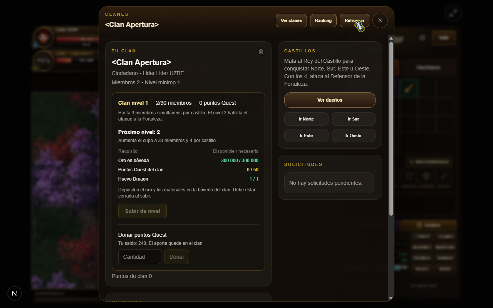
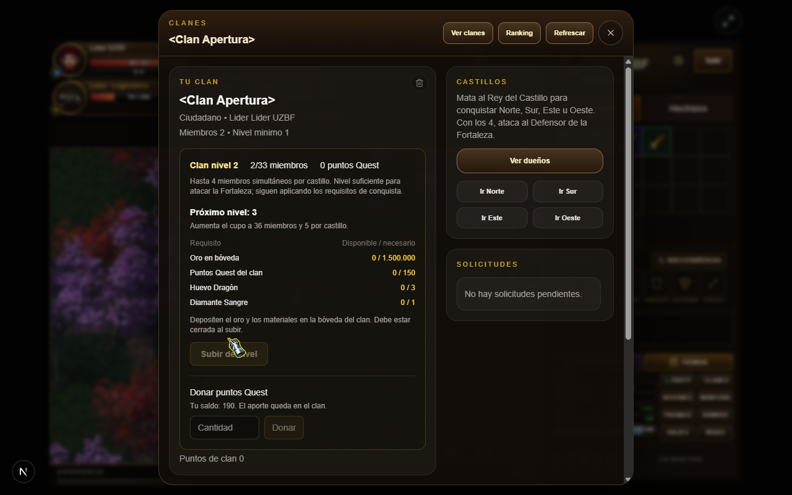
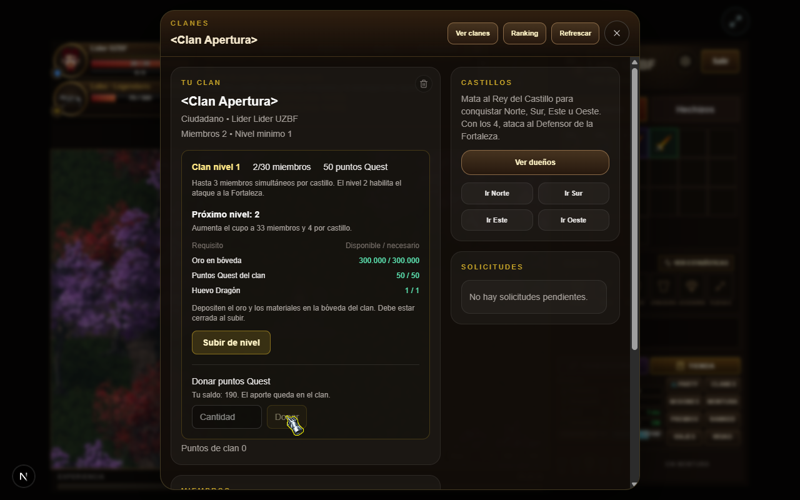
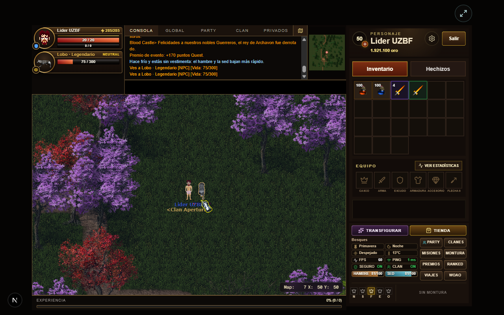
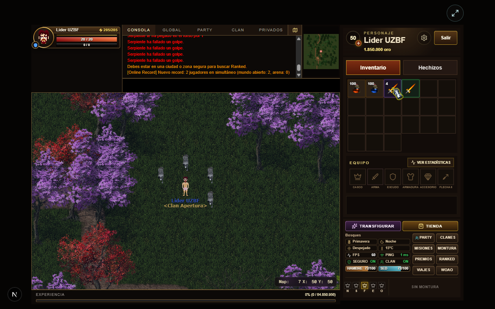
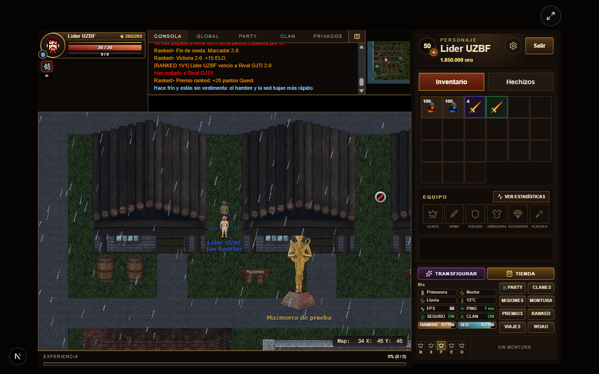
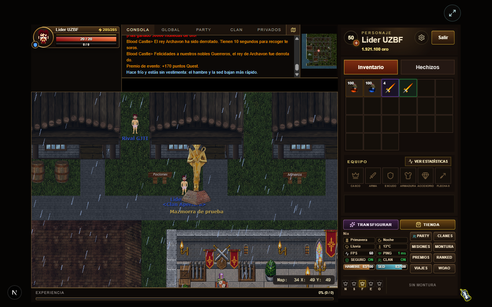

Implementa la prioridad 1 de apertura: las mejoras iguales vuelven a compartir pila, los clanes compran niveles con recursos colectivos y los premios Quest se confirman con saldos persistidos y recibos de operación.

## Correcciones y balance

- Inventario: agrupa por objeto + mejora efectiva en recogida, carga, entregas y equipar/desequipar; tope de 10.000. Las mejoras diferentes conservan sus pilas.
- NPCs: paga oro base y drops monetarios explícitos una vez por muerte. Las misiones verifican toda la entrega antes de consumir requisitos; se revisan los 36 mínimos de nivel y premios EXP.
- Agrega fuentes explícitas de Huevo Dragón, Diamante Sangre y Corazón Oscuro, con migración de datos que se aplica una sola vez.
- Blood Castle valida mapa 205, guardián antes del jefe y tiempo disponible.
- Corrige ENOBUFS al cargar catálogos grandes desde API, incorpora el NPC universal de misiones a las semillas API y permite inicializar el esquema desde cero.
- La vida de NPC viaja en 32 bits para admitir criaturas mejoradas de más de 65.535 HP. Corrige el scroll/cierre del panel de clanes y los scripts de build en Windows.
- Informes: [economía y misiones](https://github.com/leb90/WoaoWeb/blob/feat/prioridad-1-apertura/docs/balance/APERTURA_PVE.md), [48 cruces PvE del motor real](https://github.com/leb90/WoaoWeb/blob/feat/prioridad-1-apertura/docs/balance/APERTURA_COMBATE.md).

## Sistemas nuevos

**Rangos de NPC:** Normal, Mejorado, Líder, Especial y Legendario. Modifican vida, daño, EXP, oro y chance de drop; respetan exclusiones de ciudades, principiantes, jefes, invocaciones, eventos y mazmorras. El respawn vuelve a sortear el rango; recargar datos conserva la vida perdida y no acumula mejoras.

**Clanes:** niveles comprables 1–6, requisitos y beneficios comparados con `old/`. Cupos 30/33/36/39/42/45 y 3–8 miembros simultáneos por castillo; Fortaleza desde nivel 2. Todos los miembros pueden donar puntos Quest. El líder usa **Subir de nivel**; oro y materiales se consumen de la bóveda, con control de revisión para impedir que un guardado antiguo reponga recursos.

**Economía Quest:** PostgreSQL mantiene el saldo personal y colectivo. Importación del saldo anterior una sola vez, versiones para respuestas desordenadas, transacciones y recibos para reintentos. Journals durables conservan premios, cierres ranked y canjes cuya confirmación quedó pendiente. Los puntos premium siguen separados.

**Ranked:** victoria 8, derrota activa 2, primera victoria +12; máximo 80 al día entre ambos modos, fecha Argentina y tres encuentros premiados por cuenta rival. Exige 60 segundos, una ronda y actividad; excluye abandono propio y cuentas propias enfrentadas.

| Evento | Nuevos puntos Quest |
| --- | --- |
| Torneo automático | Campeón 100 + min(60, 2N), finalista 30; mínimo cuatro cuentas. Conserva objeto 1245 mediante entrega pendiente. |
| Hunters Game | Baja 3, campeón 15 + 2N; mínimo tres cuentas. Una baja premiada por cuenta víctima y edición. |
| Blood Castle | Superviviente 150 + 20 por completar objetivos. |
| Guerra de facciones | Victoria 40, derrota activa 10, MVP 15. |

Se conserva el oro/recompensas existentes. Los premios nuevos requieren participación efectiva. Los Juegos del Hambre antiguos continúan reemplazados por Hunters Game.

## Capturas reales

Fixtures aisladas; rango forzado para fotografiarlo y vida de objetivos reducida para acelerar Blood Castle. La interfaz, el combate y los cobros usan los handlers reales.

**Requisitos del clan y compra del nivel 2**: consume 300.000 oro, un huevo y 50 Quest; habilita cupo 33.

Donación, rango e inventario

Premios ranked y Blood Castle confirmados

## Wiki y validación

Actualiza las guías **Comunidad**, **Combate**, **Competitivo** y **Eventos** con tablas de configuración y siete imágenes. Las cuatro se verificaron en navegador, también con el build de producción, sin imágenes rotas. [Capturas completas de la wiki](https://github.com/leb90/WoaoWeb/tree/feat/prioridad-1-apertura/screenshots/apertura-2026-11-06).

- Servidor: **129 pruebas aprobadas**, incluidas las regresiones de mazmorras.
- API/PostgreSQL: **102 pruebas aprobadas en 17 archivos**, con concurrencia, idempotencia, límites diarios y bóvedas obsoletas.
- TypeScript y builds de API, servidor y frontend aprobados; ESLint del alcance modificado de UI y módulos nuevos/economía/eventos aprobado.
- Navegador: login/relogin, equipo, donación, nivel de clan, ranked 1v1, Blood Castle, canje y wiki.
- Cuentas, base y servicios temporales retirados; progreso local previo excluido del commit.

[Registro detallado de implementación, pruebas y límites](https://github.com/leb90/WoaoWeb/blob/feat/prioridad-1-apertura/docs/balance/VALIDACION_APERTURA_2026-11-06.md).

**Despliegue:** actualizar API, servidor y frontend juntos por el cambio de protocolo HP. Aplicar esquema/migraciones al arrancar API y conservar el volumen `/app/data` para progresión y journals.

**Alcance:** la muestra PvE no mide EXP/hora ni equilibrio final de todas las clases. El recorrido manual completo de 2v2 y los otros eventos queda fuera de esta evidencia; tienen cobertura automática. Permanece la advertencia heredada del NPC 570 sin plantilla en mapa 159.
