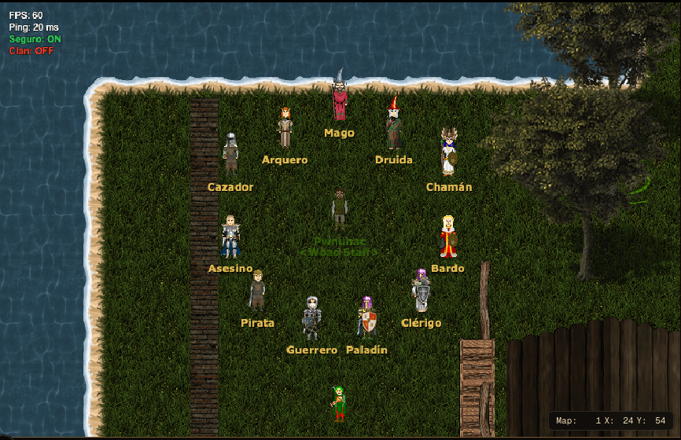
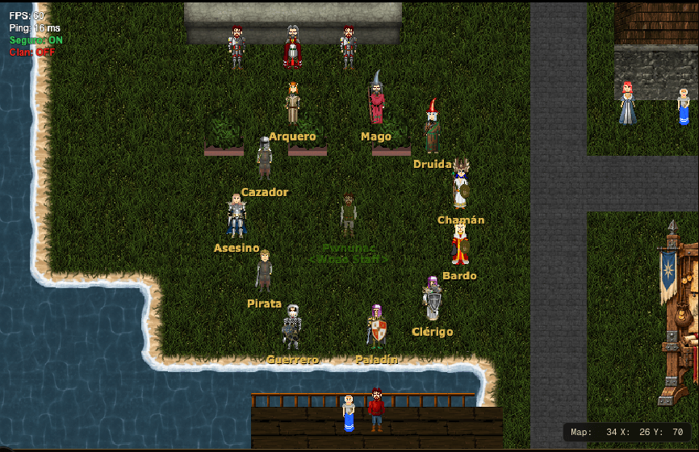
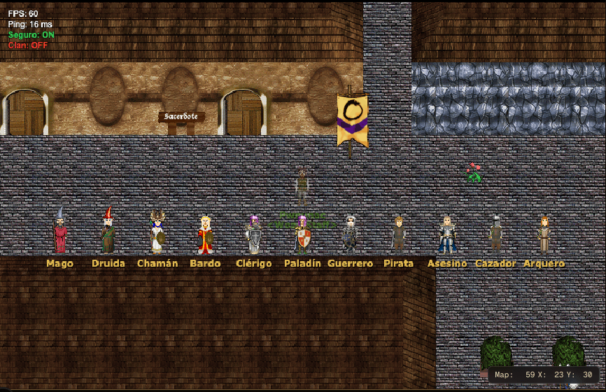
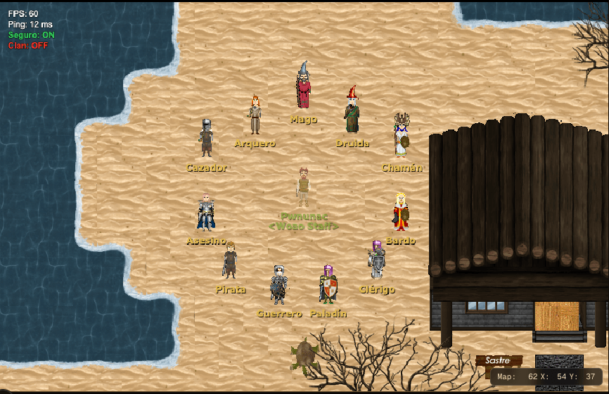
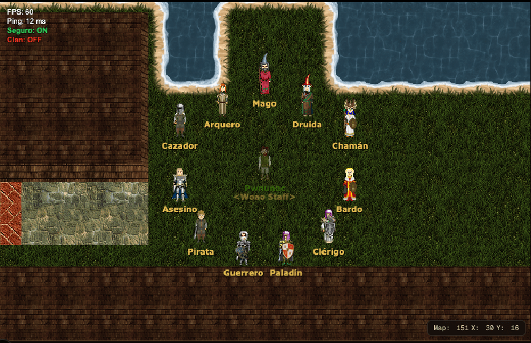
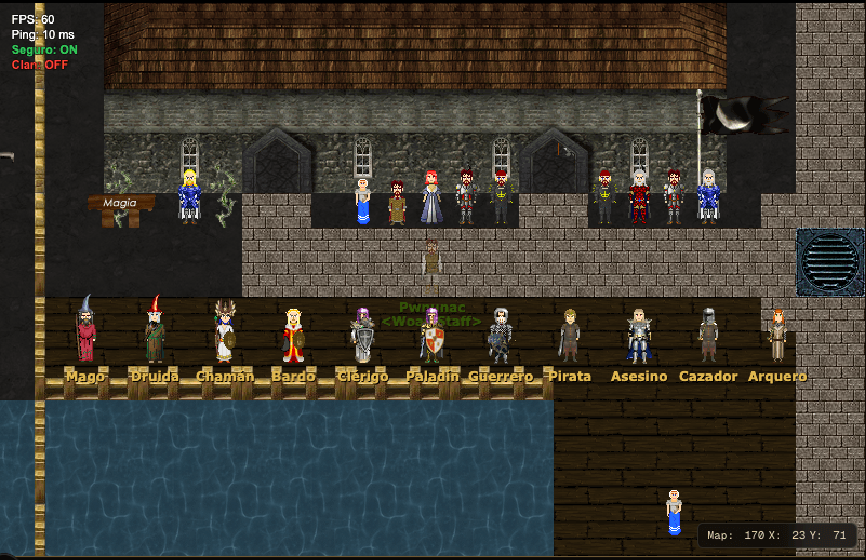
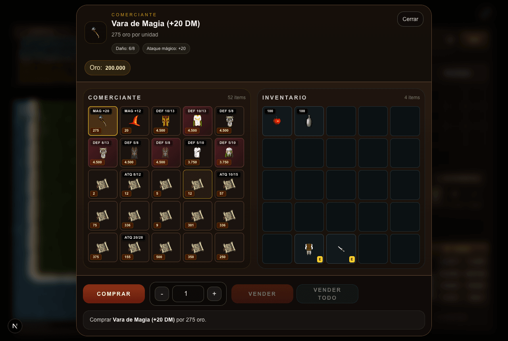
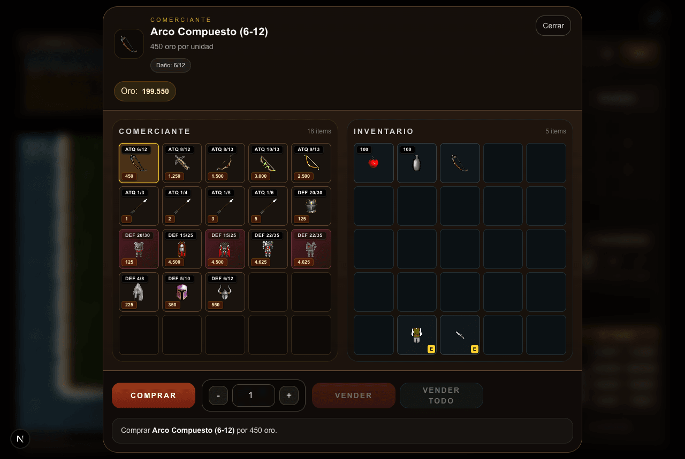

# Entrenadores de clase

Fecha: 2026-10-25. Rama `entrenadores-de-clase`.

En cada ciudad importante hay un grupo de entrenadores, uno por clase jugable, en un lugar apartado que no traba el paso. Cada uno vende equipo de nivel medio para su clase y todos los hechizos que esa clase puede aprender. Debajo del cuerpo tiene escrita su clase, así se sabe a cuál ir.

## 1. Lo pedido

1. En las ciudades importantes, entrenadores de clases parados en círculo.
2. Que no tapen caminos: en un lugar bien colocado, que no trabe los sectores transitados.
3. Venden armas e ítems de nivel intermedio (más o menos nivel 20 a 35) y todos los hechizos de su clase.
4. Debajo del cuerpo dice la clase de cada uno.
5. Todos los hechizos tienen que tener pergamino.

Los ítems no tienen nivel y eso no cambia: "nivel medio" es equipo que se compra y rinde a mitad de camino, como la Espada Cántabra.

## 2. Qué hay

### Los once entrenadores

Uno por clase jugable, en este orden (en el círculo, desde arriba y como las agujas del reloj; en la fila, de izquierda a derecha): Mago, Druida, Chamán, Bardo, Clérigo, Paladín, Guerrero, Pirata, Asesino, Cazador y Arquero. Magia, híbridos, cuerpo a cuerpo y a distancia quedan juntos.

- NPC 9700 a 9710, "Entrenador de Magos", "Entrenador de Clérigos", etc. No se mueven y no se pueden atacar.
- Visten la ropa de su clase: la misma que la vista previa de creación de personaje (`CLASS_OUTFITS` en `frontend/lib/characterCreation.ts`), con arma, escudo y casco a la vista.
- Debajo del cuerpo se lee la clase en dorado ("Mago", "Clérigo"...). Es corta a propósito: en el círculo los vecinos quedan a dos baldosas y "Entrenador de Guerreros" se pisaba con el de al lado. El nombre completo aparece al hacerles clic.

### Ciudades

| Ciudad | Mapa | Forma | Centro | Dónde |
|---|---|---|---|---|
| Ullathorpe | 1 | círculo | (24,54) | el pasto junto al agua, al oeste |
| Nix | 34 | círculo | (26,70) | el pasto junto al agua, al suroeste; la calle queda al costado |
| Banderbill | 59 | fila | (23,32) | contra la pared sur del bolsón del oeste, mirando al norte; la plaza queda libre |
| Lindos | 62 | círculo | (54,37) | la playa al lado del sastre |
| Arghal | 151 | círculo | (30,16) | el pasto junto al agua, al norte de las tiendas |
| Caos | 170 | fila | (23,73) | sobre el muelle, contra la baranda, mirando a la vereda de las tiendas, cerca de donde se llega |

- Lindos es el mapa 62: el 63 es la playa del muelle donde llega el barco.
- Arghal es el mapa 151: el 150 es el puerto, casi todo muelle sobre el agua.
- En Banderbill y Caos no entra un círculo fuera de las calles (Banderbill es casi toda edificios; Caos, una cuadrícula de calles angostas sin plazas), así que van en fila contra una pared.

| | |
|---|---|
|  |  |
|  |  |
|  |  |

### Qué vende cada uno

Primero el equipo y después los pergaminos, ordenados del que se aprende primero al último. Las armaduras van en sus dos versiones (altos y bajos).

| Entrenador | Equipo |
|---|---|
| Mago, Druida, Chamán | Vara de Magia (+20 DM), Sombrero de Mago (+12 DM), Túnicas Legendaria, del Acólito, de las Tinieblas y Protectora |
| Bardo | Katana, Espada Cántabra, Mangual; Coraza, Armadura Titánica, Placas Terráneas, Túnica Protectora; Yelmo; Escudos Genovés, Mongol y de Madera Reforzado |
| Clérigo | Espada de los Templarios, Espada Cántabra, Halberd, Katana; Coraza, Armadura Titánica, Placas Terráneas; Cascos de Plata, Cruzado y con Cuernos; Escudos Imperial, Genovés, Mongol y de Madera Reforzado |
| Paladín | Como el Clérigo, con Hacha de Guerra dos Filos en lugar de Katana |
| Guerrero | Espada Cántabra, Hacha Dos Manos, Espada Dos Manos, Doble Hacha, Hacha de Guerra dos Filos, Halberd; armaduras, cascos y escudos como el Clérigo |
| Pirata | Sable Pirata, Doble Espada-Hacha +1, Doble Hacha, Halberd; armaduras; Escudos Genovés, Mongol y de Madera Reforzado (el pirata no usa cascos) |
| Asesino | Puñal Asesino, Espada Cántabra, Katana; armaduras; cascos; Escudos Genovés y Mongol |
| Cazador | Arco Compuesto, Ballesta, Arcos Mágicos 33 % y 50 %, Flechas (común, +1, +2, +3), Espada Cántabra; armaduras; cascos |
| Arquero | Lo del Cazador más el Arco Galadhriel (solo del arquero), sin la espada |

| | |
|---|---|
|  |  |

Pergaminos: todos los que la clase puede aprender según `clasesNoPermitidas`, salvo Aura Protectora (57, de GM) y el que dice "SIN USO". El Guerrero y el Arquero no aprenden hechizos; el Cazador solo Instinto Animal.

Quedan afuera a propósito los sets de tier, los premios, los ítems de facción (Armada Real, Caos, Horda) y los crafteos de nivel 40.

### Precio propio en una tienda

Los arcos y las flechas se fabrican y valen 1 de oro, así que vendidos tal cual saldrían gratis. Ahora una tienda puede ponerle a un ítem su propio precio con `valor` (`objs: [{ cant, item, valor }]`), sin tocar el valor del objeto ni lo que se paga al venderlo. Como todo, se cobra la mitad:

- Arco Compuesto: 450.
- Ballesta: 1.250.
- Arco Mágico 33 %: 1.500.
- Arco Mágico 50 %: 3.000.
- Arco Galadhriel: 2.500.
- Flechas: 1, 2, 3 y 5 por unidad.

### Pergaminos que faltaban

Se creó el de **Círculo de Protección** (hechizo 67, objeto 1831, 3.000 de oro), para quienes aprenden Curar Heridas Críticas: mago, clérigo, asesino, bardo, druida y paladín.

Los demás hechizos sin pergamino no son de jugador:
- de GM: 34, 38, 53 y 69;
- gratis: 37 resucita sin maná, y 52 y 56 no gastan maná;
- sin uso: 58 y 59;
- **Aliento de Dragón** (68) lo usa el Caballero Oscuro. Hace 62-68 y pasaría a ser el mejor hechizo de un objetivo del mago, por encima de Llama de Dragón (60-65), que es lo que protege `combatBalance.test.ts`. Queda como hechizo de criatura hasta que se decida otra cosa.

## 3. Dónde está

- `server/src/scripts/applyClassTrainersData.ts`: arma todo y se puede correr varias veces:
  - plantillas de los NPC y sus tiendas (server, api y la copia recortada del cliente);
  - el pergamino nuevo;
  - la ubicación en cada ciudad, en `npcs.json` y en la clave `npcs` de `specials.json` del mapa, que van sincronizadas, en `server/` y en `api/`.

  Para cambiar algo, editar el script y correr:
  ```
  pnpm --dir server exec tsx src/scripts/applyClassTrainersData.ts && pnpm --dir server export-client-objs
  ```
- Servidor:
  - `loadNpcs.ts` y `/invocarnpc` copian `idWeapon`, `idShield`, `idHelmet` y `etiqueta` de la plantilla;
  - `handleProtocol.ts` manda la etiqueta al final del paquete de la criatura y usa el precio de la tienda en `openTrade`;
  - `game.ts` cobra ese precio al comprar.
- Cliente:
  - `aowProtocol.ts` lee la etiqueta;
  - `characterRenderer.ts` (`ensureNpcLabel`) la dibuja en la capa de los globos de chat, por encima del mapa, para que no la tapen cercas, árboles ni techos de las filas de abajo;
  - `entityOverlays.ts` la mueve con su criatura en cada cuadro y `useRemoteEntityController.ts` la borra cuando la criatura se va.
- `server/src/classTrainers.test.ts` revisa:
  - que cada entrenador venda solo lo que su clase puede usar, con precio;
  - que estén todos los pergaminos de la clase;
  - que todos los hechizos de jugador tengan pergamino;
  - que estén los 11 en cada ciudad, igual en las cuatro copias de los mapas.

## 4. Cómo se eligió cada lugar

Un script miró el terreno de cada mapa y buscó lugares donde:
- **No se traba el paso.** Se marca el tránsito: el camino más corto entre cada par de puntos de interés (la llegada, cada salida del mapa, las puertas, los teleports y las criaturas fijas, como tiendas, banco y sacerdote). Ningún entrenador puede quedar a menos de dos baldosas de un tramo transitado (el que usa al menos el 15 % del máximo de esa ciudad).
- **No pisan la calle.** En Nix y Caos las calles anchas confunden al cálculo de tránsito (el camino más corto usa un solo carril y el resto de la calle parece vacío), así que además se evitó la textura de la calle: la piedra gris de Nix y la piedra clara de Caos. En Caos los entrenadores no la pisan; el frente, sí.
- **Nada queda bloqueado.** Con los 11 puestos, todo lo que antes se podía alcanzar se sigue alcanzando, y nadie queda pegado a una puerta, un teleport, una salida u otra criatura. Adentro del círculo no queda ninguna criatura ni objeto.
- **Las 11 baldosas sirven:** se pueden pisar y no son agua, salida, objeto ni zona especial.

Formas: un **círculo** de radio 4 donde entra, o una **fila** de 11 contra una pared donde no (cada 2 baldosas, 21 de largo, con dos filas libres delante para pararse a comprar). El radio 4 y la separación de 2 hacen que ningún entrenador quede justo debajo de otro, así la etiqueta de uno no cae sobre el cuerpo del de abajo. Con radio 3 o con una elipse más ancha que alta, eso pasa.

Después se midió en el cliente cuánto tapa el mapa a cada uno. Para cada baldosa se compara la imagen con y sin lo que se dibuja encima de una criatura parada ahí (techos, árboles, cercas, carteles y estandartes de esa fila y las de abajo) y se cuentan los píxeles que cambian en el lugar del cuerpo. Medirlo con la imagen real hizo falta porque muchos de esos gráficos son enormes y casi todo transparente: la empalizada de Caos es un techo de 256×320 que tapa a un entrenador y no al de al lado.

Resultado: en las seis ciudades no queda tapado ningún píxel de ningún entrenador.

## 5. Pruebas

- `server/src/classTrainers.test.ts` (entra en `pnpm --dir server test-combat-balance`).
- En vivo con Playwright, en Nix:
  - los 11 aparecen en el círculo, con arma a la vista y su etiqueta dibujada;
  - la tienda del Mago tiene su equipo y sus pergaminos, incluido Círculo de Protección, y no tiene armas de guerrero ni Aliento de Dragón;
  - comprar Dardo Mágico cobra 12 (la mitad de 25);
  - la tienda del Arquero no tiene hechizos y muestra el Arco Compuesto a 450;
  - comprarlo cobra 450 y no 0;
  - lo comprado queda guardado en la base al salir.
- En vivo, recorrida de las seis ciudades con un GM: los 11 con su etiqueta en cada una, y la medición de tapados de arriba.
- `classTrainers.test.ts` también revisa que no queden entrenadores en mapas que no son de las seis ciudades (por ejemplo, el 63 cuando Lindos pasó al 62).
