# Mazmorras (PvE instanciado)

Fecha: 2026-10-25. Estado: **etapa 1 (motor) hecha**; faltan las mecánicas, la Gruta y el balance (sección 4). La primera mazmorra está en [mazmorras/01-GRUTA_DEL_ABISAL.md](mazmorras/01-GRUTA_DEL_ABISAL.md).

Una serie de mazmorras al estilo Zelda para el PvE del juego: puzzle, exploración, llaves y un jefe. Cada una da un **ítem de mazmorra** que se usa en las siguientes.

## 1. Lo pedido

1. Mazmorras a nivel Zelda; cada una da un ítem de mazmorra.
2. Se entra solo o con un grupo que se arma al querer entrar, al estilo World of Warcraft.
3. Se entra solo por una **piedra de invocación**; de otra forma, no.
4. Cada grupo (o jugador solo) tiene **su propia instancia**: adentro no hay PvP.
   - Con tu grupo no te podés atacar.
   - Si salís del grupo, te expulsa de la instancia.
5. La dificultad se ajusta según si vas solo o en grupo.
6. Los ítems de mazmorra se ven en un **menú arriba del de los ítems**. Ahí solo hay ítems de mazmorra, y solo se usan en las mazmorras.
7. La primera mazmorra recrea el Túnel del Pez Abisal de *Link's Awakening* con gráficos de AO e igual jugabilidad (ticket de Trello).

## 2. Lo que ya existe y se reutiliza

| Pieza | Dónde | Para qué sirve |
|---|---|---|
| Instancias de mapa | `server/src/mapInstanceManager.ts` | Clona un mapa base a un número dinámico (30000 + base × 50 + n) con sus propias criaturas. Lo destruye cuando no queda nadie. |
| Mapas de instancia en el cliente | `frontend/utils/gameLoader.ts` | Para esos números, el cliente ya dibuja el mapa base. |
| Party | `server/src/game.ts` (`partyId`, `memberIds`, hasta 10) | Base del grupo de la mazmorra. |
| Puertas que se abren y cierran | `game.ts` (objeto puerta, bloquea 2 baldosas) | Puertas de sala y puertas con llave. |
| Salidas y teleports | `specials.json` (`exits`), objeto teleport (tipo 19) | Escaleras a túneles y portales. |
| Criaturas grandes | Leviatán (548), Tortuga gigante (539), Elemental de agua (92) | Jefe, minijefe y enemigos de agua. |

**Límites que hay que tener en cuenta:**
- El número de mapa viaja como entero de 16 bits, así que el mapa base de una mazmorra no puede pasar de 709. Los mapas libres van del 507 al 599: se propone reservar **510-519 para la mazmorra 1, 520-529 para la 2**, y así.
- El server solo carga los mapas 1-309 y 500-506: hay que sumarle los de mazmorras.

## 3. Cómo funciona (propuesta)

### 3.1 Entrada por la piedra de invocación
- Cada mazmorra tiene una piedra en el mundo (una criatura fija que no se ataca). Para la Mazmorra 1 se propone la playa de Lindos, por el tema del agua.
- Al hacerle clic se abre un panel con la mazmorra, el nivel recomendado, si ya cobraste la recompensa de hoy y dos botones: **Entrar solo** y **Entrar con mi grupo**.
- **Con grupo** (como la piedra de encuentro de WoW) **[confirmado: con la party actual, hasta 5]**:
  - el líder de la party la usa;
  - a cada miembro online le aparece "Leandro te invoca a la Gruta del Abisal" con 30 segundos para aceptar;
  - los que aceptan son invocados a la instancia desde donde estén, siempre que estén vivos y no en otra actividad (arena, Hunters, Blood Castle).
- **No hay otra forma de entrar:** los mapas de mazmorra no tienen salidas al mundo y `/telepme` de un GM a un mapa base de mazmorra avisa en lugar de dejarte adentro.

### 3.2 La instancia
- Una corrida crea la instancia de **todos los mapas de la mazmorra** a la vez (en la 1, los tres), con sus criaturas, puertas y cofres en el estado inicial.
- Pertenece al grupo con el que se entró: nadie más entra.
- **Sin PvP:** adentro no se puede atacar a otro jugador ni con hechizos de daño. Los de ayuda (curar, resucitar) sí.
- **Expulsión:**
  - si un jugador sale de la party (o lo echan), vuelve a la piedra;
  - si el líder cambia, la instancia sigue;
  - si alguien se desconecta y vuelve dentro de 10 minutos, vuelve a la instancia; si no, aparece en la piedra.
- Se destruye a los 15 minutos de quedar vacía.

### 3.3 Dificultad según el grupo
Se calcula al crear la instancia, con la cantidad de jugadores que entraron (n):

| | Solo (n = 1) | Por cada jugador más |
|---|---|---|
| Vida de las criaturas | × 1 | + 70 % |
| Daño de las criaturas | × 1 | + 15 % |
| Experiencia y oro | normal | se reparte como en una party |

El jefe escala igual. Si alguien entra después (invocado por el líder mientras la instancia vive), no se recalcula.

### 3.4 Muerte y salida
- **[confirmado]** Si morís adentro quedás fantasma, como en el resto del juego, hasta que alguien te resucite (un clérigo del grupo, por ejemplo). La instancia sigue.
- Un fantasma puede salir por el portal de la entrada, así nadie queda trabado si muere todo el grupo. Afuera se revive como siempre.
- Para salir hay un portal en la entrada y otro después del jefe. También te saca salir de la party.

### 3.5 Recompensas y repetición
- **[confirmado]** La recompensa del jefe se cobra **una vez por día por personaje**. Se puede repetir la mazmorra; sin esa recompensa, pero con las criaturas.
- El **ítem de mazmorra** (en la 1, las Patas de rana) se gana una sola vez y queda para siempre en el personaje.

### 3.6 Ítems de mazmorra y el menú "Mazmorra"
- Son una categoría aparte: no van al inventario común, no se tiran, no se venden ni se comercian.
- En el panel de la derecha, arriba de la grilla del inventario, aparece una franja **Mazmorra** solo cuando estás en una:
  - **Permanentes de la serie (inventario de mazmorra):** las Patas de rana (Mazmorra 1) y los que den las siguientes. Se guardan porque las mazmorras siguientes pueden necesitarlos.
  - **De la corrida** (como en Zelda): las llaves chicas (con contador), la llave del jefe, el mapa y la brújula. Solo existen adentro: afuera no se tienen.
  - **Las llaves** las lleva el que abrió el cofre y desaparecen al abrir la puerta. Si el que la lleva sale de la mazmorra (por ejemplo, expulsado al dejar la party) o se desconecta, pasa a otro del grupo que siga adentro.
- **Solo se usan en mazmorras.** Afuera no hacen nada y la franja no se ve.

### 3.7 Mecánicas de mazmorra
Todas por datos del mapa, para que las mazmorras siguientes se armen sin código nuevo. Cómo quedó cada una está en la sección 7.

| Mecánica | Cómo funciona en AO |
|---|---|
| Llave chica / puerta con llave | Cofre o criatura que da una llave de la corrida. Cualquier llave abre cualquier puerta con llave de esa mazmorra y se gasta. La lleva el que abrió el cofre; si sale o se desconecta, pasa a otro del grupo. |
| Llave del jefe | Abre solo la puerta del jefe y también se gasta. |
| Sala que se cierra | Al entrar el primero, las puertas se traban hasta matar a todas las criaturas de la sala. Puede dar un cofre al terminar. |
| Pozo | Caer quita vida y te deja en la entrada de esa sala. |
| Pinchos / aplastadores | Baldosas que dañan al pisarlas o cada cierto tiempo. |
| Placa | Se activa mientras alguien (o un bloque) está encima: abre una puerta o hace aparecer un cofre. |
| Bloque empujable | Al caminar contra él se corre una baldosa si está libre. Sirve para dejar una placa apretada jugando solo. |
| Agua profunda | No se puede pisar sin el ítem de mazmorra que deja nadar (las Patas de rana): con ellas se nada bajo el mar. Nadando no se ataca. |
| Escalera a túnel (warp) | Lleva a otra parte o a otro mapa de la mazmorra; una vez recorrida queda como atajo. |
| Cofre de mazmorra | Mapa, brújula, llave, oro u objeto. Lo abre uno: el mapa y la brújula valen para todo el grupo; la llave la lleva él. |
| Losa de piedra | Texto con una pista o lore al hacerle clic. |
| Mapa / brújula | El mapa muestra todas las salas en el minimapa. La brújula marca cofres y la sala del jefe. |

## 4. Plan por etapas (un PR por etapa)

1. **Motor de mazmorras. [hecho]** Ver la sección 6.
   - Definición por datos (`jsons/dungeons.json`) y piedra de invocación.
   - Entrar solo o con la party, instancia de todos los mapas, sin PvP.
   - Expulsión, muerte, salida y escalado.
   - Generador de mapas desde un plano en texto y una mazmorra de prueba de dos mapas.
   - El bloqueo diario de la recompensa pasa a la etapa 3, junto con el cofre del jefe.
2. **Mecánicas. [hecho]** Ver la sección 7.
   - Las de la tabla 3.7, el menú "Mazmorra" y el mapa y la brújula en el minimapa.
   - Los túneles que quedan como atajo pasan a la etapa 3, si la Gruta los necesita.
3. **Gruta del Abisal.**
   - Un generador de mapas desde un plano en texto, con gráficos de AO, así las salas se editan fácil.
   - Los mapas 510-512, criaturas por sala, minijefe, jefe con fases, Patas de rana y recompensas.
4. **Prueba y balance.** En vivo solo y en grupo de 5, ajuste de números y página de la wiki.
5. **Caverna de las Llaves. [hecha, en desarrollo hasta que exista la mazmorra de la pluma]** Ver la sección 8. (Cuarta de la serie; el orden está en [mazmorras/00-PATRON_LINKS_AWAKENING.md](mazmorras/00-PATRON_LINKS_AWAKENING.md)). Diseño en [mazmorras/02-CAVERNA_DE_LAS_LLAVES.md](mazmorras/02-CAVERNA_DE_LAS_LLAVES.md).
   - Primero, los ítems y las mecánicas nuevas:
     - la Carrera (Botas de Pegaso) y el salto (Pluma, que va a dar la mazmorra anterior);
     - cristales, piso que se desmorona, placa con tiempo, paredes resquebrajadas, aplastadores, puertas de un solo sentido y estatuas que despiertan.
   - Después, los mapas 520-522, el minijefe, el jefe y las recompensas.
6. **Cueva de la Cola. [hecha, en desarrollo hasta probarla en producción]** Ver la sección 9. Segunda de la serie: da la Pluma de Roc, que pide la Caverna. Diseño en [mazmorras/03-CUEVA_DE_LA_COLA.md](mazmorras/03-CUEVA_DE_LA_COLA.md).
   - Primero, las mecánicas nuevas: chispas, cuchillas, empujón, rodillo de púas, escalera y portal que aparecen, pozos con destino, cola débil, bloque con cerradura y placa que hace aparecer un cofre.
   - Después, los mapas 530-532, el jefe con su sprite nuevo, el minijefe y las recompensas. Con esto, la Caverna puede salir de desarrollo.
7. **Roca de la Tortuga. [diseñada]** Adapta la Roca Tortuga (nivel 8 de Link's Awakening) y da el **Polvo de Fuego**. Diseño en [mazmorras/04-ROCA_DE_LA_TORTUGA.md](mazmorras/04-ROCA_DE_LA_TORTUGA.md). El orden de la serie se define al final; esta pide la pluma, el gancho y el brazalete.
   - Es la más grande: la grilla de 8 × 8 salas en un mapa (540), los 6 pasajes y el Afuera (541) y la Guarida de la Cabeza Ardiente (542).
   - Se construye en cuatro PR: los tres ítems (Polvo de Fuego, Gancho y Brazalete de Fuerza); las mecánicas de recorrido; los mapas, las criaturas, las revanchas y la música; y los jefes.
8. **Gruta de la Botella. [diseño para confirmar]** Adapta la Gruta de la Botella (nivel 2 de Link's Awakening) y da el **Brazalete de Fuerza** (ya hecho). Diseño en [mazmorras/05-GRUTA_DE_LA_BOTELLA.md](mazmorras/05-GRUTA_DE_LA_BOTELLA.md).
   - La grilla de 6 × 7 salas en un mapa (550), los 3 pasajes (551) y la Guarida del Genio (552).
   - Comparte con la Roca de la Tortuga las salas oscuras, las antorchas, los cristales, el remolino, los imitadores y los búhos: esas mecánicas se arman juntas, en un PR para las dos.
   - Propone el **Polvo mágico** como tercer básico (para las antorchas), para que no quede un círculo con la Roca.
9. **Santuario del Rostro. [hecho, en desarrollo hasta probarlo en producción]** Adapta el Santuario del Rostro (nivel 6 de Link's Awakening) y da el **Brazalete de Fuerza nivel 2**. Diseño en [mazmorras/06-SANTUARIO_DEL_ROSTRO.md](mazmorras/06-SANTUARIO_DEL_ROSTRO.md).
   - La grilla de 8 × 7 salas en un mapa (560), los 3 pasajes (561) y la Guarida del Rostro (562).
   - Las mecánicas están en la sección 17; los mapas, las criaturas y la música, en la 18; los jefes, en la 19.
   - Se construyó en tres PR: las mecánicas; los mapas, las criaturas y la música; y los jefes.

## 5. Decisiones

| Tema | Decisión |
|---|---|
| Cómo se arma el grupo | **Confirmado:** con la party actual, invocada desde la piedra |
| Tamaño máximo del grupo | **Confirmado:** 5 |
| Muerte adentro | **Confirmado:** fantasma como afuera, hasta que te resuciten; el fantasma puede salir por el portal |
| Repetición | **Confirmado:** recompensa del jefe una vez por día por personaje |
| Escalado | Propuesta: vida + 70 % y daño + 15 % por jugador extra (se ajusta en la etapa 4) |
| Piedra de la Mazmorra 1 | Propuesta: playa de Lindos |
| Trofeo del jefe | Propuesta: "Escama del Abisal", un coleccionable de la serie como los instrumentos de Zelda, más un cofre con oro y un objeto |

## 6. Etapa 1: el motor

### Qué hace
- **Piedra de invocación:** una criatura fija con `dungeonId` en su plantilla. Al tocarla (a 4 baldosas o menos) se abre su panel: descripción, nivel, "Entrar solo" y "Con mi grupo (n)".
- **Solo:** crea la corrida y te deja en la entrada.
- **Con grupo:**
  - lo usa el líder de la party (hasta 5);
  - entra él y a los demás les llega una invocación de 30 segundos para aceptar;
  - aceptan desde donde estén, si siguen en la party, vivos y fuera de otra actividad (arena, Hunters, otra instancia).
- **Corrida:** copia todos los mapas de la mazmorra con sus criaturas, en el mismo lugar libre (`30000 + mapa × 50 + lugar`, hasta 50 corridas a la vez por mazmorra). Las criaturas de una corrida **no reaparecen**, y en los mapas base no aparece ninguna.
- **Dificultad:** se calcula al crear la corrida con los miembros conectados de la party: vida + 70 % y daño + 15 % por cada uno además del primero.
- **Sin PvP:** adentro no se puede atacar a otro jugador, ni cuerpo a cuerpo ni con hechizos. Con la party ya lo frenaba el fuego amigo; esto cubre a los que quedan adentro sin party (por ejemplo, si se desconecta el líder y la party se disuelve).
- **Salir:**
  - por el portal de salida, o con "Salir" en el cartel de arriba (`/mazmorra salir`);
  - un fantasma también puede salir;
  - se aparece junto a la piedra (`regreso`).
- **Expulsión:** salir de la party o que te echen te saca. Desconectarse no: el server te saca de la party al desconectarte, pero eso no cuenta.
- **Reconexión:** si te desconectás adentro y volvés mientras la corrida sigue viva, aparecés donde estabas. Una corrida sin nadie conectado adentro se borra a los 15 minutos, y una de la que salieron todos, enseguida. Si la corrida ya no existe, aparecés junto a la piedra.
- **Escaleras:** las salidas entre mapas de la mazmorra llevan al mapa de la misma corrida.

### Cómo se arma una mazmorra
1. Se agrega a `server/jsons/dungeons.json`:
   - `id`, `nombre`, `descripcion`, `nivelMinimo` y `maxJugadores`;
   - `regreso`: dónde aparecés al salir, junto a la piedra;
   - `piedraNpc`: número libre para la plantilla de la piedra (`piedraCuerpo` cambia su cuerpo);
   - `escalado` y, si en producción solo tiene que entrar un GM (solo o con su party), `soloDesarrollo: true`.
2. Se dibujan los planos en `server/mazmorras/<id>/mapa_<N>.txt` (N entre 507 y 599). El formato está al principio de `server/src/scripts/buildDungeonMaps.ts`:
   - `#` pared, `.` piso, `~` agua, `E` entrada, `S` portal de salida;
   - `1`-`9` escaleras que se unen de a pares;
   - letras para criaturas, con su número en `leyenda.json`.
3. Se corre `pnpm --dir server exec tsx src/scripts/buildDungeonMaps.ts <id>`. El generador:
   - escribe los mapas en el server, la API y el cliente (`static/maps_local` y el minimapa en `imgs_maps`);
   - anota en `dungeons.json` la entrada, las salidas y los mapas;
   - crea la plantilla de la piedra.
4. Se reinicia el server de juego.

Las paredes usan las texturas del mapa 116: la cara de la pared en el lado norte de cada sala y piedra oscura en el resto. La etapa 3 suma las paredes laterales para la Gruta.

### Mazmorra de prueba
- `prueba`, mapas 590 y 591: abierta para todos, también en producción.
- Sus mapas están marcados "GM", así que no aparecen en la wiki.
- La piedra (NPC 9720) no está puesta en ningún mapa. Para probar, un GM la invoca con `/invocarnpc 9720`.

### Archivos
- `server/src/dungeons.ts`: el motor.
- Enganches en el server:
  - `protocol.ts`: paso por el portal y las escaleras, clic en la piedra, `/mazmorra` como comando de panel;
  - `commands.ts`: `/mazmorra`;
  - `game.ts`: sin PvP y expulsión al salir de la party;
  - `npcs.ts`: sin reaparecer;
  - `loadNpcs.ts`: nada en los mapas base;
  - `loadMaps.ts`: carga los mapas de mazmorra;
  - `login.ts`: vuelta a la corrida;
  - `mapInstanceManager.ts`: no borra las corridas al desconectarse;
  - `handleProtocol.ts` y `package.ts`: paquete `dungeonState` (100).
- Cliente:
  - `aowProtocol.ts` lee el paquete;
  - `components/DungeonOverlay.tsx` muestra el panel, la invocación y el cartel de adentro.
- `server/src/dungeons.test.ts`: cuentas de instancias y escalado, lugares libres, datos de cada mazmorra (mapas en las tres copias, entrada, portal de salida, piedra) y escaleras que no salen de la mazmorra.

## 7. Etapa 2: las mecánicas

### Cómo quedó cada una
Todas salen del plano: el generador las guarda en la clave `dungeon` de `specials.json` y `dungeons.ts` las lee al crear la corrida. Cada corrida tiene su propio estado (puertas abiertas, cofres abiertos, bloques, salas cerradas). Las llaves las lleva el que abre el cofre; el mapa y la brújula valen para todo el grupo.

| Símbolo | Mecánica | Cómo funciona |
|---|---|---|
| `L` | Puerta con llave chica | Clic a 2 baldosas o menos: si llevás una llave chica, la gasta y abre. Si la lleva otro, la puerta dice quién. |
| `J` | Puerta del jefe | Igual, con la llave del jefe, que también se gasta. |
| `!` | Sala que se cierra | Al entrar con criaturas adentro, sus puertas `+` se cierran. Al morir la última se abren y aparecen los cofres de la sala, que hasta ahí no se ven (tampoco en el minimapa). Si alguien está parado en una puerta, se cierra cuando quede libre. |
| `+` | Puerta de sala | Abierta; se cierra cuando se cierra una sala a la que da. |
| `O` | Pozo | Caer quita el 10 % de la vida y te deja donde entraste a la sala. |
| `^` | Lava | Quema el 8 % de la vida al pisarla y cada segundo que te quedás. |
| `%` | Lava periódica | Erupciona 1 de cada 3 segundos (se ve el fuego de la Llamarada): mientras erupciona quema el 12 % cada medio segundo. |
| `_` | Placa | Apretada con un jugador o un bloque encima. Con todas las placas del mapa apretadas a la vez se abren las puertas `=`, y quedan abiertas. |
| `B` | Bloque | Clic estando al lado: se corre una baldosa hacia el otro lado si hay piso libre de la misma sala (no pozo, lava, agua ni otro objeto; sí una placa). Así se resuelve una placa jugando solo. |
| `?` | Losa | Clic a 2 baldosas o menos: muestra su texto (`losas` en `leyenda.json`, en orden de lectura). |
| `~` | Agua profunda | Solo se nada con las Patas de rana: el personaje se ve medio sumergido y nadando no se puede atacar ni lanzar hechizos. Sin ellas el cliente no deja pisarla. |
| `K` `N` `M` `X` | Cofres de llave chica, llave del jefe, mapa y brújula | Clic al lado. Las llaves quedan en la franja del que abrió el cofre; el mapa y la brújula, en la de todos. |
| `$` | Cofre de oro | El oro (`oro` en `leyenda.json`, 250 si no está) es para el que lo abre. |
| `R` | Cofre principal | Da el ítem de la mazmorra (`itemMazmorra` en `dungeons.json`) a todos los que están en la corrida, para siempre. |
| `T` | Cofre trampa | Suelta las criaturas de `trampa` en `leyenda.json` (con el escalado del grupo) y cierra la sala hasta matarlas. |

Las criaturas no pisan pozos, lava ni puertas (trigger 2): no salen de su sala, así que la sala que se cierra las encierra a todas. Los cofres abiertos quedan como cofre abierto.

### Sonidos
Al estilo de las mazmorras de Zelda, con sonidos libres (de dónde sale cada uno, en `docs/CREDITOS_SONIDOS.md`). Los escuchan los que tienen el lugar a la vista.

| Sonido | Cuándo |
|---|---|
| Objeto (210) | Abrir un cofre con una llave, la llave del jefe, el mapa o la brújula |
| Ítem de mazmorra (211) | Abrir el cofre principal (Patas de rana) |
| Secreto (212) | Aparece un cofre oculto al vaciar una sala, o se resuelve el puzzle de las placas |
| Puerta que se abre (213) | Con llave, con la llave del jefe, por las placas o al vaciar una sala cerrada |
| Puertas que se cierran (214) | Se cierra una sala, por sus criaturas o por un cofre trampa |
| Oro (215) | Abrir un cofre de oro |

### Criaturas con vida propia
Cuando no persiguen a nadie, las criaturas de mazmorra pasean en un sector de 3 × 3 alrededor de donde nacieron, con pausas de 1,5 a 4,5 segundos. Lo hacen siempre que algún jugador las tenga a la vista, aunque no las esté peleando (por ejemplo, un GM invisible). Si salen a perseguir a alguien y lo pierden, vuelven a su lugar. Como no pisan puertas, nunca salen de su sala.

### Menú "Mazmorra" y minimapa
- **Franja "Mazmorra":** arriba de la grilla del inventario, solo adentro. Muestra las Patas de rana, las llaves chicas (con contador), la llave del jefe, el mapa y la brújula; lo que falta se ve apagado. Una llave que lleva otro del grupo se ve a media luz, con su nombre al pasar el mouse.
- **Minimapa:**
  - lo que no se visitó queda tapado; con el mapa, las salas sin visitar se ven a media luz;
  - con la brújula se marcan los cofres (dorados si están cerrados) y la puerta del jefe.

### Ítems de mazmorra
Son el inventario de mazmorra: quedan en el progreso del personaje (`dungeonItems` en `data/woaoProgress.json`), no en el inventario común. No se tiran, no se venden y solo hacen algo adentro, pero se guardan para las mazmorras siguientes. Las Patas de rana (`patas_de_rana`) son las que dejan nadar.

### Llaves en grupo
- La llave la lleva el que abrió el cofre y solo él abre la puerta. A los demás la franja les muestra quién la tiene.
- Al abrir la puerta, la llave desaparece.
- Si el que la lleva sale de la mazmorra (portal, "Salir" o expulsado al dejar la party) o se desconecta, pasa al primero del grupo que siga adentro, y se avisa a todos.
- Afuera nadie tiene llaves, mapa ni brújula: son de la corrida. Al volver a entrar se arranca sin ellas, pero con las Patas de rana.

### Mazmorra de prueba
Recorre todas las mecánicas en dos mapas:
- **Mapa 590:**
  - **Entrada:** una losa, un cofre con llave, lava y un pozo. La puerta con llave lleva a la sala de las placas y una puerta de sala, a la sala que se cierra (tres criaturas y la brújula oculta).
  - **Sala de las placas:** dos placas y un bloque. La puerta de cristal que abren lleva al tesoro: el mapa, las Patas de rana, la escalera y un lago con un cofre de oro en una isla.
- **Mapa 591:** una franja de lava periódica, la llave del jefe del otro lado, una sala con un cofre trampa y la puerta del jefe con el portal de salida.

### Archivos
- `server/src/dungeons.ts`: las mecánicas.
- `server/src/scripts/buildDungeonMaps.ts`: los símbolos nuevos, las salas, los objetos de mazmorra (1832-1840 en `objs.json`) y los colores del minimapa.
- Enganches en el server:
  - `protocol.ts`: pozos y agua al moverse, sala, lava y placas después del paso, clic en cofres, losas, puertas y bloques, y nada de ataques nadando;
  - `game.ts`: las criaturas no pisan el trigger 2, y la foto del área manda el bloqueo actual de puertas, cofres y bloques;
  - `npcs.ts`: abrir la sala al morir la última criatura, y el paseo en 3 × 3 (`wanderRadius`) de las criaturas de mazmorra;
  - `login.ts`: el estado de la mazmorra al reconectar;
  - `socket.ts`: pasar las llaves del que se desconecta;
  - `woaoProgress.ts`: `dungeonItems`.
- Cliente:
  - `Engine.ts`: nadar con las Patas de rana, no embarcar adentro y el personaje medio sumergido;
  - `DungeonOverlay.tsx`: la losa, la franja y la niebla del minimapa;
  - `InventoryFloatingPanel.tsx`: dónde van la franja y la niebla.
- `server/src/dungeons.test.ts` suma los objetos de mazmorra y que las mecánicas de cada mapa estén bien armadas: puertas con su objeto, cofres ocultos solo en salas que se cierran, llaves suficientes, llave del jefe si hay puerta del jefe y criaturas que no pisan pozos, lava ni puertas. También el traspaso de llaves al que sigue adentro.

## 8. Caverna de las Llaves: la Carrera, el salto y las mecánicas nuevas

El diseño está en [mazmorras/02-CAVERNA_DE_LAS_LLAVES.md](mazmorras/02-CAVERNA_DE_LAS_LLAVES.md). Es la cuarta de la serie y pide la Pluma, que va a dar la mazmorra anterior. Mientras tanto, está marcada `soloDesarrollo` (en producción entra un GM), y un GM se puede dar la Pluma con `/mazmorra item pluma`.

### La Carrera y el salto
Los dos son ítems del inventario de mazmorra y solo funcionan adentro. Se usan con su tecla (configurable en las teclas del juego) o con un clic en la franja, también en el celular.

| | Carrera (Botas de Pegaso) | Salto (Pluma de Roc) |
|---|---|---|
| Tecla | La de objeto que se le asigne en la Mochila (Z o X; ver la sección 10) | La de objeto que se le asigne en la Mochila |
| Qué hace | Medio segundo de carga, pataleando en el lugar con polvo, y corre en línea recta hasta 8 baldosas (55 ms cada una), con una estela del personaje | Salta en arco, con la sombra en el piso: cae 2 baldosas adelante (por encima de 1 de pozo, lava, pinchos o piso que se desmorona) |
| Al chocar | Con una criatura: le pega un golpe y medio y la empuja. Con cristales: los rompe y sigue. Con una pared rajada: tiembla (en la arena, el jefe cae). Con otra cosa: frena con un sacudón | — |
| Juntos | Corriendo, al llegar al borde de un pozo de hasta 2 baldosas salta solo (salto largo, cae 3 adelante) | |
| Espera | 1,5 s | 1 s |

Mientras corre o salta no camina ni ataca. El server decide el movimiento entero y se lo manda de una vez a los que miran (paquete `dungeonMotion`, 101); cada cliente lo anima, y el server mueve al personaje baldosa por baldosa como en un paso normal (`protocol.moveUserByServer`). Está basado en el Dash Attack del guerrero de `_Argentum` y `_React-Argentum`, con la carga previa y la estela de Zelda.

### Símbolos nuevos del plano
| Símbolo | Qué es |
|---|---|
| `*` | Bloque de cristal: lo rompe la Carrera |
| `:` | Piso que se desmorona: se cae 150 ms después de pisarlo (caminando, un paso tarda 200) y vuelve a los 5 s. Se cruza corriendo o saltando |
| `P` / `Q` | Runa con tiempo y su reja: la runa abre las rejas del mapa por 3 s |
| `W` | Pared rajada |
| `Z` | Aplastador: baja 0,6 s de cada 2 y saca el 15 % de la vida |
| `<` `>` `{` `}` | Puerta de un solo sentido, hacia el oeste, el este, el norte y el sur |
| `G` | Cofre de oro grande (`oroGrande` en `leyenda.json`) |
| `Y` | Cofre del jefe: el trofeo de la serie y el oro, una vez por día por personaje, para todos los que están adentro |

Las criaturas no pisan el piso que se desmorona, los aplastadores ni las puertas.

### Criaturas especiales
Se arman en `leyenda.json` ("plantillas"), sobre una criatura de AO, con marcas que lee `dungeons.ts`:
- `despierta`: quieta hasta que un jugador se acerca a esa distancia (las estatuas); también despierta al primer golpe.
- `pareja` y `revivirMs`: si muere una del grupo y otra sigue viva, la revive a ese tiempo; la que queda se enfurece (piensa más rápido). Hay que bajarlas juntas.
- `flota` y `divide`: el jefe que flota no recibe daño (ni de hechizos de área) hasta que alguien se estrella corriendo contra una pared rajada (cae aturdido 6 s). A la mitad de la vida se parte en `divide.cantidad` criaturas `divide.npc`. Si un golpe lo baja de más de la mitad a cero, igual se parte.

En la Caverna: Estatua guardiana (9730), Serpiente Gemela (9731), Ojo Viscoso (9732) y Ojo Menor (9733).

### Sonidos nuevos
Cristal (216), derrumbe (217), golpe (218), Carrera (219), salto (220) y aplastador (221). Están en `docs/CREDITOS_SONIDOS.md`.

### Para probarla
1. Con un GM: `/invocarnpc 9721` (la piedra de la Caverna) y `/mazmorra item pluma`. Para probar sin recorrer, también `/mazmorra item botas_de_pegaso`.
2. Entrar por la piedra. El regreso es Nix (mapa 34, en 50,52).

La prueba en vivo de punta a punta recorre la Caverna entera con un personaje común que tiene la Pluma (51 controles, de la entrada al portal de salida).

| La Carrera | El Ojo partido en dos | El cofre del jefe |
|---|---|---|
| 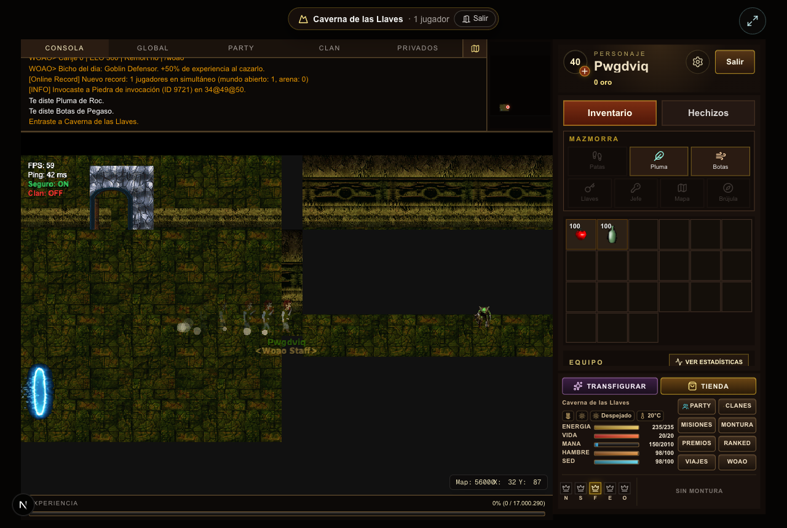 | 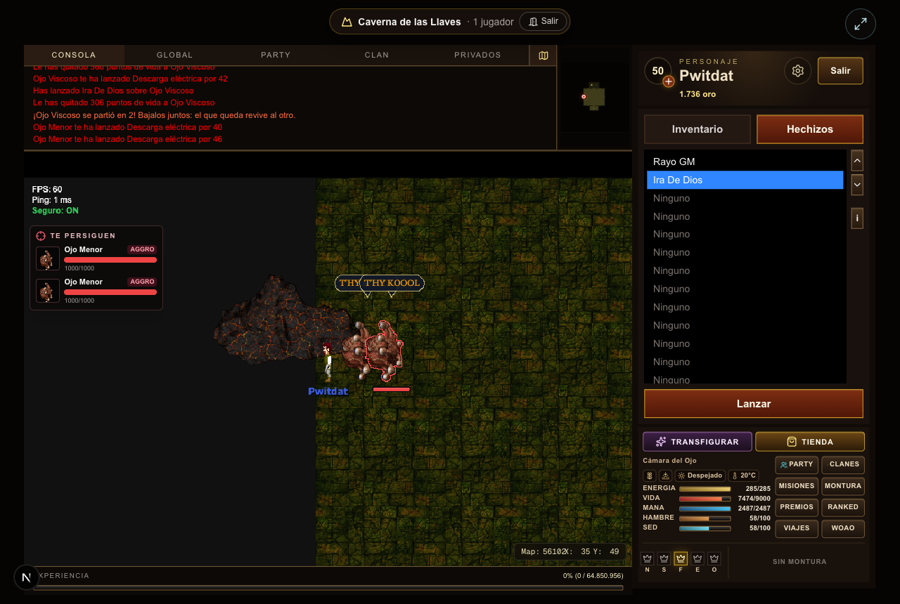 | 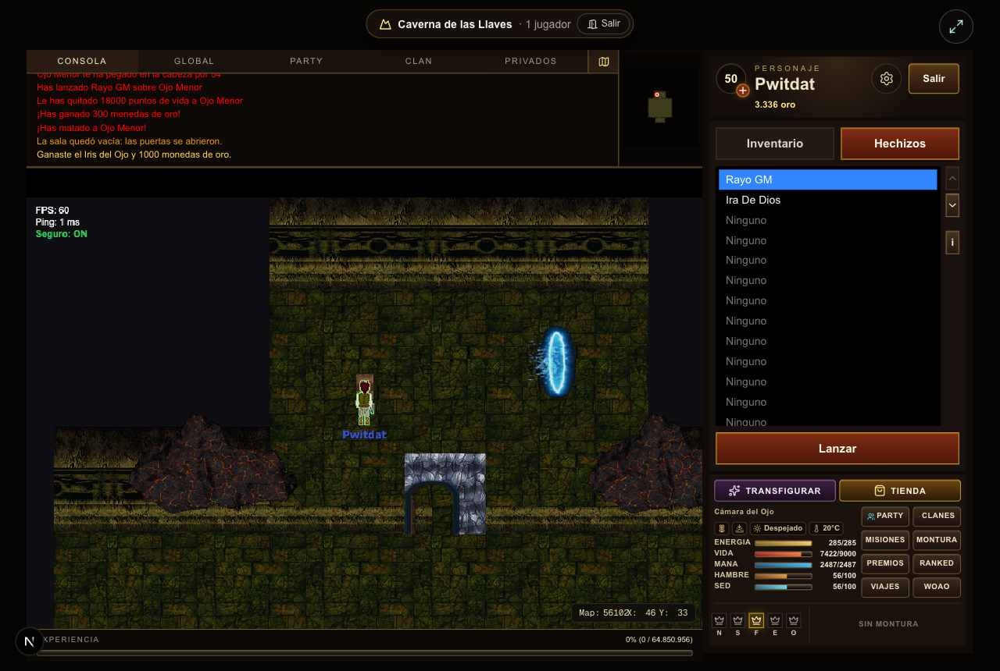 |

### Archivos
- `server/src/dungeonMotion.ts`: la Carrera y el salto.
- `server/src/dungeons.ts`: las mecánicas nuevas, las criaturas especiales, el cofre del jefe, el inventario de mazmorra en el estado y `/mazmorra carrera | salto | item`.
- `server/src/protocol.ts`: `moveUserByServer`, y en el paso normal, las puertas de un solo sentido y el freno mientras corre o salta; los ataques y hechizos también se frenan.
- `server/src/game.ts`: el jefe que flota no recibe daño, tampoco de los hechizos de área. `server/src/npcs.ts`: las estatuas dormidas y las criaturas enfurecidas.
- `server/src/scripts/buildDungeonMaps.ts`: los símbolos y objetos nuevos (1841-1849) y las plantillas propias.
- `server/mazmorras/caverna/`: los planos de los mapas 520-522 y la leyenda.
- Cliente:
  - `components/game/engine/dungeonMotion.ts`: las animaciones (carga, estela, polvo, arco, sombra y sacudón);
  - `Engine.ts`: dónde se dibujan y el freno al caminar;
  - `useMovementSync.ts`: la posición del server se aplica al terminar el movimiento;
  - `useKeyboardGameplay.ts` y `lib/hotkeys.ts`: las teclas;
  - `DungeonOverlay.tsx`: la franja con el inventario de mazmorra.

## 9. Cueva de la Cola: el Ciempiés, las trampas que se mueven y lo que aparece

El diseño está en [mazmorras/03-CUEVA_DE_LA_COLA.md](mazmorras/03-CUEVA_DE_LA_COLA.md). Es la segunda de la serie y da la Pluma de Roc. Está marcada `soloDesarrollo` hasta probarla en producción; después se abre para todos y, con ella, la Caverna.

### El Ciempiés Colosal (como Moldorm)
Sale del código del original (sección 6.1 del diseño). El server lo simula cada 50 ms en `dungeonBoss.ts`:
- **Movimiento:** la cabeza va en 16 direcciones a 3,5 baldosas por segundo y gira 22,5° cada 0,15 s. El sentido de giro se sortea cada 0,3 a 0,8 s, y en el borde de la plataforma rebota.
- **Velocidad:** después de cada golpe, y por debajo del 25 % de la vida, avanza al doble.
- **Cuerpo:** sigue el rastro de la cabeza.
- **La cola:** es la criatura de AO, con nombre y barra de vida, y es lo único que recibe daño. La cabeza y los segmentos queman (10 %) y empujan 2 baldosas, salvo a los que están en el aire.
- **Los pozos:** caer lleva a la Galería baja. Si se caen todos, el ciempiés se cura y la arena se abre, para volver a entrar.

Los que lo ven reciben la cabeza unas 10 veces por segundo (paquete `dungeonBoss`, 102). El cliente (`engine/dungeonBoss.ts`) interpola y dibuja la cabeza, dos segmentos y la cola del LPC Centipede, cada parte girada sobre el rastro. El sprite y su crédito están en `docs/CREDITOS_GRAFICOS.md`.

### Trampas que se mueven (`dungeonHazards.ts`)
| Trampa | Qué hace |
|---|---|
| Chispa | No se mata. Da vueltas alrededor del pilar o del cofre que tiene al lado (260 ms por baldosa); al tocar quema el 10 %, sin empujar (empujando por su anillo te volvía a alcanzar en cadena), y al mismo jugador no lo vuelve a quemar hasta 1,5 s después |
| Cuchilla | Quieta hasta que alguien queda en su fila o columna (hasta 7 baldosas, sin paredes ni bloques en el medio). Sale disparada, quema el 10 % y empuja, y vuelve despacio. Un bloque empujado le corta el recorrido. Van donde se puede salir de su fila: en un pasillo serían inevitables |
| Rodillo | El del Ogro del Rodillo: una columna de púas que cruza la sala de punta a punta mientras la sala está cerrada; al llegar, el ogro salta al otro lado. Quema el 15 % y empuja, salvo al que está en el aire |
| Empujón | `empuja` en la plantilla: el golpe de la criatura corre al jugador esas baldosas, y lo puede tirar a un pozo (los escarabajos) |

El empujón usa `dungeonMotion.push`: el server mueve al jugador como en la Carrera y el cliente lo anima deslizándose sin girar.

### Lo nuevo del motor
- **Placas por sala:** cada sala se resuelve sola. Abre sus rejas `=` y hace aparecer sus cofres; los cofres de una sala con placas arrancan ocultos.
- **Escaleras y portales que aparecen:** los de una sala que se cierra (y su otra punta, aunque esté en otro mapa) aparecen al vaciarla. En `leyenda.json`, `portales` dice qué escaleras se ven como portal. Las de `siempreVisibles` no se esconden nunca: se llega por ellas a una sala que se cierra hasta vaciarla.
- **Pozos con destino:** el plano dice `caida: <mapa>` y la `D` de ese mapa es adonde se cae.
- **Otros símbolos:** el bloque con cerradura (`&`) y el piso que las criaturas no pisan (`,`).
- **Caracola secreta (`C`):** un coleccionable por mazmorra, para cada uno del grupo (`progress.caracolas`).
- **Gráficos por mazmorra:** `graficos` (piso y pared) en `leyenda.json`.
- **Puertas al caminar:** las puertas que se abrieron llegan con su bloqueo también cuando entran a la vista caminando (`protocol.ts`, al cruzar de mapa el cliente carga el mapa base con todo cerrado).

En la Cueva: Escarabajo (9734), Babosa (9735), Chispa (9736), Cuchilla (9737), Escarabajo de púas (9738), Mini gusano (9739), Fuego del palo (9740), Duende de la cueva (9741), Ogro del Rodillo (9742) y Ciempiés Colosal (9743). La piedra es el NPC 9722.

### Para probarla
1. Con un GM: `/invocarnpc 9722` (la piedra de la Cueva) y entrar por la piedra. No hace falta ningún ítem.
2. En local, `/devcurar` deja la vida y el maná al máximo (no funciona en producción).

La prueba en vivo de punta a punta recorre la Cueva entera con un personaje común que entra sin nada: 53 controles, de la entrada al portal de salida, pasando por la Pluma, el rodillo, la caída y el Ciempiés.

| El Ciempiés | El rodillo del Ogro | La Cámara de la pluma |
|---|---|---|
|  |  |  |

### Archivos
- `server/src/dungeonBoss.ts`: el Ciempiés.
- `server/src/dungeonHazards.ts`: chispas, cuchillas, rodillo y empujón.
- `server/src/dungeonMotion.ts`: `push` (el empujón) e `isAirborne` (en el aire).
- `server/src/dungeons.ts`: placas por sala, escaleras que aparecen, pozos con destino, bloque con cerradura, Caracola, la sala que se abre si quedó vacía, el tic de 50 ms y las ayudas para los módulos nuevos.
- `server/src/scripts/buildDungeonMaps.ts`: los símbolos y opciones nuevos.
- `server/mazmorras/cueva/`: los planos de los mapas 530-532 y la leyenda.
- Cliente: `engine/dungeonBoss.ts` (el Ciempiés), `engine/dungeonMotion.ts` (el empujón), `public/sprites/ciempies.png`.

## 10. La Mochila, las teclas de objeto, el mapa grande y la música (todas las mazmorras)

Pedido de Leandro: que el inventario no se deforme con cada ítem nuevo, al estilo del menú de Link's Awakening, y música propia en cada mazmorra. El inventario clásico (la grilla de objetos) no cambia.

### La barra y la Mochila (`components/DungeonBackpack.tsx`)
Adentro de una mazmorra, arriba del inventario, hay una barra con:
- las dos **teclas de objeto** (la A y la B de Zelda; por defecto Z y X), con la letra encima del ítem;
- las llaves chicas, la llave del jefe, la brújula y el botón del mapa;
- el botón de la **Mochila**.

| La barra (Z y X arriba del inventario) | La Mochila | El mapa grande |
|---|---|---|
| 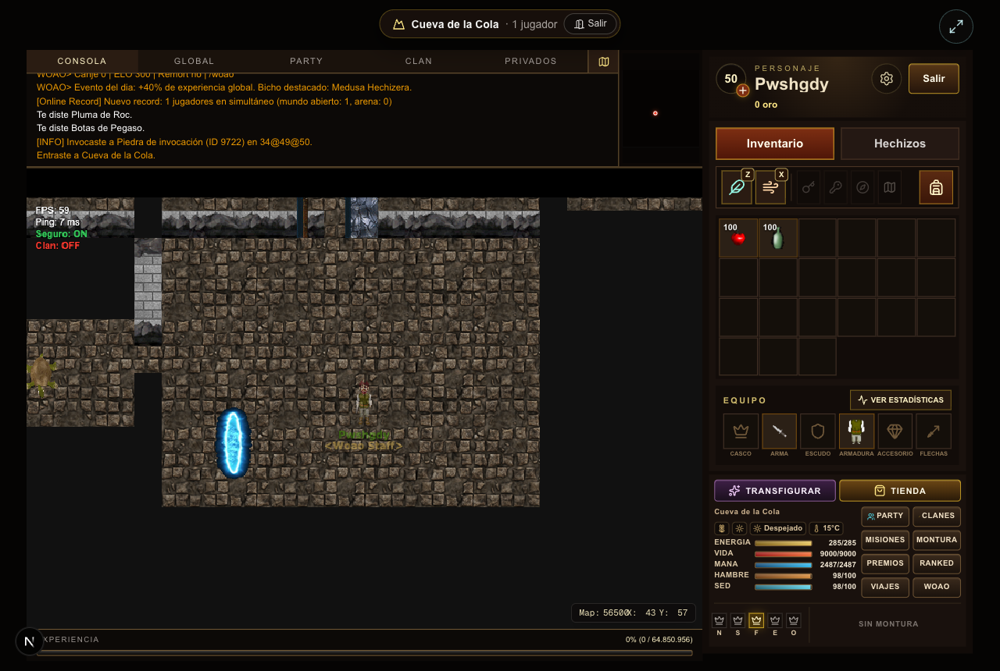 | 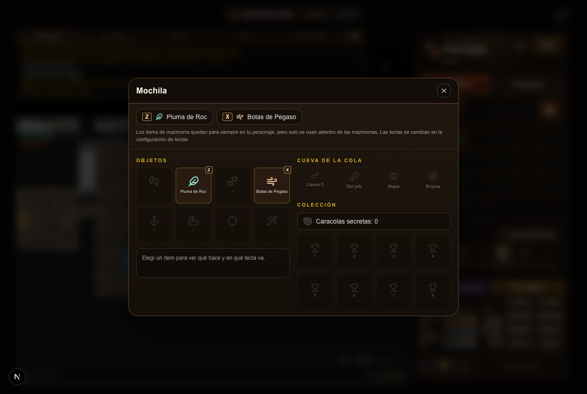 | 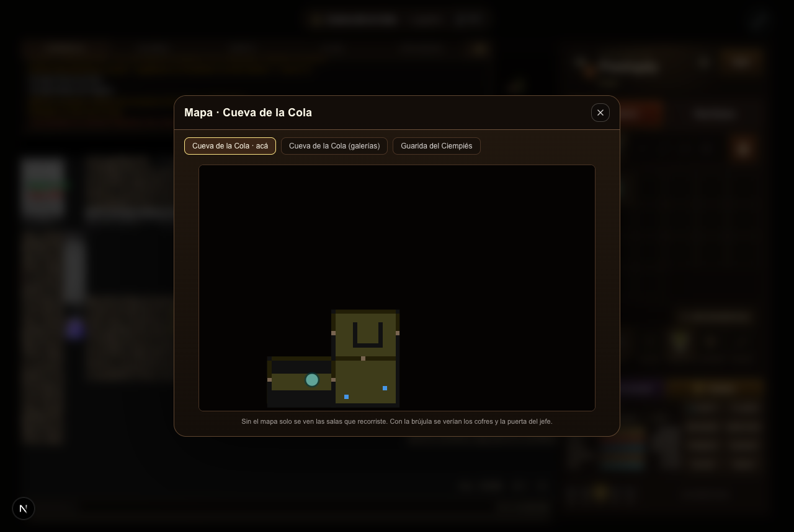 |

La Mochila muestra:
- las dos teclas y qué ítem tiene cada una;
- los 8 ítems de la serie: los que tiene, con su letra si está en una tecla, y huecos para los que faltan;
- lo de la mazmorra actual: llaves, llave del jefe, mapa y brújula;
- la colección: caracolas secretas y los 8 trofeos.

Para poner un ítem en una tecla, se lo elige en la Mochila; si ya estaba en la otra, se cambian. Se guarda en el personaje (`progress.dungeonButtons`, comando `/mazmorra boton <1|2> <ítem|ninguno>`). Las teclas se cambian en la configuración de teclas, como el resto (`dungeonItem1` y `dungeonItem2`, que reemplazan a las viejas de la Carrera y el salto). Los ítems de mazmorra quedan para siempre, pero solo se usan adentro: afuera las teclas no hacen nada y el server lo vuelve a validar.

### El mapa grande
Se abre desde la barra, aunque no se tenga el mapa (como en Link's Awakening):
- **Sin el mapa:** se ven las salas recorridas.
- **Con el mapa:** también las demás, a media luz.
- **Con la brújula:** los cofres y la puerta del jefe.

Hay una pestaña por piso, y el jugador parpadea donde está. La brújula además suena al entrar a una sala con una llave sin agarrar.

### La música (`lib/dungeonMusic.ts`)
Cada mazmorra tiene en `jsons/dungeons.json` ("musica") tres temas que suenan uno detrás del otro y vuelven a empezar, y uno de combate. El combate suena mientras el jugador está en una sala cerrada con un jefe o un minijefe vivo (`jefe` y `minijefe` en las plantillas). Al terminar, sigue con el próximo tema. No tiene un botón propio para silenciarla: sigue al volumen general del juego. Los archivos están en `frontend/public/music/mazmorras/<mazmorra>/` y los créditos, en `docs/CREDITOS_SONIDOS.md`.

## 11. Polvo de Fuego, Gancho y Brazalete de Fuerza (Roca de la Tortuga)

El diseño está en [mazmorras/04-ROCA_DE_LA_TORTUGA.md](mazmorras/04-ROCA_DE_LA_TORTUGA.md), secciones 6 y 6.2. La Roca de la Tortuga da el Polvo de Fuego y, como en el original, usa el Gancho y el Brazalete de Fuerza. Leandro pidió hacer los dos ahora para que queden listos para las mazmorras que los den. Hasta entonces, un GM los da con `/mazmorra item polvo_de_fuego|gancho|pulsera`.

Son ítems de mazmorra como la Pluma y las Botas: se ponen en las teclas Z o X desde la Mochila y solo funcionan adentro.

**Ninguno toca los atributos, los hechizos ni la defensa del personaje** (pedido de Leandro): el hechizo Fuerza es parte del meta de AO. El Brazalete no da fuerza: es la herramienta de Zelda para levantar cosas. Y el Escudo Espejo solo frena lo que pasa adentro de las mazmorras. El server los resuelve en `dungeonTools.ts` y avisa en el mismo paquete que la Carrera (101), con tipos nuevos. El cliente los dibuja en `engine/dungeonTools.ts`.

| Ítem | Qué hace | Números |
|---|---|---|
| **Polvo de Fuego** (`fuego`) | Llamarada en línea recta hasta 6 baldosas. Al llegar: enciende una antorcha, derrite un bloque de hielo o quema a una criatura; las plantillas con `debilFuego` se queman el doble. El dibujo es el proyectil de los hechizos en colores de fuego, con chispas al llegar | 45 ms por baldosa, 0,7 s entre usos. Daño: 20 + 3 por nivel (±10 %) |
| **Gancho** (`gancho`) | Cadena hasta 7 baldosas. Si engancha algo firme (cofre, bloque, vasija, piedra, estatua, antorcha, hielo, cristal o puerta), arrastra al personaje hasta al lado, por encima de pozos y lava. En una criatura, la aturde 1,5 s y le saca un poco. Contra la pared o sin nada, vuelve. No atraviesa a otros personajes | 40 ms por baldosa de ida, 50 por baldosa de arrastre, 0,9 s entre usos. Daño: 5 + 1 por nivel |
| **Brazalete de Fuerza** (`pulsera`) | Levanta la vasija o la piedra que hay adelante y la lleva sobre la cabeza: se camina, pero no se ataca ni se usan otros ítems. Apretando otra vez la tira hasta 4 baldosas; se rompe al caer y lastima a la criatura que toque. Lo que tapaba queda a la vista (un botón). Al morir, salir o cambiar de mapa se suelta | 70 ms por baldosa del tiro. Daño: 15 + 2 por nivel |
| **Brazalete de Fuerza II** (`pulsera_poderosa`, la misma acción) | Todo lo del Brazalete y además las **piedras pesadas** (`]` en el plano). Con el Brazalete común la piedra pesada no se mueve: "Es demasiado pesada" | Daño de la piedra pesada tirada: 30 + 3 por nivel |
| **Escudo Espejo** (`escudo`) | Lo levanta 3 s delante del personaje (el Escudo de Diamantes del juego, con un brillo que lo recorre). Lo que llega de frente no entra: los golpes de las criaturas, con aviso. Las trampas que tiran rayos o bolas de fuego lo consultan con `mirrorBlocks` | 3 s levantado y 1,5 s de espera |

Mientras arrastra el Gancho, el personaje cuenta como en el aire, igual que saltando: la lava, el rodillo y el Ciempiés no lo tocan.

| Las antorchas encendidas y el cofre que aparece | La vasija levantada con el Brazalete de Fuerza | El Gancho cruzando la lava |
|---|---|---|
| 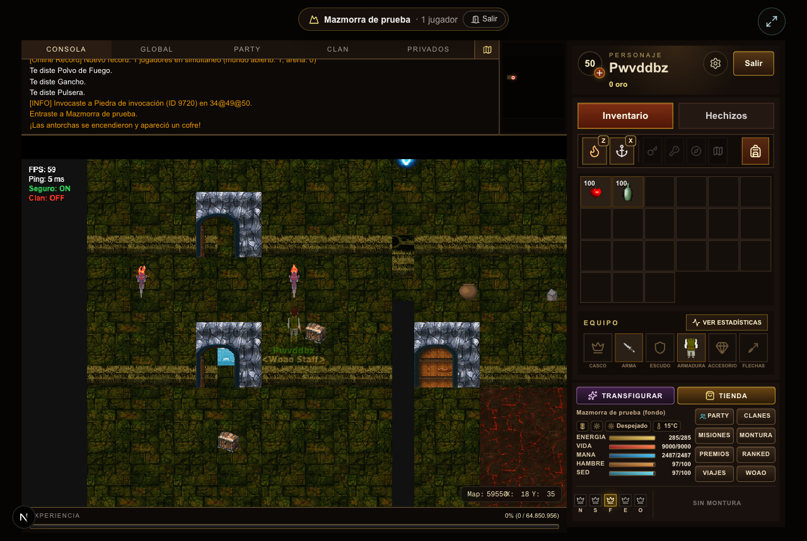 | 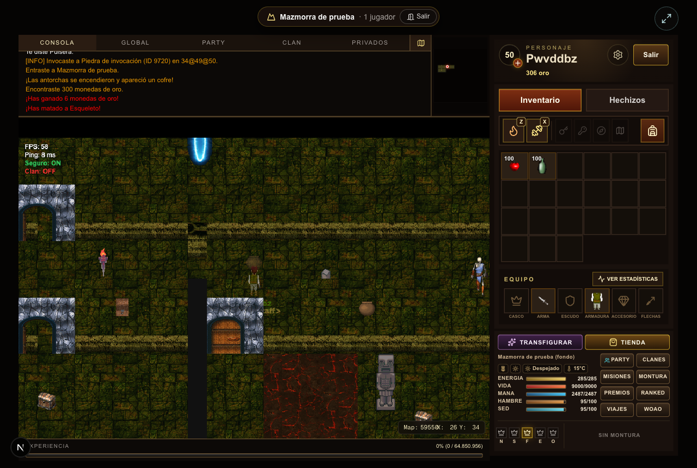 | 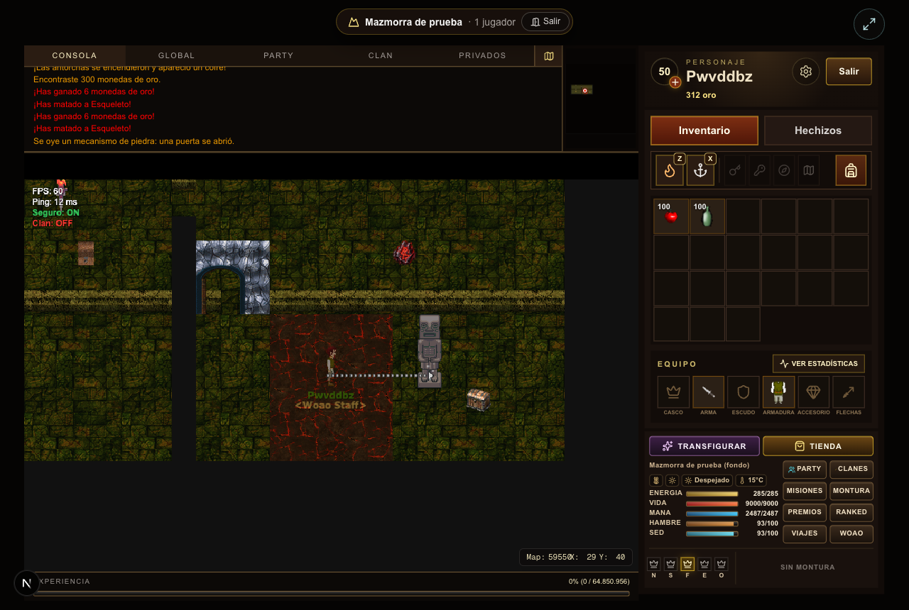 |

(En las capturas el personaje es un GM invisible: por eso se ve, con lo que lleva, medio transparente.)

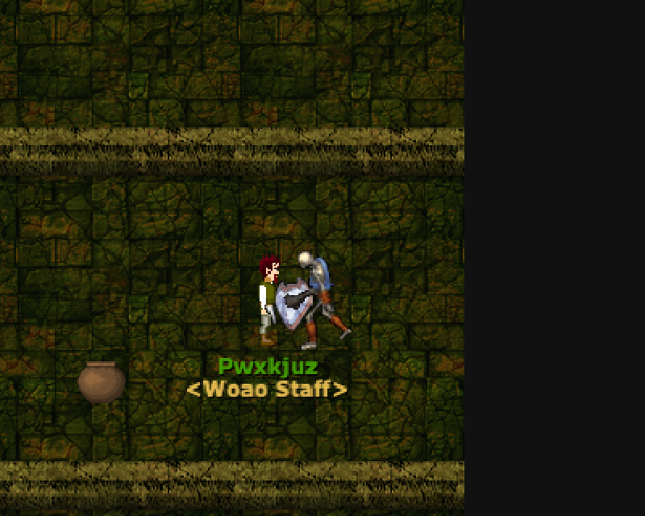

### Símbolos nuevos del plano
| Símbolo | Qué es |
|---|---|
| `F` / `A` | Antorcha apagada / encendida (tapan el paso). Los cofres de una sala con antorchas apagadas aparecen al encenderlas todas |
| `I` | Bloque de hielo: lo derrite el Polvo |
| `U` / `V` | Vasija / vasija sobre una placa (la placa cuenta para las puertas `=`) |
| `;` | Piedra suelta |
| `]` | Piedra pesada: solo el Brazalete de Fuerza II |
| `H` | Estatua para engancharse |

Objetos 1852-1857 y gráficos 38215-38229 (créditos en [CREDITOS_GRAFICOS.md](CREDITOS_GRAFICOS.md)). Sonidos 222-225 (créditos en [CREDITOS_SONIDOS.md](CREDITOS_SONIDOS.md)).

### Para probarlos
En la mazmorra de prueba, el mapa 591 tiene debajo de la sala de la salida cuatro salas nuevas:
- **Antorchas:** dos antorchas y un cofre que aparece al encenderlas; un bloque de hielo tapa la puerta de abajo.
- **Vasijas:** una vasija, una piedra, un esqueleto y una vasija sobre el botón que abre la sala de la lava.
- **Detrás del hielo:** un cofre.
- **Lava:** una franja de lava de 5 baldosas y una estatua del otro lado, para cruzar con el Gancho, y un cofre.

La prueba en vivo es `pw/run-herramientas.mjs`.

### Archivos
- `server/src/dungeonTools.ts`: los tres ítems.
- `server/src/dungeons.ts`: `toolTargetAt`, `lightTorch`, `meltIce`, `liftAt` y `canToolHitNpc`; antorchas, hielo y vasijas en el estado de cada mapa; los ítems en `DUNGEON_ITEMS` y los comandos `fuego`, `gancho` y `pulsera`.
- `server/src/dungeonMotion.ts`: el arrastre cuenta como estar en el aire, y con las manos ocupadas no se ataca.
- `server/src/scripts/buildDungeonMaps.ts`: los símbolos y objetos nuevos.
- Cliente: `engine/dungeonTools.ts`, `DungeonBackpack.tsx` (la casilla de la Vara pasa a ser el Polvo de Fuego), `aowProtocol.ts` y los gráficos nuevos en los dos índices de gráficos (con la versión subida en `gameLoader.ts`).

## 12. Los básicos: Bombas y Arco (todas las mazmorras)

Pedido de Leandro: en Zelda las bombas y el arco se compran (no los da ninguna mazmorra), así que acá los tiene **todo el mundo desde la primera mazmorra**, antes de conseguir el primer ítem. Son ítems de mazmorra como los demás, pero no hace falta conseguirlos:
- aparecen en la Mochila como "Básicos";
- se ponen en Z o X;
- solo funcionan adentro de las mazmorras.

Para no cambiarle las teclas a quien ya tiene ítems, van al final de la lista: las teclas sin elegir siguen siendo los dos primeros ítems de la serie. Un personaje sin ninguno arranca con Z = Bombas y X = Arco.

| Ítem | Qué hace | Números |
|---|---|---|
| **Bombas** (`bomba`) | Pone una bomba adelante (o a los pies, si adelante no hay piso libre). La mecha titila cada vez más rápido y a los 2 s explota en 3 × 3 baldosas: lastima a las criaturas y abre las **paredes rajadas**. Una por jugador a la vez; no lastima a los jugadores | Daño: 30 + 4 por nivel (±10 %) |
| **Arco** (`flecha`) | Una flecha en línea recta hasta 8 baldosas, sin gastar flechas. Se clava en la primera criatura o en lo que tape el paso. Se dibuja con la flecha de los arqueros (paquete `createProjectile`) | 35 ms por baldosa, 0,6 s entre tiros. Daño: 15 + 2,5 por nivel |

| La bomba sobre la pared rajada, la explosión y el arco abierto |
|---|
| 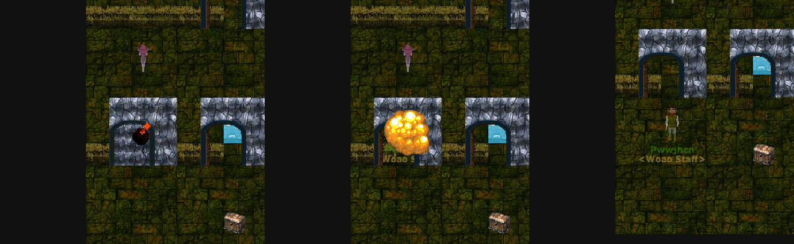 |

| Los básicos en la Mochila, con Z y X |
|---|
| 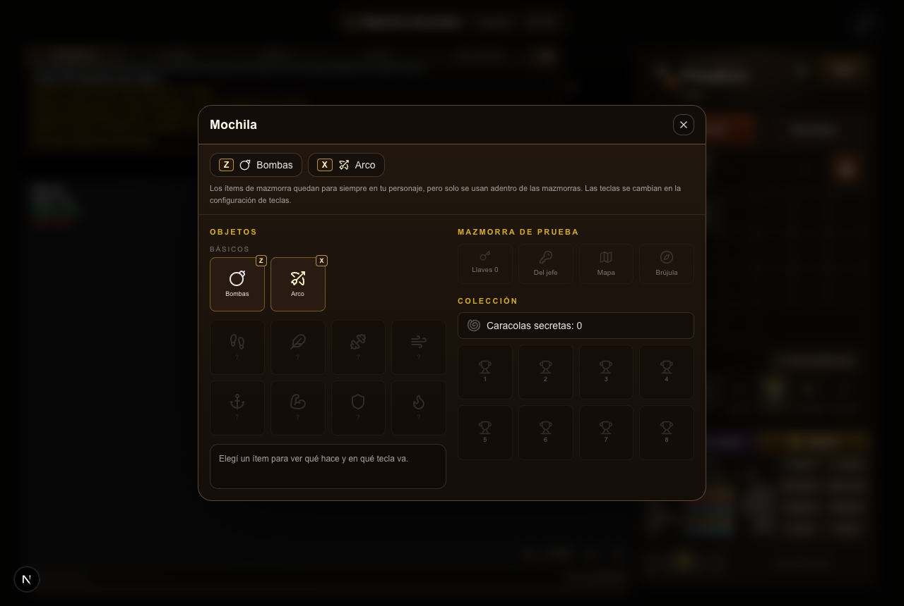 |

### La pared rajada (`@` en el plano)
Es una puerta más (tipo `bomba`):
- **Cerrada:** en una pared horizontal se ve como un arco tapiado con una grieta; en una vertical, como un montón de rocas.
- **Al clic:** avisa que "con una bomba se rompe".
- **Al explotar una bomba al lado:** se abre (queda el arco abierto, o nada), suena el secreto y avisa al grupo.
- **En el minimapa:** se ve como pared, para no delatar el pasaje.

En la Roca de la Tortuga, además, las Serpientes Gemelas se tragan las bombas y la estatua-ojo se baja con una flecha, como en el original (se arman con la mazmorra).

### Para probarlos
En el mapa 591 de la mazmorra de prueba, la sala de las antorchas tiene una pared rajada horizontal hacia la de abajo, y esa, una vertical hacia la de la lava. La prueba en vivo es `pw/run-bombas.mjs`.

### Archivos
- `server/src/dungeonTools.ts`: `bomb` y `arrow`.
- `server/src/dungeons.ts`: los básicos en `DEFAULT_DUNGEON_ITEMS`, la puerta `bomba` y `bombBlast`.
- `server/src/scripts/buildDungeonMaps.ts`: el símbolo `@` y los objetos 1858 y 1859 (gráficos 38230 y 38231).
- Cliente:
  - `engine/dungeonTools.ts`: la bomba y la explosión, con planillas sueltas en `public/sprites/bomba.png` y `explosion.png`;
  - `DungeonBackpack.tsx`: la fila de básicos.
- Sonidos 226-228. Los créditos de gráficos y sonidos están en [CREDITOS_GRAFICOS.md](CREDITOS_GRAFICOS.md) y [CREDITOS_SONIDOS.md](CREDITOS_SONIDOS.md).

## 13. Mecánicas compartidas: Polvo mágico, salas oscuras, cristales, remolino, imitadores y búhos

Las pide tanto la Roca de la Tortuga como la Gruta de la Botella ([mazmorras/04-ROCA_DE_LA_TORTUGA.md](mazmorras/04-ROCA_DE_LA_TORTUGA.md) y [mazmorras/05-GRUTA_DE_LA_BOTELLA.md](mazmorras/05-GRUTA_DE_LA_BOTELLA.md)). Leandro aprobó el Polvo mágico como tercer básico.

| Mecánica | Cómo funciona | Plano |
|---|---|---|
| **Polvo mágico** (`polvo`, básico) | Espolvorea la baldosa de adelante: enciende una antorcha apagada o le saca un poco a la criatura que esté ahí (10 + 1,5 por nivel; el doble a las `debilFuego`). Nube de chispas doradas y violetas | — |
| **Salas oscuras** | Una sala con antorchas está a oscuras mientras quede alguna apagada: un velo negro sobre la sala, más claro cuantas más estén encendidas. Hay un círculo de luz alrededor de cada personaje y de cada antorcha encendida, y el velo también tapa a las criaturas. Las antorchas las encienden el Polvo mágico y el Polvo de Fuego | `F` / `A` |
| **Cristales y bloques de color** | Los bloques **azules** arrancan levantados y los **naranjas** bajados. Golpear un cristal los invierte **en toda la corrida**, y el cristal muestra el color de los que están arriba. Le pegan un golpe al aire de frente, una flecha, una llamarada, una bomba o el Gancho. Un bloque que tiene que subir con alguien encima sube apenas quede libre | `(` azul, `)` naranja, `\|` cristal |
| **Remolino** | Cada 0,6 s arrastra una baldosa hacia él a los que están en su sala (salvo en el aire). Al llegar al centro te deja en la entrada de la mazmorra | `"` |
| **Imitadores** | Copian cada paso del jugador de su sala, **al revés** (como el Masked Mimic de Link's Awakening, `19_masked_mimic.asm`). Si quedan al lado, pegan. Se cubren de frente: se les pega por la espalda o de costado. Contra una pared se quedan, pero miran hacia donde querían ir | plantilla con `imitador` |
| **Pico de piedra y búhos** | El pico sale de un cofre y vale para todo el grupo, como el mapa (aparece en la barra y en la Mochila). Sin el pico, los búhos "quieren decir algo"; con él, muestran su pista (texto en `buhos` de leyenda.json) | `0` cofre del pico, `/` búho |

| La sala oscura: la luz alrededor del personaje | El cristal golpeado: los azules abajo, los naranjas arriba | Los imitadores |
|---|---|---|
| 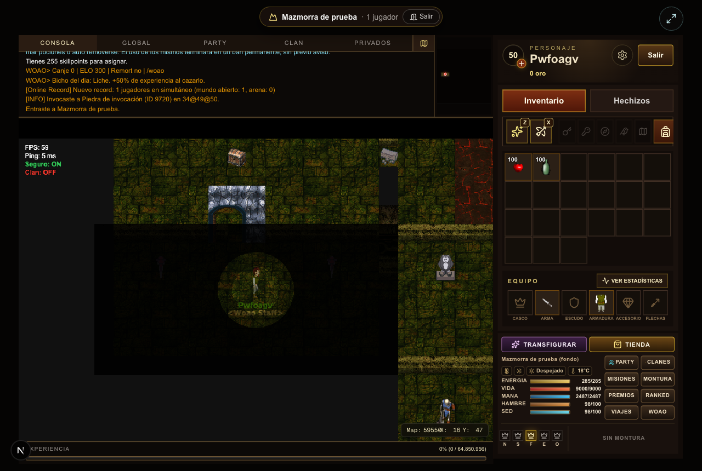 | 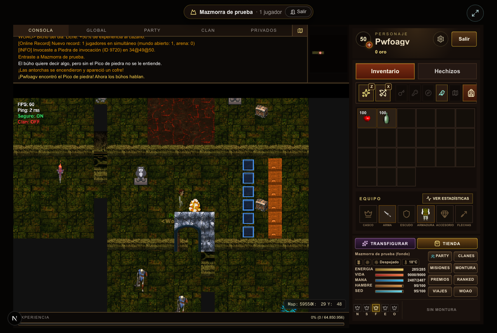 | 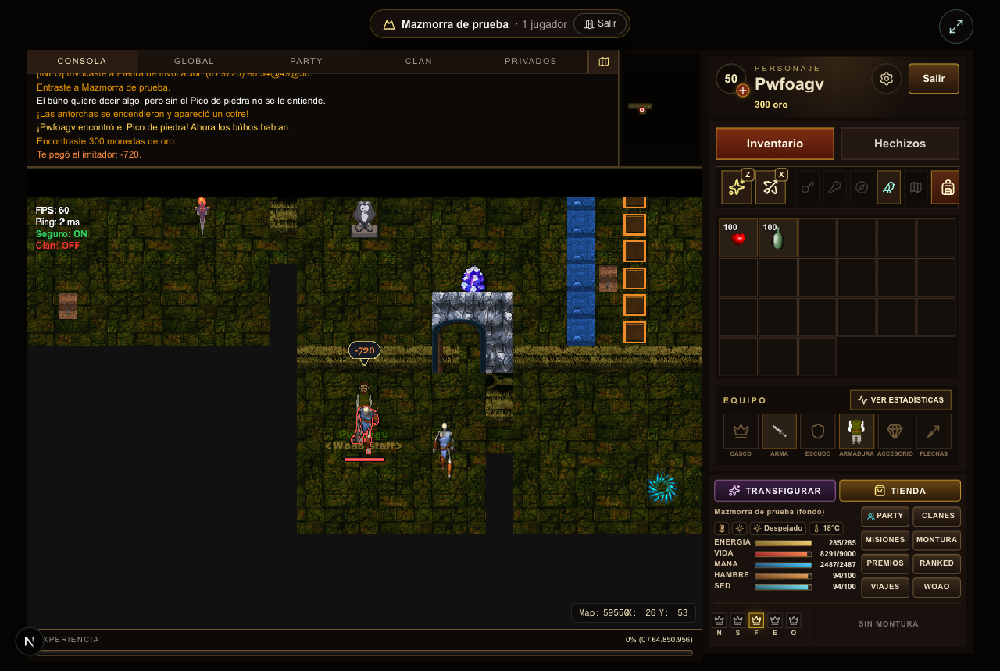 |

Objetos 1861-1868; gráficos 42249-42266. Sonido 231 (polvo). Créditos en [CREDITOS_GRAFICOS.md](CREDITOS_GRAFICOS.md) y [CREDITOS_SONIDOS.md](CREDITOS_SONIDOS.md).

### Para probarlas
En el mapa 591 de la mazmorra de prueba, al sur de la sala detrás del hielo, hay cuatro salas:
- **Sala oscura:** dos antorchas y el pico.
- **Sala del búho y el cristal:** una columna de bloques azules y otra de naranjas, con un cofre entre las dos.
- **Imitadores.**
- **Remolino.**

La prueba en vivo es `pw/run-compartidas.mjs`.

### Archivos
- `server/src/dungeons.ts`: `hitSwitch`, `onAirSwing` (lo llama el ataque al aire de `protocol.ts`), las salas oscuras en el estado (`oscuras`), el remolino en el tic, los búhos y el cofre del pico.
- `server/src/dungeonHazards.ts`: los imitadores (`onPlayerStep` y `frontalBlockReason`, que consulta `getNpcInvulnerableReason` con el atacante).
- `server/src/dungeonTools.ts`: el Polvo mágico y los golpes al cristal de la llamarada, la flecha y la bomba.
- Cliente:
  - `engine/dungeonDarkness.ts`: el velo;
  - `engine/dungeonTools.ts`: el polvo;
  - la Mochila, con el Polvo mágico en los básicos y el pico.

## 14. Mecánicas de la Gruta de la Botella: fantasmas, orejudos, escarabajo, matar en orden y placa de peso

Son las que pide solo la Gruta de la Botella ([mazmorras/05-GRUTA_DE_LA_BOTELLA.md](mazmorras/05-GRUTA_DE_LA_BOTELLA.md)). Ninguna toca atributos ni hechizos del personaje: son reglas de las criaturas y de las salas.

| Mecánica | Cómo funciona | Plano |
|---|---|---|
| **Fantasmas** | En una sala con todas sus antorchas apagadas no les entra nada: ni golpes, ni hechizos, ni ítems ("se escurre en la oscuridad"). Con una antorcha encendida (Polvo mágico o Polvo de Fuego) ya se los puede lastimar | plantilla con `fantasma` |
| **Orejudos** | Solo les entra lo tirado: una vasija o una piedra con el Brazalete, una bomba o una flecha. Los golpes, los hechizos, el fuego, el Gancho y el polvo no les hacen nada | plantilla con `orejudo` |
| **Escarabajo de casco** | No recibe daño de nada. Cada golpe cuerpo a cuerpo lo tira hasta dos baldosas hacia atrás y lo deja quieto 1,2 s, para encadenar el siguiente; si pasa por un pozo, cae y muere | plantilla con `retrocede` |
| **Matar en orden** | Las criaturas de la sala llevan un número. Si cae una antes que otra de número menor, todas las vencidas vuelven a aparecer a los 1,5 s. Si caen todas en orden, aparece el cofre de la sala | plantilla con `orden: 1, 2, 3…` |
| **Bloques que abren la escalera** | Las escaleras de una sala con placas quedan ocultas (las dos puntas) hasta que se apriete la última placa. Las placas se aprietan con bloques empujados o parándose encima | `_` placa, `B` bloque |
| **Placa de peso** | Una placa que no baja con un jugador solo: hay que pararse encima con algo levantado (una vasija o una piedra) o correrle un bloque. Si te parás sin nada, avisa que le falta peso | `-` |

Una sala de matar en orden esconde su cofre hasta que caen todas sus criaturas. El cofre va en el plano como cualquier otro: lo oculta el generador, igual que en las salas con placas o con antorchas apagadas.

| A oscuras, el fantasma no recibe el rayo | Matar en orden: aparece el cofre | La placa de peso con la vasija levantada |
|---|---|---|
| 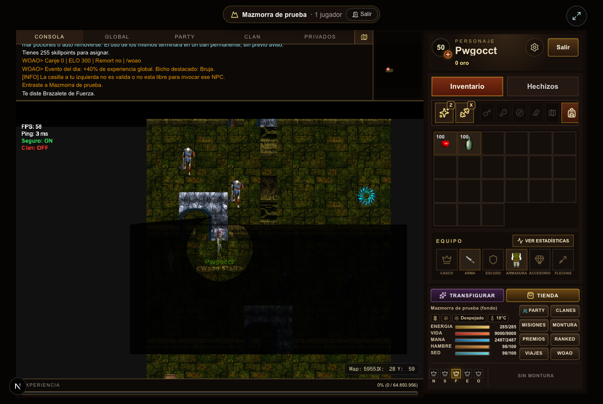 | 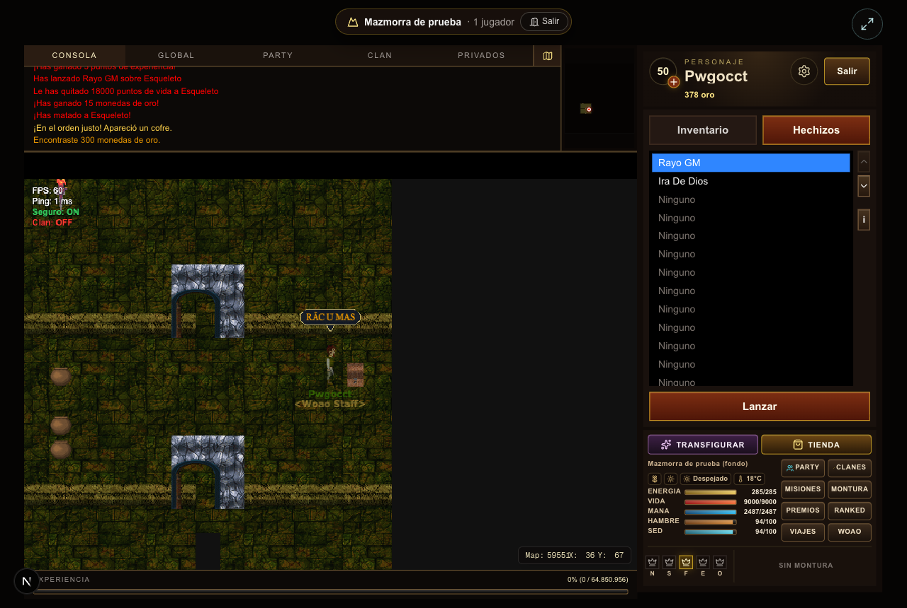 | 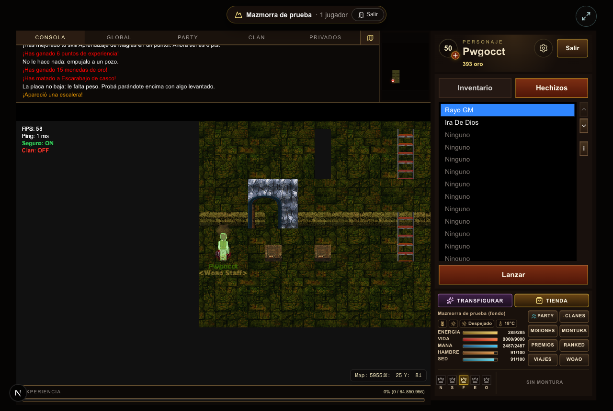 |

**Objetos del mapa base que la corrida saca.** El cliente dibuja los objetos del mapa base. Por eso, cuando una escalera oculta, una vasija levantada o un bloque corrido entra a la vista caminando, el server lo borra (`isObjectRemoved` en `enterTile` de `protocol.ts`). Antes, una escalera oculta lejos de donde entraste se veía aunque no funcionara.

### Para probarlas
En el mapa 591 de la mazmorra de prueba, al sur de los imitadores, hay cuatro salas:
- **Fantasmas:** una antorcha apagada y dos fantasmas.
- **Orden:**
  - un orejudo (1), un murciélago (2) y un esqueleto (3);
  - cuatro vasijas para tirarle al orejudo;
  - un cofre oculto.
- **Escarabajo:** una columna de pozos.
- **Bloques:**
  - dos placas con sus bloques debajo y la placa de peso;
  - una vasija para levantar;
  - una escalera oculta que lleva a la sala del escarabajo.

La prueba en vivo es `pw/run-gruta.mjs`.

### Archivos
- `server/src/dungeons.ts`:
  - `getNpcInvulnerableReason(npc, atacante, fuente)`: fantasmas, orejudos y escarabajo;
  - `onNpcStruck`, que lo llama el golpe cuerpo a cuerpo de `game.ts`;
  - `onOrderDied`;
  - la placa de peso en `updatePlates`;
  - las escaleras de las salas con placas en `solvePlates`.
- `server/src/dungeonHazards.ts`: `strikeBeetle`, el empujón del escarabajo y la caída al pozo.
- `server/src/dungeonTools.ts`: cada ítem le dice a `damageNpc` con qué pega (`fuego`, `gancho`, `tiro`, `bomba`, `flecha`, `polvo`).
- `server/src/scripts/buildDungeonMaps.ts`: el símbolo `-`, los cofres ocultos de las salas de orden y las escaleras ocultas de las salas con placas.

## 15. Gruta de la Botella: los mapas, las criaturas y la música

El diseño está en [mazmorras/05-GRUTA_DE_LA_BOTELLA.md](mazmorras/05-GRUTA_DE_LA_BOTELLA.md). Da el Brazalete de Fuerza, pide la Pluma de Roc y está marcada `soloDesarrollo`. La piedra es el NPC 9724.

Los jefes (el Cíclope y el Genio de la Botella) están en la sección 16.

### Mapas
| Mapa | Qué tiene |
|---|---|
| 550 | La gruta: la grilla del original, 6 × 7 celdas de 16 × 12 con 24 salas, más el nicho de la caracola y el de la escalera a la Guarida |
| 551 | Los tres pasajes: A → B (islas cortadas por pozos, con chispas), C ↔ D (pozos y criaturas) y E → F (la placa que abre la puerta y la placa de peso) |
| 552 | La Guarida: la arena de 20 × 15 con paredes, la sala del trofeo y la llegada |

- **Gráficos:**
  - piso de losas claras verdosas (bloque de grh 33847);
  - paredes de piedra oliva con musgo (bloque de grh 9683).
- **Compositor:** los planos salen de `scratchpad/dungeon5/componer.py`.
- **Simulador:** `scratchpad/dungeon5/simular.py` recorre los planos baldosa por baldosa. Usa la pluma, las llaves, las vasijas, los bloques de color, las escaleras que aparecen y las antorchas, y confirma tres cosas:
  - se llega a todas las salas y a todos los cofres;
  - antes del Brazalete hay 4 cerraduras para 4 llaves;
  - desde ningún lugar, con ningún estado de los bloques, se queda uno trabado.

### Lo que cambió respecto del diseño
- **Anillo azul:**
  - la K2 queda dentro de un anillo de bloques **naranjas**, y el cristal es parte del anillo;
  - se entra con los azules bajados, así que el anillo está arriba; el cristal lo baja, pero también sube los azules de la entrada.
- **Esqueletos:** tiene un cristal. Si alguien deja el bloque naranja de la puerta del Cristal central levantado, del lado de la entrada también se puede volver a bajar.
- **Isla oscura:** en vez del corazón hay un cofre de oro, que aparece al encender la antorcha.
- **Matar en orden:** un bloque tapa la salida del corral del orejudo. Se lo corre y se le tira desde abajo.
- **Pozos azules:** dos caminos alrededor de un pozo grande, uno cortado por un bloque azul y otro por uno naranja.
- **Caracola secreta:** detrás de una pared rajada al norte de los Esqueletos.
- **Puente:** la escalera F llega a un costado. Al pie del puente, pisarla para subir te devolvía al pasaje.
- **Cuchillas:**
  - no van en las esquinas: barren las filas 1 y 8 y las columnas 3 y 10;
  - en las esquinas, la puerta norte dejaba al jugador en la fila de dos cuchillas, que lo empujaban de una a otra sin salida.

### Lo nuevo del motor
- **Puerta `=` con antorchas:** encender todas las antorchas de una sala abre sus puertas `=` (en la Gruta, la de las Antorchas al este).
- **Cofres de una sala oscura que se cierra:** no aparecen al encender la antorcha, sino al vencer a las criaturas. Es el caso del Brazalete, que lo guardan los fantasmas.
- **`divide` en una criatura que no flota:** se parte al morir. El Moco de la gruta suelta dos moquitos, que cuentan para la sala que se cierra.

### Criaturas
| Id | Criatura | Cuerpo |
|---|---|---|
| 9760 | Murciélago | El de AO |
| 9761 | Esqueleto | El de AO |
| 9762 | Chispa | La de la Cueva |
| 9763 | Cuchilla | La de la Cueva |
| 9764 | Moco de la gruta (se parte al morir) | Moco de Pantano |
| 9765 | Moquito | Quark |
| 9766 | Escarabajo de púas | El de la Cueva |
| 9767 | Imitador | Asesino |
| 9768 | Fantasma | El de AO |
| 9769 | Orejudo | **Nuevo:** el conejo LPC de Redshrike (cuerpo 577) |
| 9770 | Orejudo preso (orden 1) | El conejo |
| 9771 | Murciélago (orden 2) | El de AO |
| 9772 | Esqueleto (orden 3) | El de AO |
| 9773 | Escarabajo de casco | La tortuga de la Cueva |
| 9774 | Cíclope (minijefe) | El de AO |
| 9775 | Genio de la Botella (jefe) | El de AO |

Todas pisan los hechizos y las estadísticas de su base, porque algunas bases no sirven tal cual:
- el Cíclope de AO pega 400-600;
- el Fantasma tira hechizos;
- el Genio es un NPC amistoso que no se ataca. Si la plantilla no lo vuelve atacable y hostil, su sala no lo cuenta, no se cierra y no suena el combate. Un test controla que todo jefe o minijefe se pueda atacar.

**El orejudo:** el sprite está en `graphics/330011.png`, con los cuadros 42267-42282 y las animaciones 42283-42286. El crédito está en [CREDITOS_GRAFICOS.md](CREDITOS_GRAFICOS.md).

### Música
Son cuatro temas de Kevin MacLeod (CC-BY 4.0), igualados a −18 LUFS:
1. Mirage (cueva húmeda y fantasmal);
2. Mystery Bazaar;
3. Hidden Wonders;
4. de combate, Ibn Al-Noor, con tambores y aire árabe para el Genio.

Los créditos están en [CREDITOS_SONIDOS.md](CREDITOS_SONIDOS.md).

| Veinte vasijas: los orejudos y el moco | Las Antorchas, a oscuras | Los bloques en las placas: aparece la escalera A |
|---|---|---|
| 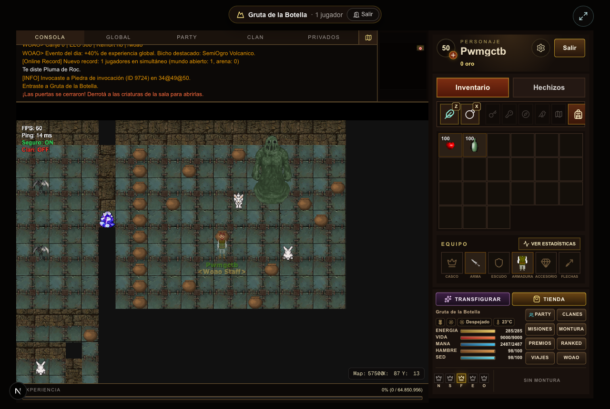 | 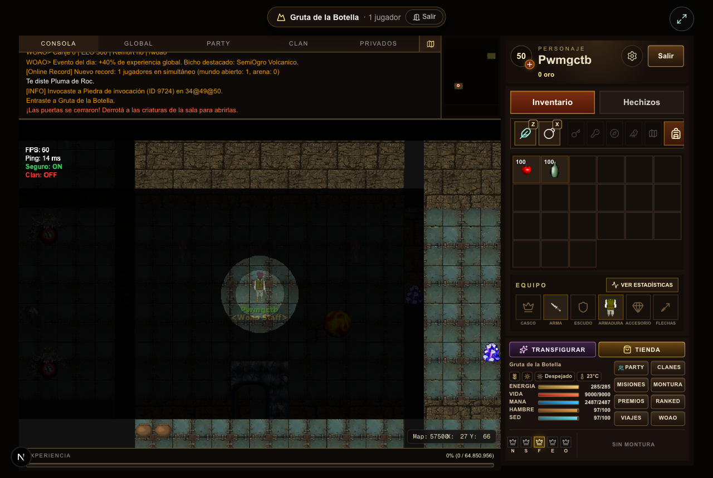 | 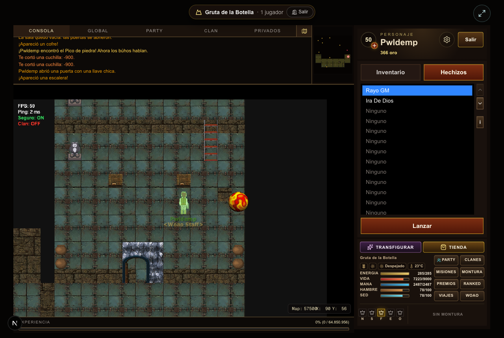 |

### Para probarla
Con un GM:
1. `/mazmorra item pluma`.
2. `/invocarnpc 9724`.
3. Entrar por la piedra.

La prueba en vivo es `pw/run-botella.mjs` (72 controles). Recorre la Gruta por el camino del diseño, de la Entrada al trofeo.

## 16. Gruta de la Botella: el Cíclope y el Genio de la Botella

Los dos salen del código del original (zladx/LADX-Disassembly) y los mueve el server (`server/src/dungeonGrotto.ts`, con `customMotion`), como el Ciempiés. En la plantilla se marcan con `ciclope` y `genio`.

### El Cíclope (minijefe; el Hinox, `06_hinox.asm`)
| Qué hace | Cómo |
|---|---|
| Camina | 2 a 4 baldosas en una dirección al azar (una de cada cuatro veces, hacia el jugador más cercano) y se para un momento |
| Embiste | Si tiene a alguien en su fila o columna (hasta 8 baldosas, sin paredes en el medio), a veces corre hacia él después de un amague de 0,35 s. Contra la pared queda un momento quieto |
| Agarra y tira | Si la embestida alcanza a alguien, lo levanta (15 %) y lo tira contra el centro de la sala |
| Represalia | Cada golpe que recibe lo frena y le tira una bomba en arco al que tiene más cerca: explota a los 1,5 s en 3 × 3 (12 %). Hay que moverse |
| Pisotón | Si camina contra alguien, le pega (8 %) y lo empuja |

### El Genio de la Botella (jefe; el Genie, `04_genie.asm`)
**Fase 1, con la botella:**
- **La botella:** salta de baldosa en baldosa, en arco y con su sombra. Primero va hacia el centro y después persigue. Al lado de alguien se queda quieta: es cuando se le puede pegar.
- **El Genio sale y vuelve:** a los 4 s sale en una nube de humo, flota y tira **8 bolas de fuego** (una cada 0,8 s, alternando las manos). Las bolas van en arco hacia donde estaba el jugador y queman el 10 %; el Escudo Espejo las frena de frente. Después vuelve a la botella en otra nube. Afuera, la botella vacía queda sólida en su lugar.
- **Invulnerable:** mientras tenga la botella no se lo puede lastimar ("¡No me podés lastimar mientras tenga mi botella!").
- **Aturdir la botella:** un golpe (cuerpo a cuerpo, flecha, bomba o algo tirado) a la botella con el Genio adentro la aturde 3 s; queda torcida y en el último segundo tiembla.
- **Levantarla y estrellarla:** aturdida, se levanta con el **Brazalete** y se tira contra una pared. Si no llega a una pared, cae entera y vuelve a saltar. Con **3 golpes contra la pared se rompe**.

**Fase 2, sin la botella:**
- El Genio persigue y pega (10 %).
- Cada golpe que recibe lo hace huir 2 s, y a veces aparece del otro lado de la sala (con humo) y tira una bola de fuego.
- Cada 5 a 7 s tira otra bola de fuego.

**Cómo se dibuja (`engine/dungeonGrotto.ts`):**
- **El Genio:** es la criatura de AO (cuerpo 235). Adentro de la botella no se lo ve; afuera, flota meciéndose.
- **Lo que se dibuja aparte:** la botella, su sombra, el humo, las bolas de fuego y los pedazos. Llegan por el paquete `dungeonBoss` con `tipo` (`botella`, `humo`, `fuego`).
- **La botella en las manos y al tirarla:** se dibuja con lo de las herramientas, porque es el objeto de mazmorra 1869 ("Botella del Genio").
- **La bomba del Cíclope:** es la de las herramientas, con un vuelo en arco desde él (`from`).

**El sprite de la botella:** un ánfora de "Free ceramic jars" de Clodo (CC-BY 4.0), pasada a violeta y achicada, con su versión rota. Está en `graphics/330012.png`, cuadros 42287 (entera) y 42288 (rota); el crédito está en [CREDITOS_GRAFICOS.md](CREDITOS_GRAFICOS.md).

| La botella salta, con su sombra | El Genio afuera, tirando fuego | Levantada con el Brazalete |
|---|---|---|
| 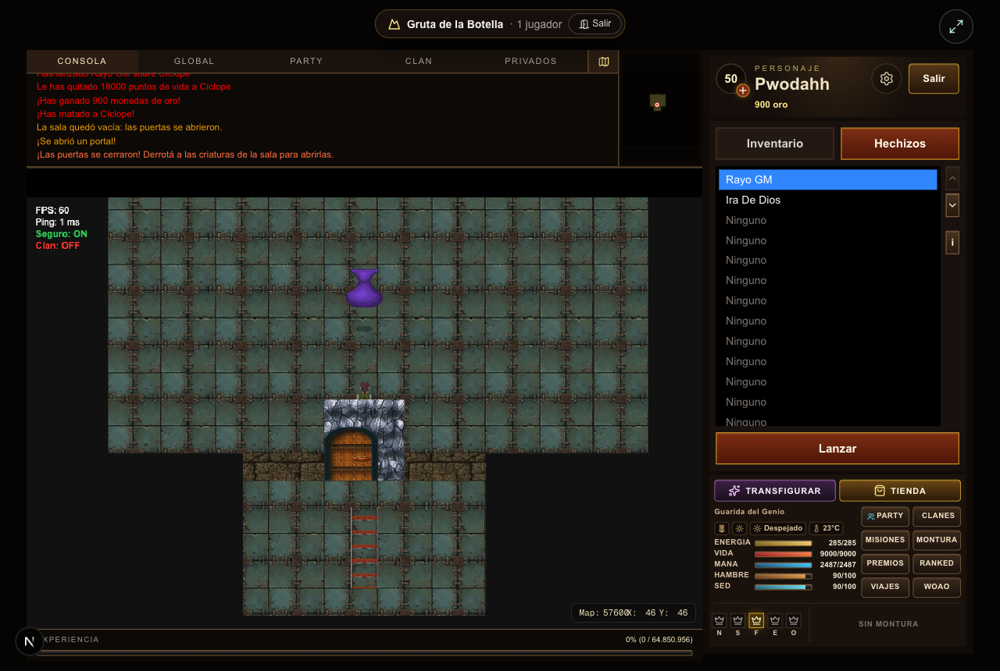 | 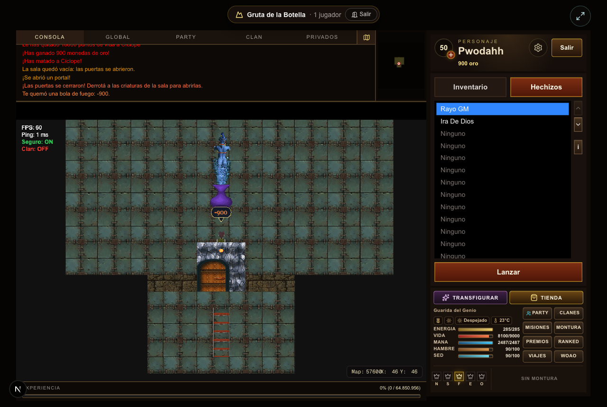 | 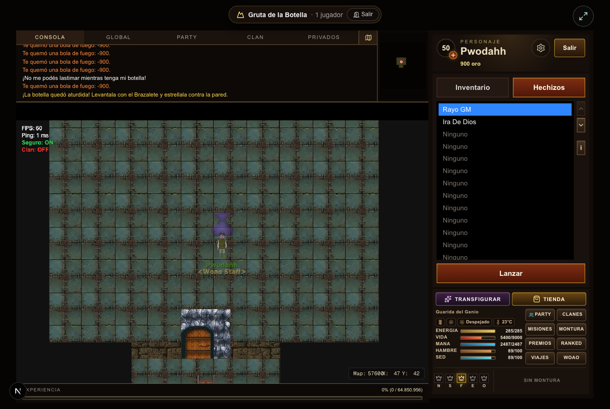 |

### Para probarlos
La prueba en vivo es `pw/run-botella-jefes.mjs`. Prueba lo siguiente:
- **El Cíclope:** la embestida que agarra y tira, la bomba al recibir un flechazo y el portal al vencerlo.
- **El Genio, fase 1:** la botella que salta, la música de combate, las bolas de fuego, la invulnerabilidad con la botella y las tres vueltas de aturdir, levantar y estrellar contra la pared.
- **El Genio, fase 2:** el rayo que le entra y el trofeo.

El recorrido completo, `pw/run-botella.mjs`, también pelea con los dos.

## 17. Santuario del Rostro: las mecánicas propias

El diseño está en [mazmorras/06-SANTUARIO_DEL_ROSTRO.md](mazmorras/06-SANTUARIO_DEL_ROSTRO.md). Como el resto, salen del original. Las nuevas están en `server/src/dungeonShrine.ts`. Lo que toca a los objetos que se levantan, a las puertas y a los cofres está en `dungeons.ts` y `dungeonTools.ts`.

| Mecánica | Cómo funciona | Plano |
|---|---|---|
| **Estatua pesada** | Se levanta solo con el Brazalete de Fuerza nivel 2; tirada, pega como la piedra pesada | `♜` |
| **Persiana** | Una puerta sin cerradura que se abre cuando le pega algo tirado con el Brazalete (una estatua o una vasija) | `[` |
| **Cofre trabado** | El de la llave del jefe: con un clic no se abre, tirándole algo sí (se lo lleva el que tiró) | `Ñ` |
| **Cabezas de caballo** | Se levantan con el nivel 1 y se tiran; no se rompen y caen paradas o acostadas (mitad y mitad), en la última baldosa libre del vuelo. Con todas las de su sala paradas, la sala se resuelve: se abren sus puertas `=` | `♞` |
| **Baldosas voladoras** | Con alguien en la sala, cada 1,1 s una se despega, sube y tiembla, y sale derecho hacia donde está el jugador más cercano (10 %; el Escudo Espejo la frena de frente). Las marcadas dejan un pozo. Rotas todas, la sala se resuelve: aparecen sus cofres (que arrancan ocultos) | `▦`, `▩` (deja pozo) |
| **Cintas transportadoras** | Cada 0,33 s corren una baldosa al que está encima (salvo en el aire) | `→ ← ↑ ↓` |
| **Lanzallamas** | Cada 2,6 s escupe una bola de fuego en línea recta hacia la sala, hasta la pared; quema (12 %) al primero que encuentra | `♨` |
| **Ojo de piedra** | Gira por las 8 direcciones; si ve a alguien en línea (hasta 8 baldosas, sin paredes), avisa con una línea fina y le tira un rayo (12 %; el Escudo Espejo lo frena) | `◉` |
| **Hechiceros** | Aparecen en la fila o la columna del jugador, tiran un rayo mágico y desaparecen. Escondidos no se los puede tocar; el golpe cuerpo a cuerpo solo los empuja; una bomba o algo tirado los mata de una | plantilla con `hechicero` |
| **Mocos escondidos** | No se ven ni ocupan baldosa hasta que alguien pasa a 2 baldosas; ahí aparecen y pelean | plantilla con `escondido` |
| **Estrellas** | Rebotan en diagonal contra las paredes y pegan al tocar | plantilla con `estrella` |

**La puerta `=`:** ahora también la abren las cabezas paradas y las baldosas rotas, además de las placas y las antorchas de la sala.

**Las criaturas escondidas** (los hechiceros entre apariciones y los mocos):
- no ocupan baldosa y el cliente no las dibuja (paquete `dungeonBoss` con `tipo: "oculto"`);
- al aparecer se presentan enteras a los que las ven, como al revivir.

| Las cabezas paradas abren la puerta | Las baldosas voladoras | El ojo de piedra y la cinta |
|---|---|---|
| 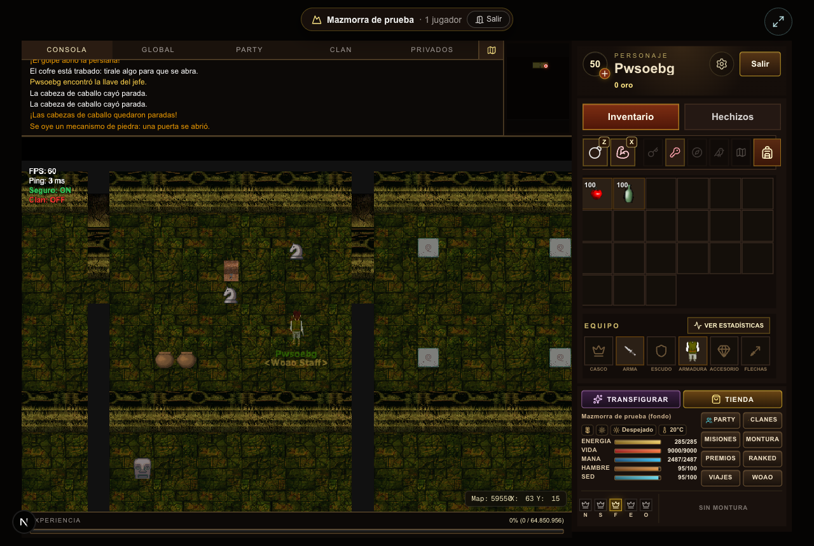 | 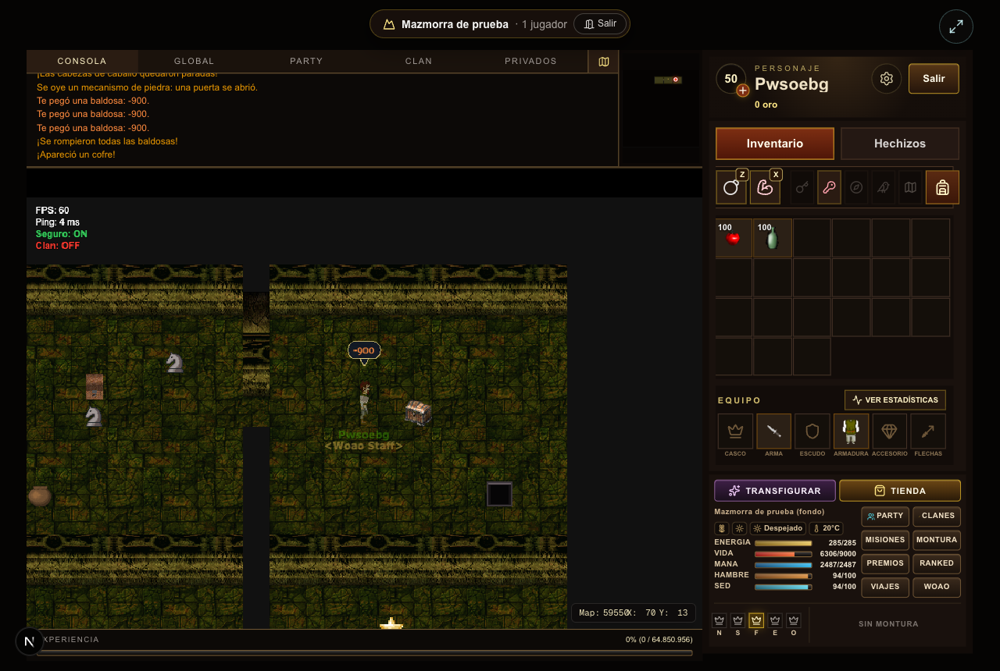 | 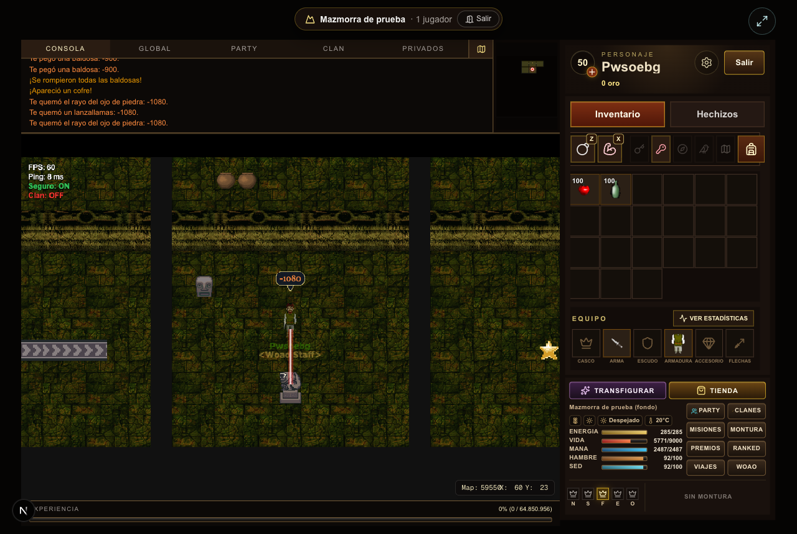 |

**Gráficos:** archivos 330013 a 330020, con la estrella como cuerpo 578. Los créditos están en [CREDITOS_GRAFICOS.md](CREDITOS_GRAFICOS.md).

### Para probarlas
En el mapa 591 de la mazmorra de prueba, a la derecha, hay seis salas sueltas (se llega con `/telepme`):
- la estatua y la persiana;
- el cofre trabado y las cabezas;
- las baldosas;
- las cintas;
- el lanzallamas y el ojo;
- las criaturas.

La prueba en vivo es `pw/run-santuario.mjs`.

## 18. Santuario del Rostro: los mapas, las criaturas y la música

El diseño está en [mazmorras/06-SANTUARIO_DEL_ROSTRO.md](mazmorras/06-SANTUARIO_DEL_ROSTRO.md). Da el **Brazalete de Fuerza nivel 2**, pide el Brazalete de Fuerza, la Pluma de Roc, las Botas de Pegaso y el Gancho, y está marcada `soloDesarrollo`. La piedra es el NPC 9725.

Los jefes (el Machacador, las Serpientes Glotonas y el Rostro de Piedra) van en el PR que sigue. Por ahora son criaturas comunes con su plantilla, su sala y su música de combate.

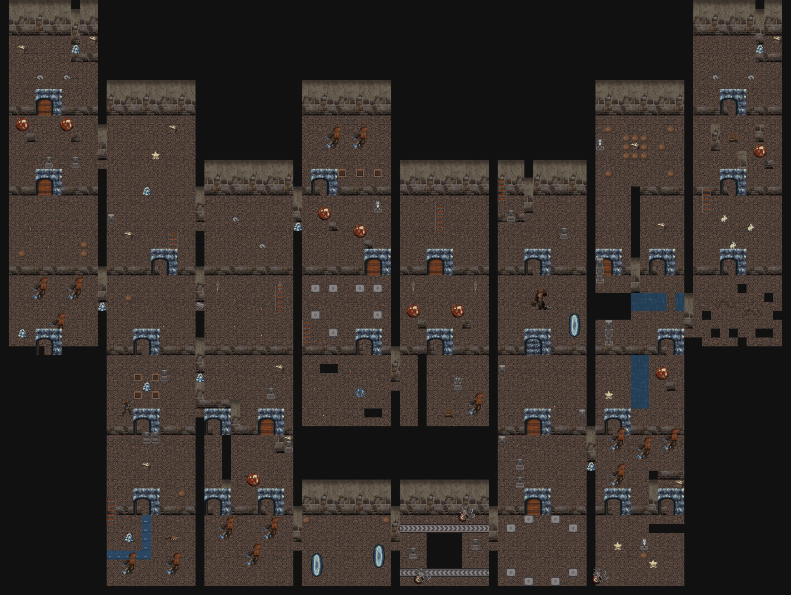

### Mapas
| Mapa | Qué tiene |
|---|---|
| 560 | El santuario: la grilla del original, 8 × 7 celdas de 11 × 9 con salas de 10 × 8 (como en Zelda), 40 salas |
| 561 | Los tres pasajes: A → B (islas cortadas por pozos de 1, con chispas), C → D (pozos de 1 y chispas) y E → F (siete aplastadores que se pasan con la Carrera) |
| 562 | La Guarida: la arena de 18 × 14 con el borde de baldosas voladoras y una vasija en cada esquina, la sala del trofeo y la llegada |

- **Gráficos:**
  - piso de baldosas hexagonales (bloque de grh 9667);
  - paredes de piedra tallada (bloque de grh 9699).
- **Compositor:** los planos salen de `scratchpad/dungeon6/componer.py`.
- **Simulador:** `scratchpad/dungeon6/simular.py` es el de la Gruta con lo del Santuario:
  - las estatuas solo con el nivel 2;
  - las cabezas y las vasijas con el Brazalete;
  - las persianas, que abre algo tirado desde su lado;
  - las baldosas que dejan pozo, que cuentan como pozo;
  - el Gancho, que tira hasta 7 baldosas por encima de pozos y agua;
  - el salto en carrera, que cruza dos pozos.

  El agua solo se cruza con `--nadar`. Confirma tres cosas:
  - se llega a todas las salas y a todos los cofres, con o sin las Patas de rana;
  - antes del Brazalete nivel 2 hay 2 cerraduras para 2 llaves;
  - desde ningún lugar, con ningún estado de los bloques, se queda uno trabado.

### Lo que cambió respecto del diseño
- **Canal:**
  - el bolsillo del poste queda detrás de tres filas de pozos, porque el salto en carrera cruza dos y nadando se llegaba igual;
  - del lado de acá hay un segundo poste para volver con el Gancho; sin él, el bolsillo y el Anillo de vasijas eran un callejón sin salida;
  - un puente sobre el agua lleva a la puerta de la K2.
- **Escalera F:** llega a los Orejudos, que se cierra, pero se ve siempre. Si no, el pasaje E → F terminaba en nada para el que venía de la Pasarela.
- **Pico y brújula:** se pueden agarrar antes del Brazalete nivel 2, porque la Pasarela queda abierta desde la Vasija del botón, como en el plano.
- **Plano:** la Escalera B no tiene puerta a los Hechiceros (se llega por el pasaje A → B), como en el original.

### Lo nuevo del motor
**`siempreVisibles` en `leyenda.json`:** las escaleras de esa lista no se esconden aunque lleguen a una sala que se cierra. Se llega por ellas y la sala se cierra hasta vaciarla. Las demás escaleras de una sala que se cierra siguen apareciendo al vaciarla.

### Criaturas
| Id | Criatura | Cuerpo |
|---|---|---|
| 9776 | Hechicero | El de AO |
| 9777 | Moco escondido | Moco chico (cuerpo 146) |
| 9778 | Estrella | La nueva (cuerpo 578) |
| 9779 | Chispa | La de la Cueva |
| 9780 | Cuchilla | La de la Cueva |
| 9781 | Gusano | Cuerpo 375 |
| 9782 | Imitador | Asesino |
| 9783 | Orejudo | El conejo (cuerpo 577) |
| 9784 | Machacador (minijefe, provisorio) | Ogro |
| 9785 | Serpiente Glotona (minijefe, provisorio) | Cuerpo 13 |
| 9786 | Rostro de Piedra (jefe, provisorio) | Cuerpo 141; el sprite de la cara va con los jefes |

Todas son atacables y hostiles, y pisan los hechizos de su base.

### Música
Son cuatro temas de Kevin MacLeod (CC-BY 4.0), igualados a −18 LUFS:
1. Temple of the Manes (arpas y flautas modales, un templo antiguo);
2. Vulcan (percusión lenta y pareja, lo más parecido al original);
3. Shamanistic (ritual e inquietante, crece hacia el final);
4. de combate, Grim Idol (oscuro, con órgano y metales, para la cara de piedra).

Los créditos están en [CREDITOS_SONIDOS.md](CREDITOS_SONIDOS.md).

### Cómo se ve
| La Entrada, con la Mochila y la música | El Brazalete de Fuerza nivel 2 | Con el nivel 2 se levanta la estatua |
|---|---|---|
| 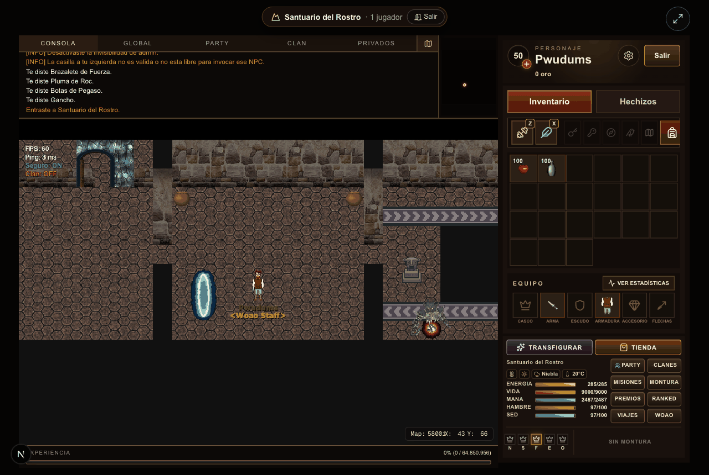 | 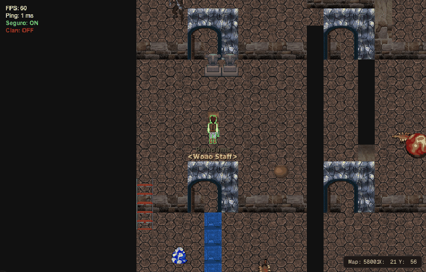 | 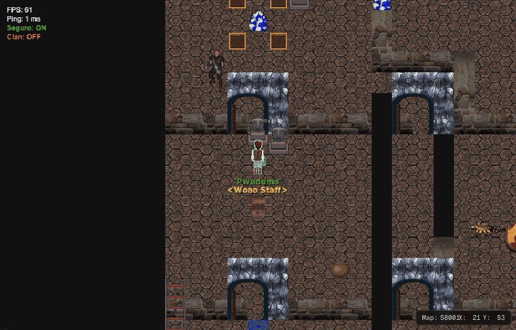 |

| Las cintas y la cuchilla | Las baldosas voladoras | El Gancho cruza los pozos del Canal |
|---|---|---|
| 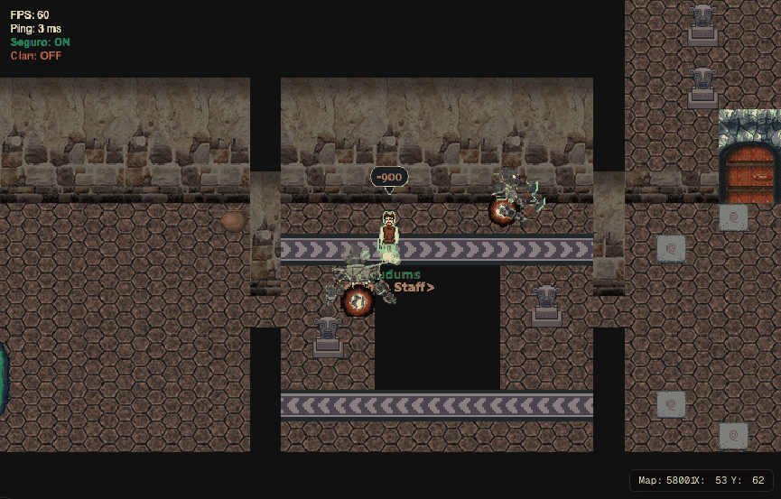 | 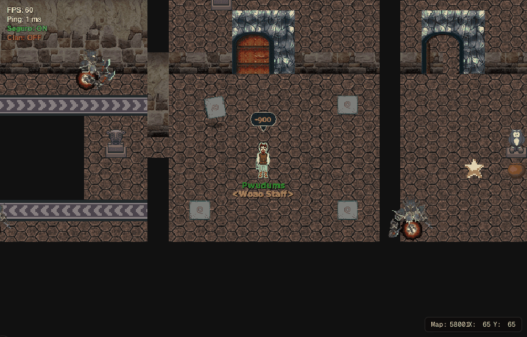 | 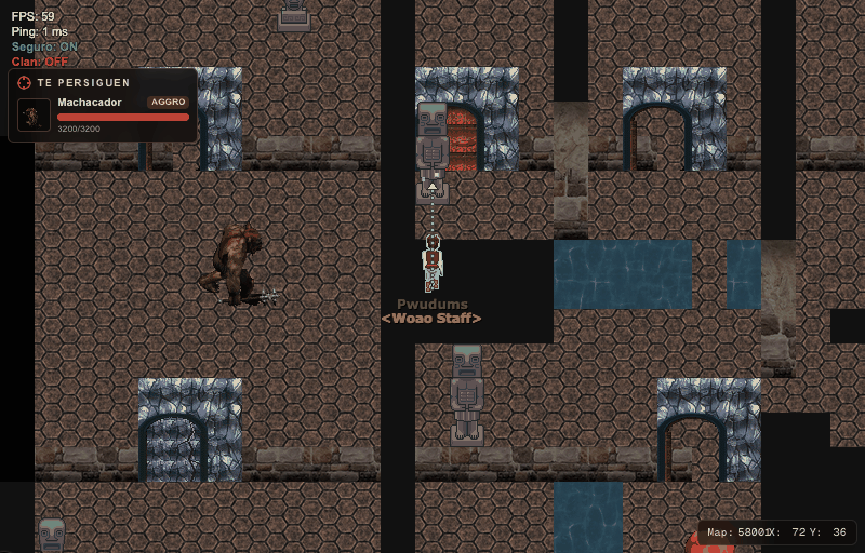 |

| El Anillo de vasijas y el cofre trabado | Los siete aplastadores del pasaje E → F | La Guarida del Rostro (jefe provisorio) |
|---|---|---|
| 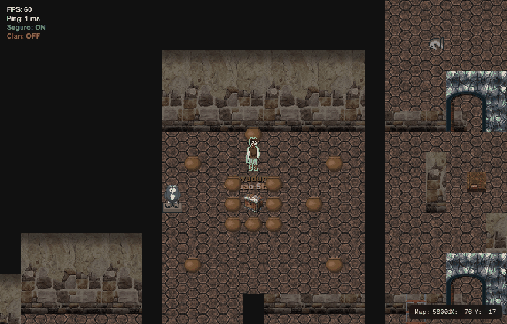 | 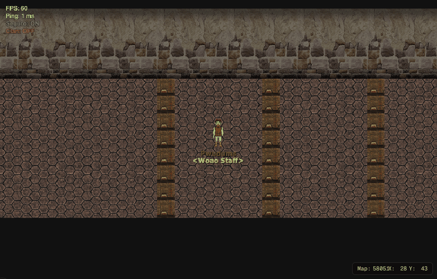 | 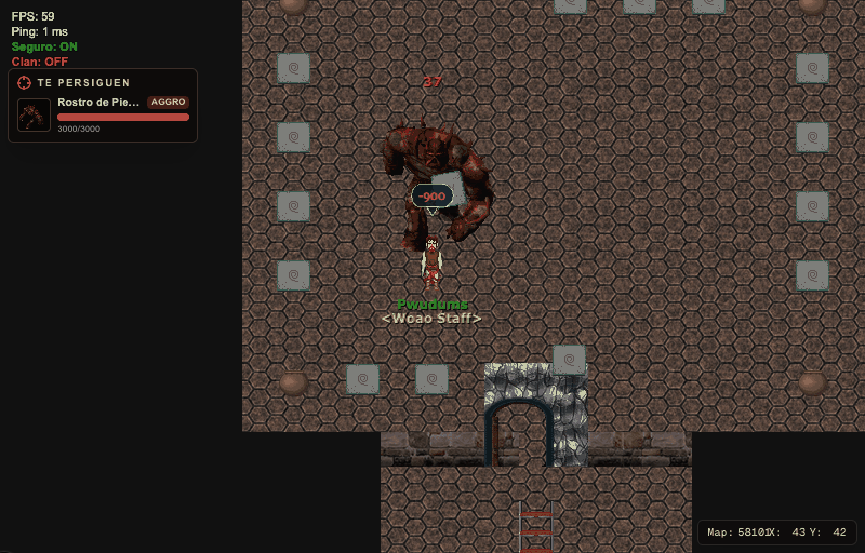 |

### Para probarla
Con un GM:
1. `/mazmorra item pulsera`, `/mazmorra item pluma`, `/mazmorra item botas_de_pegaso` y `/mazmorra item gancho`.
2. `/invocarnpc 9725`.
3. Entrar por la piedra.

La prueba en vivo es `pw/run-rostro.mjs`, con 15 controles:
- la piedra pide los ítems;
- se entra y suena la música;
- el cofre da el nivel 2, que levanta las estatuas y abre la pared giratoria;
- las cintas;
- las baldosas abren la puerta;
- el Gancho ida y vuelta en el Canal;
- el cofre trabado del Anillo;
- el pasaje de los aplastadores;
- la Guarida.

## 19. Santuario del Rostro: el Machacador, las Serpientes Glotonas y el Rostro de Piedra

Los tres salen del código del original (zladx/LADX-Disassembly) y los mueve el server (`server/src/dungeonShrineBosses.ts`, con `customMotion`). En la plantilla se marcan con `machacador`, `glotona` y `rostro`. Lo que se dibuja aparte llega por el paquete `dungeonBoss` con `tipo` (`bola`, `glotona`, `rostro` y `pozo`) y lo dibuja `engine/dungeonShrineBosses.ts`.

### El Machacador (minijefe; el Smasher, `06_smasher.asm`)
| Qué hace | Cómo |
|---|---|
| Busca la bola | Va hasta su **bola de hierro** y la levanta (0,55 s) |
| Se acerca y la tira | Da dos pasos hacia el jugador más cercano y se la tira. La bola vuela en arco hasta donde estaba (hasta 5 baldosas) y le pega al primero que encuentra (15 %, con empujón). El Escudo Espejo la frena de frente |
| Deambula | Mientras un jugador tiene la bola, camina al azar sin perseguir |
| Pisotón | Si camina contra alguien, le pega (8 %) y lo empuja |

- **La bola en el piso** es sólida. Se levanta con el **Brazalete** (alcanza el nivel 1), mirándola, y se tira hacia adonde mira el personaje.
- **Cómo se le gana:** solo lo lastima su propia bola, **4 bolazos** de un cuarto de la vida cada uno. Con cada uno retrocede y queda atontado 0,9 s, y la bola rebota.
- **Lo demás no le entra:** golpes, hechizos, flechas, bombas ni el Gancho ("Al Machacador no le entran golpes...").
- **La bola en las manos** se dibuja con lo de las herramientas, como el objeto de mazmorra 1881. No está en `objs.json`: el cliente la reconoce por ese número.

### Las Serpientes Glotonas (minijefes; las Dodongo Snakes, `05_dodongo_snake.asm`)
- **Cómo andan:** en línea recta, 2 a 4 baldosas, y siempre giran 90°. Cada cuatro giros encaran al jugador más cercano. No caen a los pozos y muerden (8 %) al que se les cruza.
- **Las bombas:**
  - Se tragan una bomba recién puesta (de menos de 1,7 s) que esté al lado de la cabeza.
  - Si la ven en su línea, a 3 baldosas o menos, van a buscarla.
  - Tragada, la bomba no explota afuera y el que la puso puede poner otra.
- **La digestión:**
  1. Quedan quietas 2,3 s.
  2. Al segundo les explota adentro y se inflan.
  3. Después eructan humo.
- **Cómo se les gana:** con la **tercera bomba** revientan. Son seis para las dos.
- **Lo demás no les entra:** los golpes, los hechizos y las explosiones de afuera.

### El Rostro de Piedra (jefe; Facade, `04_facade.asm`)
- **La cara:** está tallada en el piso de la Guarida. La criatura de AO no se ve. No se mueve y tocarla no lastima.
- **Al entrar:** a los 1,5 s aparece de a poco (2,5 s) y da la pista por el chat: «¡Eh, tonto! ¿Querés una pista? Mi punto débil es... ¡Uy! ¡Casi!».
- **Las baldosas:** tira las **20 baldosas** del borde de a parejas opuestas, girando alrededor de la cara, una cada 1,07 s. Suben, flotan y salen hacia el jugador más cercano (10 %); el Escudo Espejo las frena. Las de esta sala no salen solas, como las de las otras: las tira él.
- **Las vasijas:** después tira las **4 vasijas** de las esquinas, en cruz (15 %). Si alguien ya levantó una, la saltea.
- **Los pozos:** después abre pozos en el **anillo a dos baldosas de la cara** (16 lugares), uno cada 1,6 a 2,6 s, como mucho dos a la vez y nunca dos seguidos en el mismo lugar. Cada uno:
  1. se raja (0,65 s);
  2. se abre (0,27 s);
  3. queda abierto 0,8 s, chupando cada 0,4 s al que esté a dos baldosas o menos;
  4. se cierra solo.

  Caer saca el 10 % y te devuelve a la entrada de la sala.
- **Cómo se le gana:** solo con **bombas** que exploten a dos baldosas o menos de la cara: **5**, un quinto de la vida cada una.
- **Después de cada bomba:** se enoja, se hunde en el piso y vuelve a aparecer. Durante 4,6 s las bombas no le hacen nada ("La cara se cerró...").
- **Sin nadie en la sala:** no tira nada.
- **Al morir:** dice su última frase, cierra los pozos y se abre la sala del trofeo.

**Los sprites:**
- **La cara:** tres cabezas de "[LPC] Jungle Ruins" de bluecarrot16 (serena, con la boca abierta y enojada), en `graphics/330021.png`.
- **La bola de hierro:** dibujada para el juego, en `graphics/330022.png`.
- **Los pozos:** se dibujan con formas.

Los créditos están en [CREDITOS_GRAFICOS.md](CREDITOS_GRAFICOS.md).

| El Machacador levanta su bola | Con el Brazalete, la bola es tuya | Las Serpientes Glotonas |
|---|---|---|
| 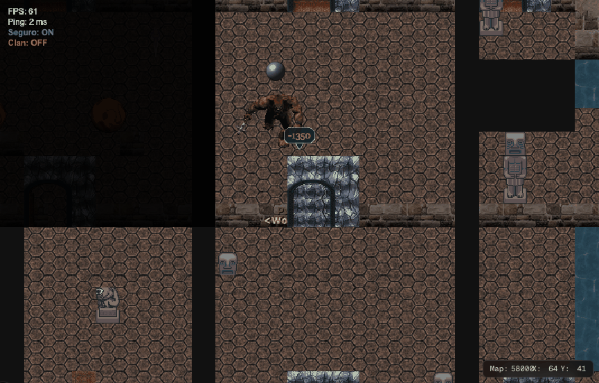 | 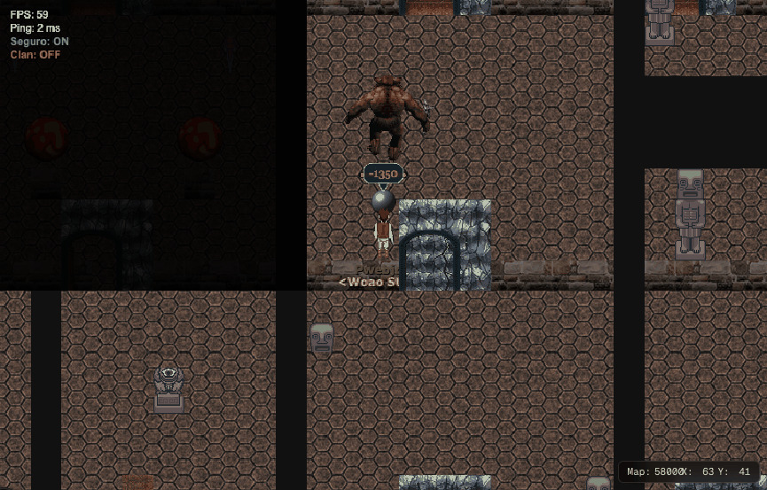 | 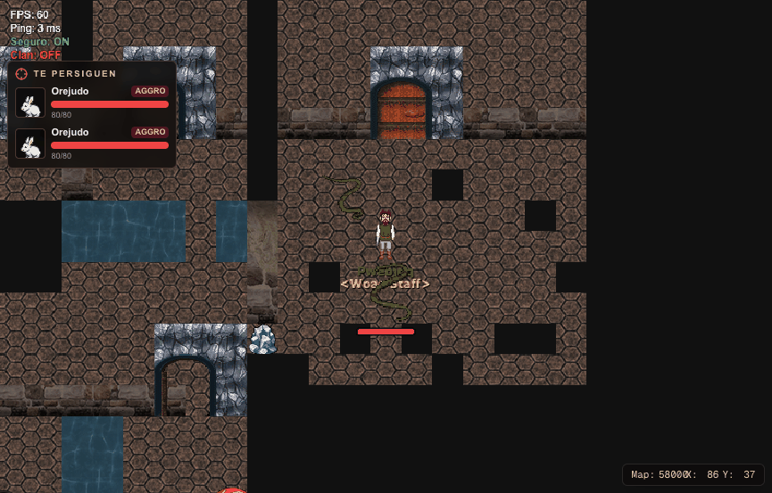 |

| El Rostro de Piedra aparece | Las baldosas del borde vuelan | Una bomba en la cara |
|---|---|---|
| 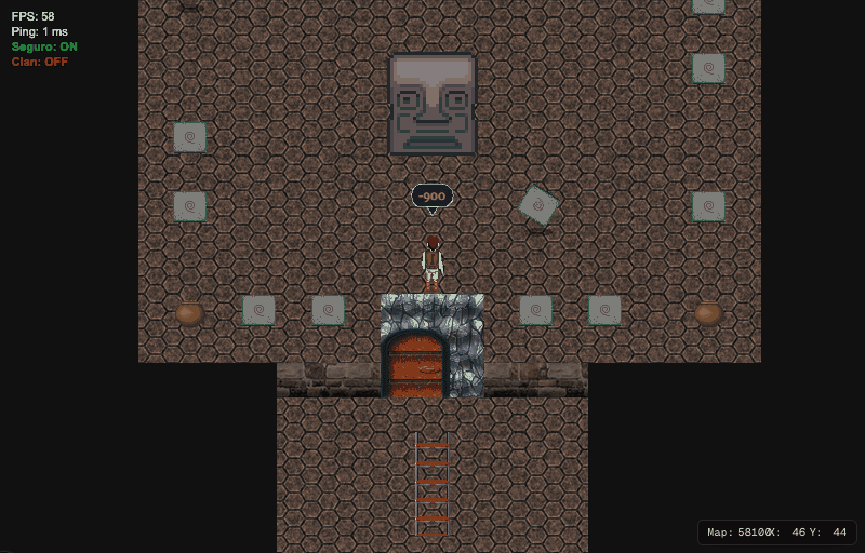 | 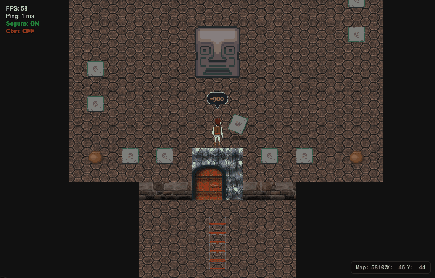 | 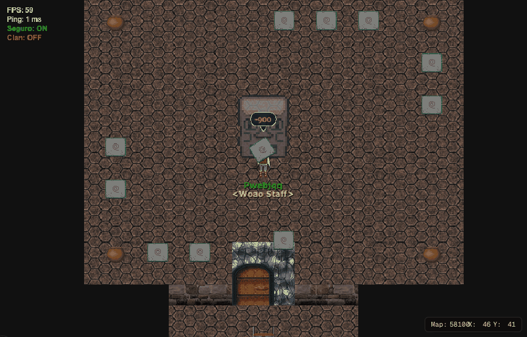 |

| Un pozo que chupa, al lado de la cara | Vencido: se abre la puerta del trofeo |
|---|---|
| 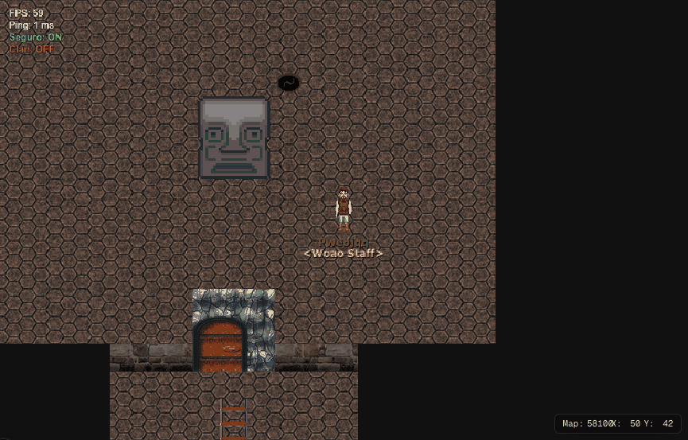 | 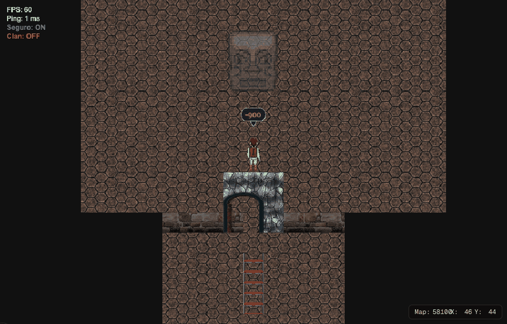 |

### Para probarlos
Con un GM:
1. `/mazmorra item pulsera`, `/mazmorra item pluma`, `/mazmorra item botas_de_pegaso` y `/mazmorra item gancho`. Para la bola del Machacador sirve también `/mazmorra item pulsera_poderosa`.
2. `/invocarnpc 9725`.
3. Entrar por la piedra.

La prueba en vivo es `pw/run-rostro-jefes.mjs` (17 controles). Pelea con los tres:
- **El Machacador:** la bola en el piso, la que tira y los bolazos con el Brazalete.
- **Las Serpientes:** los golpes no les entran y se tragan las bombas hasta reventar.
- **El Rostro de Piedra:**
  - aparece y da la pista, y la criatura de AO no se ve;
  - las baldosas;
  - los hechizos no le entran;
  - las bombas en la cara;
  - los pozos que chupan;
  - la quinta bomba y la puerta del trofeo.
