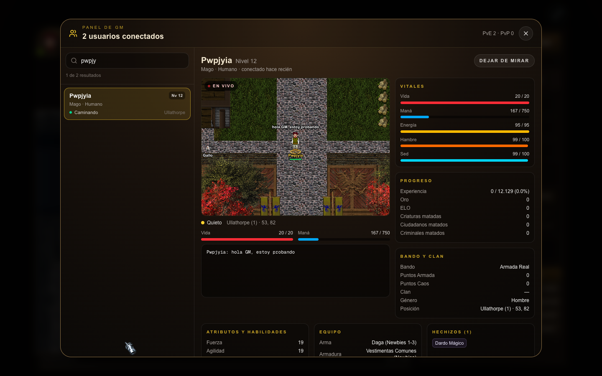
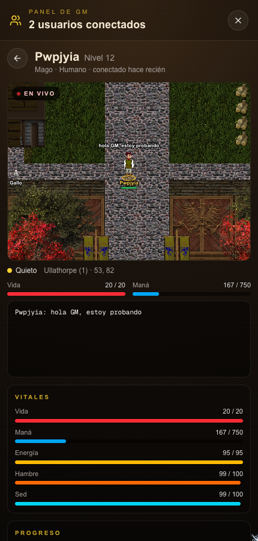

# Panel /online de los GM

Un GM (privilegio 1, como `/inspect` o `/invi`) escribe `/online` y se le abre un panel con todos los conectados. Desde ahí puede elegir a cualquiera y ver su ficha completa y, en vivo, qué está haciendo. Un jugador común que escribe `/online` sigue viendo solo la cuenta en la consola.

## Lista y buscador

- Arriba dice cuántos usuarios hay conectados (los bots de la arena y los invocados se cuentan aparte) y los contadores de PvE y PvP.
- Cada fila muestra nivel, clase, raza, clan, mapa y qué está haciendo: *Caminando*, *Peleando con Lobo*, *Meditando*, *Pescando*, *En el banco*, *Inactivo hace 5 min*, etc. También marca si es GM, bot, si está en la Arena, en un reto o en pelea PvP, o si está invisible.
- El buscador filtra por nombre, clase, raza, mapa o clan, sin importar mayúsculas ni tildes. Espera 250 ms después de la última tecla (`hooks/useDebouncedValue.ts`).
- La lista se actualiza sola cada 3 segundos mientras el panel está abierto.

## Ficha y vista en vivo

Al tocar a alguien se ve:

- **La vista en vivo**: el mapa a su alrededor, con todos los personajes y criaturas cerca, moviéndose en tiempo real. Su nombre aparece en dorado, con una marca bajo los pies. Se ven sus diálogos en globos y la vida de las criaturas lastimadas. Los techos no se dibujan, así se lo ve también adentro de las casas. Cerca de un borde se dibuja el mapa vecino, igual que en el juego.
- **Su consola en vivo**: todo lo que le llega a la consola (golpes, experiencia, mensajes del server, chat) y lo que se habla cerca.
- **La ficha**: vida, maná, energía, hambre y sed; experiencia, oro, ELO y muertes; bando, clan y posición; atributos y habilidades; equipo puesto, estados (paralizado, envenenado…), hechizos e inventario. Se actualiza cada segundo.

Si el jugador se desconecta, la vista lo avisa. En el celular, la lista y la ficha se ven por separado, con una flecha para volver.

## Cómo funciona

- `server/src/gmOnline.ts` guarda qué GM tiene el panel abierto y a quién mira. Un solo intervalo (200 ms, activo solo mientras algún GM tiene el panel abierto) le manda a cada uno:
  - la lista, cada 3 s;
  - la ficha, cada 1 s;
  - un cuadro cada 200 ms, con lo que rodea al personaje (10 × 8 baldosas para cada lado), los objetos del piso, los mapas vecinos con su ubicación y las líneas nuevas de su consola.
- `server/src/gmSpectateFeed.ts` guarda la consola de los personajes observados. `handleProtocol.console` y `handleProtocol.dialog` le pasan cada línea que le llega al personaje. Si nadie lo mira, no se guarda nada.
- Todo viaja en el paquete `gmOnline` (106), en JSON troceado como el de estadísticas.
- Lo que el GM hace en el panel vuelve al server como comandos de chat: `/onlinever <id>`, `/onlinedejar` y `/onlinecerrar`. Están en `UI_PANEL_COMMANDS` de `protocol.ts`, así no los frena el antispam del chat.
- En el cliente, `lib/gmOnline.ts` guarda los datos fuera del HUD, porque los cuadros llegan 5 veces por segundo y redibujarían todo el juego. Solo los lee `GmOnlineModal`.
- `GmLiveView` dibuja en un canvas 2D con los gráficos del juego y las mismas reglas de ubicación que `characterLayout.ts` y `sceneRenderer.ts`. Entre un cuadro y el siguiente interpola las posiciones para que se vea fluido.
