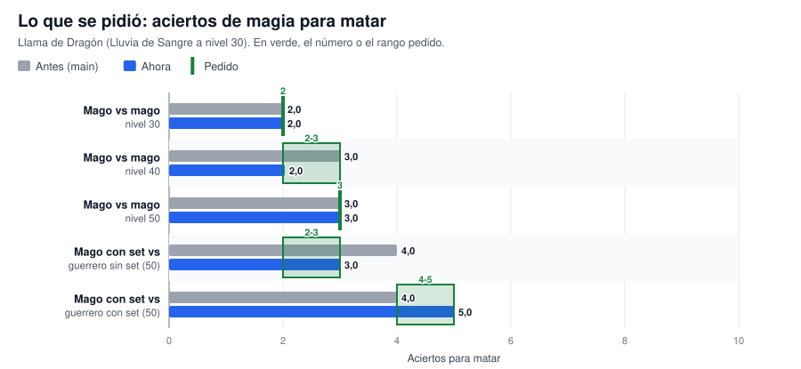
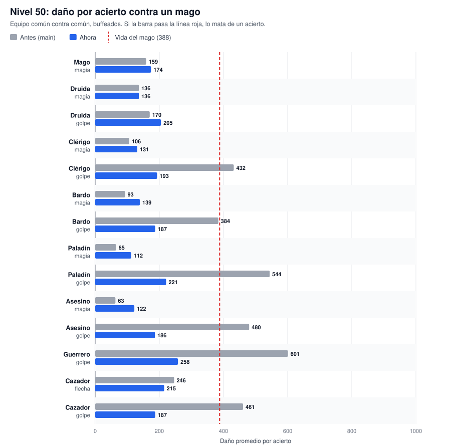
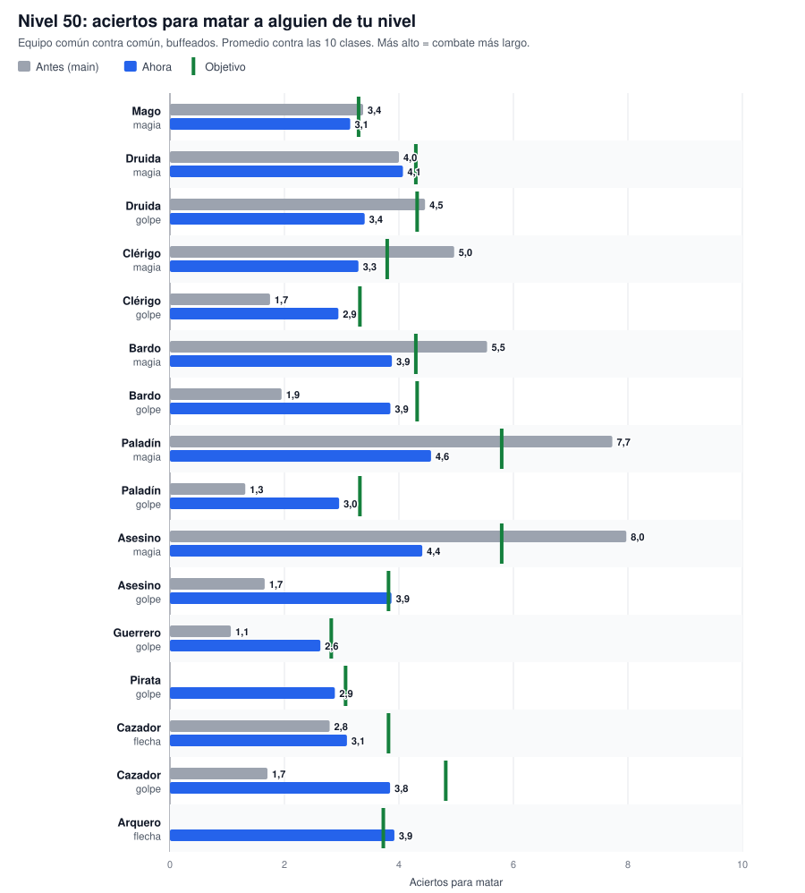
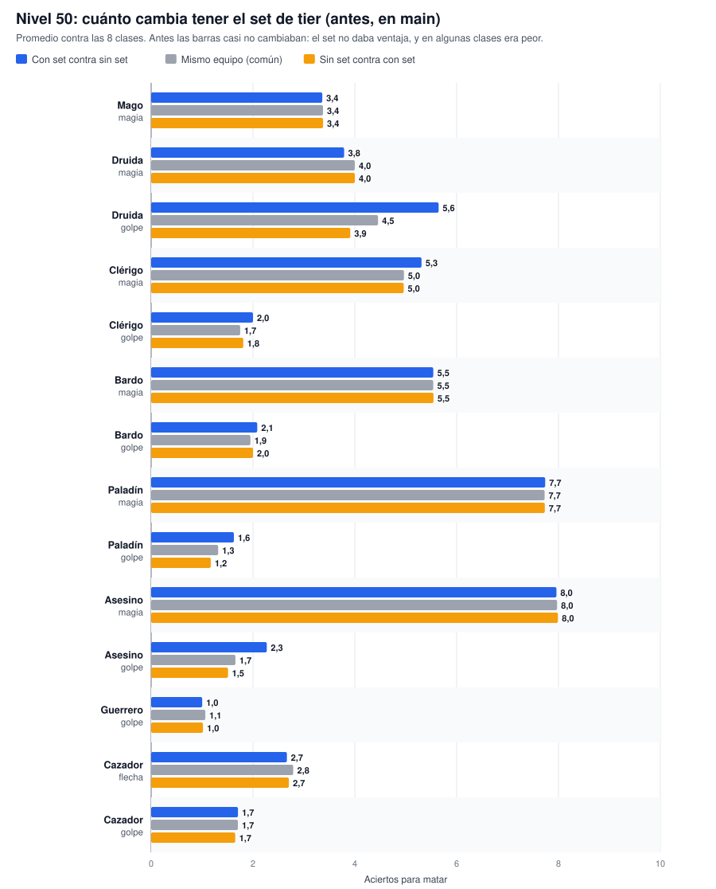
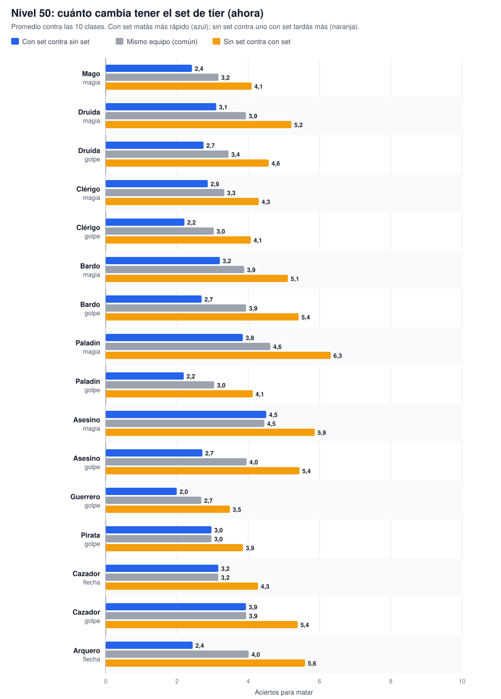

# Nivelación PvP por clase: cómo queda con los ítems

Guía para leer rápido el balance de [BALANCE_PVP.md](BALANCE_PVP.md): qué ítems usa cada clase, cuánta vida y maná tiene, cuánto pega y en cuántos aciertos mata a alguien de su nivel, **antes** (en `main`) y **ahora** (con este cambio). Todos los números salen del simulador, que usa el motor real del server y que se comparó contra el juego en vivo.

## Cómo leer los números

- **Acierto**: un golpe, flecha o hechizo que entra. Los golpes fallados no cuentan (al lado del daño figura la chance de acertar).
- **Aciertos para matar**: cuántos aciertos seguidos hacen falta para bajar toda la vida del otro, sin que se cure. Es un promedio: 2,5 quiere decir que la mitad de las veces son 2 y la otra mitad 3.
- **`antes → ahora (objetivo)`**: lo que pasaba en `main`, lo que pasa ahora y lo que se busca. ⚠ marca cuando ahora queda a más de medio acierto del objetivo.
- **Equipo común**: lo mejor que se consigue sin premios (crafteo, drops, misiones o comerciantes).
- **Set**: el set de tier de la clase (Arcano, Silvestre, Templario, Paladín, Bardo, Verdugo, Silvano y Umbral; ítems 1749 a 1780). Donde el set no tiene pieza se usa la mejor común. El cazador y el pirata no tienen set: para ellos "con set" es su equipo común. Las piezas de set son **siempre Legendarias**: +3 al golpe o a la defensa y +6 al daño mágico, y no se caen al morir. Las stats de las tablas son las del ítem sin la rareza.
- Todos pelean **buffeados** (fuerza y agilidad al doble, como en cualquier pelea), con raza humana y los skills al tope del nivel.
- \* Los ítems con "+maná" antes **no sumaban maná** (bug). Ahora sí.
- ² Las clases físicas no tienen anillo útil: el Anillo de Magia (#1242) no tiene efecto en combate y el Anillo de Resistencia Mágica (#988) no se consigue por ninguna vía.

## Lo pedido, en un gráfico



## Cuánto pega cada clase a nivel 50

La línea roja es la vida de un mago nivel 50 (388). Antes lo mataban de un solo acierto: clérigo (golpe), paladín (golpe), asesino (golpe), guerrero (golpe), cazador (golpe). Ahora, ninguno.



## En cuántos aciertos mata cada clase a alguien de su nivel



Los mismos gráficos para [nivel 30](graficos/aciertos-nivel-30.svg) y [nivel 40](graficos/aciertos-nivel-40.svg).

## Qué da el set

Bonos del set (`server/jsons/sets.json`, por piezas distintas equipadas): **2 piezas:** +10 % de vida máxima; **4 piezas:** +20 % de vida máxima y +25 % de daño contra jugadores. El daño es físico o mágico, según con qué pegue la clase, y solo cuenta contra jugadores. Se aplica el escalón más alto alcanzado, sin acumular. La idea es que **el set valga más o menos un acierto a nivel 50**: con set matás un poco más rápido y aguantás un poco más.

Antes las tres barras de cada clase casi no cambiaban, porque el set no daba ventaja. Ahora se separan:





## Combo golpe + magia contra un mago

Chance de matar a un mago con un golpe cuerpo a cuerpo y enseguida una magia, los dos con el mismo equipo. Si el golpe falla, el combo no mata.

| Clase | Nivel 30 común | Nivel 30 con set | Nivel 40 común | Nivel 40 con set | Nivel 50 común | Nivel 50 con set |
|---|---:|---:|---:|---:|---:|---:|
| Druida | 89 % | 86 % | 37 % | 5 % | 0 % | 0 % |
| Clérigo | 95 % | 96 % | 95 % | 95 % | 73 % | 80 % |
| Bardo | 92 % | 94 % | 9 % | 16 % | 0 % | 0 % |
| Paladín | 95 % | 95 % | 4 % | 39 % | 0 % | 0 % |
| Asesino | 75 % | 59 % | 0 % | 0 % | 0 % | 0 % |

## Todas las clases a nivel 50, en una tabla

Equipo común contra común.

| Clase | Daño a un mago por acierto | Aciertos para matar a un mago | a un guerrero | a su misma clase |
|---|---|---|---|---|
| Mago (magia) | 159 → **174** | 3,0 → **3,0** (3,0) | 4,0 → **4,0** (4,0) | 3,0 → **3,0** (3,0) |
| Druida (magia) | 136 → **136** | 3,0 → **3,0** (4,0) ⚠ | 5,0 → **5,0** (5,0) | 4,0 → **4,0** (4,0) |
| Druida (golpe) | 170 → **205** (acierta 95 %) | 3,0 → **2,0** (3,5) ⚠ | 5,5 → **4,2** (5,0) ⚠ | 3,0 → **3,0** (4,0) ⚠ |
| Clérigo (golpe) | 432 → **223** (acierta 96 %) | 1,0 → **2,0** (2,5) | 2,0 → **3,9** (4,0) | 1,9 → **3,0** (3,5) |
| Clérigo (magia) | 106 → **170** | 4,0 → **3,0** (3,5) | 6,0 → **4,0** (4,5) | 4,9 → **3,0** (3,5) |
| Bardo (magia) | 93 → **139** | 5,0 → **3,0** (4,0) ⚠ | 7,0 → **5,0** (5,0) | 5,0 → **4,0** (4,0) |
| Bardo (golpe) | 384 → **186** (acierta 95 %) | 1,6 → **3,0** (3,5) ⚠ | 2,0 → **4,8** (5,0) | 2,0 → **3,9** (4,0) |
| Paladín (golpe) | 544 → **221** (acierta 95 %) | 1,0 → **2,0** (2,5) | 1,9 → **3,9** (4,0) | 1,8 → **3,7** (4,0) |
| Paladín (magia) | 65 → **112** | 6,4 → **4,0** (5,5) ⚠ | 9,9 → **6,0** (6,5) | 8,3 → **5,0** (6,0) ⚠ |
| Asesino (golpe) | 480 → **186** (acierta 95 %) | 1,0 → **3,0** (3,0) | 2,0 → **4,8** (4,5) | 1,9 → **4,0** (3,5) |
| Asesino (magia) | 63 → **122** | 6,7 → **4,0** (5,5) ⚠ | 10,1 → **5,5** (6,5) ⚠ | 7,8 → **4,0** (6,0) ⚠ |
| Guerrero (golpe) | 601 → **258** (acierta 95 %) | 1,0 → **2,0** (2,0) | 1,5 → **3,0** (3,5) | 1,5 → **3,0** (3,5) |
| Cazador (flecha) | 246 → **215** (acierta 96 %) | 2,0 → **2,0** (3,0) ⚠ | 3,4 → **4,0** (4,5) ⚠ | 3,0 → **3,9** (4,0) |
| Cazador (golpe) | 461 → **187** (acierta 95 %) | 1,0 → **3,0** (4,0) ⚠ | 2,0 → **4,7** (5,5) ⚠ | 2,0 → **4,6** (5,0) |

## Clase por clase

### Mago

*El que más daño hace con magia. Nada de daño físico.*

Set de tier: **Set Arcano**.

**Equipo**

| Lugar | Equipo común | Set de tier |
|---|---|---|
| Arma | **Báculo Mago (+300 Mana +28DM)** (golpe 8-12, +28 daño mágico, +300 maná*) · #753 | **Báculo Arcano** (golpe 4-7, +39 daño mágico) · #1750 |
| Armadura o túnica | **Túnica Lujosa Azul +300Maná (Alto/as)** (defensa 2-4, +300 maná*) · #732 | **Túnica Arcana** (defensa 23-35, +300 maná*) · #1752 |
| Casco | **Sombrero Hechizado (+20 DM)** (defensa 2-6, +20 daño mágico) · #1223 | **Corona Arcana** (defensa 23-29, +32 daño mágico) · #1749 |
| Escudo | — | **Escudo Arcano** (defensa 5-14, +28 daño mágico) · #1751 |
| Anillo | **Anillo de Energía (+20 DM)** (+20 daño mágico) · #1221 | **Anillo de Energía (+20 DM)** (+20 daño mágico) · #1221 |

**Vida, maná y hechizo**

| Nivel | Vida | Vida con set | Maná antes → ahora | Hechizo principal |
|---|---:|---:|---|---|
| 30 | 238 | 286 | 1533 → 2133 | LLuvia de Sangre (55-60 base, 1050 de maná: 2 con el maná lleno) |
| 40 | 313 | 376 | 2010 → 2610 | Llama de Dragon (60-65 base, 1000 de maná: 2 con el maná lleno) |
| 50 | 388 | 466 | 2487 → 3087 | Llama de Dragon (60-65 base, 1000 de maná: 3 con el maná lleno) |

**Aciertos para matar con magia** (equipo común contra común)

| Nivel | Daño a un mago | Contra mago | Contra guerrero |
|---|---|---|---|
| 30 | 126 → **138** | 2,0 → **2,0** (2,0) | 3,1 → **3,0** (3,0) |
| 40 | 146 → **161** | 3,0 → **2,0** (2,5) | 4,0 → **4,0** (3,5) |
| 50 | 159 → **174** | 3,0 → **3,0** (3,0) | 4,0 → **4,0** (4,0) |

**Con set a nivel 50** (magia)

| Situación | Contra un mago | Contra un guerrero |
|---|---|---|
| Los dos con equipo común | 3,0 → **3,0** (3,0) | 4,0 → **4,0** (4,0) |
| Vos con set, el otro sin set | 3,0 → **2,0** (2,3) | 4,0 → **3,0** (3,0) |
| Vos sin set, el otro con set | 3,0 → **3,0** (3,9) ⚠ | 4,0 → **6,0** (5,2) ⚠ |
| Los dos con set | 3,0 → **2,5** (3,0) | 4,0 → **5,0** (4,0) ⚠ |

### Druida

*Menos magia que el mago y un arma que sirva.*

Set de tier: **Set Silvestre**.

**Equipo**

| Lugar | Equipo común | Set de tier |
|---|---|---|
| Arma (para la magia) | **Báculo de la Naturaleza (+28 DM)** (golpe 8-10, +28 daño mágico) · #1225 | **Báculo Silvestre** (golpe 9-15, +37 daño mágico) · #1754 |
| Arma (para pegar) | **Estandarte Real** (golpe 15-18) · #1018 | **Báculo Silvestre** (golpe 9-15, +37 daño mágico) · #1754 |
| Armadura o túnica | **Túnica Legendaria +55Maná (Alto/as)** (defensa 10-13, +55 maná*) · #519 | **Túnica Silvestre** (defensa 23-35, +200 maná*) · #1756 |
| Casco | **Sombrero Hechizado (+20 DM)** (defensa 2-6, +20 daño mágico) · #1223 | **Corona Silvestre** (defensa 23-29, +32 daño mágico) · #1753 |
| Escudo | — | **Escudo Silvestre** (defensa 5-14, +28 daño mágico) · #1755 |
| Anillo | **Anillo de Energía (+20 DM)** (+20 daño mágico) · #1221 | **Anillo de Energía (+20 DM)** (+20 daño mágico) · #1221 |

**Vida, maná y hechizo**

| Nivel | Vida | Vida con set | Maná antes → ahora | Hechizo principal |
|---|---:|---:|---|---|
| 30 | 252 | 302 | 1089 → 1144 | Incinerar (58-63 base, 1050 de maná: 1 con el maná lleno) |
| 40 | 332 | 398 | 1449 → 1504 | Incinerar (58-63 base, 1050 de maná: 1 con el maná lleno) |
| 50 | 412 | 494 | 1809 → 1864 | Incinerar (58-63 base, 1050 de maná: 1 con el maná lleno) |

**Aciertos para matar con magia** (equipo común contra común)

| Nivel | Daño a un mago | Contra mago | Contra guerrero | Contra druida |
|---|---|---|---|---|
| 30 | 114 → **114** | 3,0 → **3,0** (3,0) | 4,0 → **4,0** (4,0) | 3,0 → **3,0** (3,0) |
| 40 | 125 → **125** | 3,0 → **3,0** (3,5) | 4,1 → **4,1** (4,5) | 3,0 → **3,0** (3,5) |
| 50 | 136 → **136** | 3,0 → **3,0** (4,0) ⚠ | 5,0 → **5,0** (5,0) | 4,0 → **4,0** (4,0) |

**Aciertos para matar con golpe** (equipo común contra común)

| Nivel | Daño a un mago | Contra mago | Contra guerrero | Contra druida |
|---|---|---|---|---|
| 30 | 140 → **169** (acierta 88 %) | 2,0 → **2,0** (2,5) | 4,6 → **3,7** (4,0) | 2,0 → **2,0** (3,0) ⚠ |
| 40 | 155 → **187** (acierta 95 %) | 2,7 → **2,0** (3,0) ⚠ | 5,2 → **3,9** (4,5) ⚠ | 3,0 → **2,0** (3,5) ⚠ |
| 50 | 170 → **205** (acierta 95 %) | 3,0 → **2,0** (3,5) ⚠ | 5,5 → **4,2** (5,0) ⚠ | 3,0 → **3,0** (4,0) ⚠ |

**Con set a nivel 50** (magia)

| Situación | Contra un mago | Contra un guerrero |
|---|---|---|
| Los dos con equipo común | 3,0 → **3,0** (4,0) ⚠ | 5,0 → **5,0** (5,0) |
| Vos con set, el otro sin set | 3,0 → **3,0** (3,0) | 5,0 → **4,0** (3,8) |
| Vos sin set, el otro con set | 3,0 → **4,0** (5,2) ⚠ | 5,0 → **8,0** (6,5) ⚠ |
| Los dos con set | 3,0 → **3,0** (4,0) ⚠ | 5,0 → **6,0** (5,0) ⚠ |

### Clérigo

*Como el druida, pero puede usar más armas: pega más cuerpo a cuerpo que con magia. Con set mata a un mago con set con un combo (golpe + magia) la mayoría de las veces.*

Set de tier: **Set Templario**.

**Equipo**

| Lugar | Equipo común | Set de tier |
|---|---|---|
| Arma (para pegar) | **Espada MataDragones** (golpe 35-48) · #402 | **Espada Templaria** (golpe 39-52, +2 Fuerza) · #1758 |
| Arma (para la magia) | **Báculo de Sagrado (24-30)** (golpe 20-22, +10 daño mágico) · #841 | **Espada Templaria** (golpe 39-52, +2 Fuerza) · #1758 |
| Armadura o túnica | **Placas Doradas +5F (Alto/as)** (defensa 50-70, +5 Fuerza) · #729 | **Armadura Templaria** (defensa 60-83, resistencia mágica 7, +3 Fuerza) · #1760 |
| Casco | **Casco Centurión(10-14)** (defensa 10-14) · #832 | **Yelmo Templario** (defensa 25-35, resistencia mágica 7, +2 Agilidad) · #1757 |
| Escudo | **Escudo Teutón +2Fu/+2Ag** (defensa 20-22, +2 Fuerza +2 Agilidad) · #1230 | **Escudo Templario** (defensa 25-35, resistencia mágica 7, +2 Fuerza) · #1759 |
| Anillo | — (no hay anillo útil para esta clase²) | — (no hay anillo útil para esta clase²) |

**Vida, maná y hechizo**

| Nivel | Vida | Vida con set | Maná antes → ahora | Hechizo principal |
|---|---:|---:|---|---|
| 30 | 252 | 302 | 1089 → 1089 | Ventisca (55-60 base, 1050 de maná: 1 con el maná lleno) |
| 40 | 332 | 398 | 1449 → 1449 | Ventisca (55-60 base, 1050 de maná: 1 con el maná lleno) |
| 50 | 412 | 494 | 1809 → 1809 | Purificar (58-63 base, 1500 de maná: 1 con el maná lleno) |

**Aciertos para matar con golpe** (equipo común contra común)

| Nivel | Daño a un mago | Contra mago | Contra guerrero | Contra clérigo |
|---|---|---|---|---|
| 30 | 398 → **203** (acierta 95 %) | 1,0 → **2,0** (2,0) | 1,4 → **2,8** (3,0) | 1,0 → **2,4** (2,5) |
| 40 | 415 → **213** (acierta 95 %) | 1,0 → **2,0** (2,0) | 2,0 → **3,3** (3,5) | 1,3 → **2,8** (3,0) |
| 50 | 432 → **223** (acierta 96 %) | 1,0 → **2,0** (2,5) | 2,0 → **3,9** (4,0) | 1,9 → **3,0** (3,5) |

**Aciertos para matar con magia** (equipo común contra común)

| Nivel | Daño a un mago | Contra mago | Contra guerrero | Contra clérigo |
|---|---|---|---|---|
| 30 | 81 → **130** | 3,1 → **2,0** (2,5) | 5,0 → **3,0** (3,5) | 4,0 → **2,5** (2,5) |
| 40 | 91 → **147** | 4,0 → **3,0** (3,0) | 6,0 → **4,0** (4,0) | 4,0 → **3,0** (3,0) |
| 50 | 106 → **170** | 4,0 → **3,0** (3,5) | 6,0 → **4,0** (4,5) | 4,9 → **3,0** (3,5) |

**Con set a nivel 50** (golpe)

| Situación | Contra un mago | Contra un guerrero |
|---|---|---|
| Los dos con equipo común | 1,0 → **2,0** (2,5) | 2,0 → **3,9** (4,0) |
| Vos con set, el otro sin set | 2,0 → **2,0** (1,9) | 2,0 → **2,8** (3,0) |
| Vos sin set, el otro con set | 1,0 → **3,0** (3,3) | 2,0 → **5,7** (5,2) |
| Los dos con set | 2,0 → **2,0** (2,5) | 2,0 → **3,6** (4,0) |

### Bardo

*Mixto: un poco de magia y un poco de arma (identidad a confirmar).*

Set de tier: **Set Bardo**.

**Equipo**

| Lugar | Equipo común | Set de tier |
|---|---|---|
| Arma (para la magia) | **Espada MataDragones** (golpe 35-48) · #402 | **Daga Bardo** (golpe 37-51) · #1766 |
| Arma (para pegar) | **Espada MataDragones** (golpe 35-48) · #402 | **Daga Bardo** (golpe 37-51) · #1766 |
| Armadura o túnica | **Placas Azules +3F (Alto/as)** (defensa 40-55, +3 Fuerza) · #705 | **Armadura Bardo** (defensa 51-69, resistencia mágica 7, +3 Fuerza) · #1768 |
| Casco | **Casco De Oro (8-14)** (defensa 8-14) · #132 | **Yelmo Bardo** (defensa 28-37, resistencia mágica 7) · #1765 |
| Escudo | **Escudo Bizantino (12-20)** (defensa 12-20) · #826 | **Escudo Bardo** (defensa 25-35, resistencia mágica 7, +2 Agilidad) · #1767 |
| Anillo | — (no hay anillo útil para esta clase²) | — (no hay anillo útil para esta clase²) |

**Vida, maná y hechizo**

| Nivel | Vida | Vida con set | Maná antes → ahora | Hechizo principal |
|---|---:|---:|---|---|
| 30 | 267 | 320 | 1089 → 1089 | Apocalipsis (50-55 base, 950 de maná: 1 con el maná lleno) |
| 40 | 352 | 422 | 1449 → 1449 | Apocalipsis (50-55 base, 950 de maná: 1 con el maná lleno) |
| 50 | 437 | 524 | 1809 → 1809 | Apocalipsis (50-55 base, 950 de maná: 1 con el maná lleno) |

**Aciertos para matar con magia** (equipo común contra común)

| Nivel | Daño a un mago | Contra mago | Contra guerrero | Contra bardo |
|---|---|---|---|---|
| 30 | 74 → **111** | 4,0 → **3,0** (3,0) | 5,5 → **4,0** (4,0) | 4,0 → **3,0** (3,0) |
| 40 | 83 → **125** | 4,0 → **3,0** (3,5) | 6,1 → **4,1** (4,5) | 5,0 → **3,0** (3,5) |
| 50 | 93 → **139** | 5,0 → **3,0** (4,0) ⚠ | 7,0 → **5,0** (5,0) | 5,0 → **4,0** (4,0) |

**Aciertos para matar con golpe** (equipo común contra común)

| Nivel | Daño a un mago | Contra mago | Contra guerrero | Contra bardo |
|---|---|---|---|---|
| 30 | 353 → **170** (acierta 92 %) | 1,0 → **2,0** (2,5) | 1,9 → **3,6** (4,0) | 1,0 → **2,8** (3,0) |
| 40 | 368 → **178** (acierta 95 %) | 1,0 → **2,0** (3,0) ⚠ | 2,0 → **4,2** (4,5) | 1,9 → **3,3** (3,5) |
| 50 | 384 → **186** (acierta 95 %) | 1,6 → **3,0** (3,5) ⚠ | 2,0 → **4,8** (5,0) | 2,0 → **3,9** (4,0) |

**Con set a nivel 50** (magia)

| Situación | Contra un mago | Contra un guerrero |
|---|---|---|
| Los dos con equipo común | 5,0 → **3,0** (4,0) ⚠ | 7,0 → **5,0** (5,0) |
| Vos con set, el otro sin set | 5,0 → **3,0** (3,0) | 7,0 → **4,0** (3,8) |
| Vos sin set, el otro con set | 5,0 → **4,0** (5,2) ⚠ | 7,0 → **7,8** (6,5) ⚠ |
| Los dos con set | 5,0 → **3,0** (4,0) ⚠ | 7,0 → **6,0** (5,0) ⚠ |

### Paladín

*Mucho cuerpo a cuerpo, poca magia.*

Set de tier: **Set Paladín**.

**Equipo**

| Lugar | Equipo común | Set de tier |
|---|---|---|
| Arma (para pegar) | **Espada MataDragones** (golpe 35-48) · #402 | **Espada Paladín** (golpe 40-54, +2 Fuerza) · #1762 |
| Arma (para la magia) | **Espada MataDragones** (golpe 35-48) · #402 | **Espada Paladín** (golpe 40-54, +2 Fuerza) · #1762 |
| Armadura o túnica | **Placas Doradas +5F (Alto/as)** (defensa 50-70, +5 Fuerza) · #729 | **Armadura Paladín** (defensa 60-83, resistencia mágica 7, +5 Fuerza) · #1764 |
| Casco | **Casco Centurión(10-14)** (defensa 10-14) · #832 | **Yelmo Paladín** (defensa 25-35, resistencia mágica 7, +200 maná*) · #1761 |
| Escudo | **Escudo Teutón +2Fu/+2Ag** (defensa 20-22, +2 Fuerza +2 Agilidad) · #1230 | **Escudo Paladín** (defensa 25-35, resistencia mágica 7, +2 Fuerza) · #1763 |
| Anillo | — (no hay anillo útil para esta clase²) | — (no hay anillo útil para esta clase²) |

**Vida, maná y hechizo**

| Nivel | Vida | Vida con set | Maná antes → ahora | Hechizo principal |
|---|---:|---:|---|---|
| 30 | 296 | 355 | 567 → 767 | Descarga electrica (38-50 base, 350 de maná: 2 con el maná lleno) |
| 40 | 391 | 469 | 747 → 947 | Descarga electrica (38-50 base, 350 de maná: 2 con el maná lleno) |
| 50 | 486 | 583 | 927 → 1127 | Apocalipsis (50-55 base, 950 de maná: 1 con el maná lleno) |

**Aciertos para matar con golpe** (equipo común contra común)

| Nivel | Daño a un mago | Contra mago | Contra guerrero | Contra paladín |
|---|---|---|---|---|
| 30 | 498 → **200** (acierta 95 %) | 1,0 → **2,0** (2,0) | 1,0 → **2,9** (3,0) | 1,0 → **2,8** (3,0) |
| 40 | 524 → **212** (acierta 95 %) | 1,0 → **2,0** (2,0) | 1,0 → **3,4** (3,5) | 1,0 → **3,1** (3,5) |
| 50 | 544 → **221** (acierta 95 %) | 1,0 → **2,0** (2,5) | 1,9 → **3,9** (4,0) | 1,8 → **3,7** (4,0) |

**Aciertos para matar con magia** (equipo común contra común)

| Nivel | Daño a un mago | Contra mago | Contra guerrero | Contra paladín |
|---|---|---|---|---|
| 30 | 52 → **75** | 5,0 → **3,9** (4,5) ⚠ | 7,7 → **5,3** (5,5) | 6,5 → **4,8** (5,0) |
| 40 | 59 → **85** | 6,0 → **4,0** (5,0) ⚠ | 8,9 → **6,2** (6,0) | 7,5 → **5,3** (5,5) |
| 50 | 65 → **112** | 6,4 → **4,0** (5,5) ⚠ | 9,9 → **6,0** (6,5) | 8,3 → **5,0** (6,0) ⚠ |

**Con set a nivel 50** (golpe)

| Situación | Contra un mago | Contra un guerrero |
|---|---|---|
| Los dos con equipo común | 1,0 → **2,0** (2,5) | 1,9 → **3,9** (4,0) |
| Vos con set, el otro sin set | 1,0 → **2,0** (1,9) | 2,0 → **2,8** (3,0) |
| Vos sin set, el otro con set | 1,0 → **3,0** (3,3) | 2,0 → **5,8** (5,2) ⚠ |
| Los dos con set | 1,0 → **2,0** (2,5) | 2,0 → **3,5** (4,0) |

### Asesino

*Golpe común por debajo del guerrero; su fuerte es la apuñalada por la espalda.*

Set de tier: **Set del Umbral**.

**Equipo**

| Lugar | Equipo común | Set de tier |
|---|---|---|
| Arma (para pegar) | **Espada MataDragones** (golpe 35-48) · #402 | **Daga del Umbral** (golpe 37-51, +3 Fuerza) · #1778 |
| Arma (para la magia) | **Espada MataDragones** (golpe 35-48) · #402 | **Daga del Umbral** (golpe 37-51, +3 Fuerza) · #1778 |
| Armadura o túnica | **Placas Azules +3F (Alto/as)** (defensa 40-55, +3 Fuerza) · #705 | **Armadura del Umbral** (defensa 51-69, resistencia mágica 7, +3 Fuerza) · #1780 |
| Casco | **Casco Centurión(10-14)** (defensa 10-14) · #832 | **Yelmo del Umbral** (defensa 23-32, resistencia mágica 7, +2 Agilidad) · #1777 |
| Escudo | **Escudo de Diamantes (20-25)** (defensa 20-25) · #1079 | **Escudo del Umbral** (defensa 25-35, resistencia mágica 7, +2 Fuerza) · #1779 |
| Anillo | — (no hay anillo útil para esta clase²) | — (no hay anillo útil para esta clase²) |

**Vida, maná y hechizo**

| Nivel | Vida | Vida con set | Maná antes → ahora | Hechizo principal |
|---|---:|---:|---|---|
| 30 | 267 | 320 | 567 → 767 | Descarga electrica (38-50 base, 350 de maná: 2 con el maná lleno) |
| 40 | 352 | 422 | 747 → 947 | Descarga electrica (38-50 base, 350 de maná: 2 con el maná lleno) |
| 50 | 437 | 524 | 927 → 1127 | Destello infernal (54-59 base, 950 de maná: 1 con el maná lleno) |

**Aciertos para matar con golpe** (equipo común contra común)

| Nivel | Daño a un mago | Contra mago | Contra guerrero | Contra asesino |
|---|---|---|---|---|
| 30 | 436 → **168** (acierta 95 %) | 1,0 → **2,0** (2,0) | 1,0 → **3,7** (3,5) | 1,0 → **2,9** (2,5) |
| 40 | 460 → **178** (acierta 95 %) | 1,0 → **2,0** (2,5) | 1,9 → **4,2** (4,0) | 1,0 → **3,6** (3,0) ⚠ |
| 50 | 480 → **186** (acierta 95 %) | 1,0 → **3,0** (3,0) | 2,0 → **4,8** (4,5) | 1,9 → **4,0** (3,5) |

**Aciertos para matar con magia** (equipo común contra común)

| Nivel | Daño a un mago | Contra mago | Contra guerrero | Contra asesino |
|---|---|---|---|---|
| 30 | 51 → **76** | 5,0 → **3,8** (4,5) ⚠ | 7,9 → **5,2** (5,5) | 6,0 → **4,0** (5,0) ⚠ |
| 40 | 57 → **85** | 6,0 → **4,0** (5,0) ⚠ | 9,1 → **6,1** (6,0) | 7,0 → **5,0** (5,5) ⚠ |
| 50 | 63 → **122** | 6,7 → **4,0** (5,5) ⚠ | 10,1 → **5,5** (6,5) ⚠ | 7,8 → **4,0** (6,0) ⚠ |

**Con set a nivel 50** (golpe)

| Situación | Contra un mago | Contra un guerrero |
|---|---|---|
| Los dos con equipo común | 1,0 → **3,0** (3,0) | 2,0 → **4,8** (4,5) |
| Vos con set, el otro sin set | 2,0 → **2,0** (2,3) | 2,8 → **3,0** (3,4) |
| Vos sin set, el otro con set | 1,0 → **3,9** (3,9) | 2,0 → **7,9** (5,9) ⚠ |
| Los dos con set | 2,0 → **3,0** (3,0) | 2,7 → **4,7** (4,5) |

### Guerrero

*El que más pega físico. Nada de magia.*

Set de tier: **Set del Verdugo**.

**Equipo**

| Lugar | Equipo común | Set de tier |
|---|---|---|
| Arma | **Espada MataDragones** (golpe 35-48) · #402 | **Espada del Verdugo** (golpe 41-55, +3 Fuerza) · #1770 |
| Armadura o túnica | **Placas Doradas +5F (Alto/as)** (defensa 50-70, +5 Fuerza) · #729 | **Armadura del Verdugo** (defensa 60-83, resistencia mágica 7, +5 Fuerza) · #1772 |
| Casco | **Casco Centurión(10-14)** (defensa 10-14) · #832 | **Yelmo del Verdugo** (defensa 30-39, resistencia mágica 7, +5 Agilidad) · #1769 |
| Escudo | **Escudo Sajón (+5 Fuerza)** (defensa 10-15, +5 Fuerza) · #824 | **Escudo del Verdugo** (defensa 30-39, resistencia mágica 7, +5 Fuerza) · #1771 |
| Anillo | — (no hay anillo útil para esta clase²) | — (no hay anillo útil para esta clase²) |

**Vida, maná y hechizo**

| Nivel | Vida | Vida con set | Maná antes → ahora | Hechizo principal |
|---|---:|---:|---|---|
| 30 | 325 | 390 | — | — |
| 40 | 430 | 516 | — | — |
| 50 | 535 | 642 | — | — |

**Aciertos para matar con golpe** (equipo común contra común)

| Nivel | Daño a un mago | Contra mago | Contra guerrero |
|---|---|---|---|
| 30 | 553 → **234** (acierta 95 %) | 1,0 → **1,6** (2,0) | 1,0 → **2,3** (2,5) |
| 40 | 580 → **248** (acierta 95 %) | 1,0 → **2,0** (2,0) | 1,0 → **3,0** (3,0) |
| 50 | 601 → **258** (acierta 95 %) | 1,0 → **2,0** (2,0) | 1,5 → **3,0** (3,5) |

**Con set a nivel 50** (golpe)

| Situación | Contra un mago | Contra un guerrero |
|---|---|---|
| Los dos con equipo común | 1,0 → **2,0** (2,0) | 1,5 → **3,0** (3,5) |
| Vos con set, el otro sin set | 1,0 → **1,9** (1,5) | 1,0 → **2,0** (2,6) ⚠ |
| Vos sin set, el otro con set | 1,0 → **3,0** (2,6) | 1,1 → **4,6** (4,5) |
| Los dos con set | 1,0 → **2,0** (2,0) | 1,0 → **3,0** (3,5) ⚠ |

### Cazador

*Arco; el cuerpo a cuerpo queda en segundo plano.*

**No tiene set de tier:** la columna del set repite su equipo común.

**Equipo**

| Lugar | Equipo común | Set de tier |
|---|---|---|
| Arma (para tirar flechas) | **Arco Mágico (50% ahorro flechas)** (arco, golpe 10-13) · #843 | **Arco Mágico (50% ahorro flechas)** (arco, golpe 10-13) · #843 |
| Flecha | **Flecha De Los Dioses** (flecha, golpe 8-10) · #607 | **Flecha De Los Dioses** (flecha, golpe 8-10) · #607 |
| Arma (para pegar) | **Espada MataDragones** (golpe 35-48) · #402 | **Espada MataDragones** (golpe 35-48) · #402 |
| Armadura o túnica | **Placas Doradas +5F (Alto/as)** (defensa 50-70, +5 Fuerza) · #729 | **Placas Doradas +5F (Alto/as)** (defensa 50-70, +5 Fuerza) · #729 |
| Casco | **Casco Centurión(10-14)** (defensa 10-14) · #832 | **Casco Centurión(10-14)** (defensa 10-14) · #832 |
| Escudo | **Escudo Teutón +2Fu/+2Ag** (defensa 20-22, +2 Fuerza +2 Agilidad) · #1230 | **Escudo Teutón +2Fu/+2Ag** (defensa 20-22, +2 Fuerza +2 Agilidad) · #1230 |
| Anillo | — (no hay anillo útil para esta clase²) | — (no hay anillo útil para esta clase²) |

**Vida, maná y hechizo**

| Nivel | Vida | Vida con set | Maná antes → ahora | Hechizo principal |
|---|---:|---:|---|---|
| 30 | 296 | 296 | — | — |
| 40 | 391 | 391 | — | — |
| 50 | 486 | 486 | — | — |

**Aciertos para matar con flecha** (equipo común contra común)

| Nivel | Daño a un mago | Contra mago | Contra guerrero | Contra cazador |
|---|---|---|---|---|
| 30 | 204 → **176** (acierta 96 %) | 2,0 → **2,0** (2,0) | 2,8 → **3,4** (3,5) | 2,8 → **3,4** (3,0) |
| 40 | 228 → **198** (acierta 96 %) | 2,0 → **2,0** (2,5) | 3,0 → **3,7** (4,0) | 3,0 → **3,7** (3,5) |
| 50 | 246 → **215** (acierta 96 %) | 2,0 → **2,0** (3,0) ⚠ | 3,4 → **4,0** (4,5) ⚠ | 3,0 → **3,9** (4,0) |

**Aciertos para matar con golpe** (equipo común contra común)

| Nivel | Daño a un mago | Contra mago | Contra guerrero | Contra cazador |
|---|---|---|---|---|
| 30 | 423 → **169** (acierta 89 %) | 1,0 → **2,0** (3,0) ⚠ | 1,0 → **3,6** (4,5) ⚠ | 1,0 → **3,6** (4,0) |
| 40 | 444 → **179** (acierta 95 %) | 1,0 → **2,0** (3,5) ⚠ | 1,9 → **4,1** (5,0) ⚠ | 1,9 → **4,0** (4,5) |
| 50 | 461 → **187** (acierta 95 %) | 1,0 → **3,0** (4,0) ⚠ | 2,0 → **4,7** (5,5) ⚠ | 2,0 → **4,6** (5,0) |

**Con set a nivel 50** (flecha)

| Situación | Contra un mago | Contra un guerrero |
|---|---|---|
| Los dos con equipo común | 2,0 → **2,0** (3,0) ⚠ | 3,4 → **4,0** (4,5) ⚠ |
| Vos con set, el otro sin set | 2,0 → **2,0** (3,0) ⚠ | 3,0 → **4,0** (4,5) ⚠ |
| Vos sin set, el otro con set | 2,0 → **3,0** (3,9) ⚠ | 3,0 → **6,2** (5,9) |
| Los dos con set | 2,0 → **3,0** (3,9) ⚠ | 3,0 → **6,2** (5,9) |

## De dónde salen estos números

- Simulador: `server/src/scripts/balanceSim/` (explicado en la sección 4 de [BALANCE_PVP.md](BALANCE_PVP.md)). Usa las funciones reales de combate del server (`game.userDmgUser` y `game.userSpellUser`) con 2000 tiradas por cruce.
- Validado contra el juego en vivo el 2026-10-23: golpe de guerrero 398-439 en el juego contra 392-449 simulado; Llama de Dragón 137-145 en los dos.
- Para regenerar esta guía y los gráficos:

```bash
# Antes: el simulador corrido sobre main (sin este cambio), por ejemplo en un worktree.
git worktree add /tmp/woao-main main && pnpm --dir /tmp/woao-main/server install
pnpm --dir /tmp/woao-main/server balance-sim --tiradas 2000 --salida /tmp/antes.json
# Ahora: el código actual.
pnpm --dir server balance-sim --tiradas 2000 --salida /tmp/ahora.json
cd server && npx tsx src/scripts/balanceSim/charts.ts /tmp/antes.json /tmp/ahora.json
npx tsx src/scripts/balanceSim/guide.ts /tmp/antes.json /tmp/ahora.json
```
