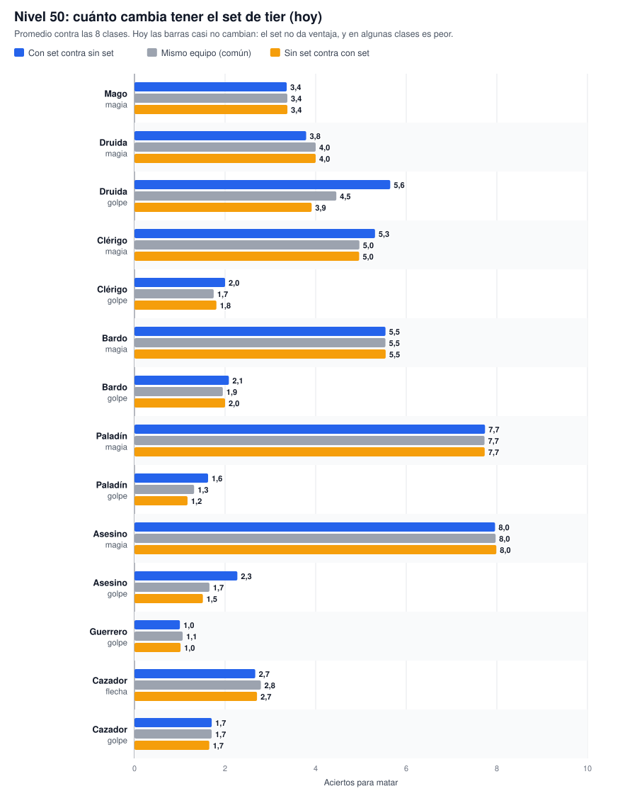
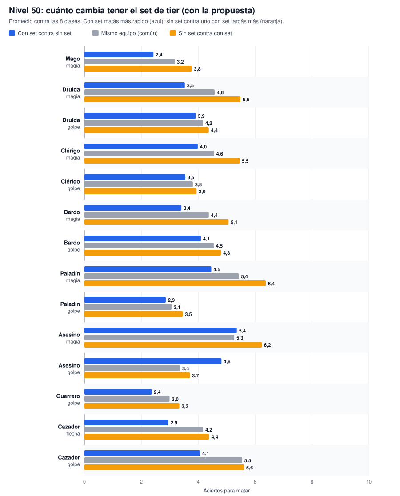

# Nivelación PvP por clase: cómo queda con los ítems

Guía para leer rápido la propuesta de [BALANCE_PVP.md](BALANCE_PVP.md): qué ítems usa cada clase, cuánta vida y maná tiene, cuánto pega y en cuántos aciertos mata a alguien de su nivel, **hoy** y **con la propuesta**. Todos los números salen del simulador, que usa el motor real del server y que se comparó contra el juego en vivo.

## Cómo leer los números

- **Acierto**: un golpe, flecha o hechizo que entra. Los golpes fallados no cuentan (al lado del daño figura la chance de acertar).
- **Aciertos para matar**: cuántos aciertos seguidos hacen falta para bajar toda la vida del otro, sin que se cure. Es un promedio: 2,5 quiere decir que la mitad de las veces son 2 y la otra mitad 3.
- **`hoy → propuesta (objetivo)`**: lo que pasa hoy en `main`, lo que pasaría con la propuesta y lo que se busca. ⚠ marca cuando la propuesta queda a más de medio acierto del objetivo.
- **Equipo común**: lo mejor que se consigue sin premios (crafteo, drops, misiones o comerciantes).
- **Set**: el set de tier de premios de canje (Desterrado y del Caído, con sus versiones +1, +2 y LEGENDARIA). Donde el set no tiene pieza se usa la mejor común.
- Todos pelean **buffeados** (fuerza y agilidad al doble, como en cualquier pelea), con raza humana y los skills al tope del nivel.
- \* Los ítems con "+maná" hoy **no suman maná** (bug). La propuesta lo arregla.
- ² Las clases físicas no tienen anillo útil: el Anillo de Magia (#1242) no tiene efecto en combate y el Anillo de Resistencia Mágica (#988) no se consigue por ninguna vía.

## Lo pedido, en un gráfico


## Cuánto pega cada clase a nivel 50

La línea roja es la vida de un mago nivel 50 (388). Hoy lo matan de un solo acierto: clérigo (golpe), paladín (golpe), asesino (golpe), guerrero (golpe), cazador (golpe). Con la propuesta, ninguno.


## En cuántos aciertos mata cada clase a alguien de su nivel


Los mismos gráficos para [nivel 30](graficos/aciertos-nivel-30.svg) y [nivel 40](graficos/aciertos-nivel-40.svg).

## Qué da el set

Con la propuesta, el set completo da **+25 % de daño** (físico o mágico, según con qué pegue la clase) y **+20 % de vida máxima**. Se suma una sola vez por personaje y tiene tope. La idea es que **el set valga más o menos un acierto a nivel 50**: con set matás un poco más rápido y aguantás un poco más.

Hoy las tres barras de cada clase casi no cambian, porque el set no da ventaja. Con la propuesta se separan:

⚠ **Ojo:** aun con la propuesta, con set mata más lento el asesino (golpe). Es un problema de los ítems, no del bono: la pieza de tier es peor que la común (por ejemplo, el Puñal Desterrado del asesino pega 19-22 y la Espada MataDragones común 35-48). Se arregla normalizando las piezas de tier (sección 7.5 de [BALANCE_PVP.md](BALANCE_PVP.md)).





## Todas las clases a nivel 50, en una tabla

Equipo común contra común.

| Clase | Daño a un mago por acierto | Aciertos para matar a un mago | a un guerrero | a su misma clase |
|---|---|---|---|---|
| Mago (magia) | 159 → **174** | 3,0 → **3,0** (3,0) | 4,0 → **4,0** (4,0) | 3,0 → **3,0** (3,0) |
| Druida (magia) | 136 → **115** | 3,0 → **4,0** (4,0) | 5,0 → **6,0** (5,0) ⚠ | 4,0 → **4,0** (4,0) |
| Druida (golpe) | 170 → **178** (acierta 95 %) | 3,0 → **3,0** (3,5) | 5,5 → **5,1** (5,0) | 3,0 → **3,0** (4,0) ⚠ |
| Clérigo (golpe) | 432 → **193** (acierta 95 %) | 1,0 → **2,5** (3,0) | 2,0 → **4,6** (4,5) | 1,9 → **3,8** (4,0) |
| Clérigo (magia) | 106 → **116** | 4,0 → **4,0** (4,5) | 6,0 → **6,0** (5,5) | 4,9 → **4,0** (4,5) |
| Bardo (magia) | 93 → **125** | 5,0 → **4,0** (4,0) | 7,0 → **5,0** (5,0) | 5,0 → **4,0** (4,0) |
| Bardo (golpe) | 384 → **167** (acierta 96 %) | 1,6 → **3,0** (3,5) | 2,0 → **5,6** (5,0) ⚠ | 2,0 → **4,4** (4,0) |
| Paladín (golpe) | 544 → **221** (acierta 96 %) | 1,0 → **2,0** (2,5) | 1,9 → **3,9** (4,0) | 1,8 → **3,7** (4,0) |
| Paladín (magia) | 65 → **97** | 6,4 → **4,4** (5,5) ⚠ | 9,9 → **7,0** (6,5) | 8,3 → **6,0** (6,0) |
| Asesino (golpe) | 480 → **210** (acierta 94 %) | 1,0 → **2,0** (3,0) ⚠ | 2,0 → **4,0** (4,5) | 1,9 → **3,5** (3,5) |
| Asesino (magia) | 63 → **101** | 6,7 → **4,0** (5,5) ⚠ | 10,1 → **6,6** (6,5) | 7,8 → **5,0** (6,0) ⚠ |
| Guerrero (golpe) | 601 → **232** (acierta 95 %) | 1,0 → **2,0** (2,0) | 1,5 → **3,7** (3,5) | 1,5 → **3,7** (3,5) |
| Cazador (flecha) | 246 → **178** (acierta 95 %) | 2,0 → **3,0** (3,0) | 3,4 → **5,0** (4,5) ⚠ | 3,0 → **4,9** (4,0) ⚠ |
| Cazador (golpe) | 461 → **145** (acierta 95 %) | 1,0 → **3,0** (4,0) ⚠ | 2,0 → **7,0** (5,5) ⚠ | 2,0 → **7,0** (5,0) ⚠ |

## Clase por clase

### Mago

*El que más daño hace con magia. Nada de daño físico.*

**Equipo**

| Lugar | Equipo común | Set de tier |
|---|---|---|
| Arma | **Báculo Mago (+300 Mana +28DM)** (golpe 8-12, +28 daño mágico, +300 maná*) · #753 | **Báculo Desterrado (MAGO) LEGENDARIO** (golpe 4-6, +38 daño mágico) · #1512 |
| Armadura o túnica | **Túnica Lujosa Azul +300Maná (Alto/as)** (defensa 2-4, +300 maná*) · #732 | **Túnica Desterrada (Mago)(Alto/as)** (defensa 20-30, +300 maná*) · #1341 |
| Casco | **Sombrero Hechizado (+20 DM)** (defensa 2-6, +20 daño mágico) · #1223 | **Capucha Mágica del Caído (MAGO) +2** (defensa 15-20, +30 daño mágico) · #1474 |
| Escudo | — | — |
| Anillo | **Anillo de Energía (+20 DM)** (+20 daño mágico) · #1221 | **Anillo Mago del Caído (MAGO)** (+20 daño mágico) · #1357 |

**Vida, maná y hechizo**

| Nivel | Vida | Vida con set (propuesta) | Maná hoy → propuesta | Hechizo principal |
|---|---:|---:|---|---|
| 30 | 238 | 286 | 1533 → 2133 | LLuvia de Sangre (55-60 base, 1050 de maná: 2 con el maná lleno) |
| 40 | 313 | 376 | 2010 → 2610 | Llama de Dragon (60-65 base, 1000 de maná: 2 con el maná lleno) |
| 50 | 388 | 466 | 2487 → 3087 | Llama de Dragon (60-65 base, 1000 de maná: 3 con el maná lleno) |

**Aciertos para matar con magia** (equipo común contra común)

| Nivel | Daño a un mago | Contra mago | Contra guerrero |
|---|---|---|---|
| 30 | 126 → **138** | 2,0 → **2,0** (2,0) | 3,1 → **3,0** (3,0) |
| 40 | 146 → **161** | 3,0 → **2,0** (2,5) | 4,0 → **4,0** (3,5) |
| 50 | 159 → **174** | 3,0 → **3,0** (3,0) | 4,0 → **4,0** (4,0) |

**Con set a nivel 50** (magia)

| Situación | Contra un mago | Contra un guerrero |
|---|---|---|
| Los dos con equipo común | 3,0 → **3,0** (3,0) | 4,0 → **4,0** (4,0) |
| Vos con set, el otro sin set | 3,0 → **2,0** (2,3) | 4,0 → **3,0** (3,0) |
| Vos sin set, el otro con set | 3,0 → **3,0** (3,9) ⚠ | 4,0 → **5,0** (5,2) |
| Los dos con set | 3,0 → **2,6** (3,0) | 4,0 → **4,0** (4,0) |

### Druida

*Menos magia que el mago y un arma que sirva.*

**Equipo**

| Lugar | Equipo común | Set de tier |
|---|---|---|
| Arma (para la magia) | **Báculo de la Naturaleza (+28 DM)** (golpe 8-10, +28 daño mágico) · #1225 | **Báculo Desterrado (DRUIDA) LEGENDARIO** (golpe 8-14, +32 daño mágico) · #1515 |
| Arma (para pegar) | **Estandarte Real** (golpe 15-18) · #1018 | **Báculo Desterrado (DRUIDA) LEGENDARIO** (golpe 8-14, +32 daño mágico) · #1515 |
| Armadura o túnica | **Túnica Legendaria +55Maná (Alto/as)** (defensa 10-13, +55 maná*) · #519 | **Túnica Desterrada (Druida)(Alto/as)(+200 Mana)** (defensa 20-30, +200 maná*) · #1342 |
| Casco | **Sombrero Hechizado (+20 DM)** (defensa 2-6, +20 daño mágico) · #1223 | **Corona de Plumas del Caído (DRUIDA) +2** (defensa 15-20, +30 daño mágico) · #1477 |
| Escudo | — | — |
| Anillo | **Anillo de Energía (+20 DM)** (+20 daño mágico) · #1221 | **Anillo Naturaleza del Caído (DRUIDA) LEGENDARIO** (+25 daño mágico) · #1454 |

**Vida, maná y hechizo**

| Nivel | Vida | Vida con set (propuesta) | Maná hoy → propuesta | Hechizo principal |
|---|---:|---:|---|---|
| 30 | 252 | 302 | 1089 → 1144 | Incinerar (58-63 base, 1050 de maná: 1 con el maná lleno) |
| 40 | 332 | 398 | 1449 → 1504 | Incinerar (58-63 base, 1050 de maná: 1 con el maná lleno) |
| 50 | 412 | 494 | 1809 → 1864 | Incinerar (58-63 base, 1050 de maná: 1 con el maná lleno) |

**Aciertos para matar con magia** (equipo común contra común)

| Nivel | Daño a un mago | Contra mago | Contra guerrero | Contra druida |
|---|---|---|---|---|
| 30 | 114 → **97** | 3,0 → **3,0** (3,0) | 4,0 → **4,0** (4,0) | 3,0 → **3,0** (3,0) |
| 40 | 125 → **106** | 3,0 → **3,2** (3,5) | 4,1 → **5,0** (4,5) | 3,0 → **4,0** (3,5) |
| 50 | 136 → **115** | 3,0 → **4,0** (4,0) | 5,0 → **6,0** (5,0) ⚠ | 4,0 → **4,0** (4,0) |

**Aciertos para matar con golpe** (equipo común contra común)

| Nivel | Daño a un mago | Contra mago | Contra guerrero | Contra druida |
|---|---|---|---|---|
| 30 | 140 → **147** (acierta 89 %) | 2,0 → **2,0** (2,5) | 4,6 → **4,4** (4,0) | 2,0 → **2,0** (3,0) ⚠ |
| 40 | 155 → **163** (acierta 95 %) | 2,7 → **2,0** (3,0) ⚠ | 5,2 → **4,8** (4,5) | 3,0 → **3,0** (3,5) |
| 50 | 170 → **178** (acierta 95 %) | 3,0 → **3,0** (3,5) | 5,5 → **5,1** (5,0) | 3,0 → **3,0** (4,0) ⚠ |

**Con set a nivel 50** (magia)

| Situación | Contra un mago | Contra un guerrero |
|---|---|---|
| Los dos con equipo común | 3,0 → **4,0** (4,0) | 5,0 → **6,0** (5,0) ⚠ |
| Vos con set, el otro sin set | 3,0 → **3,0** (3,0) | 5,0 → **4,5** (3,8) ⚠ |
| Vos sin set, el otro con set | 3,0 → **4,9** (5,2) | 5,0 → **7,0** (6,5) |
| Los dos con set | 3,0 → **3,9** (4,0) | 5,0 → **5,0** (5,0) |

### Clérigo

*Como el druida, pero puede usar más armas: pega más cuerpo a cuerpo que con magia.*

**Equipo**

| Lugar | Equipo común | Set de tier |
|---|---|---|
| Arma (para pegar) | **Espada MataDragones** (golpe 35-48) · #402 | **Espada del Caído (CLERIGO)(+2 F) LEGENDARIO** (golpe 32-37, +2 Fuerza) · #1506 |
| Arma (para la magia) | **Báculo de Sagrado (24-30)** (golpe 20-22, +10 daño mágico) · #841 | **Espada del Caído (CLERIGO)(+2 F) LEGENDARIO** (golpe 32-37, +2 Fuerza) · #1506 |
| Armadura o túnica | **Placas Doradas +5F (Alto/as)** (defensa 50-70, +5 Fuerza) · #729 | **Armadura del Caido (Altos)(CLERIGO)(+3F)** (defensa 20-30, +3 Fuerza) · #1345 |
| Casco | **Casco Centurión(10-14)** (defensa 10-14) · #832 | **Casco del Caído (CLERIGO)(+2 A) +2** (defensa 20-31, +2 Agilidad) · #1480 |
| Escudo | **Escudo Teutón +2Fu/+2Ag** (defensa 20-22, +2 Fuerza +2 Agilidad) · #1230 | **Escudo del Caído (CLERIGO)(+2F) +2** (defensa 20-31, +2 Fuerza) · #1456 |
| Anillo | — (no hay anillo útil para esta clase²) | — (no hay anillo útil para esta clase²) |

**Vida, maná y hechizo**

| Nivel | Vida | Vida con set (propuesta) | Maná hoy → propuesta | Hechizo principal |
|---|---:|---:|---|---|
| 30 | 252 | 302 | 1089 → 1089 | Ventisca (55-60 base, 1050 de maná: 1 con el maná lleno) |
| 40 | 332 | 398 | 1449 → 1449 | Ventisca (55-60 base, 1050 de maná: 1 con el maná lleno) |
| 50 | 412 | 494 | 1809 → 1809 | Purificar (58-63 base, 1500 de maná: 1 con el maná lleno) |

**Aciertos para matar con golpe** (equipo común contra común)

| Nivel | Daño a un mago | Contra mago | Contra guerrero | Contra clérigo |
|---|---|---|---|---|
| 30 | 398 → **177** (acierta 94 %) | 1,0 → **2,0** (2,0) | 1,4 → **3,4** (3,5) | 1,0 → **2,8** (3,0) |
| 40 | 415 → **185** (acierta 95 %) | 1,0 → **2,0** (2,5) | 2,0 → **4,0** (4,0) | 1,3 → **3,5** (3,5) |
| 50 | 432 → **193** (acierta 95 %) | 1,0 → **2,5** (3,0) | 2,0 → **4,6** (4,5) | 1,9 → **3,8** (4,0) |

**Aciertos para matar con magia** (equipo común contra común)

| Nivel | Daño a un mago | Contra mago | Contra guerrero | Contra clérigo |
|---|---|---|---|---|
| 30 | 81 → **89** | 3,1 → **3,0** (3,5) | 5,0 → **5,0** (4,5) | 4,0 → **3,2** (3,5) |
| 40 | 91 → **100** | 4,0 → **4,0** (4,0) | 6,0 → **5,3** (5,0) | 4,0 → **4,0** (4,0) |
| 50 | 106 → **116** | 4,0 → **4,0** (4,5) | 6,0 → **6,0** (5,5) | 4,9 → **4,0** (4,5) |

**Con set a nivel 50** (golpe)

| Situación | Contra un mago | Contra un guerrero |
|---|---|---|
| Los dos con equipo común | 1,0 → **2,5** (3,0) | 2,0 → **4,6** (4,5) |
| Vos con set, el otro sin set | 2,0 → **2,0** (2,3) | 2,0 → **4,3** (3,4) ⚠ |
| Vos sin set, el otro con set | 1,0 → **3,0** (3,9) ⚠ | 2,0 → **5,0** (5,9) ⚠ |
| Los dos con set | 2,0 → **3,0** (3,0) | 2,0 → **4,9** (4,5) |

### Bardo

*Mixto: un poco de magia y un poco de arma (identidad a confirmar).*

**Equipo**

| Lugar | Equipo común | Set de tier |
|---|---|---|
| Arma (para la magia) | **Espada MataDragones** (golpe 35-48) · #402 | **Lanza Desterrada (Bardo) LEGENDARIO** (golpe 32-39) · #1496 |
| Arma (para pegar) | **Espada MataDragones** (golpe 35-48) · #402 | **Lanza Desterrada (Bardo) LEGENDARIO** (golpe 32-39) · #1496 |
| Armadura o túnica | **Placas Azules +3F (Alto/as)** (defensa 40-55, +3 Fuerza) · #705 | **Armadura del Caido (Altos)(BARDO)(+3F)** (defensa 20-30, +3 Fuerza) · #1346 |
| Casco | **Casco De Oro (8-14)** (defensa 8-14) · #132 | **Casco del Caído (BARDO) +2** (defensa 24-34) · #1486 |
| Escudo | **Escudo Bizantino (12-20)** (defensa 12-20) · #826 | **Escudo del Caído(BARDO)(+2 A) +2** (defensa 20-31, +2 Agilidad) · #1462 |
| Anillo | — (no hay anillo útil para esta clase²) | — (no hay anillo útil para esta clase²) |

**Vida, maná y hechizo**

| Nivel | Vida | Vida con set (propuesta) | Maná hoy → propuesta | Hechizo principal |
|---|---:|---:|---|---|
| 30 | 267 | 320 | 1089 → 1089 | Apocalipsis (50-55 base, 950 de maná: 1 con el maná lleno) |
| 40 | 352 | 422 | 1449 → 1449 | Apocalipsis (50-55 base, 950 de maná: 1 con el maná lleno) |
| 50 | 437 | 524 | 1809 → 1809 | Apocalipsis (50-55 base, 950 de maná: 1 con el maná lleno) |

**Aciertos para matar con magia** (equipo común contra común)

| Nivel | Daño a un mago | Contra mago | Contra guerrero | Contra bardo |
|---|---|---|---|---|
| 30 | 74 → **100** | 4,0 → **3,0** (3,0) | 5,5 → **4,0** (4,0) | 4,0 → **3,0** (3,0) |
| 40 | 83 → **112** | 4,0 → **3,0** (3,5) | 6,1 → **5,0** (4,5) | 5,0 → **4,0** (3,5) |
| 50 | 93 → **125** | 5,0 → **4,0** (4,0) | 7,0 → **5,0** (5,0) | 5,0 → **4,0** (4,0) |

**Aciertos para matar con golpe** (equipo común contra común)

| Nivel | Daño a un mago | Contra mago | Contra guerrero | Contra bardo |
|---|---|---|---|---|
| 30 | 353 → **153** (acierta 93 %) | 1,0 → **2,0** (2,5) | 1,9 → **4,1** (4,0) | 1,0 → **3,1** (3,0) |
| 40 | 368 → **160** (acierta 95 %) | 1,0 → **2,1** (3,0) ⚠ | 2,0 → **4,8** (4,5) | 1,9 → **3,8** (3,5) |
| 50 | 384 → **167** (acierta 96 %) | 1,6 → **3,0** (3,5) | 2,0 → **5,6** (5,0) ⚠ | 2,0 → **4,4** (4,0) |

**Con set a nivel 50** (magia)

| Situación | Contra un mago | Contra un guerrero |
|---|---|---|
| Los dos con equipo común | 5,0 → **4,0** (4,0) | 7,0 → **5,0** (5,0) |
| Vos con set, el otro sin set | 5,0 → **3,0** (3,0) | 7,0 → **4,1** (3,8) |
| Vos sin set, el otro con set | 5,0 → **4,0** (5,2) ⚠ | 7,0 → **6,0** (6,5) |
| Los dos con set | 5,0 → **3,4** (4,0) ⚠ | 7,0 → **5,0** (5,0) |

### Paladín

*Mucho cuerpo a cuerpo, poca magia.*

**Equipo**

| Lugar | Equipo común | Set de tier |
|---|---|---|
| Arma (para pegar) | **Espada MataDragones** (golpe 35-48) · #402 | **Espada del Caído (PALADIN)(+2 F) LEGENDARIO** (golpe 33-39, +2 Fuerza) · #1509 |
| Arma (para la magia) | **Espada MataDragones** (golpe 35-48) · #402 | **Espada del Caído (PALADIN)(+2 F) LEGENDARIO** (golpe 33-39, +2 Fuerza) · #1509 |
| Armadura o túnica | **Placas Doradas +5F (Alto/as)** (defensa 50-70, +5 Fuerza) · #729 | **Armadura del Caido (Altos)(PALADIN)(+5F)** (defensa 20-30, +5 Fuerza) · #1348 |
| Casco | **Casco Centurión(10-14)** (defensa 10-14) · #832 | **Casco del Caído (PALADIN)(+200 Mana) +2** (defensa 20-31, +200 maná*) · #1483 |
| Escudo | **Escudo Teutón +2Fu/+2Ag** (defensa 20-22, +2 Fuerza +2 Agilidad) · #1230 | **Escudo del Caído (PALADIN)(+2F) +2** (defensa 20-31, +2 Fuerza) · #1459 |
| Anillo | — (no hay anillo útil para esta clase²) | — (no hay anillo útil para esta clase²) |

**Vida, maná y hechizo**

| Nivel | Vida | Vida con set (propuesta) | Maná hoy → propuesta | Hechizo principal |
|---|---:|---:|---|---|
| 30 | 296 | 355 | 567 → 767 | Descarga electrica (38-50 base, 350 de maná: 2 con el maná lleno) |
| 40 | 391 | 469 | 747 → 947 | Descarga electrica (38-50 base, 350 de maná: 2 con el maná lleno) |
| 50 | 486 | 583 | 927 → 1127 | Apocalipsis (50-55 base, 950 de maná: 1 con el maná lleno) |

**Aciertos para matar con golpe** (equipo común contra común)

| Nivel | Daño a un mago | Contra mago | Contra guerrero | Contra paladín |
|---|---|---|---|---|
| 30 | 498 → **200** (acierta 95 %) | 1,0 → **2,0** (2,0) | 1,0 → **2,9** (3,0) | 1,0 → **2,8** (3,0) |
| 40 | 524 → **212** (acierta 95 %) | 1,0 → **2,0** (2,0) | 1,0 → **3,3** (3,5) | 1,0 → **3,1** (3,5) |
| 50 | 544 → **221** (acierta 96 %) | 1,0 → **2,0** (2,5) | 1,9 → **3,9** (4,0) | 1,8 → **3,7** (4,0) |

**Aciertos para matar con magia** (equipo común contra común)

| Nivel | Daño a un mago | Contra mago | Contra guerrero | Contra paladín |
|---|---|---|---|---|
| 30 | 52 → **65** | 5,0 → **4,0** (4,5) | 7,7 → **6,1** (5,5) ⚠ | 6,5 → **5,2** (5,0) |
| 40 | 59 → **73** | 6,0 → **5,0** (5,0) | 8,9 → **7,1** (6,0) ⚠ | 7,5 → **6,0** (5,5) ⚠ |
| 50 | 65 → **97** | 6,4 → **4,4** (5,5) ⚠ | 9,9 → **7,0** (6,5) | 8,3 → **6,0** (6,0) |

**Con set a nivel 50** (golpe)

| Situación | Contra un mago | Contra un guerrero |
|---|---|---|
| Los dos con equipo común | 1,0 → **2,0** (2,5) | 1,9 → **3,9** (4,0) |
| Vos con set, el otro sin set | 1,0 → **2,0** (1,9) | 2,0 → **3,6** (3,0) ⚠ |
| Vos sin set, el otro con set | 1,0 → **3,0** (3,3) | 2,0 → **4,0** (5,2) ⚠ |
| Los dos con set | 1,0 → **3,0** (2,5) | 2,0 → **4,0** (4,0) |

### Asesino

*Golpe común por debajo del guerrero; su fuerte es la apuñalada por la espalda.*

**Equipo**

| Lugar | Equipo común | Set de tier |
|---|---|---|
| Arma (para pegar) | **Espada MataDragones** (golpe 35-48) · #402 | **Puñal Desterrado (Asesino)(+3F) LEGENDARIO** (golpe 19-22, +3 Fuerza) · #1499 |
| Arma (para la magia) | **Espada MataDragones** (golpe 35-48) · #402 | **Puñal Desterrado (Asesino)(+3F) LEGENDARIO** (golpe 19-22, +3 Fuerza) · #1499 |
| Armadura o túnica | **Placas Azules +3F (Alto/as)** (defensa 40-55, +3 Fuerza) · #705 | **Armadura Desterrada (Asesino)(+3F)** (defensa 20-30, +3 Fuerza) · #1181 |
| Casco | **Casco Centurión(10-14)** (defensa 10-14) · #832 | **Casco Desterrado (Asesino)(+2A) +2** (defensa 20-26, +2 Agilidad) · #1471 |
| Escudo | **Escudo de Diamantes (20-25)** (defensa 20-25) · #1079 | **Escudo Desterrado (Asesino)(+2F) +2** (defensa 17-30, +2 Fuerza) · #1447 |
| Anillo | — (no hay anillo útil para esta clase²) | — (no hay anillo útil para esta clase²) |

**Vida, maná y hechizo**

| Nivel | Vida | Vida con set (propuesta) | Maná hoy → propuesta | Hechizo principal |
|---|---:|---:|---|---|
| 30 | 267 | 320 | 567 → 767 | Descarga electrica (38-50 base, 350 de maná: 2 con el maná lleno) |
| 40 | 352 | 422 | 747 → 947 | Descarga electrica (38-50 base, 350 de maná: 2 con el maná lleno) |
| 50 | 437 | 524 | 927 → 1127 | Destello infernal (54-59 base, 950 de maná: 1 con el maná lleno) |

**Aciertos para matar con golpe** (equipo común contra común)

| Nivel | Daño a un mago | Contra mago | Contra guerrero | Contra asesino |
|---|---|---|---|---|
| 30 | 436 → **190** (acierta 96 %) | 1,0 → **2,0** (2,0) | 1,0 → **3,0** (3,5) ⚠ | 1,0 → **2,7** (2,5) |
| 40 | 460 → **201** (acierta 96 %) | 1,0 → **2,0** (2,5) | 1,9 → **3,6** (4,0) | 1,0 → **3,0** (3,0) |
| 50 | 480 → **210** (acierta 94 %) | 1,0 → **2,0** (3,0) ⚠ | 2,0 → **4,0** (4,5) | 1,9 → **3,5** (3,5) |

**Aciertos para matar con magia** (equipo común contra común)

| Nivel | Daño a un mago | Contra mago | Contra guerrero | Contra asesino |
|---|---|---|---|---|
| 30 | 51 → **63** | 5,0 → **4,1** (4,5) | 7,9 → **6,3** (5,5) ⚠ | 6,0 → **5,0** (5,0) |
| 40 | 57 → **71** | 6,0 → **5,0** (5,0) | 9,1 → **7,4** (6,0) ⚠ | 7,0 → **5,8** (5,5) |
| 50 | 63 → **101** | 6,7 → **4,0** (5,5) ⚠ | 10,1 → **6,6** (6,5) | 7,8 → **5,0** (6,0) ⚠ |

**Con set a nivel 50** (golpe)

| Situación | Contra un mago | Contra un guerrero |
|---|---|---|
| Los dos con equipo común | 1,0 → **2,0** (3,0) ⚠ | 2,0 → **4,0** (4,5) |
| Vos con set, el otro sin set | 2,0 → **3,0** (2,3) ⚠ | 2,8 → **6,0** (3,4) ⚠ |
| Vos sin set, el otro con set | 1,0 → **3,0** (3,9) ⚠ | 2,0 → **4,5** (5,9) ⚠ |
| Los dos con set | 2,0 → **4,0** (3,0) ⚠ | 2,7 → **6,1** (4,5) ⚠ |

### Guerrero

*El que más pega físico. Nada de magia.*

**Equipo**

| Lugar | Equipo común | Set de tier |
|---|---|---|
| Arma | **Espada MataDragones** (golpe 35-48) · #402 | **Espada del Caído (GUERR./PIRA.)(+3F) LEGENDARIO** (golpe 35-48, +3 Fuerza) · #1503 |
| Armadura o túnica | **Placas Doradas +5F (Alto/as)** (defensa 50-70, +5 Fuerza) · #729 | **Armadura del Caido (Altos)(GUER./PIRA.)(+5F)** (defensa 20-30, +5 Fuerza) · #1347 |
| Casco | **Casco Centurión(10-14)** (defensa 10-14) · #832 | **Casco del Caído (GUERRERO/PIRATA)(+5A) +2** (defensa 24-34, +5 Agilidad) · #1489 |
| Escudo | **Escudo Sajón (+5 Fuerza)** (defensa 10-15, +5 Fuerza) · #824 | **Escudo del Caído(GUERRERO/PIRATA)(+5F) +2** (defensa 24-34, +5 Fuerza) · #1465 |
| Anillo | — (no hay anillo útil para esta clase²) | — (no hay anillo útil para esta clase²) |

**Vida, maná y hechizo**

| Nivel | Vida | Vida con set (propuesta) | Maná hoy → propuesta | Hechizo principal |
|---|---:|---:|---|---|
| 30 | 325 | 390 | — | — |
| 40 | 430 | 516 | — | — |
| 50 | 535 | 642 | — | — |

**Aciertos para matar con golpe** (equipo común contra común)

| Nivel | Daño a un mago | Contra mago | Contra guerrero |
|---|---|---|---|
| 30 | 553 → **210** (acierta 95 %) | 1,0 → **2,0** (2,0) | 1,0 → **2,8** (2,5) |
| 40 | 580 → **223** (acierta 94 %) | 1,0 → **2,0** (2,0) | 1,0 → **3,0** (3,0) |
| 50 | 601 → **232** (acierta 95 %) | 1,0 → **2,0** (2,0) | 1,5 → **3,7** (3,5) |

**Con set a nivel 50** (golpe)

| Situación | Contra un mago | Contra un guerrero |
|---|---|---|
| Los dos con equipo común | 1,0 → **2,0** (2,0) | 1,5 → **3,7** (3,5) |
| Vos con set, el otro sin set | 1,0 → **2,0** (1,5) | 1,0 → **3,0** (2,6) |
| Vos sin set, el otro con set | 1,0 → **3,0** (2,6) | 1,1 → **4,0** (4,5) ⚠ |
| Los dos con set | 1,0 → **2,0** (2,0) | 1,0 → **3,0** (3,5) |

### Cazador

*Arco; el cuerpo a cuerpo queda en segundo plano.*

**Equipo**

| Lugar | Equipo común | Set de tier |
|---|---|---|
| Arma (para tirar flechas) | **Arco Mágico (50% ahorro flechas)** (arco, golpe 10-13) · #843 | **Arco Desterrado (Ahorra 33% Flechas) LEGENDARIO** (arco, golpe 11-15) · #1518 |
| Flecha | **Flecha De Los Dioses** (flecha, golpe 8-10) · #607 | **Flecha De Los Dioses** (flecha, golpe 8-10) · #607 |
| Arma (para pegar) | **Espada MataDragones** (golpe 35-48) · #402 | **Espada MataDragones** (golpe 35-48) · #402 |
| Armadura o túnica | **Placas Doradas +5F (Alto/as)** (defensa 50-70, +5 Fuerza) · #729 | **Armadura del Caido (Altos)(PALADIN)(+5F)** (defensa 20-30, +5 Fuerza) · #1348 |
| Casco | **Casco Centurión(10-14)** (defensa 10-14) · #832 | **Casco del Caído (ARQUERO/CAZADOR)(+2A) +2** (defensa 20-30, +2 Agilidad) · #1492 |
| Escudo | **Escudo Teutón +2Fu/+2Ag** (defensa 20-22, +2 Fuerza +2 Agilidad) · #1230 | **Escudo del Caído (ARQUERO/CAZADOR)(+2 F) +2** (defensa 20-31, +2 Fuerza) · #1468 |
| Anillo | — (no hay anillo útil para esta clase²) | — (no hay anillo útil para esta clase²) |

**Vida, maná y hechizo**

| Nivel | Vida | Vida con set (propuesta) | Maná hoy → propuesta | Hechizo principal |
|---|---:|---:|---|---|
| 30 | 296 | 355 | — | — |
| 40 | 391 | 469 | — | — |
| 50 | 486 | 583 | — | — |

**Aciertos para matar con flecha** (equipo común contra común)

| Nivel | Daño a un mago | Contra mago | Contra guerrero | Contra cazador |
|---|---|---|---|---|
| 30 | 204 → **146** (acierta 96 %) | 2,0 → **2,0** (2,0) | 2,8 → **4,4** (3,5) ⚠ | 2,8 → **4,5** (3,0) ⚠ |
| 40 | 228 → **164** (acierta 96 %) | 2,0 → **2,0** (2,5) | 3,0 → **4,7** (4,0) ⚠ | 3,0 → **4,5** (3,5) ⚠ |
| 50 | 246 → **178** (acierta 95 %) | 2,0 → **3,0** (3,0) | 3,4 → **5,0** (4,5) ⚠ | 3,0 → **4,9** (4,0) ⚠ |

**Aciertos para matar con golpe** (equipo común contra común)

| Nivel | Daño a un mago | Contra mago | Contra guerrero | Contra cazador |
|---|---|---|---|---|
| 30 | 423 → **131** (acierta 88 %) | 1,0 → **2,0** (3,0) ⚠ | 1,0 → **5,2** (4,5) ⚠ | 1,0 → **5,4** (4,0) ⚠ |
| 40 | 444 → **139** (acierta 95 %) | 1,0 → **3,0** (3,5) | 1,9 → **6,2** (5,0) ⚠ | 1,9 → **6,3** (4,5) ⚠ |
| 50 | 461 → **145** (acierta 95 %) | 1,0 → **3,0** (4,0) ⚠ | 2,0 → **7,0** (5,5) ⚠ | 2,0 → **7,0** (5,0) ⚠ |

**Con set a nivel 50** (flecha)

| Situación | Contra un mago | Contra un guerrero |
|---|---|---|
| Los dos con equipo común | 2,0 → **3,0** (3,0) | 3,4 → **5,0** (4,5) ⚠ |
| Vos con set, el otro sin set | 2,0 → **2,0** (2,3) | 3,0 → **3,6** (3,4) |
| Vos sin set, el otro con set | 2,0 → **3,2** (3,9) ⚠ | 3,0 → **5,4** (5,9) |
| Los dos con set | 2,0 → **3,0** (3,0) | 3,0 → **4,0** (4,5) |

## De dónde salen estos números

- Simulador: `server/src/scripts/balanceSim/` (explicado en la sección 4 de [BALANCE_PVP.md](BALANCE_PVP.md)). Usa las funciones reales de combate del server (`game.userDmgUser` y `game.userSpellUser`) con 2000 tiradas por cruce.
- Validado contra el juego en vivo el 2026-10-23: golpe de guerrero 398-439 en el juego contra 392-449 simulado; Llama de Dragón 137-145 en los dos.
- Para regenerar esta guía y los gráficos:

```bash
pnpm --dir server balance-sim --tiradas 2000 --salida /tmp/actual.json
pnpm --dir server balance-sim --tiradas 2000 --propuesta src/scripts/balanceSim/propuestas/propuesta-v1.json --salida /tmp/propuesta.json
cd server && npx tsx src/scripts/balanceSim/charts.ts /tmp/actual.json /tmp/propuesta.json
npx tsx src/scripts/balanceSim/guide.ts /tmp/actual.json /tmp/propuesta.json src/scripts/balanceSim/propuestas/propuesta-v1.json
```
