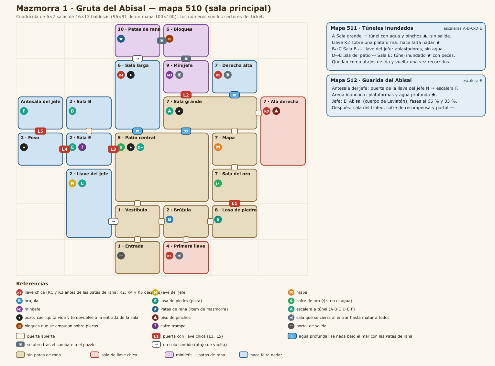
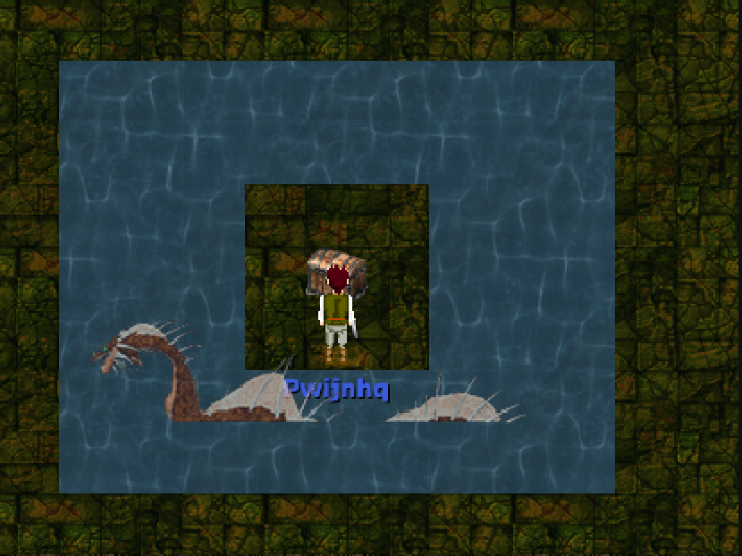
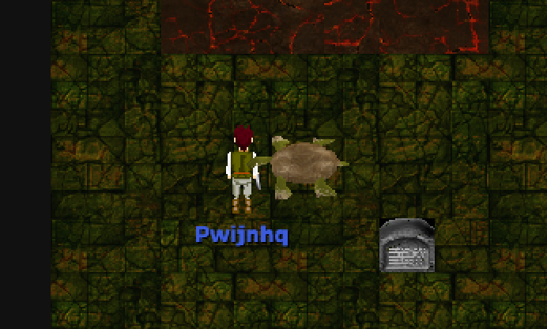

# Mazmorra 1 · Gruta del Abisal

Fecha: 2026-10-25. Estado: **diseño, a confirmar**. El sistema (instancias, grupo, ítems de mazmorra, mecánicas) está en [../MAZMORRAS.md](../MAZMORRAS.md).

Adaptación del **Túnel del Pez Abisal** de *Link's Awakening* (ticket de Trello). No se copia baldosa por baldosa: se respeta la estructura jugable, que es esta:
- se progresa con llaves;
- el minijefe abre el camino al ítem;
- el ítem (las aletas del original, acá **Patas de rana**) deja nadar bajo el agua;
- nadando se llega a lo que faltaba y al jefe;
- los túneles funcionan como atajos.

## 1. Cómo funciona el original

Lo leímos sala por sala en el mapa del ticket:

- **Sin aletas** se recorre la parte baja:
  - entrada y vestíbulo;
  - la brújula;
  - una sala con llave;
  - la losa de piedra;
  - el patio central inundado;
  - la sala grande con el mapa y sus pozos;
  - el ala derecha.
- Con dos llaves se llega al **minijefe** (una bola que gira alrededor de una plataforma). Después viene una sala de bloques y el altar de las **Aletas**, arriba al centro.
- **Con las aletas** se nada por el agua profunda (el verde oscuro del mapa) hasta:
  - más llaves;
  - la llave del jefe;
  - la escalera F, que baja a la arena del jefe.
- Después del jefe está la sala del instrumento.
- **Escaleras con letra:** A, B↔C, D↔E y F bajan a túneles laterales que conectan salas. B↔C tiene aplastadores; D↔E está inundado; A no tiene salida y guarda una llave sobre el agua.
- **Contenido:**
  - 5 llaves chicas, la llave del jefe, mapa, brújula y losa;
  - 2 cofres de 50 rupias y uno vacío;
  - trampas: pozos, pinchos, salas que se cierran y bloques.

**Diferencia con el ticket:**
- El ticket ubica el ítem principal (las aletas del original) y la brújula a la izquierda. En el original las aletas están arriba al centro, después del minijefe, y la brújula abajo, al lado del vestíbulo.
- Se mantiene el original, porque las Patas de rana tienen que llegar a mitad de camino: son las que abren la segunda mitad de la mazmorra.
- Los 10 sectores del ticket están todos, solo cambia dónde quedan (sección 6).

## 2. Mapas de AO

| Mapa | Nombre | Qué entra |
|---|---|---|
| **510** | Gruta del Abisal | Toda la mazmorra principal: una cuadrícula de 6 × 7 salas de 16 × 13 baldosas (96 × 91), con paredes compartidas y puertas de 2 baldosas en el medio de cada borde. Cada sala del original es una sala de AO (las largas ocupan 2 celdas y el patio, 4). |
| **511** | Túneles inundados | Los túneles A, B↔C y D↔E, como pasillos de unas 40 × 9 baldosas separados entre sí. |
| **512** | Guarida del Abisal | La antesala bajando por la escalera F, la arena del jefe (unas 40 × 30, inundada, con plataformas), la sala del trofeo y el portal de salida. |

Una sala de 16 × 13 entra en una pantalla del juego, igual que en Zelda: se ve la sala entera y el combate de un grupo de 5 tiene lugar.

**Gráficos:** el piso de baldosas verdes y las paredes de piedra labrada del mapa 116 ("Dungeon"), que tienen la misma paleta que la mazmorra de Zelda. Para el agua profunda se usa el agua de AO, y para las escaleras, los portales azules que ya usa ese mapa.

## 3. Salas

Celda = (columna, fila) en la cuadrícula del mapa 510; la fila 0 es la de arriba.

| Sala | Celda | Sector | Contenido | Criaturas | Trampas |
|---|---|---|---|---|---|
| Entrada | (2,6) | 1 | Aparecés acá; portal de salida | — | — |
| Vestíbulo | (2,5) | 1 | Distribuidor: al este, al norte y la vuelta del ala izquierda | Pocas, de presión | — |
| Brújula | (3,5) | 2 | Cofre: **Brújula** | Guardianes | — |
| Primera llave | (3,6) | 4 | Cofre al terminar: **K1** | Guardianes | Se cierra al entrar |
| Losa de piedra | (4,5) | 8 | **Losa** con la pista del jefe | — | — |
| Sala del oro | (4,4) | 7 | Cofre de oro en una isla (se llega nadando) | De agua | Agua profunda |
| Mapa | (4,3) | 7 | Cofre: **Mapa** | Guardián | — |
| Sala grande | (3,2)-(4,2) | 7 | **Escalera A**; canales al patio y a Derecha alta | De presión | 2 pozos |
| Ala derecha | (5,2)-(5,3) | 7 | **K3** sobre un bloque elevado | De presión | Pinchos |
| Patio central | (2,3)-(3,4) | 5 | Cofre de oro; **escalera D** en una isla | Muchas, de presión, con riesgo de rodeo | Pozos, agua profunda |
| Minijefe | (3,1) | 9 | **Tortuga Espinosa** | Minijefe | Se cierra al entrar |
| Bloques | (3,0) | 6 | Dos bloques sobre dos placas abren el paso a las Patas de rana | Una criatura que patrulla | Placas |
| Patas de rana | (2,0) | 10 | Altar: **Patas de rana** (ítem de mazmorra) | — | — |
| Sala larga | (2,1)-(2,2) | 6 | **K4** junto a un pozo; baja nadando al patio | De agua | Pozo, agua profunda |
| Derecha alta | (4,1) | 7 | Cofre al terminar: **K5** | Guardianes | Se cierra al entrar |
| Sala E | (1,3) | 2 | Cofre trampa; **escalera E** | Aparecen al abrir el cofre | Se cierra al abrir el cofre |
| Sala B | (1,2) | 2 | **Escalera B** | De agua | Agua |
| Llave del jefe | (1,4)-(1,5) | 2 | Cofre: **llave del jefe**; **escalera C**; salida de un solo sentido al vestíbulo | Guardianes | — |
| Foso | (0,3) | 2 | Plataforma rodeada de pozos | De presión | Pozos |
| Antesala del jefe | (0,2) | — | Puerta del jefe; **escalera F** | — | — |

## 4. Recorrido

1. **Inicio:**
   - Entrada → Vestíbulo.
   - Al este, la Brújula. Al sur de ella, la sala de la Primera llave: se cierra hasta matar a los guardianes y da la **K1**.
   - Al este de la Brújula, la Losa de piedra.
2. **Ala derecha:**
   - La K1 abre **L1** (Losa → Sala del oro). El cofre está en una isla: queda para la vuelta.
   - Al norte, el Mapa y después la Sala grande: pozos, escalera A. El túnel A todavía no sirve: la llave está pasando agua profunda.
   - Al este, el Ala derecha: pinchos, **K3**.
3. **Minijefe:**
   - La K3 abre **L2** (Sala grande → Minijefe).
   - La Tortuga Espinosa da vueltas a la plataforma y embiste. Queda aturdida al chocar contra la pared: ahí se le pega.
   - Después, la sala de Bloques: hay que dejar las dos placas apretadas con los bloques (o con jugadores) para abrir el paso a las **Patas de rana**.
4. **Con las Patas de rana** (en cualquier orden):
   - Patas de rana → Sala larga (puerta de un solo sentido): **K4** junto al pozo; nadando se baja al Patio, que es el atajo al vestíbulo.
   - Túnel A: nadar hasta la plataforma: **K2**.
   - Sala grande → nadando a Derecha alta: se cierra al entrar y da la **K5**.
   - Sala del oro: el cofre de la isla.
5. **Ala izquierda:**
   - K2, K4 y K5 abren **L3** (Patio → Sala E), **L4** (Sala E → Foso) y **L5** (Foso → Antesala), en cualquier orden.
   - En la Sala E, el cofre trampa cierra la sala y suelta criaturas. La escalera E lleva por el túnel inundado D↔E a la isla del Patio (otro atajo).
   - Al norte de la Sala E está la Sala B. La escalera B lleva por el túnel de los aplastadores B↔C a la sala de la **Llave del jefe**, que vuelve al vestíbulo por una puerta de un solo sentido.
6. **Final:**
   - En la Antesala, la llave del jefe abre la puerta. La escalera F baja a la Guarida (mapa 512).
   - **El Abisal**, después la sala del trofeo y el portal de salida.

## 5. Ubicaciones

### Llaves y puertas
| Llave | Dónde | Necesita | Puerta | Entre |
|---|---|---|---|---|
| K1 | Primera llave | Matar a los guardianes | L1 | Losa → Sala del oro |
| K3 | Ala derecha | Cruzar los pinchos | L2 | Sala grande → Minijefe |
| K2 | Túnel A | Patas de rana | L3 | Patio → Sala E |
| K4 | Sala larga | Patas de rana | L4 | Sala E → Foso |
| K5 | Derecha alta | Patas de rana + matar a los guardianes | L5 | Foso → Antesala |
| Llave del jefe | Llave del jefe | Túnel B↔C | Puerta del jefe | Antesala → escalera F |

Cualquier llave chica abre cualquier puerta con llave, como en Zelda. Antes de las Patas de rana hay 2 llaves y 2 puertas; después, 3 y 3.

### Escaleras (los warps A-F)
| Letra | Une | Para qué |
|---|---|---|
| A | Sala grande ↔ túnel A (mapa 511) | Sin salida: K2 sobre el agua |
| B↔C | Sala B ↔ Llave del jefe, por el túnel de los aplastadores | Llegar a la llave del jefe |
| D↔E | Isla del Patio ↔ Sala E, por el túnel inundado | Atajo entre el centro y el ala izquierda |
| F | Antesala → Guarida (mapa 512) | El jefe |

Además hay dos puertas de un solo sentido que acortan la vuelta (Patas de rana → Sala larga y Llave del jefe → Vestíbulo) y un portal de salida en la Entrada y otro después del jefe.

### Recompensa principal, minijefe y jefe
- **Patas de rana**, en el altar de la sala (2,0), después del minijefe y los bloques.
  - Es un ítem de mazmorra permanente. Con ellas se nada **bajo el mar**: el agua profunda de las mazmorras (la parte oscura del mapa, que sin ellas no se puede pisar) pasa a ser transitable, con el personaje buceando.
  - Nadando no se ataca ni se lanzan hechizos, como en Zelda.
  - Hace falta para la segunda mitad de esta mazmorra y se va a usar en las siguientes.
- **Minijefe: Tortuga Espinosa**, en (3,1).
  - Es la bola del original, con el cuerpo de la Tortuga gigante de AO.
  - La sala se cierra hasta vencerla.
- **Jefe: El Abisal**, en el mapa 512, con el cuerpo del Leviatán de AO. Tiene tres fases:
  - **Hasta 66 %:** nada alrededor de la plataforma y muerde al que está en el borde. Se le pega cuando sale a atacar.
  - **66 % a 33 %:** llama peces chicos y hace caer piedras en zonas marcadas.
  - **Menos de 33 %:** más rápido, embiste.
  - **Recompensa:** la Escama del Abisal (trofeo de la serie) y un cofre con oro y un objeto, una vez por día por personaje.

Cómo se ven, en la mazmorra de prueba (todavía con las criaturas de AO de las que toman el cuerpo; las plantillas con nombre, vida y fases propias van en la etapa 3):

| Jefe: El Abisal (cuerpo del Leviatán) | Minijefe: Tortuga Espinosa (cuerpo de la Tortuga gigante) |
|---|---|
|  |  |

### Trampas
| Tipo | Dónde | Rol (igual que en Zelda) |
|---|---|---|
| Pozos | Foso, Patio, Sala grande, Sala larga | Castigan el error y obligan a rodear |
| Pinchos | Ala derecha, túnel A | Piso peligroso en el camino a una llave |
| Aplastadores | Túnel B↔C | Pasillo angosto con tiempo |
| Salas que se cierran | Primera llave, Minijefe, Derecha alta y el cofre trampa de la Sala E | Combate obligatorio |
| Placas y bloques | Bloques | Puzzle que abre el paso al ítem |
| Agua profunda | Patio, Sala del oro, Sala larga, canales, túneles A y D↔E, Guarida | Lo que se abre con las Patas de rana |

### Criaturas
Son plantillas nuevas con cuerpos que ya existen en AO (arañas, murciélagos, esqueletos, elementales de agua); se eligen en la etapa 3. Hay tres roles, como en el original:
- **De presión**, en salas abiertas (Vestíbulo, Patio, Sala grande, Foso): varias y débiles, que rodean.
- **Guardianes**, en las salas de llave: pocas y más duras.
- **De agua**, en las salas inundadas y los túneles: solo se mueven por el agua.

La dificultad escala con el tamaño del grupo (ver [../MAZMORRAS.md](../MAZMORRAS.md), 3.3).

## 6. Los 10 sectores del ticket

| Sector del ticket | Dónde queda |
|---|---|
| 1. Entrada / hub inicial | Entrada y Vestíbulo |
| 2. Rama izquierda de exploración | Sala E, Sala B, Foso, túneles B↔C y D↔E, Llave del jefe. La brújula queda al este del vestíbulo, como en el original |
| 3. Rama izquierda de reward principal | Sala de las Patas de rana: arriba, después del minijefe, como en el original |
| 4. Sala de primera llave / puzzle | Primera llave (se cierra al entrar, K1) |
| 5. Patio o sala central grande | Patio central (4 celdas, pozos, agua, cofre de oro, escalera D) |
| 6. Sector superior de puzzle | Bloques (placas) y Sala larga (K4) |
| 7. Rama derecha de progresión | Sala del oro, Mapa, Sala grande, Ala derecha (K3), Derecha alta (K5), túnel A (K2) |
| 8. Sector de lore / pista | Losa de piedra |
| 9. Sala de miniboss | Tortuga Espinosa |
| 10. Sala de reward posterior | Bloques → Patas de rana, que abren el tramo final |
