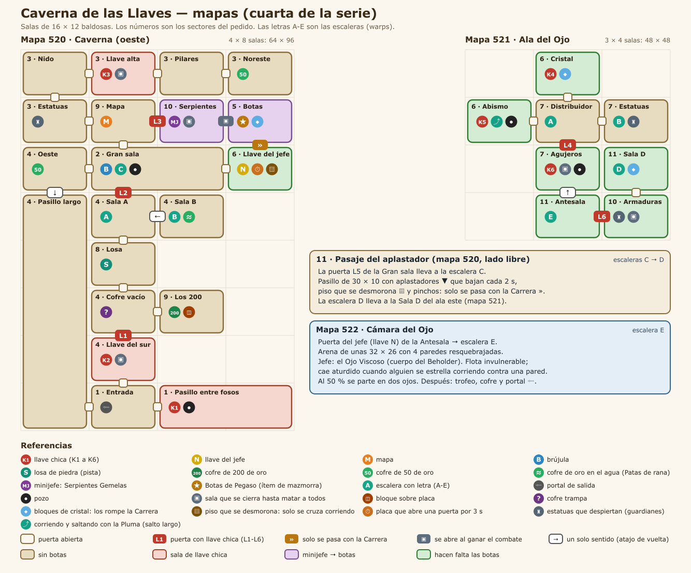
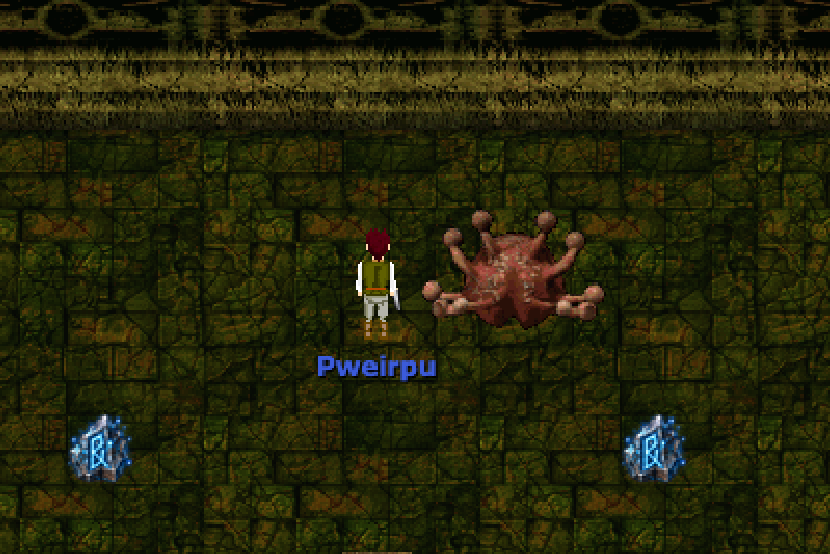
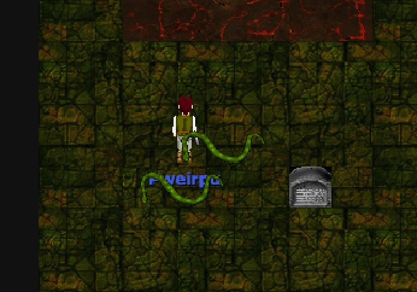

# Caverna de las Llaves

Fecha: 2026-10-26. Estado: **hecha, en desarrollo** hasta que exista la mazmorra de la pluma (cómo quedó: [../MAZMORRAS.md](../MAZMORRAS.md), sección 8). El sistema (instancias, grupo, ítems de mazmorra, mecánicas) está en [../MAZMORRAS.md](../MAZMORRAS.md); la mazmorra 1, en [01-GRUTA_DEL_ABISAL.md](01-GRUTA_DEL_ABISAL.md).

**Lugar en la serie:** es la cuarta, después de la mazmorra de la pluma, como en el original (ver [00-PATRON_LINKS_AWAKENING.md](00-PATRON_LINKS_AWAKENING.md)). Adentro hace falta saltar con la pluma. Hasta que exista la mazmorra que la da, la Caverna queda en desarrollo: entra un GM, y la pluma se da a mano para probar.

Adaptación de la **Cueva de las Llaves** (*Key Cavern*) de *Link's Awakening*. No se copia baldosa por baldosa: se respeta la estructura jugable, que es esta:
- muchas llaves chicas, que obligan a recorrer todo;
- el minijefe abre el camino al ítem;
- el ítem (las Botas de Pegaso del original) da velocidad;
- con la velocidad se abre la segunda mitad: lo que caminando no se alcanza, se rompe o se cruza a tiempo;
- las escaleras con letra funcionan como atajos entre las dos mitades.

## 1. Cómo funciona el original

Lo leímos sala por sala en el mapa del pedido.

- **Ala oeste:** es la grande.
  - **Abajo:** la entrada y, al este, un pasillo entre dos fosos con una llave al final.
  - **Al norte:** una columna de salas, con llave, la losa de piedra, un cofre vacío y un cofre de 200 rupias entre bloques. Al costado corre un pasillo largo y angosto.
  - **Arriba:** una gran sala central, rodeada de salas chicas con llaves, el mapa (en un pasillo con barandas) y la brújula.
  - **Minijefe:** las dos serpientes, en la sala de los dos agujeros.
  - **Las botas:** en un laberinto de bloques.
  - **Llave del jefe:** en un pasillo angosto al este, pasando un foso.
- **Ala este:** se llega por las escaleras.
  - **Centro:** un distribuidor con la escalera A.
  - **Alrededor:** una galería de estatuas con la escalera B, salas con llave (una con cristales, otra con un abismo) y una con agujeros.
  - **Al sur:** el ojo del jefe en el piso, la antesala con la puerta del jefe y la sala de la escalera D, llena de bloques de cristal.
- **Pasaje C↔D:** un túnel lateral con un aplastador y pinchos que une la gran sala con el fondo del ala este.
- **Contenido:**
  - unas 9 llaves chicas, la llave del jefe, mapa, brújula y losa;
  - cofres de 50 y 200 rupias y uno vacío;
  - las escaleras A, B, C y D.

## 2. Mapas de AO

| Mapa | Nombre | Qué entra |
|---|---|---|
| **520** | Caverna de las Llaves | El ala oeste: una cuadrícula de 4 × 8 salas de 16 × 12 baldosas (64 × 96). En el lado libre (unas 30 columnas) va el Pasaje del aplastador (C → D). |
| **521** | Ala del Ojo | El ala este: 3 × 4 salas de 16 × 12 (48 × 48). |
| **522** | Cámara del Ojo | La arena del jefe (unas 32 × 26), la sala del trofeo y el portal de salida. Va aparte, como la Guarida de la Gruta, porque es una sala con evento y combate de hasta 5 jugadores. |

Una sala de 16 × 12 entra en una pantalla del juego, igual que en Zelda.

**Gráficos:** para diferenciarla de la Gruta (piso de baldosas verdes), la propuesta es piso de tierra y paredes de roca de las cuevas de AO. Los bloques de cristal, el piso que se desmorona y las paredes resquebrajadas se eligen o se indexan en la etapa de mapas.

## 3. Salas

Celda = (columna, fila); la fila 0 es la de arriba. Los números de sector son los del pedido (sección 9).

### Mapa 520 (oeste)
| Sala | Celda | Sector | Contenido | Criaturas | Trampas |
|---|---|---|---|---|---|
| Entrada | (1,7) | 1 | Aparecés acá; portal de salida | — | — |
| Pasillo entre fosos | (2,7)-(3,7) | 1 | **K1** al final del pasillo | De presión | Pasillo de 2 baldosas entre dos fosos |
| Llave del sur | (1,6) | 4 | **K2** al vaciarla | Guardianes | Se cierra al entrar |
| Pasillo largo | (0,3)-(0,7) | 4 | Atajo de un solo sentido de la Sala del oeste a la Entrada | Arqueros | Pasillo de 1 a 2 baldosas |
| Cofre vacío | (1,5) | 4 | Cofre trampa | Aparecen al abrirlo | Se cierra al abrir el cofre |
| Los 200 | (2,5) | 9 | Bloque sobre placa → cofre de **200 de oro** | Murciélagos | Placas |
| Losa | (1,4) | 8 | **Losa** con la pista del jefe | — | — |
| Sala A | (1,3) | 4 | **Escalera A** (al ala este) | De presión | — |
| Sala B | (2,3) | 4 | **Escalera B**; cofre de 50 de oro en una isla (opcional, con las Patas de rana de la Gruta); puerta de un solo sentido a la Sala A | — | Agua profunda |
| Gran sala | (1,2)-(2,2) | 2 | **Brújula**; puerta **L5** a la escalera C | Muchas, de presión | Pozos |
| Oeste | (0,2) | 4 | Cofre de 50 de oro; baja al Pasillo largo | De presión | — |
| Llave del jefe | (3,2) | 6 | **Llave del jefe**: una placa abre por 3 s la reja del fondo, pasando un puente que se desmorona | — | Placa con tiempo, piso que se desmorona |
| Mapa | (1,1) | 9 | **Mapa**, en un pasillo con barandas | De presión | — |
| Estatuas | (0,1) | 3 | Paso a la rama superior | Estatuas que despiertan | — |
| Nido | (0,0) | 3 | — | Muchas y débiles | — |
| Llave alta | (1,0) | 3 | **K3** al vaciarla | Guardianes | Se cierra al entrar |
| Pilares | (2,0) | 3 | — | De presión | Pasillos entre pilares |
| Noreste | (3,0) | 3 | Cofre de 50 de oro | — | — |
| Serpientes | (2,1) | 10 | **Minijefe: Serpientes Gemelas** | Minijefe | Se cierra al entrar |
| Botas | (3,1) | 5 | Altar: **Botas de Pegaso** (ítem de mazmorra); la salida está tapada por cristales | — | Bloques de cristal |
| Pasaje del aplastador | lado libre | 11 | **Escalera C** → **escalera D** | — | Aplastadores, piso que se desmorona, pinchos |

### Mapa 521 (este)
| Sala | Celda | Sector | Contenido | Criaturas | Trampas |
|---|---|---|---|---|---|
| Distribuidor | (1,1) | 7 | **Escalera A**; puertas a las 4 salas | De presión | — |
| Estatuas | (2,1) | 7 | **Escalera B** | Estatuas que despiertan | Pasillos entre estatuas |
| Cristal | (1,0) | 6 | **K4** detrás de bloques de cristal | Guardianes | Bloques de cristal |
| Abismo | (0,1) | 6 | **K5** del otro lado de un abismo de 2 baldosas: se cruza corriendo y saltando al llegar al borde (botas y pluma), como en el original | De presión | Pozos |
| Agujeros | (1,2) | 7 | **K6** al vaciarla | Guardianes | Se cierra al entrar; pozos |
| Sala D | (2,2) | 11 | **Escalera D** (llega del pasaje), entre bloques de cristal | — | Bloques de cristal |
| Armaduras | (2,3) | 10 | Encuentro antes del jefe | Estatuas que despiertan, muchas | Se cierra al entrar |
| Antesala | (1,3) | 11 | **Puerta del jefe** → **escalera E**; puerta de un solo sentido a Agujeros (vuelta al distribuidor) | — | — |

## 4. Recorrido

1. **Inicio, sin botas** (llaves K1, K2 y K3; puertas L1, L2 y L3):
   - Entrada → al este, el Pasillo entre fosos: **K1** al final, con criaturas que empujan hacia los fosos.
   - Al norte, la Llave del sur: se cierra hasta matar a los guardianes y da la **K2**.
   - **L1** (Llave del sur → Cofre vacío): el cofre es una trampa. Al este, Los 200: bloque sobre la placa, **200 de oro**.
   - Al norte, la Losa y la Sala A con la escalera A, que lleva al ala este:
     - el Cristal y el Abismo se ven, pero sus llaves piden las botas, y Agujeros está cerrada con llave;
     - en las Estatuas, la escalera B vuelve a la Sala B, cuya puerta de un solo sentido baja a la Sala A. Es el primer atajo.
   - **L2** (Sala A → Gran sala): **brújula**. La Llave del jefe se ve pero no se alcanza.
   - Al norte, el Mapa (**mapa**) y la rama superior: Estatuas, Nido, Llave alta (**K3**), Pilares y Noreste (oro).
2. **Minijefe y botas:**
   - **L3** (Mapa → Serpientes): la sala se cierra. Las **Serpientes Gemelas** pelean de a dos: si una queda sola, se enfurece y la otra revive a los 15 s, así que hay que bajarlas juntas.
   - Al este, el altar con las **Botas de Pegaso**. La salida está tapada por cristales: el primer uso de la Carrera es para salir.
3. **Con las botas** (en cualquier orden):
   - Llave del jefe: se aprieta la placa y, corriendo, se cruza el puente que se desmorona antes de que se cierre la reja: **llave del jefe**.
   - Escalera A → ala este: Cristal (romper los cristales: **K4**) y Abismo (correr y saltar al llegar al borde: **K5**).
   - **L4** (Distribuidor → Agujeros): se cierra, guardianes: **K6**.
4. **Recta final:**
   - **L5** (Gran sala → escalera C): el Pasaje del aplastador, que solo se pasa corriendo entre golpe y golpe.
   - Escalera D → Sala D (salir rompiendo cristales) → Armaduras: se cierra y despiertan las estatuas.
   - **L6** (Armaduras → Antesala) → puerta del jefe → escalera E → **Cámara del Ojo**.
   - De la Antesala, una puerta de un solo sentido vuelve a Agujeros y al distribuidor, por si falta algo.

## 5. Ubicaciones

### Llaves y puertas
| Llave | Dónde | Necesita | Puerta | Entre |
|---|---|---|---|---|
| K1 | Pasillo entre fosos | No caerse | L1 | Llave del sur → Cofre vacío |
| K2 | Llave del sur | Matar a los guardianes | L2 | Sala A → Gran sala |
| K3 | Llave alta | Matar a los guardianes | L3 | Mapa → Serpientes |
| K4 | Cristal | Botas (romper cristales) | L4 | Distribuidor → Agujeros |
| K5 | Abismo | Botas y pluma (salto largo) | L5 | Gran sala → escalera C |
| K6 | Agujeros | Matar a los guardianes | L6 | Armaduras → Antesala |
| Llave del jefe | Llave del jefe (520) | Botas (placa con tiempo y puente) | Puerta del jefe | Antesala → escalera E |

Cualquier llave chica abre cualquier puerta con llave. Antes de las botas hay 3 llaves y 3 puertas; después, otras 3 y 3. Las llaves las lleva el que abre el cofre, como en la Gruta.

### Escaleras (los warps)
| Letra | Une | Para qué |
|---|---|---|
| A | Sala A (520) ↔ Distribuidor (521) | El camino entre las dos alas |
| B | Sala B (520) ↔ Estatuas (521) | Atajo de vuelta: la Sala B baja a la Sala A |
| C → D | Gran sala (520) → Pasaje del aplastador → Sala D (521) | La recta final; solo se pasa con la Carrera |
| E | Antesala (521) → Cámara del Ojo (522) | El jefe |

Además hay atajos de un solo sentido: Oeste → Pasillo largo → Entrada, Sala B → Sala A y Antesala → Agujeros. También hay un portal de salida en la Entrada y otro después del jefe.

### Recompensas
- **Principal: Botas de Pegaso** (sección 6), en el altar después del minijefe.
- **Secundarias:**
  - el mapa, la brújula y la losa;
  - 200 de oro en Los 200 (puzzle de placa);
  - 50 de oro en Oeste y en Noreste, y otros 50 en la isla de la Sala B, solo para quien ya tenga las Patas de rana de la Gruta. Es un guiño a la serie y no hace falta para terminar.
- **Del jefe:** el trofeo de la serie (propuesta: "Iris del Ojo"), más un cofre con oro y un objeto, una vez por día por personaje.

### Minijefe y jefe

| Jefe: Ojo Viscoso (cuerpo del Beholder) | Minijefe: Serpientes Gemelas (cuerpo de la Serpiente) |
|---|---|
|  |  |

Son capturas del juego, con las criaturas de AO de las que toman el cuerpo; las plantillas con nombre, vida y fases propias se hacen al armar la mazmorra.

- **Minijefe: Serpientes Gemelas**, en la sala de las Serpientes (520).
  - Son las serpientes del original, con el cuerpo de la Serpiente de AO.
  - Pelean de a dos. Si una muere, la otra se enfurece (más rápida) y la muerta revive a los 15 s, salvo que la otra caiga antes. Para un grupo es coordinar el daño; jugando solo, bajarlas parejas.
  - La sala se cierra hasta vencerlas.
- **Jefe: Ojo Viscoso**, en la Cámara del Ojo (522), con el cuerpo del Beholder.
  - **Fase 1:** flota en el centro, no se le puede pegar y tira rayos a distancia. La arena tiene 4 paredes resquebrajadas: el que se estrella contra una con la Carrera la hace temblar, y el ojo cae y queda aturdido 6 s. Ahí se le pega.
  - **Fase 2 (al 50 %):** se parte en dos ojos más chicos y rápidos. Si uno muere y el otro sigue vivo 10 s después, el muerto vuelve. Igual que con las serpientes, hay que bajarlos juntos.
  - Es la pista de la losa: "El ojo no baja por las buenas. Despertalo con el estruendo de una carrera contra sus paredes."

### Trampas
| Tipo | Dónde | Rol (igual que en Zelda) |
|---|---|---|
| Pozos | Pasillo entre fosos, Gran sala, Abismo, Agujeros | Castigan el error y obligan a rodear |
| Pasillos angostos con presión | Pasillo entre fosos, Pasillo largo, Pilares, Estatuas del este | Pelear sin espacio, con riesgo de caer o de quedar rodeado |
| Salas que se cierran | Llave del sur, Llave alta, Serpientes, Agujeros, Armaduras y el cofre trampa | Combate obligatorio |
| Placas y bloques | Los 200 | Puzzle que da la recompensa secundaria |
| Bloques de cristal | Botas, Cristal, Sala D | Lo que abre la Carrera |
| Piso que se desmorona | Llave del jefe, Pasaje | Solo se cruza corriendo |
| Pozos para saltar | Abismo (salto largo), Pasaje (pinchos) | Lo que abre la pluma |
| Placa con tiempo | Llave del jefe | Llegar antes de que se cierre la reja |
| Aplastadores | Pasaje | Pasillo con tiempo |

### Criaturas
Son plantillas nuevas con cuerpos que ya existen en AO. Hay cuatro roles, como en el original:
- **De presión:** varias y débiles, en las salas amplias y los pasillos (Gran sala, Nido, Pilares, Distribuidor, Pasillo entre fosos). Por ejemplo murciélagos y serpientes chicas.
- **Guardianes:** pocos y más duros, en las salas de llave.
- **Estatuas que despiertan**, como los Armos de Zelda: quietas hasta que alguien se acerca a 2 baldosas, y ahí atacan. Usan el cuerpo del Golem de piedra. Están en Estatuas, en las Estatuas del este y en Armaduras.
- **Arqueros:** en el Pasillo largo, tiran desde lejos mientras se cruza.

Pasean en 3 × 3 cuando no persiguen a nadie, como en la mazmorra de prueba. La dificultad escala con el tamaño del grupo (ver [../MAZMORRAS.md](../MAZMORRAS.md), 3.3).

## 6. El ítem: Botas de Pegaso

**Nombre:** propuesta. Como en la Gruta (las Aletas del original pasaron a ser Patas de rana), se puede cambiar.

**Qué hacen: la Carrera.**
- Se activa desde la franja "Mazmorra", con un atajo de teclado o con un botón en el celular.
- Medio segundo de carga (el personaje patalea y levanta polvo) y después corre en línea recta hacia donde mira:
  - hasta 8 baldosas, a unas tres veces la velocidad normal;
  - frena antes si choca.
- **Al chocar:**
  - contra una criatura, le pega (un golpe y medio) y la empuja una baldosa;
  - contra bloques de cristal, los rompe y sigue;
  - contra una pared resquebrajada, la hace temblar (el jefe cae aturdido);
  - contra cualquier otra cosa, frena.
- **Piso que se desmorona:** corriendo se cruza; caminando, se cae.
- **Límites:** mientras corre no ataca ni lanza hechizos, y hay que esperar 1,5 s entre una carrera y otra.

**Solo dentro de mazmorras**, como las Patas de rana. Queda para siempre en el inventario de mazmorra y se puede usar en las mazmorras siguientes.

**Uso real en esta mazmorra:** hace falta para salir de la sala del ítem, para la llave del jefe, para K4 y K5, para el pasaje y para bajar al jefe. Sin las botas no se termina.

**Base técnica: el Dash Attack del server anterior.** Está en `leb90/_Argentum` y `leb90/_React-Argentum`, y era del guerrero de nivel 50 o más.
- **Cómo se usaba:** se mantenía Shift izquierdo con una dirección y se soltaba.
- **Qué hacía el server:** juntaba lo que había en el camino (hasta 4 baldosas, frenando en lo bloqueado) y movía al personaje baldosa por baldosa cada 30 ms. A los que lo veían les mandaba la posición, con un efecto cada 2 baldosas y un sonido al final, y aplicaba el daño ×1,5 a lo que había atravesado.

Andaba bien. Lo que le faltaba era el aspecto de Zelda, y es lo que se suma ahora:
- **Carga previa:** medio segundo con el personaje pataleando en el lugar (la animación de caminar, rápida y sin moverse) y polvo en los pies.
- **Estela:** copias del personaje que se desvanecen detrás, con polvo en cada baldosa.
- **Choque:** frena en seco, con un temblor corto y un sonido de golpe.

## 7. La pluma (salto)

La da la mazmorra 1 del original. Acá se usa, así que el salto queda programado con esta mazmorra. Cuando se haga la mazmorra que la entrega, se le pasa.
- **Nombre:** Pluma de Roc (propuesta). Es un ítem de mazmorra y solo funciona adentro.
- **Qué hace:** salta en la dirección en la que mira, en arco, con la sombra en el piso.
  - **Parado o caminando:** cae 2 baldosas adelante, así que pasa por encima de 1 baldosa de pozo, lava, pinchos o piso que se desmorona.
  - **Corriendo con las botas:** cae 3 baldosas adelante, por encima de 2 (el salto largo del original).
- **Dónde no cae:** en paredes, en lo bloqueado ni en el agua profunda. Si no hay dónde caer, no salta.
- **En el aire:** no se ataca. Se puede volver a saltar al rato (1 s).
- **Cómo se usa:** con un atajo de teclado, un botón en la franja "Mazmorra" o uno en el celular, igual que la Carrera.

## 8. Mecánicas nuevas que necesita

Las de la mazmorra 1 (llaves, salas que se cierran, pozos, placas, bloques, losas, agua profunda, cofres) ya están hechas. Faltan:

| Mecánica | Para qué |
|---|---|
| La Carrera (ítem) | El ítem de esta mazmorra |
| El salto (pluma) | La pide el Abismo; viene de la mazmorra anterior de la serie |
| Puertas de un solo sentido | Los atajos de vuelta (también los usa la Gruta) |
| Bloques de cristal | Se rompen con la Carrera; no vuelven en la corrida |
| Piso que se desmorona | Se rompe un instante después de pisarlo y queda como pozo unos segundos; caminando no se llega al otro lado |
| Placa con tiempo | Abre una puerta por unos segundos |
| Pared resquebrajada | Reacciona al choque de la Carrera (tiembla; en la arena, aturde al jefe) |
| Aplastadores | Como la lava periódica, pero cae un bloque, con otro sonido y otro gráfico |
| Estatuas que despiertan | Criaturas quietas hasta que alguien se acerca |
| Criaturas en pareja | Para las Serpientes y la fase 2 del ojo: la muerta revive si la otra sigue viva |

## 9. Los 11 sectores del pedido

| Sector del pedido | Dónde queda |
|---|---|
| 1. Entrada / hub inicial | Entrada, que reparte a tres lados: Pasillo entre fosos (K1), Llave del sur (K2) y Pasillo largo (vuelta) |
| 2. Sector central principal | Gran sala: brújula, presión, el acceso a la rama superior, a la Llave del jefe y a la escalera C |
| 3. Rama superior de progresión | Estatuas, Nido, Llave alta (K3), Pilares y Noreste: pasillos angostos y salas chicas, empujando hacia arriba y a la derecha |
| 4. Rama izquierda secundaria | Llave del sur (K2), Cofre vacío (trampa), Sala A y B, Oeste y el Pasillo largo como atajo |
| 5. Sector del ítem principal | Botas: el altar después del minijefe; para salir hay que usarlas |
| 6. Puzzle con velocidad | Llave del jefe (placa con tiempo y puente), Cristal (K4), Abismo (K5, corriendo y saltando) |
| 7. Rama derecha de progreso | Ala este: Distribuidor (A), Estatuas (B), Agujeros (K6), con guardianes y salas que se cierran |
| 8. Lore / pista | Losa: la pista del jefe y de la Carrera |
| 9. Reward secundaria | Mapa (en su pasillo) y Los 200 (puzzle de placa) |
| 10. Encuentro importante | Serpientes Gemelas (abren las botas) y Armaduras (abren la recta final) |
| 11. Recta final | L5 → Pasaje del aplastador → Sala D → Armaduras → Antesala → Cámara del Ojo |

## 10. Para confirmar

| Tema | Propuesta |
|---|---|
| Nombre de la mazmorra | Caverna de las Llaves |
| Ítem | Botas de Pegaso, con la Carrera de la sección 6 |
| Minijefe y jefe | Serpientes Gemelas (Serpiente) y Ojo Viscoso (Beholder) |
| Trofeo | Iris del Ojo |
| Gráficos | Piso de tierra y paredes de roca de las cuevas de AO |
| Pluma | Pluma de Roc, con el salto de la sección 7 |
| Orden en la serie | Cuarta, después de la mazmorra de la pluma (ver [00-PATRON_LINKS_AWAKENING.md](00-PATRON_LINKS_AWAKENING.md)) |
