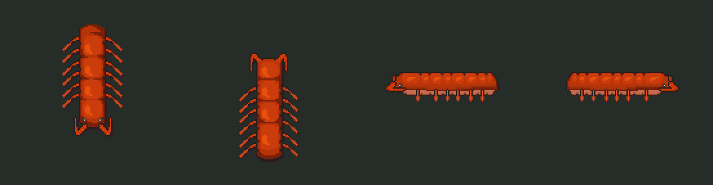
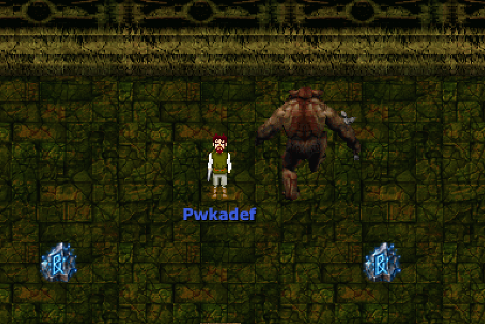

# Cueva de la Cola

Fecha: 2026-10-26. Estado: **en construcción**. Leandro aprobó todo lo propuesto (nombres, trofeo, caracola y gráficos). El sistema (instancias, grupo, ítems de mazmorra, mecánicas) está en [../MAZMORRAS.md](../MAZMORRAS.md). La mazmorra anterior de la serie es [01-GRUTA_DEL_ABISAL.md](01-GRUTA_DEL_ABISAL.md); la siguiente que ya existe es [02-CAVERNA_DE_LAS_LLAVES.md](02-CAVERNA_DE_LAS_LLAVES.md).

**Lugar en la serie:** es la segunda, y la que da la **Pluma de Roc** (ver [00-PATRON_LINKS_AWAKENING.md](00-PATRON_LINKS_AWAKENING.md)). La Caverna de las Llaves pide la pluma para entrar, así que con esta mazmorra la Caverna se puede abrir para todos.

Adaptación de la **Cueva de la Cola** (*Tail Cave*), el nivel 1 de *Link's Awakening*. No se copia baldosa por baldosa: se respeta la estructura jugable, que es esta:
- **Primera mitad:** tres llaves chicas, el mapa y la brújula, sin el ítem.
- **El ítem:** se llega bajando por un túnel, lejos del resto.
- **Después del ítem:** con la pluma se saltan los pozos que antes cortaban el paso a la llave del jefe y al minijefe.
- **El minijefe:** se vence saltando su rodillo.
- **El jefe:** pelea al borde del vacío. Si te tira, caés al piso de abajo y tenés que volver a subir.

## 1. Cómo funciona el original

Lo leímos sala por sala en el mapa del pedido (7 × 6 salas de Game Boy), con la guía de [Wikibooks](https://en.wikibooks.org/wiki/The_Legend_of_Zelda:_Link%27s_Awakening/Walkthrough/Tail_Cave) para el orden.

- **Abajo:** la entrada.
  - **Al oeste:** una sala con dos escarabajos entre dos fosos (al tirarlos, dan una llave) y la de la brújula, que se cierra hasta matar a cuatro babosas.
  - **Al norte:** la sala del botón (un foso en U con un escarabajo; el botón hace aparecer el cofre de una llave) y la del mapa. De la sala del mapa, una pared giratoria lleva a la sala grande.
- **Sala grande (el centro):**
  - una llave en un cofre al que le da vueltas una chispa;
  - un mini gusano que da rupias;
  - una pared rajada que lleva a una isla con la caracola secreta;
  - una trampa de cuchillas que se frena empujando un bloque;
  - arriba, en una cornisa, la llave del jefe, que se ve desde el principio pero no se alcanza.
- **Rama superior:** pasando la puerta con llave de la sala grande, una pasarela angosta con chispas. Después, la sala de los escarabajos de púas: al vencerlos aparece una escalera.
- **El ítem:** la escalera A baja a un pasaje lateral (plataformas, duendes y cuchillas) que sube por B a una columna aparte: un pasillo largo y la sala del cofre con la **Pluma de Roc**.
- **Con la pluma:**
  - se salta el pozo de la cornisa y se abre un bloque con cerradura: **llave del jefe**;
  - se salta el foso que corta la sala de al lado de la losa: **minijefe Rolling Bones**. Empuja un rodillo de púas del alto de la sala, que solo se esquiva saltando. Al vencerlo aparece un portal a la entrada.
- **Recta final:** la sala de las cuatro estatuas (con la escalera C) y la puerta del jefe. Moldorm pelea en una sala sin paredes: si te tira al pozo, caés al pasaje de abajo (D) y volvés a subir por C. Solo se le pega en la cola.
- **Contenido:** 3 llaves chicas, la llave del jefe, mapa, brújula, la losa (el pico de piedra), 20 rupias, la caracola secreta, la pluma y las escaleras A, B, C y D.

## 2. Mapas de AO

| Mapa | Nombre | Qué entra |
|---|---|---|
| **530** | Cueva de la Cola | Todas las salas del original menos la columna de la pluma: una cuadrícula de 6 × 5 salas de 16 × 12 baldosas (91 × 59), con roca en las celdas vacías. |
| **531** | Galerías | Lo que en Zelda es de costado (los dos pasajes) y la columna de la pluma: el Túnel de los duendes (A → B), la Sala B, el Pasillo y la Cámara de la pluma, y la Galería baja (D → C). |
| **532** | Guarida del Ciempiés | La plataforma del jefe (unas 26 × 20) rodeada de pozos, la sala del trofeo y el portal de salida. Va aparte por el combate de hasta 5 jugadores y porque sus pozos llevan a otro mapa. |

Una sala de 16 × 12 entra en una pantalla del juego, igual que en Zelda. Los pasajes de costado no se pueden hacer en AO, así que pasan a ser túneles vistos desde arriba: las plataformas son cornisas entre pozos.

**Gráficos:** propuesta de piso de baldosas de piedra gris y paredes de ladrillo de las mazmorras de AO, para diferenciarla de la Gruta (verde) y de la Caverna (tierra y roca). Las chispas, las cuchillas, el rodillo y el bloque con cerradura se eligen o se indexan al armar los mapas.

## 3. Salas

Celdas (columna, fila) desde arriba a la izquierda. El número de sector es el del pedido (sección 8).

### Mapa 530
| Sala | Celda | Sector | Contenido | Criaturas | Trampas |
|---|---|---|---|---|---|
| Entrada | (2,4) | 1 | Aparecés acá; portal de salida; **portal-atajo** al Rodillo (se activa al vencer al minijefe) | — | — |
| Escarabajos del foso | (1,4) | 6 | **K1** al vaciarla | 2 escarabajos que empujan | Pasillo entre dos fosos |
| Brújula | (0,4) | 6 | **Brújula** al vaciarla | 4 babosas | Se cierra al entrar |
| Botón | (2,3) | 7 | **K2**: pisar la placa del medio de la U hace aparecer el cofre | 1 escarabajo que empuja | Foso en U |
| Mapa | (3,3) | 7 | **Mapa** al vaciarla; al norte, puerta de un solo sentido (la pared giratoria) a la Gran sala | 2 esqueletos, 2 murciélagos | Se cierra al entrar |
| Murciélagos | (1,3) | 7 | Une la Gran sala con el Botón (la vuelta al sur) | 4 murciélagos | — |
| Gran sala: Mini gusano | (1,2) | 2 | Cofre de **50 de oro** al vencer al gusano; al oeste, el puente a la Isla, cortado por un pozo | Mini gusano | Pozos |
| Gran sala: Chispa | (2,2) | 2 | **K3** en un cofre al que le da vueltas una chispa: se abre entre pasada y pasada | Chispa | Chispa |
| Gran sala: Bloques | (3,2) | 2 | Puerta **L3** al este (Foso) | Murciélagos, esqueleto | Pasillo entre bloques |
| Gran sala: Cuchilla | (1,1) | 3 | Puerta **L1** al norte; una cuchilla barre la fila de la puerta hasta que se le pone un bloque adelante | Murciélagos | Cuchilla |
| Cornisa | (2,1)-(3,1) | 5 | **Llave del jefe** en una cornisa rodeada de pozos: se salta un pozo de 1 baldosa y se abre el bloque con cerradura **L2** | Escarabajo que empuja | Pozos |
| Isla de la caracola | (0,2) | 9 | **Caracola secreta**, en una isla rodeada de pozos (opcional, saltando) | — | Pozos |
| Pasarela de las chispas | (1,0)-(2,0) | 3 | Pasarela de 1 a 2 baldosas entre pozos; un bloque sobre la placa abre la puerta oeste | 2 chispas que rodean bloques, murciélagos | Pozos, chispas |
| Escarabajos de púas | (0,0) | 3 | Al vaciarla aparece la **escalera A** (a las Galerías) | 2 escarabajos de púas | Se cierra al entrar |
| Losa | (4,1) | 8 | **Losa** con la pista del jefe; se lee al vaciar la sala | Tres de un palo: 3 fuegos que hay que bajar juntos | Se cierra al entrar |
| Foso | (4,2) | 5 | Un foso de 1 baldosa corta la sala delante de la puerta este: sin pluma no se pasa | Esqueleto | Pozo para saltar |
| Rodillo | (5,2) | 10 | **Minijefe: Ogro del Rodillo**; al vencerlo se abre el norte y aparece el portal-atajo | Minijefe | Se cierra al entrar; rodillo de púas |
| Antesala | (5,1) | 11 | **Escalera C** (a la Galería baja) y **puerta del jefe** al norte | 4 estatuas que despiertan | Cuchillas en las esquinas |
| Umbral | (5,0) | 11 | **Escalera E** a la Guarida | — | — |

La Gran sala son las cuatro celdas de (1,1) a (3,2) sin paredes entre sí, como en el original. La Cornisa queda adentro, separada por pozos.

### Mapa 531 (Galerías)
| Sala | Sector | Contenido | Criaturas | Trampas |
|---|---|---|---|---|
| Túnel de los duendes | 4 | **Escalera A** al oeste → **escalera B** al este, unas 60 × 9. Sin pluma se pasa por cornisas; con la pluma, un atajo saltando | Duendes (goblins) | Pozos, cuchillas que corren por el túnel |
| Sala B | 4 | Llegada de la escalera B | — | — |
| Pasillo de la pluma | 4 | Pasillo largo de 1 a 2 baldosas | Murciélagos | Pasillo angosto |
| Cámara de la pluma | 4 | Cofre de la **Pluma de Roc** sobre una plataforma entre pozos | 2 escarabajos de púas | Pozos |
| Galería baja | 11 | **D**: adonde se cae desde la Guarida, al oeste. **Escalera C** al este, que sube a la Antesala. Cofre de **50 de oro** de consuelo | Esqueletos | Cuchillas |

### Mapa 532 (Guarida del Ciempiés)
| Sala | Sector | Contenido |
|---|---|---|
| Guarida | 11 | Plataforma de unas 26 × 20 rodeada de pozos de 2 baldosas. **Jefe: Ciempiés Colosal**. Caer en los pozos lleva a la Galería baja (D) |
| Sala del trofeo | 11 | Cofre del jefe (trofeo y oro, una vez por día) y portal de salida |

## 4. Recorrido

1. **Inicio, sin pluma** (llaves K1, K2 y K3):
   - Entrada → oeste: Escarabajos del foso (**K1**), con criaturas que empujan hacia los fosos. Más al oeste, la Brújula: se cierra hasta matar a las babosas (**brújula**).
   - Entrada → norte: Botón (pisar la placa: **K2**) → este: Mapa (se cierra: **mapa**) → la pared giratoria sube a la Gran sala, sin vuelta por ahí.
   - Gran sala:
     - la Chispa (**K3**, abriendo el cofre entre pasadas) y el Mini gusano (**50 de oro**);
     - la llave del jefe se ve en la Cornisa, pero hay un pozo en el medio;
     - el puente a la Isla está cortado;
     - Murciélagos es la vuelta al sur.
   - **L3** (Bloques → Foso): el foso corta la sala, pero al norte está la Losa. Se vence a Tres de un palo y se lee la pista del jefe.
   - Cuchilla: se empuja el bloque para cortarle el recorrido a la cuchilla, y **L1** abre la Pasarela de las chispas. El bloque sobre la placa abre la puerta oeste → Escarabajos de púas: al vencerlos aparece la **escalera A**.
2. **La pluma:** escalera A → Túnel de los duendes (531) → escalera B → Sala B → Pasillo → Cámara de la pluma: **Pluma de Roc**. Se vuelve por el túnel, ahora con un atajo saltando.
3. **Con la pluma** (en cualquier orden):
   - Cornisa: se salta el pozo y **L2** (bloque con cerradura): **llave del jefe**.
   - Isla: se salta el corte del puente: **caracola secreta** (opcional).
   - Foso: se salta → Rodillo: **Ogro del Rodillo**. Al vencerlo se abre el norte y queda el **portal-atajo** Rodillo ↔ Entrada, para volver rápido si falta algo.
4. **Recta final:** Antesala (despiertan las estatuas; cuchillas en las esquinas) → **puerta del jefe** → Umbral → escalera E → **Guarida del Ciempiés**. El que se cae vuelve por la Galería baja y la escalera C.

No hay forma de trabarse: las tres llaves abren las tres cerraduras, todas hacen falta, y ninguna cerradura pide una llave que esté detrás de otra.

## 5. Ubicaciones

### Llaves y puertas
| Llave | Dónde | Necesita | Abre (propuesta de orden) |
|---|---|---|---|
| K1 | Escarabajos del foso | Vaciar la sala sin caerse | L1: Cuchilla → Pasarela |
| K2 | Botón | Pisar la placa | L3: Bloques → Foso |
| K3 | Chispa | Abrir el cofre entre pasadas de la chispa | L2: bloque con cerradura de la Cornisa |
| Llave del jefe | Cornisa | Pluma (saltar el pozo) y L2 | Puerta del jefe: Antesala → Umbral |

Las llaves chicas abren cualquier cerradura; el orden de la tabla es el natural.

### Escaleras (los warps)
| Letra | Une | Para qué |
|---|---|---|
| A | Escarabajos de púas (530) ↔ Túnel de los duendes, oeste (531) | Bajar a buscar la pluma; aparece al vaciar la sala |
| B | Túnel de los duendes, este ↔ Sala B (531) | El final del túnel |
| C | Antesala (530) ↔ Galería baja, este (531) | La vuelta después de caerse en la Guarida |
| D | Pozos de la Guarida (532) → Galería baja, oeste (531) | Adonde se cae (como en el original, "TO D") |
| E | Umbral (530) → Guarida (532) | El jefe |
| Portal | Entrada ↔ Rodillo (530) | Atajo; aparece al vencer al minijefe |

### Recompensas
- **Principal: Pluma de Roc** (sección 6), en la Cámara de la pluma.
- **Secundarias:**
  - el mapa, la brújula y la losa;
  - la **caracola secreta** en la Isla, para el que ya domina el salto. Propuesta: un coleccionable nuevo de la serie que se guarda en el personaje, como los trofeos; en Zelda las caracolas se juntan para un premio;
  - 50 de oro en el Mini gusano y 50 de oro en la Galería baja (el consuelo del que se cae).
- **Del jefe:** el trofeo de la serie (propuesta: **Aguijón del Ciempiés**) y oro, una vez por día por personaje, como el Iris del Ojo.

### Minijefe y jefe

| Jefe: Ciempiés Colosal (sprite nuevo, propuesta) | Minijefe: Ogro del Rodillo (cuerpo del Ogro de AO) |
|---|---|
|  |  |

- **Minijefe: Ogro del Rodillo**, en el Rodillo (530), con el cuerpo del Ogro (NPC 577).
  - Es el Rolling Bones del original. Empuja un **rodillo de púas** del alto de la sala que la cruza de punta a punta.
  - Tocar el rodillo saca vida y empuja. Se esquiva **saltando** con la pluma justo cuando pasa.
  - Entre un rodillo y el siguiente el ogro queda expuesto. En grupo, el rodillo obliga a saltar a todos a la vez.
  - La sala se cierra hasta vencerlo.
- **Jefe: Ciempiés Colosal**, en la Guarida (532). Es el Moldorm del original; cómo se mueve está en la sección 6.1.
  - **Cuerpo:** en AO no hay ningún gusano de segmentos (el "Gusano de Arena" es un hombre lagarto). Se indexa el [LPC Centipede](https://opengameart.org/content/lpc-centipede) de FiveBrosStopMosYT: un ciempiés de pixel art visto desde arriba, con cuadros de 128 × 128. Licencia OGA-BY 3.0: solo pide el crédito, que va en los créditos del juego.
  - **Cómo se dibuja:** no como un personaje de AO (4 direcciones y de baldosa en baldosa), sino en partes: la cabeza, dos segmentos y la cola, recortados del sprite. Cada parte va girada hacia donde avanza y sigue el rastro exacto de la cabeza, así el cuerpo dobla en las curvas como en Zelda.
  - **Solo recibe daño en la cola:** la criatura de AO (con nombre y barra de vida, a la que se le pega y se le apunta) es la cola. La cabeza y los segmentos no se pueden golpear: si tocan a alguien, le sacan vida y lo empujan 2 baldosas.
  - **Los bordes son pozos:** el que cae aparece en la Galería baja (D). Si se caen todos los que estaban en la plataforma, el ciempiés **se cura**, como en el original.
  - **Más rápido:** después de cada golpe en la cola corre al doble por unos segundos, y por debajo de un cuarto de la vida corre al doble para siempre.
  - Es la pista de la losa: "El ciempiés solo siente los golpes en la cola. Saltale por encima y pegale atrás."

### Trampas
| Tipo | Dónde | Rol (igual que en Zelda) |
|---|---|---|
| Pozos | Escarabajos del foso, Botón, Cornisa, Pasarela, Guarida | Castigan el error y obligan a rodear |
| Pozos para saltar | Cornisa, Isla, Foso, atajo del Túnel | Lo que abre la pluma |
| Criaturas que empujan | Escarabajos del foso, Botón, Cornisa, Ciempiés | El riesgo de caer, como los escarabajos del original |
| Chispas | Chispa, Pasarela | Tiempo: pasar entre vuelta y vuelta |
| Cuchillas | Cuchilla, Túnel, Antesala, Galería baja | Se disparan al quedar en su fila o columna; un bloque las frena |
| Salas que se cierran | Brújula, Mapa, Escarabajos de púas, Losa, Rodillo | Combate obligatorio |
| Placas y bloques | Botón, Pasarela, Cuchilla | Puzzle que da llave o abre paso |
| Rodillo de púas | Rodillo | Solo se esquiva saltando |
| Caída al piso de abajo | Guarida | Perder tiempo y que el jefe se cure |

### Criaturas
Son plantillas nuevas con cuerpos que ya existen en AO, menos el jefe. Cumplen los roles del original:
- **De presión:** murciélagos (Murciélago), babosas y duendes (Goblin) en el Túnel, en salas amplias y en pasillos.
- **Guardianes:** escarabajos de púas y esqueletos, en las salas de llave y antes del minijefe.
- **Las que empujan:** los escarabajos (cuerpo de la Hormiga gigante). Su golpe te corre una baldosa, y al lado de un pozo eso es caerse.
- **Estatuas que despiertan:** las de la Antesala, como en la Caverna.
- **Tres de un palo:** en Zelda son tres naipes que hay que dejar en el mismo palo. Acá son tres fuegos que hay que bajar juntos; si queda uno, revive a los otros. Usa la mecánica de las criaturas en pareja de la Caverna.
- **Chispas:** no se pueden matar; dan vueltas a un bloque o a una pared y queman al tocarlas.
- **Mini gusano:** una serpiente grande, como el Mini Moldorm.

Pasean en 3 × 3 cuando no persiguen a nadie, y la dificultad escala con el tamaño del grupo, como en las otras.

## 6. El ítem: Pluma de Roc

**Ya está programada:** se hizo con la Caverna (ver [02-CAVERNA_DE_LAS_LLAVES.md](02-CAVERNA_DE_LAS_LLAVES.md), sección 7). Hasta ahora solo la daba un GM; esta mazmorra la entrega en un cofre.
- **Qué hace:** salta 2 baldosas adelante, en arco, por encima de 1 de pozo, lava, pinchos o piso que se desmorona. Corriendo con las botas cae 3 adelante.
- **Solo dentro de mazmorras.** Queda para siempre en el inventario de mazmorra.
- **Uso real en esta mazmorra:** hace falta para la llave del jefe (Cornisa), para llegar al minijefe (Foso), para esquivar su rodillo y para ponerse detrás del jefe. Sin la pluma no se termina. La Isla y el atajo del Túnel son premios para el que la domina.

### 6.1 Cómo se mueve el Ciempiés (Moldorm)

En AO las criaturas caminan de baldosa en baldosa en 4 direcciones; Moldorm no. Lo sacamos del código del original (el desensamblado [zladx/LADX-Disassembly](https://github.com/zladx/LADX-Disassembly), archivos `04_moldorm.asm` y `04_minimoldorm.asm`):

| En el original | En AO |
|---|---|
| 16 direcciones (de a 22,5°), velocidad constante: 1 píxel por cuadro | Igual: posición con decimales, unas 3 baldosas por segundo |
| Cada 6 cuadros (0,1 s) gira una dirección para un lado | Cada 0,1 s gira 22,5°: da vueltas en círculos de 1 a 2 baldosas |
| Cada 16 a 47 cuadros (0,3 a 0,8 s) sortea si gira a la izquierda o a la derecha | Igual: zigzaguea y a veces encadena una vuelta entera |
| Al chocar con una pared sale hacia el lado contrario y puede cambiar el sentido de giro | Igual, en el borde de la plataforma: no se cae a los pozos |
| La cabeza guarda su posición de cada cuadro; los 3 segmentos y la cola se dibujan donde estuvo la cabeza 12, 24, 36 y 46 cuadros antes | Igual: el server guarda el rastro y el cliente dibuja cada parte en su punto, girada |
| Después de un golpe, y con poca vida, avanza dos veces por cuadro | El doble de velocidad por 3 s después de cada golpe, y para siempre por debajo del 25 % |
| Solo la cola es vulnerable | La cola es la criatura de AO; el resto empuja |

El server simula el movimiento cada 50 ms y manda a los que miran la posición de la cabeza, el ángulo y la velocidad unas 10 veces por segundo. El cliente interpola y arma el cuerpo con su propio rastro, igual que el original. La cola se mueve de baldosa en baldosa siguiendo el rastro, para que se le pueda pegar y apuntar como a cualquier criatura.

## 7. Mecánicas nuevas que necesita

Las de las mazmorras anteriores ya están hechas: llaves, salas que se cierran, pozos, placas, bloques, losas, cofres ocultos, puertas de un solo sentido, estatuas que despiertan, criaturas en pareja y el salto. Faltan:

| Mecánica | Para qué |
|---|---|
| Chispas | Criaturas sin vida que recorren un circuito fijo y queman al tocarlas |
| Cuchillas | Trampas que salen disparadas por su fila o columna al ver a alguien y vuelven despacio; un bloque empujado les corta el recorrido |
| Empujón | El golpe de ciertas criaturas corre al jugador una o dos baldosas (y lo puede tirar a un pozo) |
| Rodillo de púas | El ataque del minijefe: una columna de púas que cruza la sala; no lastima al que está en el aire |
| Escalera y portal que aparecen | Al vaciar una sala: la escalera A y el portal-atajo |
| Pozos con destino | En la Guarida, caer lleva a la Galería baja y cura al jefe |
| Movimiento del Ciempiés | 16 direcciones, giros en círculo, rebote en el borde, cuerpo que sigue el rastro y velocidad que sube (sección 6.1) |
| Cola débil | Solo la cola recibe daño; la cabeza y el cuerpo empujan |
| Bloque con cerradura | Como una puerta con llave, pero en un bloque |
| Placa que hace aparecer un cofre | El Botón |

## 8. Los 11 sectores del pedido

| Sector del pedido | Dónde queda |
|---|---|
| 1. Entrada / hub inicial | Entrada: reparte al oeste (Escarabajos del foso, Brújula) y al norte (Botón, Mapa) |
| 2. Sector central principal | Gran sala: K3 con la chispa, el mini gusano y su oro, la vuelta al sur y el acceso a todo lo demás |
| 3. Rama superior de progresión | Cuchilla → Pasarela de las chispas → Escarabajos de púas (escalera A), y la Cornisa con la llave del jefe a la vista desde el principio |
| 4. Sector del ítem principal | Galerías: Túnel de los duendes, Sala B, Pasillo y Cámara de la pluma |
| 5. Puzzle con salto | Cornisa (llave del jefe), Foso (paso al minijefe), Isla y atajo del Túnel |
| 6. Rama izquierda secundaria | Escarabajos del foso (K1), Brújula e Isla de la caracola |
| 7. Rama derecha de progreso | Botón (K2), Mapa y Murciélagos |
| 8. Lore / pista | Losa: la pista del jefe, después de Tres de un palo |
| 9. Reward secundaria | Caracola secreta (Isla) y el oro del Mini gusano y de la Galería baja |
| 10. Encuentro importante | Ogro del Rodillo: abre la recta final y el portal-atajo |
| 11. Recta final | Antesala → puerta del jefe → Umbral → Guarida; la Galería baja y la escalera C para volver al caerse |

## 9. Qué cambia en la Caverna de las Llaves

- **Entrada:** la Caverna pide la pluma. Cuando esta mazmorra esté abierta para todos, la Caverna puede dejar de estar en desarrollo, porque la pluma ya se consigue jugando.
- **El salto** no cambia: es el mismo que ya usa la Caverna. Lo nuevo es que lo entrega un cofre.
- **El orden de la serie** queda: Gruta del Abisal (1), Cueva de la Cola (2), la de la pulsera (3, a definir) y Caverna de las Llaves (4).

## 10. Para confirmar

| Tema | Propuesta |
|---|---|
| Nombre de la mazmorra | Cueva de la Cola |
| Minijefe | Ogro del Rodillo, con el cuerpo del Ogro de AO |
| Jefe | Ciempiés Colosal, con el LPC Centipede indexado (sprite nuevo) y el movimiento de Moldorm |
| Trofeo | Aguijón del Ciempiés |
| Caracola secreta | Coleccionable nuevo de la serie, para un premio a definir |
| Gráficos | Piso de piedra gris y paredes de ladrillo de las mazmorras de AO |
| Piedra de invocación | NPC 9722, invocada por un GM como las otras; el lugar fijo se define después |

## Fuentes
- El mapa del pedido (VinnyVideo, 2008), con la leyenda de llaves, warps y objetos.
- [Wikibooks: Tail Cave](https://en.wikibooks.org/wiki/The_Legend_of_Zelda:_Link%27s_Awakening/Walkthrough/Tail_Cave): el orden del recorrido, Rolling Bones y Moldorm.
- [OpenGameArt: LPC Centipede](https://opengameart.org/content/lpc-centipede) de FiveBrosStopMosYT (OGA-BY 3.0, CC-BY-SA 3.0 y 4.0): el cuerpo del jefe.
- [zladx/LADX-Disassembly](https://github.com/zladx/LADX-Disassembly): el código de Moldorm (`src/code/entities/04_moldorm.asm` y `04_minimoldorm.asm`).
