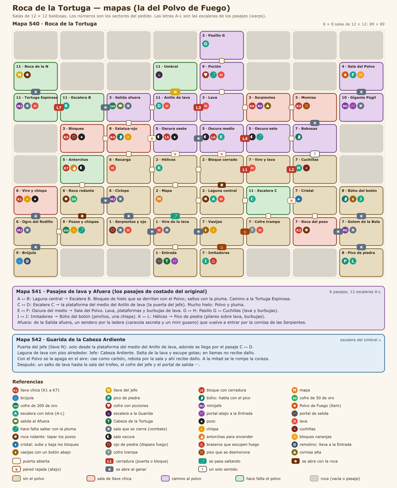
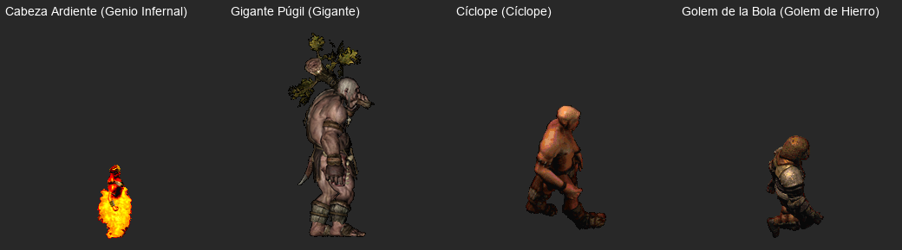

# Roca de la Tortuga

Fecha: 2026-10-26. Estado: **diseño, para confirmar**. El sistema (instancias, grupo, ítems de mazmorra, mecánicas) está en [../MAZMORRAS.md](../MAZMORRAS.md); el patrón de la serie, en [00-PATRON_LINKS_AWAKENING.md](00-PATRON_LINKS_AWAKENING.md).

**Lugar en la serie: a definir.** Leandro pasa las mazmorras sin orden y el orden se decide al final, según qué ítem pide cada una. Esta usa mucho la **Pluma de Roc** (Cueva de la Cola), así que tiene que ir después de la Cueva. Las Botas solo abren atajos. En el original es la octava, la última antes del final.

Adaptación de la **Roca Tortuga** (*Turtle Rock*), el nivel 8 de *Link's Awakening*, que da la **Vara de Fuego**. Acá el ítem es el **Polvo de Fuego**. No se copia baldosa por baldosa; se respeta la estructura jugable:
- **Es la más grande y laberíntica de la serie:** 45 salas, 6 pasajes y un tramo afuera.
- **Hay que volver atrás muchas veces:** el centro (la Laguna central) es el punto de paso, y los pasajes y un portal acortan las vueltas.
- **Primera parte, sin el ítem:** seis llaves chicas, el mapa, la brújula, el pico de piedra y cinco minijefes que ya se vieron en otras mazmorras (revanchas).
- **Mitad de mazmorra:** por las salas oscuras se llega al pasaje de lava, al **Gigante Púgil** (el minijefe propio) y al **Polvo de Fuego**.
- **Con el Polvo:** se encienden antorchas (llave 7), se derrite el hielo de los dos pasajes que faltan (la Tortuga Espinosa, la llave del jefe y la puerta del jefe) y se pelea con la **Cabeza Ardiente**.

## 1. Cómo funciona el original

Lo leímos con el mapa del pedido y lo cruzamos con el código del juego (el desensamblado [zladx/LADX-Disassembly](https://github.com/zladx/LADX-Disassembly): grilla, cofres, enemigos y eventos de cada sala), la lógica del randomizer [LADXR](https://github.com/daid/LADXR/blob/master/logic/dungeon8.py) y dos guías completas. Es una grilla de 8 × 8 celdas.

- **Fase A, suroeste:** de la entrada, salas que se cierran hasta vaciarlas, revanchas con Hinox y Rolling Bones, la primera roca rodante, la **brújula** (con una "aspiradora" que te devuelve a la entrada) y la **llave 1**.
- **Fase B, centro y sureste:**
  - la roca rodante central, sobre una laguna de lava;
  - el **mapa**, el **pico de piedra** (que hace hablar a los búhos) y la revancha con Smasher;
  - la **llave 2** tapando los pozos con otra roca;
  - un **cristal** que sube y baja bloques en toda la mazmorra;
  - un cofre trampa y una escalera oculta.
- **Fase C, este y norte:**
  - llaves 3 a 6: momias sobre piso que se desmorona; una estatua-ojo a la que hay que tirarle una flecha; bloques; y las Serpientes Dodongo, que se vencen desde arriba después de salir y volver a entrar por afuera;
  - búhos con pistas.
- **Fase D, salas oscuras:** tres salas sin luz con bloques con cerradura. Llevan al pasaje de lava, a **Blaino** (un boxeador que bloquea de frente y te puede mandar de un gancho a la entrada) y a la **Vara de Fuego**, detrás de bloques que hay que haber bajado con el cristal.
- **Fase E:** con la vara se encienden dos antorchas (**llave 7**). Un pasaje con hielo lleva a la revancha con Cue Ball y a la última roca rodante, que da la **llave de la Pesadilla**.
- **Fase F:** otro pasaje con hielo llega a la plataforma del medio de la sala de la puerta del jefe. Ahí espera **Hot Head**, en una laguna de lava.
- **Las 12 letras A-L** del mapa son las 12 escaleras que llevan a los 6 pasajes de costado, una en cada punta. Los teletransportes de verdad son aparte: Blaino ↔ entrada y la aspiradora.
- **Contenido:** 7 llaves chicas y 7 cerraduras (3 puertas y 4 bloques), llave de la Pesadilla, mapa, brújula, pico de piedra, 20 y 2 × 50 rupias, una medicina y la Vara de Fuego.

## 2. Mapas de AO

| Mapa | Nombre | Qué entra |
|---|---|---|
| **540** | Roca de la Tortuga | La grilla entera del original en un solo mapa: 8 × 8 celdas de 12 × 12 baldosas (89 × 89), con 45 salas. Las celdas vacías y las de los pasajes son roca. |
| **541** | Pasajes de lava y Afuera | Los 6 pasajes de costado, como túneles vistos desde arriba (lava, plataformas, hielo), y el sendero de afuera. |
| **542** | Guarida de la Cabeza Ardiente | La laguna de lava del jefe, la sala del trofeo y el portal de salida. Va aparte por el combate de hasta 5 jugadores. |

- **Las salas son de 12 × 12,** más chicas que las de la Cueva (16 × 12) y más cerca de las de Zelda (10 × 8). Así la grilla de 8 × 8 entra entera en un mapa y el mapa grande de la Mochila la muestra completa, como en el original.
- **Los pasajes de costado no se pueden hacer en AO:** pasan a ser túneles vistos desde arriba, donde las plataformas son islas entre lava.
- **Gráficos (propuesta):** piso de roca volcánica, paredes de roca oscura y lava de AO, para diferenciarla de las otras tres. El Afuera usa piso de exterior. Las antorchas, el hielo, las vasijas, la roca rodante, los bloques naranjas y el ojo de piedra se eligen o se indexan al armar los mapas.

## 3. Salas

Celdas (columna, fila) desde arriba a la izquierda, de 0 a 7. El número de sector es el del pedido (sección 9).

### Mapa 540

**Suroeste y entrada** (fase A)
| Sala | Celda | Sector | Contenido | Criaturas | Trampas |
|---|---|---|---|---|---|
| Entrada | (3,7) | 1 | Aparecés acá; portal de salida; **portal-atajo** (al vencer al Gigante Púgil). La puerta norte se abre al vencer a la **Cabeza de la Tortuga** | Cabeza de la Tortuga | Se cierra al entrar |
| Vire de la lava | (3,6) | 1 | Al norte, el Mapa, pasando la lava de un salto | Vire | Canales de lava; se cierra al entrar |
| Serpientes y ojo | (2,6) | 1 | Al vaciarla se abre el norte | 3 serpientes | Ojo de piedra sobre lava; se cierra |
| Cíclope | (2,5) | 6 | **Revancha: Cíclope** (el Hinox); al vencerlo se abre el oeste | Minijefe | Se cierra al entrar |
| Roca rodante | (1,5) | 6 | Primera **roca rodante**: abre el camino al sur; si tapa todos los pozos, cofre de **50 de oro** | — | Pozos |
| Pozos y chispas | (1,6) | 9 | Cofre de **200 de oro** al este, saltando | 2 chispas | Pozos |
| Ogro del Rodillo | (0,6) | 6 | **Revancha: Ogro del Rodillo**; abre norte y sur | Minijefe | Se cierra; rodillo de púas |
| Brújula | (0,7) | 9 | **Brújula** en una plataforma con baranda | 3 babosas escondidas | **Remolino**: te tira hacia él y, si llegás al centro, te deja en la Entrada (atajo) |
| Vire y chispa | (0,5) | 6 | **K1** al vaciarla | Vire | Chispa, pozos |

**Centro** (fase B)
| Sala | Celda | Sector | Contenido | Criaturas | Trampas |
|---|---|---|---|---|---|
| Mapa | (3,5) | 2 | **Mapa** (empujando bloques) | — | Bloques |
| Laguna central | (4,5) | 2 | Roca rodante sobre una laguna de lava: con ella se arma el camino al norte. **Escalera A** (pasaje A ↔ B) | — | Lava |
| Bloque cerrado | (4,4) | 2 | Bloque con cerradura **L1** al este | — | — |
| Hélices | (3,4) | 2 | **Escalera K** (pasaje K ↔ L); antorchas encendidas | 3 hélices | — |
| Recarga | (2,4) | 6 | Vasijas con pociones | — | Lava |

**Sureste** (fase B)
| Sala | Celda | Sector | Contenido | Criaturas | Trampas |
|---|---|---|---|---|---|
| Pico de piedra | (7,7) | 8 | **Pico de piedra**; **escalera L**; al vaciarla se abre el norte | 4 serpientes | Pozos, vasijas |
| Golem de la Bola | (7,6) | 7 | **Revancha: Golem de la Bola** (el Smasher); abre norte, oeste y sur | Minijefe | Se cierra |
| Búho del botón | (7,5) | 8 | Búho (pista de la roca rodante). Te encierra: el botón está bajo una vasija. **Escalera J** | 2 babosas | Ojo de piedra, pozos |
| Roca del pozo | (6,6) | 7 | Roca rodante sobre un pozo en diagonal: tapar todos da la **K2** | 2 babosas | Pozos |
| Cristal | (6,5) | 7 | **Cristal**: al golpearlo suben o bajan los bloques naranjas de toda la mazmorra | — | — |
| Escalera C | (5,5) | 11 | **Escalera C** (pasaje C ↔ D, al final) | — | — |
| Cofre trampa | (5,6) | 7 | Cofre del que sale una babosa | — | Lava |
| Vasijas | (4,6) | 7 | Un botón bajo una vasija abre el este y el sur | Hada | 2 chispas |
| Imitadores | (4,7) | 7 | Al vencer a los imitadores aparece la **escalera I** (pasaje I ↔ J: atajo al Búho) | 2 imitadores | 2 braseros que escupen fuego |

**Este y norte** (fase C)
| Sala | Celda | Sector | Contenido | Criaturas | Trampas |
|---|---|---|---|---|---|
| Vire y lava | (5,4) | 7 | Puerta **L2** al este | Vire | Lava |
| Cuchillas | (6,4) | 7 | **Escalera H** (pasaje G ↔ H); al norte, puerta de un solo sentido | Esqueleto | Cuchillas en las 4 esquinas |
| Babosas | (6,3) | 7 | Búho ("a los que tienen la llave, atacalos desde arriba"); al vaciarla se abre el norte | 4 babosas escondidas | — |
| Momias | (6,2) | 3 | **K3** al vaciarla | 2 momias | Piso que se desmorona |
| Serpientes | (5,2) | 3 | **Revancha: Serpientes Gemelas** en el piso bajo: desde abajo no reciben daño. Desde la **cornisa alta** (se llega por Afuera) sí. Al vencerlas, cofre con la **K6** | Minijefe | Cornisa |
| Lava | (4,2) | 3 | Puerta **L3** al oeste | 4 babosas | Lava |
| Poción | (4,1) | 9 | Cofre con **pociones** en una cornisa rodeada de lava, saltando | — | Lava |
| Pasillo G | (4,0) | 3 | **Escalera G** (pasaje G ↔ H) | — | — |
| Anillo de lava | (3,2) | 11 | Anillo de piso alrededor de lava. En la plataforma del medio, la **puerta del jefe** (N) y la **escalera D**, que solo se alcanzan desde el pasaje C ↔ D | — | Lava |
| Salida afuera | (2,2) | 3 | Salida al **Afuera** (arriba); cofre de **200 de oro** en una cornisa, saltando desde el oeste; al vaciarla se abre el oeste | Vire, 2 serpientes | Se cierra |
| Estatua-ojo | (2,3) | 8 | Búho ("si la estatua se ve rara, pegale"). Pegarle a la estatua-ojo da la **K4** | — | 2 chispas |
| Bloques | (1,3) | 3 | Empujando bloques aparece un cofre con la **K5** | — | Ojo de piedra, pozos |

**Salas oscuras** (fase D): se ve poco hasta encender sus antorchas, cosa que solo se puede con el Polvo. Antes se cruzan a oscuras.
| Sala | Celda | Sector | Contenido | Criaturas | Trampas |
|---|---|---|---|---|---|
| Oscura este | (5,3) | 5 | Puerta **L4** al oeste; una columna de pozos que se salta | 2 babosas | 2 chispas, pozos |
| Oscura del medio | (4,3) | 5 | **Escalera E** (pasaje E ↔ F) tapada por el bloque **L6**; la puerta al oeste se cierra | Serpiente | — |
| Oscura oeste | (3,3) | 5 | Bloque **L5**: abre el paso a la parte de arriba de la Oscura del medio, donde está L6 | 2 serpientes, hélice | Pozos |
| Antorchas | (1,4) | 5 | Dos antorchas apagadas: encendidas con el Polvo, cofre con la **K7** | 2 serpientes | Oscura |

**Norte, el ítem y el final** (fases D a F)
| Sala | Celda | Sector | Contenido | Criaturas | Trampas |
|---|---|---|---|---|---|
| Sala del Polvo | (7,1) | 4 | Llega la **escalera F**. Cofre del **Polvo de Fuego** detrás de **bloques naranjas** (tienen que estar bajados con el cristal) | — | — |
| Gigante Púgil | (7,2) | 10 | **Minijefe: Gigante Púgil**. Al vencerlo se abre el norte y aparece el **portal-atajo** a la Entrada | Minijefe | Se cierra |
| Escalera B | (1,2) | 11 | **Escalera B** (pasaje A ↔ B); puerta **L7** al oeste | — | — |
| Tortuga Espinosa | (0,2) | 11 | **Revancha: Tortuga Espinosa** en un anillo de piso alrededor de lava; al vencerla se abre el norte | Minijefe | Lava; se cierra |
| Roca de la llave del jefe | (0,1) | 11 | Última roca rodante: un pozo grande con dos antorchas en pilares. Tapar todo da la **llave del jefe** | — | Pozos |
| Umbral | (3,1) | 11 | Escalera a la **Guarida** (542) | — | — |

### Mapa 541 (Pasajes de lava y Afuera)
| Pasaje | Une | Contenido | Hace falta |
|---|---|---|---|
| A ↔ B | Laguna central ↔ Escalera B | Bloques de **hielo**; criaturas chicas | Polvo y pluma |
| C ↔ D | Escalera C ↔ plataforma del Anillo de lava | Mucho **hielo** | Polvo y pluma |
| E ↔ F | Oscura del medio ↔ Sala del Polvo | Lava, islas y burbujas de lava | Pluma |
| G ↔ H | Pasillo G ↔ Cuchillas | Lava, burbujas, 2 criaturas | Pluma |
| I ↔ J | Imitadores ↔ Búho del botón | Pinchos, una chispa, 2 criaturas | Pluma |
| K ↔ L | Hélices ↔ Pico de piedra | Pilares sobre lava, 5 burbujas | Pluma |
| Afuera | Salida afuera → cornisa de las Serpientes | Sendero por la ladera, **caracola secreta** y un mini gusano | — |

### Mapa 542 (Guarida de la Cabeza Ardiente)
| Sala | Sector | Contenido |
|---|---|---|
| Guarida | 11 | Laguna de lava de unas 16 × 10 con piso alrededor, en una sala de unas 22 × 16. **Jefe: Cabeza Ardiente** (sección 6.1) |
| Sala del trofeo | 11 | Al norte, pasando un hueco de lava de un salto, como en el original. Cofre del jefe (trofeo y oro, una vez por día) y portal de salida |

## 4. Recorrido

1. **Fase A, suroeste** (K1, brújula):
   - En la Entrada despierta la **Cabeza de la Tortuga**: hasta vencerla no se abre el norte.
   - Vire de la lava → Serpientes y ojo → **Cíclope** → Roca rodante (camino al sur y, opcional, **50 de oro**) → Pozos y chispas (**200 de oro** saltando) → **Ogro del Rodillo** → Brújula (**brújula**; el remolino es un atajo a la Entrada) y Vire y chispa (**K1**).
2. **Fase B, centro y sureste** (mapa, pico, K2, cristal):
   - Vire de la lava → norte saltando → Mapa (**mapa**) → Laguna central. La roca arma el camino al Bloque cerrado; L1 queda para después.
   - Hélices → escalera K → pasaje K ↔ L → Pico de piedra (**pico**) → **Golem de la Bola** → Búho del botón (romper la vasija y pisar el botón para salir) y Roca del pozo (**K2**) → Cristal (**bajar los bloques naranjas**).
   - Por el sur: Escalera C → Cofre trampa → Vasijas (el botón abre el paso) → Imitadores (la escalera I es un atajo al Búho).
3. **Fase C, este y norte** (K3 a K6):
   - Bloque cerrado: **L1** → Vire y lava: **L2** → Cuchillas → (un solo sentido) Babosas → Momias (**K3**) → Serpientes (todavía no se las puede lastimar) → Lava: **L3** → Anillo de lava (la puerta del jefe se ve en el medio, pero no se alcanza) → Salida afuera.
   - Estatua-ojo (**K4**) y Bloques (**K5**).
   - **Afuera:** el sendero (**caracola secreta**) vuelve a entrar por la cornisa de las Serpientes. Desde arriba se vence a las **Serpientes Gemelas** (**K6**).
4. **Fase D, salas oscuras y el Polvo:**
   - Babosas → Oscura este: **L4** → Oscura del medio → Oscura oeste: **L5** → parte alta de la Oscura del medio: **L6** → escalera E → pasaje de lava → Sala del Polvo.
   - Del lado de abajo, el **Gigante Púgil**. Al vencerlo se abre el paso y queda el portal-atajo a la Entrada.
   - **Polvo de Fuego**, si los bloques naranjas están abajo. Si no, hay que volver al cristal: con el portal y el remolino la vuelta es corta.
5. **Fase E, con el Polvo** (K7 y llave del jefe):
   - Portal a la Entrada → Roca rodante → Antorchas: encender las dos (**K7**).
   - Laguna central → escalera A → pasaje con hielo → Escalera B: **L7** → **Tortuga Espinosa** → Roca de la llave del jefe (**llave del jefe**).
6. **Fase F, el jefe:** Escalera C → pasaje con hielo → plataforma del Anillo de lava → **puerta del jefe** → Umbral → **Guarida**. Después, el salto a la sala del trofeo.

**No hay forma de trabarse:**
- Las llaves K1 a K6 salen antes de las cerraduras L1 a L6, y la K7 sale con el Polvo, para la L7.
- Una llave chica abre cualquier cerradura, así que el orden de arriba es el natural, no el único.
- Si alguien sube los bloques naranjas después de haberlos bajado, alcanza con volver a golpear el cristal.

## 5. Ubicaciones

### Llaves y cerraduras
| Llave | Dónde | Cómo | Cerradura (orden natural) |
|---|---|---|---|
| K1 | Vire y chispa | Vaciar la sala | L1: bloque del Bloque cerrado |
| K2 | Roca del pozo | Tapar todos los pozos con la roca | L2: puerta Vire y lava → Cuchillas |
| K3 | Momias | Vaciar la sala sin caerse | L3: puerta Lava → Anillo de lava |
| K4 | Estatua-ojo | Pegarle a la estatua | L4: puerta Oscura este → Oscura del medio |
| K5 | Bloques | Empujar los bloques | L5: bloque de la Oscura oeste |
| K6 | Serpientes | Vencerlas desde la cornisa | L6: bloque sobre la escalera E |
| K7 | Antorchas | Encender las dos con el Polvo | L7: puerta Escalera B → Tortuga Espinosa |
| Llave del jefe | Roca de la llave del jefe | Tapar todo con la roca | Puerta del jefe (Anillo de lava → Umbral) |

### Escaleras (los warps) y portales
| Letra | Une | Para qué |
|---|---|---|
| A ↔ B | Laguna central ↔ Escalera B | Con el Polvo: la Tortuga Espinosa y la llave del jefe |
| C ↔ D | Escalera C ↔ plataforma del Anillo de lava | Con el Polvo: la puerta del jefe |
| E ↔ F | Oscura del medio ↔ Sala del Polvo | El ítem |
| G ↔ H | Pasillo G ↔ Cuchillas | Atajo entre el norte y el este |
| I ↔ J | Imitadores ↔ Búho del botón | Atajo; la I aparece al vencer a los imitadores |
| K ↔ L | Hélices ↔ Pico de piedra | Al sureste |
| Portal | Entrada ↔ Gigante Púgil | Atajo; aparece al vencerlo (como el teletransporte de Blaino) |
| Remolino | Brújula → Entrada | Atajo de un solo sentido |
| Afuera | Salida afuera → cornisa de las Serpientes | El tramo de afuera |
| Guarida | Umbral → 542 | El jefe |

### Recompensas
- **Principal: Polvo de Fuego** (sección 6), en la Sala del Polvo.
- **Secundarias:**
  - el mapa, la brújula y el pico de piedra;
  - 50 de oro (Roca rodante), 200 de oro (Pozos y chispas, Salida afuera) y un cofre con pociones (Poción), que es la medicina del original;
  - la **caracola secreta** del Afuera, que en el original era una pieza de corazón.
- **Del jefe:** el trofeo de la serie (propuesta: **Corazón de Magma**; en el original, el Tambor del Trueno) y oro, una vez por día por personaje.

### Minijefes y jefe

En el original hay seis minijefes, cinco de ellos revanchas de las mazmorras anteriores. Acá las revanchas son los nuestros. Las de las mazmorras que todavía no existen usan un cuerpo de AO y se pueden cambiar cuando se diseñen:

| Minijefe | Original | Sala | Cuerpo | Cómo se pelea |
|---|---|---|---|---|
| **Cabeza de la Tortuga** | La cabeza de la entrada | Entrada | Tortuga gigante (539) dibujada grande, o un sprite nuevo | Sale de la pared norte, se mueve de costado y estira el cuello para embestir. Abre la mazmorra |
| **Cíclope** | Hinox (mazmorra 2) | Cíclope | Cíclope (582) | Embiste y empuja; guardián fuerte |
| **Ogro del Rodillo** | Rolling Bones (mazmorra 1) | Ogro del Rodillo | Ogro (577), el de la Cueva | Igual que en la Cueva: el rodillo se salta |
| **Golem de la Bola** | Smasher (mazmorra 6) | Golem de la Bola | Golem de Hierro (579) | Tira su bola de hierro. Sin la Pulsera no se la puede agarrar: la bola rebota por la sala y queda un rato en el piso, y ahí el golem está expuesto |
| **Serpientes Gemelas** | Serpientes Dodongo (mazmorra 3) | Serpientes | Serpiente (504), las de la Caverna | Como en la Caverna (hay que bajarlas juntas), pero solo reciben daño de los que están en la cornisa alta. En el original se les tiran bombas desde arriba |
| **Tortuga Espinosa** | Cue Ball (mazmorra 4) | Tortuga Espinosa | Tortuga gigante (539) | Como en la Gruta: da vueltas al anillo y embiste; aturdida al chocar, se le pega |
| **Gigante Púgil** | Blaino (propio) | Gigante Púgil | Gigante (586) | Ver abajo |

- **Gigante Púgil** (Blaino), en el Gigante Púgil, con el cuerpo del Gigante de AO:
  - **Movimiento:** avanza a saltitos y se alinea con su objetivo.
  - **Ataques:** tira cinco golpes cortos y después uno al azar. Uno es una embestida que te deja mareado unos 2,5 s. Otro es un **gancho** que te manda volando a la **Entrada**, como en el original.
  - **Defensa:** bloquea todo lo que le llega **de frente**, golpes y hechizos. Hay que pegarle de costado o por la espalda; en grupo, rodearlo.
  - **Al vencerlo:** se abre el paso al Polvo y aparece el portal-atajo.
- **Jefe: Cabeza Ardiente** (Hot Head), en la Guarida (542), con el cuerpo del Genio Infernal (748), que ya es una bola de fuego. Cómo se pelea, en la sección 6.1.

### Trampas
| Tipo | Dónde | Rol (igual que en Zelda) |
|---|---|---|
| Lava | Casi todas las salas, los pasajes y la Guarida | Quema, saca vida y te devuelve al borde; se salta con la pluma |
| Pozos | Roca rodante, Pozos y chispas, Vire y chispa, Bloques, Oscuras, salas de roca | Castigan el error |
| Roca rodante | Roca rodante, Laguna central, Roca del pozo, Roca de la llave del jefe | Puzzle: dirigir la roca para tapar los pozos |
| Salas que se cierran | Entrada, Vire de la lava, Serpientes y ojo, salas de minijefe, Salida afuera | Combate obligatorio |
| Salas oscuras | Las tres Oscuras y Antorchas | Avanzar viendo poco; con el Polvo se iluminan |
| Ojo de piedra | Serpientes y ojo, Búho del botón, Bloques | Si quedás en su fila o columna, dispara fuego (el Beamos) |
| Braseros | Imitadores | Escupen fuego cada tanto |
| Chispas y cuchillas | Varias; las cuchillas, en las esquinas de Cuchillas | Las de la Cueva |
| Piso que se desmorona | Momias | Si te quedás quieto, se hunde (el de la Caverna) |
| Remolino | Brújula | Te arrastra; si llegás al centro, volvés a la Entrada |
| Burbujas de lava | Pasajes | Saltan de la lava y queman |
| Bloques naranjas | Sala del Polvo | Suben y bajan con el cristal |

### Criaturas
Son plantillas nuevas con cuerpos de AO. Cumplen los roles del original:
- **De presión:** serpientes, babosas que aparecen de golpe (los Zol), hélices (los Peahat: vuelan y mientras vuelan no reciben daño) y vire (Imp de AO, que al morir se parte en dos murciélagos y tira bolas de fuego).
- **Guardianes:** momias (los Gibdo; quemadas con el Polvo quedan en esqueleto), esqueletos y los minijefes.
- **Imitadores** (los Mimic): se mueven al revés que vos. Al vencerlos aparece la escalera I.
- **Chispas y cuchillas:** las de la Cueva.

Pasean en 3 × 3 cuando no persiguen a nadie, y la dificultad escala con el tamaño del grupo, como en las otras.

## 6. El ítem: Polvo de Fuego

Adapta la Vara de Fuego (*Magic Rod*) del original. Es un ítem de mazmorra como la Pluma y las Botas: queda para siempre en el personaje, se pone en una de las dos teclas de la Mochila (Z o X) y **solo funciona adentro de las mazmorras**. Ocupa la casilla de la "Vara mágica" en la Mochila.

- **Qué hace:** tira una llamarada que vuela en línea recta hacia adonde mirás, hasta 6 baldosas o hasta chocar. Tiene un enfriamiento corto, menos de un segundo.
- **Usos en esta mazmorra:**
  - **Enciende antorchas:** las de las salas oscuras, que se iluminan, y las dos de Antorchas, que dan la K7.
  - **Derrite el hielo:** los bloques de los pasajes A ↔ B y C ↔ D, que son el camino a la llave del jefe y al jefe.
  - **Quema criaturas:** hace daño de fuego y el doble a babosas, momias, hélices y vire.
  - **Contra el jefe:** apaga a la Cabeza Ardiente en el aire y, cuando se le rompe la coraza, le hace daño directo.
- **Uso real:** sin el Polvo no se consiguen la K7 ni la llave del jefe, y no se llega al jefe ni se lo vence.
- **Para las otras mazmorras:** sirve para antorchas, hielo y telarañas que tapan pasos.

### 6.1 Cómo se pelea la Cabeza Ardiente (Hot Head)

Lo sacamos del código del original (`05_hot_head.asm`). La sala de Hot Head tiene una laguna de lava de 7 × 5 en una sala de 10 × 8; la de AO es más grande, para hasta 5 jugadores.

| En el original | En AO |
|---|---|
| Espera sumergida ~1 s y sale en uno de 8 puntos de la laguna al azar | Igual: 8 puntos repartidos en la laguna |
| Salta en horizontal hacia el otro lado: ~3 baldosas en ~0,8 s, en arco | Igual. En llamas no recibe daño de nada |
| Al caer en la lava tira 4 gotas en diagonal, que vuelan ~2 baldosas y queman el piso 0,25 s | Igual. La gota y el contacto sacan vida (las gotas, menos) |
| Un disparo de la vara en el aire la apaga: cae, tiembla ~1 s y rebota en diagonal por toda la sala ~4,3 s | El **Polvo de Fuego** la apaga en el aire. Queda como **cabeza de carbón**, rebotando por la sala (también por el piso) unos 5 s: **ahí recibe daño de todo** |
| Con 5 golpes mientras está apagada se le rompe la coraza | La coraza es la mitad de la vida: al llegar a la mitad se rompe y queda la cabeza chica |
| Fase 2: mismos saltos y gotas; la vara le hace daño (2 disparos) | Fase 2: cabeza más chica y algo más rápida, y más gotas. Ya no se apaga: el Polvo le hace mucho daño, y las armas y hechizos le pegan cuando está fuera de la lava |
| Al morir cae el contenedor de corazón | Se abre el paso a la sala del trofeo |

- **Cómo se dibuja:** como el Ciempiés, el server mueve a la Cabeza (sin baldosas, en arco) y el cliente la dibuja.
  - En llamas: el cuerpo del Genio Infernal.
  - Apagada: el mismo, oscurecido.
  - En la fase 2: más chico.
- **Pista del búho de la Guarida:** "Apagala en el aire con el Polvo y pegale mientras es carbón."

## 7. Qué cambia respecto del original

El original pide ítems que en nuestra serie no existen. Se reemplazan sin cambiar el rol de cada sala:

| En el original | Para qué | Acá |
|---|---|---|
| Canción del Alma de la Rana | Despertar la cabeza de la entrada | Despierta sola al llegar |
| Bombas | Paredes bombeables y las Serpientes Dodongo | Las paredes que hacen falta pasan a ser puertas. Las que son atajo pasan a ser **paredes rajadas**, que se rompen con la Carrera (Botas) y son opcionales. Las Serpientes se vencen desde la cornisa |
| Gancho | El oro de la Salida afuera, la medicina, un bloque de la sala oscura y un pasaje | Saltos con la pluma |
| Pulsera | Vasijas sobre botones y la bola de Smasher | Las vasijas se rompen a golpes; el Golem de la Bola, como está arriba |
| Arco | La estatua-ojo | Cualquier golpe o hechizo |
| Polvo mágico | Encender las salas oscuras antes de tener la vara | Se cruzan a oscuras; con el Polvo se iluminan |
| Pico de piedra | Que hablen los búhos | Igual: sin el pico, los búhos no dicen nada |

## 8. Mecánicas nuevas que necesita

Ya están hechas las de las mazmorras anteriores:
- llaves, salas que se cierran, pozos, lava, placas, bloques y bloques con cerradura;
- cofres ocultos, puertas de un solo sentido, paredes rajadas y piso que se desmorona;
- chispas, cuchillas, el rodillo y el empujón;
- portal-atajo y escaleras que aparecen, criaturas en pareja, que flotan y que se dividen;
- el salto y la Carrera.

Faltan:

| Mecánica | Para qué |
|---|---|
| Polvo de Fuego | El ítem: la llamarada, con su efecto que vuela (sección 6) |
| Antorchas | Apagadas y encendidas; al encender todas las de una sala aparece un cofre |
| Salas oscuras | Se ve poco hasta encender las antorchas de la sala |
| Bloques de hielo | Tapan el paso hasta derretirlos con el Polvo |
| Roca rodante | Se la empuja y rueda sola mientras haya pozo o lava, y el jugador la dirige con las flechas. Cada baldosa que pisa queda como piso. Al tapar todo, premio; si alguien se equivoca, se reinicia al salir todos de la sala |
| Cristal y bloques naranjas | Golpear el cristal sube o baja los bloques de toda la corrida |
| Ojo de piedra y braseros | Disparan fuego por su fila o columna: el ojo, al verte; el brasero, cada tanto |
| Burbujas de lava | Saltan de la lava en puntos fijos |
| Remolino | Arrastra hacia el centro, salvo al que está en el aire; el centro lleva a la Entrada |
| Vasijas | Se rompen a golpes o con el Polvo; abajo puede haber un botón |
| Estatua-ojo | Golpearla suelta una llave |
| Pico de piedra y búhos | Ítem de la corrida, como el mapa; sin él los búhos no hablan. Va en la Mochila |
| Daño solo desde la cornisa | Las Serpientes Gemelas solo reciben daño de los que están en la cornisa alta |
| Golpes de frente bloqueados y gancho a la Entrada | El Gigante Púgil |
| Imitadores | Criaturas que se mueven al revés que el jugador más cercano |
| Cabeza de la Tortuga, Tortuga Espinosa y Cabeza Ardiente | Movimiento propio de cada una (sección 5 y 6.1) |

## 9. Los 11 sectores del pedido

| Sector del pedido | Dónde queda |
|---|---|
| 1. Entrada / hub inicial | Entrada con la Cabeza de la Tortuga, Vire de la lava y Serpientes y ojo: reparte al oeste, al norte (saltando) y al este |
| 2. Sector central principal | Laguna central, Mapa, Bloque cerrado y Hélices: el punto de paso al que se vuelve siempre |
| 3. Rama superior de exploración | El norte: Momias, Serpientes, Lava, Salida afuera, Bloques, el Pasillo G y el Afuera |
| 4. Sector del ítem principal | Pasaje E ↔ F y Sala del Polvo |
| 5. Puzzle con fuego | Las salas oscuras, Antorchas (K7), los pasajes con hielo y la Cabeza Ardiente |
| 6. Rama izquierda secundaria | Cíclope, Roca rodante, Ogro del Rodillo, Vire y chispa (K1), Brújula con el remolino y Recarga |
| 7. Rama derecha de progresión | Vire y lava, Cuchillas, Babosas, Cristal, Roca del pozo (K2), Golem de la Bola, Vasijas, Cofre trampa e Imitadores |
| 8. Lore / pista | Pico de piedra y los búhos (Búho del botón, Babosas, Estatua-ojo y la Guarida) |
| 9. Reward secundaria | Mapa, Brújula, 50 y 200 de oro, las pociones y la caracola secreta |
| 10. Encuentro importante | Gigante Púgil: abre el camino al Polvo y el portal-atajo |
| 11. Tramo final | Escalera B, Tortuga Espinosa, la roca de la llave del jefe, el pasaje con hielo, el Anillo de lava, el Umbral y la Guarida |

## 10. Cómo se construye

Es la mazmorra más grande. Para que cada parte se pueda probar y mergear sola, se arma en tres PR después de este:
1. **Polvo de Fuego y mecánicas de recorrido:**
   - el ítem;
   - antorchas y salas oscuras, hielo, roca rodante, cristal, ojo de piedra y braseros, burbujas, remolino, vasijas, estatua-ojo, pico y búhos;
   - una sala de prueba en la mazmorra de prueba.
2. **Mapas 540-542, criaturas, revanchas y música:**
   - el recorrido completo hasta la puerta del jefe;
   - las revanchas, con los minijefes de la Cueva y de la Caverna;
   - tres temas y uno de combate. Candidatos libres en OpenGameArt: *Lava Area Theme*, *Tower of Lava*, *Shrine to the Smoldering Volcano* y, para el combate, *Lava Dungeon Battle*.
3. **Jefes:** Cabeza de la Tortuga, Gigante Púgil, Tortuga Espinosa y Cabeza Ardiente. La prueba completa en vivo va acá.

**Números:**
- Mapas 540-542.
- Piedra de invocación: NPC 9723. Por ahora la invoca un GM, y el lugar fijo se define después, como las otras.
- Plantillas de criaturas: desde 9744.
- Va como `soloDesarrollo` y pide la pluma.

## 11. Para confirmar

| Tema | Propuesta |
|---|---|
| Nombre de la mazmorra | Roca de la Tortuga |
| Ítem | Polvo de Fuego, en la casilla de la Vara mágica de la Mochila |
| Jefe | Cabeza Ardiente, con el cuerpo del Genio Infernal |
| Minijefe propio | Gigante Púgil, con el cuerpo del Gigante |
| Revanchas | Cíclope, Ogro del Rodillo, Golem de la Bola, Serpientes Gemelas y Tortuga Espinosa |
| Cabeza de la Tortuga | Tortuga gigante dibujada grande, o buscar un sprite nuevo |
| Trofeo | Corazón de Magma |
| Gráficos | Roca volcánica, paredes de roca oscura y lava |
| Dependencias | Pide la pluma (va después de la Cueva). Las Botas solo abren atajos |

## Fuentes
- El mapa del pedido (VinnyVideo, 2008), con la leyenda de llaves, warps y objetos.
- [zladx/LADX-Disassembly](https://github.com/zladx/LADX-Disassembly):
  - la grilla de salas (`src/data/maps/layouts.asm`);
  - los cofres, enemigos y eventos de cada sala;
  - el código de Hot Head (`src/code/entities/05_hot_head.asm`), de Blaino (`18_blaino.asm`), de la cabeza de tortuga (`18_turtle_rock_head.asm`) y de la roca rodante (`07_holefiller.asm`).
- [LADXR, lógica de la mazmorra 8](https://github.com/daid/LADXR/blob/master/logic/dungeon8.py): qué pide cada zona.
- [VGMaps: mapa de Revned](https://www.vgmaps.com/Atlas/GB-GBC/LegendOfZelda-Link'sAwakeningDX-TurtleRock.png).
- [Zelda's Palace: recorrido](https://www.zeldaspalace.com/linksawakening/soluce.php?p=17) y [Gamer Guides: Turtle Rock](https://gamerguides.com/the-legend-of-zelda-links-awakening/guide/walkthrough/thunder-drum/turtle-rock).
- [Zelda Wiki: Hot Head](https://zeldawiki.wiki/wiki/Hot_Head) y [Blaino](https://zeldawiki.wiki/wiki/Blaino).
