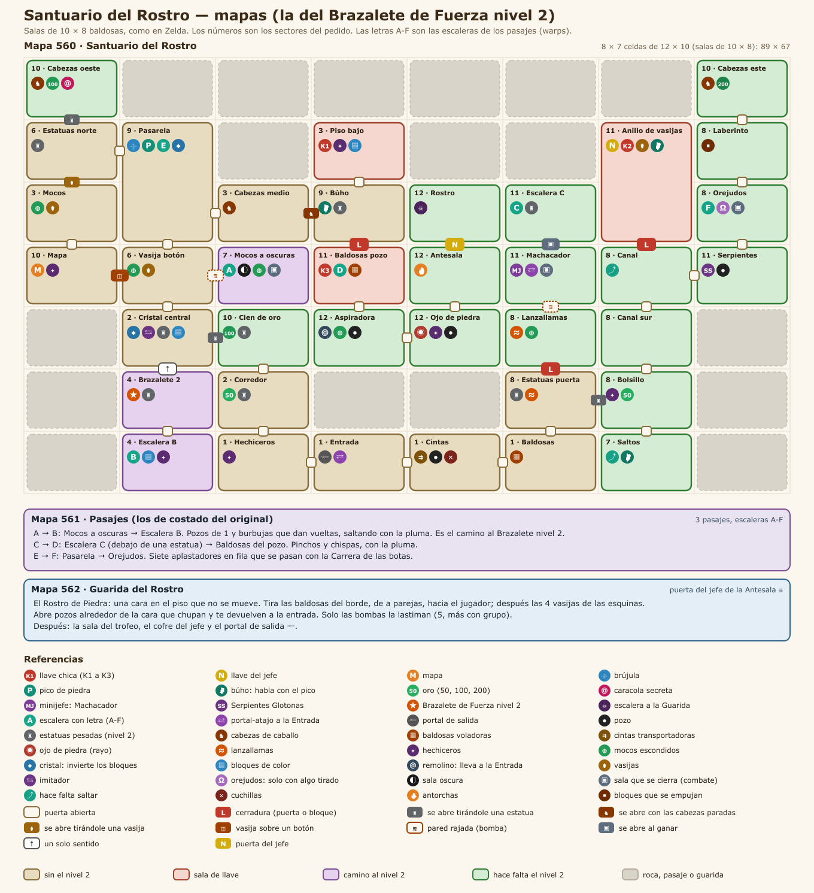

# Santuario del Rostro

Fecha: 2026-10-27. Estado: **diseño aprobado** (Leandro aprobó todo y pidió el gancho como en el original); en construcción. El sistema (instancias, grupo, ítems de mazmorra, mecánicas) está en [../MAZMORRAS.md](../MAZMORRAS.md); el patrón de la serie, en [00-PATRON_LINKS_AWAKENING.md](00-PATRON_LINKS_AWAKENING.md).

**Lugar en la serie: a definir.** Leandro pasa las mazmorras sin orden y el orden se decide cuando estén todas. En el original es la sexta.
- **Ítem:** da el **Brazalete de Fuerza nivel 2**.
- **Para entrar:** pide el **Brazalete de Fuerza**, porque las vasijas, las cabezas de caballo y la bola del minijefe se levantan con el nivel 1.
- **Otros ítems que usa:** como en el original, la Pluma de Roc, las Botas de Pegaso, el **Gancho** (lo da la mazmorra que sigue) y los básicos (bombas, arco y polvo mágico).

Adaptación del **Santuario del Rostro** (*Face Shrine*), el nivel 6 de *Link's Awakening*. No se copia baldosa por baldosa; se respeta la estructura jugable:
- **Un laberinto grande:** 40 salas en una grilla de 8 × 7 y tres pasajes, con cristales que cambian los bloques de toda la mazmorra.
- **La primera parte:**
  - se busca el **Brazalete nivel 2** por la sala oscura de los mocos y un pasaje;
  - con él se levantan las **estatuas pesadas** y se las tira contra las persianas para abrirlas.
- **El medio:**
  - tres llaves chicas, el **Machacador** (el minijefe, al que se le devuelve su bola de hierro) y las **Serpientes Glotonas**, que solo mueren comiendo bombas;
  - la **llave del jefe**, en un cofre rodeado de vasijas que se abre tirándole una vasija.
- **El final:** el **Rostro de Piedra**, una cara en el piso que tira las baldosas y las vasijas de su sala y abre pozos alrededor. Solo le hacen daño las bombas.

## 1. Cómo funciona el original

Lo leímos con el mapa del pedido (VinnyVideo, 2008) y lo cruzamos con el código del juego (el desensamblado [zladx/LADX-Disassembly](https://github.com/zladx/LADX-Disassembly): grilla, salas, cofres, enemigos y eventos) y con la lógica del randomizer [LADXR](https://github.com/daid/LADXR/blob/master/logic/dungeon6.py). El análisis completo sala por sala está en el scratchpad (`dungeon6/original.md`).

- **La grilla:** 8 columnas × 7 filas con 40 salas vistas desde arriba (dos son habitaciones de dos pantallas) y 3 pasajes de costado en la fila de arriba.
- **Las salas son de 10 × 8 baldosas:** más chicas que en las otras mazmorras, por eso entran todas.
- **Cuatro mecánicas que lo definen:**
  - **las estatuas pesadas:** solo las levanta la Pulsera L-2 (15 en toda la mazmorra), y varias se tiran contra una **persiana** para abrirla;
  - **las cabezas de caballo:** se tiran con la L-1 y caen paradas o acostadas (50 %); con las dos paradas, se abre la sala;
  - **los cristales:** cambian los bloques bajos de toda la mazmorra; si estás parado sobre uno cuando sube, quedás arriba;
  - **las baldosas voladoras:** se despegan y vuelan hacia Link; en una sala dejan pozos.
- **Llaves:** 3 llaves chicas para 3 cerraduras (una puerta y dos bloques cerradura), más la Llave de Pesadilla.
- **Warps:**
  - **A ↔ B:** el camino a la Pulsera L-2;
  - **C ↔ D:** después del minijefe, hacia la tercera llave;
  - **E ↔ F:** hacia el cuadrante noreste, donde está la Llave de Pesadilla;
  - **el teletransportador:** se activa al vencer al minijefe.
- **Minijefes:**
  - **Smasher:** tira una bola de hierro que Link levanta y le devuelve; 4 golpes;
  - **Dodongo Snakes:** solo mueren comiendo bombas, 3 cada una.
- **Jefe:** **Facade**, una cara en el piso que no se mueve.
  - **Ataques:** tira 20 baldosas, después las 4 vasijas de las esquinas, y abre pozos que chupan.
  - **Cómo se lo daña:** solo con bombas; son 5.

## 2. Mapas de AO

| Mapa | Nombre | Qué entra |
|---|---|---|
| **560** | Santuario del Rostro | La grilla del original en un mapa: 8 × 7 celdas de 12 × 10 baldosas, con salas de 10 × 8 adentro (las del original). Ocupa 89 × 67 |
| **561** | Pasajes | Los 3 pasajes de costado, como túneles vistos desde arriba |
| **562** | Guarida del Rostro | La sala del jefe (más grande que la del original, para hasta 5 jugadores) y la del trofeo |

- **Salas de 10 × 8,** como en Zelda. Las otras mazmorras usan 14 × 10, pero con 40 salas la grilla no entra en un mapa de 100 × 100 de otra forma. Las salas de pelea más dura (el Machacador y las Serpientes) siguen siendo de una celda, como en el original.
- **Gráficos (propuesta):** piso de baldosas con dibujo y paredes de piedra tallada, distintos de las otras mazmorras.

## 3. Salas

Celdas (columna, fila) desde arriba a la izquierda, de 0 a 7 y de 0 a 6. El número de sector es el del pedido (sección 9). "Persiana" es una puerta que se abre con el evento de la sala; "estatua" es una estatua pesada (solo con el Brazalete nivel 2).

### Mapa 560

**Abajo, la entrada y el camino al Brazalete nivel 2**
| Sala | Celda | Sector | Contenido | Criaturas | Trampas |
|---|---|---|---|---|---|
| Entrada | (3,6) | 1 | Aparecés acá; portal de salida; **portal-atajo** al Machacador (al vencerlo) | — | — |
| Hechiceros | (2,6) | 1 | Paso hacia el corredor | 3 hechiceros | — |
| Escalera B | (1,6) | 4 | Llega la **escalera B** dentro de un anillo de bloques altos (se sale bajándolos con un cristal) | Mini gusano, 2 hechiceros | Bloques de color |
| Brazalete nivel 2 | (1,5) | 4 | Cofre del **Brazalete de Fuerza nivel 2**. Dos estatuas tapan la pared giratoria hacia el Cristal central (de un solo sentido) | — | Estatuas |
| Corredor | (2,5) | 2 | Cofre de **50 de oro** detrás de una estatua; un corredor une la Entrada con el Cristal central | Mini gusano, chispa | — |
| Cintas | (4,6) | 1 | Dos lazos de **cinta transportadora** con pozos y 2 cuchillas | — | Cintas, pozos, cuchillas |
| Baldosas | (5,6) | 1 | 16 **baldosas voladoras** | — | Baldosas voladoras |
| Saltos | (6,6) | 7 | Saltar sobre los bloques levantados (pluma) hasta el bolsillo del cofre de los Hechiceros del bolsillo. Búho detrás de una vasija | 2 estrellas | Cuchilla |

**El centro y el oeste**
| Sala | Celda | Sector | Contenido | Criaturas | Trampas |
|---|---|---|---|---|---|
| Cristal central | (1,4) | 2 | **Cristal** en el centro, 4 bloques bajos; una estatua se tira contra la persiana este | Imitador | Bloques de color |
| Cien de oro | (2,4) | 10 | Cofre de **100 de oro**; estatua contra la persiana sur | — | Estatua |
| Mapa | (0,3) | 10 | **Mapa** al vencer a los hechiceros. Cristal | 3 hechiceros | — |
| Vasija del botón | (1,3) | 6 | Una **vasija sobre un botón** abre la persiana oeste; **pared rajada oculta** al este (bomba) | 2 mocos escondidos | — |
| Mocos a oscuras | (2,3) | 7 | Sala oscura con 2 antorchas; al vencer a los 4 mocos escondidos aparece la **escalera A** | 4 mocos escondidos | Oscura, se cierra |
| Mocos escondidos | (0,2) | 3 | Se tira una vasija contra la persiana norte | 3 mocos escondidos | Vasijas |
| Estatuas del norte | (0,1) | 6 | Se tira una **estatua** contra la persiana norte, hacia las Cabezas del oeste | 2 chispas | Estatuas |
| Cabezas del oeste | (0,0) | 10 | Cofre de **100 de oro** y la **caracola secreta**. Dos **cabezas de caballo** abren la persiana para volver | Estrella | Cabezas |

**Arriba al medio**
| Sala | Celda | Sector | Contenido | Criaturas | Trampas |
|---|---|---|---|---|---|
| Pasarela | (1,1)-(1,2) | 9 / 10 | Sala de dos celdas: **brújula** arriba, **pico de piedra** abajo y la **escalera E**. Una pasarela cercada lleva a las Cabezas del medio | Estrella, lanzallamas | Bloques de color |
| Cabezas del medio | (2,2) | 3 | Dos **cabezas de caballo** abren las persianas oeste y este | — | Cabezas |
| Búho de la pasarela | (3,2) | 9 | **Búho** (pista del jefe). Estatua contra la persiana oeste. Al sur, un **bloque cerradura** baja a las Baldosas del pozo | 2 chispas | Estatuas |
| Hechiceros del piso bajo | (3,1) | 3 | Piso de bloques bajos; **K1** al vencer a los hechiceros | 2 hechiceros | Bloques de color |
| Escalera C | (5,2) | 11 | Una **estatua** tapa la **escalera C** | — | Estatua |
| Machacador | (5,3) | 11 | **Minijefe: el Machacador.** Al vencerlo aparece el **portal-atajo** a la Entrada | Minijefe | Se cierra |
| Lanzallamas | (5,4) | 8 | Puerta con llave al sur; **pared rajada** al norte (bomba, hacia el Machacador) | 2 mocos, 2 lanzallamas | Lanzallamas |

**El este**
| Sala | Celda | Sector | Contenido | Criaturas | Trampas |
|---|---|---|---|---|---|
| Estatuas de la puerta | (5,5) | 8 | **Puerta con llave** al norte; se tiran 2 estatuas contra la persiana este | — | Estatuas, lanzallamas |
| Hechiceros del bolsillo | (6,5) | 8 | Un bolsillo con un cofre de **oro**, al que se llega desde los Saltos | 4 hechiceros | — |
| Canal sur | (6,4) | 8 | Un canal de agua; el borde lleva al Canal | Chispa, estrella | — |
| Canal | (6,3) | 8 | Bolsillo con un **bloque cerradura** hacia el Anillo de vasijas, al que se llega con el **Gancho** (se engancha a un bloque del otro lado del agua) | — | Agua |
| Serpientes | (7,3) | 11 | **Las Serpientes Glotonas** (solo mueren comiendo bombas) | 2 serpientes | Pozos |
| Anillo de vasijas | (6,1)-(6,2) | 11 | Sala de dos celdas. Arriba, 22 vasijas rodean el cofre de la **llave del jefe**, que solo se abre **tirándole una vasija**. Abajo, cofre de la **K2** junto a un canal. Búho | — | Vasijas, agua |
| Orejudos | (7,2) | 8 | Llega la **escalera F**; la sala se abre al vencer a los orejudos | 3 orejudos | Se cierra |
| Laberinto | (7,1) | 8 | Laberinto de bloques con uno empujable | 2 chispas | Bloques |
| Cabezas del este | (7,0) | 10 | Cofre de **200 de oro**; dos cabezas de caballo | Estrella | Cabezas |

**El final**
| Sala | Celda | Sector | Contenido | Criaturas | Trampas |
|---|---|---|---|---|---|
| Baldosas del pozo | (3,3) | 11 | 16 baldosas voladoras que, al despegarse, **dejan pozos**; al romperse todas cae la **K3**. Llega la **escalera D**. Bloque cerradura hacia el Búho de la pasarela | — | Baldosas, pozos |
| Aspiradora | (3,4) | 12 | Un **remolino** entre pozos que lleva a la Entrada | 4 mocos escondidos | Remolino, pozos |
| Ojo de piedra | (4,4) | 12 | Un **ojo de piedra** que dispara un rayo al que se le cruza (el Escudo Espejo lo frena), pozos y bloques | Hechicero | Ojo, pozos |
| Antesala | (4,3) | 12 | La **puerta del jefe** al norte. Encender las 2 antorchas espanta a las chispas | 2 chispas | — |
| Rostro | (4,2) | 12 | La escalera a la Guarida | — | — |

### Mapa 561 (Pasajes)
| Pasaje | Une | Contenido | Hace falta |
|---|---|---|---|
| A → B | Mocos a oscuras → Escalera B | Pozos de 1 y dos burbujas que dan vueltas | Pluma |
| C → D | Escalera C → Baldosas del pozo | Pinchos y chispas | Pluma |
| E → F | Pasarela → Orejudos | Siete aplastadores en fila, que se pasan con la Carrera | Botas |

### Mapa 562 (Guarida del Rostro)
| Sala | Contenido |
|---|---|
| Guarida | Sala de unas 18 × 14 con el borde de baldosas con dibujo (las que vuelan) y una vasija en cada esquina. **Jefe: el Rostro de Piedra** (sección 6.1) |
| Sala del trofeo | Cofre del jefe (trofeo y oro, una vez por día) y portal de salida |

## 4. Recorrido

1. **Al Brazalete nivel 2** (sin llaves):
   - Entrada → Hechiceros → Corredor → Cristal central: golpear el cristal.
   - Vasija del botón: volar la pared rajada → Mocos a oscuras: encender las antorchas y vencer a los mocos (**escalera A**).
   - Pasaje A → B con la pluma → Escalera B: bajar el anillo con un cristal.
   - **Brazalete nivel 2.** La pared giratoria vuelve al Cristal central.
2. **Con el Brazalete nivel 2**, las estatuas abren el oeste y el norte:
   - Vasija del botón → **Mapa** → Mocos escondidos → Pasarela (**pico**, **brújula**).
   - Estatuas del norte → Cabezas del oeste: **100 de oro** y **caracola**.
   - Cabezas del medio → Búho de la pasarela → Hechiceros del piso bajo: **K1**.
3. **El este y el Machacador:**
   - Baldosas → Estatuas de la puerta (estatuas) → Hechiceros del bolsillo → Canal sur → Canal → Anillo de vasijas: **K2**.
   - Estatuas de la puerta: **puerta con llave** → Lanzallamas: volar la pared → **Machacador** (portal-atajo).
   - Escalera C (estatua) → pasaje C → D con la pluma → Baldosas del pozo: **K3**.
4. **La llave del jefe:**
   - Pasarela: **escalera E** → pasaje E → F con las botas → Orejudos → Laberinto → Cabezas del este: **200 de oro**.
   - Serpientes: dar de comer bombas → Canal: **Gancho** → **bloque cerradura** → Anillo de vasijas: tirarle una vasija al cofre (**llave del jefe**).
5. **El final:**
   - Baldosas del pozo → Aspiradora → Ojo de piedra → Antesala → **puerta del jefe** → Guarida.
   - Opcional, en cualquier momento después del paso 1: Saltos → el cofre de oro del bolsillo.

**No hay forma de trabarse:**
- Las 3 cerraduras se abren con cualquier llave, y las 3 llaves aparecen antes de necesitarlas: la puerta pide una, el bloque de las Baldosas del pozo la segunda y el del Canal la tercera, como en el original.
- Si alguien deja los bloques de color al revés, alcanza con volver a golpear un cristal (hay uno de cada lado de cada paso).

## 5. Ubicaciones

### Llaves y cerraduras
| Llave | Dónde | Cómo |
|---|---|---|
| K1 | Hechiceros del piso bajo | Vencer a los hechiceros |
| K2 | Anillo de vasijas (abajo) | Cofre |
| K3 | Baldosas del pozo | Romper todas las baldosas |
| Llave del jefe | Anillo de vasijas (arriba) | Tirarle una vasija al cofre |

Cerraduras: la puerta de las Estatuas de la puerta, el bloque de las Baldosas del pozo y el bloque del Canal. La puerta del jefe está en la Antesala.

### Escaleras y portales
| Letra | Une | Para qué |
|---|---|---|
| A → B | Mocos a oscuras → Escalera B | El camino al Brazalete nivel 2; la A aparece al vencer a los mocos |
| C → D | Escalera C → Baldosas del pozo | La K3 y el camino al final; la C está debajo de una estatua |
| E → F | Pasarela → Orejudos | El noreste, donde está la llave del jefe |
| Portal | Entrada ↔ Machacador | Atajo; aparece al vencerlo |
| Remolino | Aspiradora → Entrada | Si te chupa, volvés a empezar |

### Recompensas
- **Principal:** el **Brazalete de Fuerza nivel 2**. Reemplaza al nivel 1 en la Mochila y en las teclas, como en Zelda.
- **Secundarias:**
  - mapa, brújula y pico de piedra;
  - oro: **50** (Corredor), **100** (Cien de oro y Cabezas del oeste), **200** (Cabezas del este) y el bolsillo de los Hechiceros;
  - la **caracola secreta**, en las Cabezas del oeste.
- **Del jefe:** el trofeo de la serie (propuesta: **Máscara de Piedra**; en el original, el Triángulo de Coral) y oro, una vez por día por personaje.

### Minijefes

**El Machacador** (el Smasher, `06_smasher.asm`), en su sala. Cuerpo de AO a elegir al construirlo (un ogro o un troll petiso); si ninguno sirve, se busca un sprite libre.
- Va a buscar su **bola de hierro**, la levanta, se acerca y te la tira.
- La bola solo lastima en el aire. Tirada, queda en el piso: **la levantás con el Brazalete y se la devolvés**.
- 4 golpes con la bola. Los golpes, las flechas y las bombas no le hacen nada.
- Al vencerlo se abre la sala y aparece el portal-atajo a la Entrada.

**Las Serpientes Glotonas** (las Dodongo Snakes, `05_dodongo_snake.asm`), en su sala, con el cuerpo de la Serpiente de AO:
- Dos serpientes que dan vueltas y no caen en los pozos.
- **Solo mueren comiendo bombas:** 3 cada una. Con cada bomba quedan quietas un momento. Los golpes y las explosiones de afuera no les hacen nada.

### Jefe: el Rostro de Piedra (Facade, `04_facade.asm`)
Una cara tallada en el piso de la Guarida. No se mueve y tocarla no lastima. Se dibuja aparte, como la botella del Genio; si no hay un sprite que sirva, se busca uno libre.

| En el original | En AO |
|---|---|
| Aparece de a poco y habla ("Pista del búho") | Igual, con la cara apareciendo en el piso |
| Tira **20 baldosas**, de a parejas opuestas del borde: cada una sube, flota un momento y sale derecho hacia Link | Igual, apuntando al jugador más cercano. El Escudo Espejo las frena de frente |
| Después tira **las 4 vasijas** de las esquinas | Igual (lastiman más que las baldosas) |
| Abre **pozos** alrededor de la cara, uno cada ~2 s, que duran ~2 s y chupan; caer te devuelve a la entrada de la sala | Igual |
| **Solo le hacen daño las bombas:** 5 bombas, y después de cada una no recibe daño ~4,6 s | Igual, con la vida escalada para hasta 5 jugadores |
| Al morir cae el contenedor de corazón | Se abre la sala del trofeo |

- **Pista del búho:** "La cara no se mueve, pero el piso sí. Solo las bombas la lastiman."

### Criaturas
Plantillas nuevas con cuerpos de AO, con los roles del original:
- **De presión:** mocos escondidos (aparecen al acercarse, como las estatuas que despiertan de la Caverna), chispas, estrellas, mini gusanos.
- **Hechiceros** (los Wizrobes):
  - **Movimiento:** aparecen en un lugar, tiran un rayo y desaparecen; solo se los puede lastimar mientras están visibles.
  - **Cómo mueren:** una bomba o algo tirado los mata de un golpe; con flechas tarda más. El golpe cuerpo a cuerpo solo los empuja. Cuerpo del Mago malvado.
- **Guardianes:**
  - el **imitador** del Cristal central;
  - los **orejudos** (solo con algo tirado);
  - el **ojo de piedra** y los **lanzallamas**, trampas que no se matan.

## 6. El ítem: Brazalete de Fuerza nivel 2

**Ya está hecho** (era el "Brazalete de Fuerza II"). Decisión de Leandro: **es la mejora del Brazalete de Fuerza, como en Zelda.**
- **En la Mochila y en las teclas:** al conseguirlo **reemplaza al nivel 1**, con el nombre "Brazalete de Fuerza nivel 2". La tecla que tenía el 1 pasa al 2.
- **Requisitos:** lo que pedía el nivel 1 lo cumple el 2.
- **Atributos:** no toca la fuerza del personaje (el hechizo es parte del meta de AO); solo levanta más.
- **Qué hace:** lo mismo que el nivel 1 (vasijas y piedras) y además las **piedras pesadas** y las **estatuas**.
- **Usos en esta mazmorra:**
  - **abrir paso:** las estatuas que tapan la pared giratoria, el cofre de 50, la escalera C;
  - **abrir persianas:** las estatuas que se tiran contra ellas;
  - **sin el nivel 2 no se llega** a la mitad de la mazmorra (las estatuas abren el oeste, el norte y el este).

Este PR de diseño ya trae el cambio del nivel 2: en la Mochila ocupa el lugar del 1 y las teclas pasan solas.

### 6.1 El Rostro de Piedra
Ver la sección 5. Lo nuevo para construir: la cara en el piso, las baldosas que vuelan, las vasijas que vuelan, los pozos que se abren y cierran, y el daño solo con bombas.

## 7. Qué cambia respecto del original

| En el original | Acá |
|---|---|
| Espada | Cualquier golpe (los cristales, empujar a los hechiceros) |
| Bumerán y vara de fuego | No hacen falta: el cristal se golpea con una flecha o una bomba, y a los hechiceros los matan las bombas, lo tirado o las flechas |
| La Balada del Pez del Viento para los Pols Voice | Algo tirado, bombas o flechas (los orejudos) |
| El atajo raro de la Escalera C a la sala de los lanzallamas | No va: alcanza con el portal-atajo |
| El cofre de Medicina del bolsillo | Oro |
| Ítems flotantes que se agarran saltando | No van |
| Tektites de agua | Chispas y estrellas |
| Antorchas que matan a los enemigos | Antorchas que espantan a las chispas de la Antesala |

## 8. Mecánicas que necesita

**Ya hechas:**
- llaves, bloques cerradura, salas que se cierran, pozos, placas, cofres y escaleras que aparecen;
- puertas de un solo sentido, paredes rajadas, portal-atajo, remolino;
- salas oscuras, cristales y bloques de color, imitadores, orejudos, búhos y pico;
- mocos que despiertan, chispas, cuchillas y aplastadores;
- la pluma, las botas, el Gancho, las bombas, el arco y el Brazalete con su nivel 2.

**Nuevas:**

| Mecánica | Para qué |
|---|---|
| Estatuas pesadas | Piedras pesadas con forma de estatua (solo el nivel 2) |
| Persianas que se abren tirándoles algo | Una estatua o una vasija contra la puerta la abre |
| Cabezas de caballo | Se tiran: caen paradas o acostadas (mitad y mitad); con las dos paradas se abre la sala |
| Cofre que se abre tirándole algo | La llave del jefe |
| Baldosas voladoras | Se despegan y vuelan hacia el jugador; en una sala dejan pozos |
| Cintas transportadoras | Te llevan en un sentido |
| Lanzallamas y ojo de piedra | Trampas que disparan al que se les cruza; el Escudo Espejo frena el rayo del ojo |
| Hechiceros | Aparecen, tiran un rayo y desaparecen |
| Machacador | La bola de hierro que se le devuelve con el Brazalete |
| Serpientes Glotonas | Solo mueren comiendo bombas |
| Rostro de Piedra | Las baldosas, las vasijas y los pozos; solo bombas |

El ojo de piedra también lo pide la Roca de la Tortuga: se hace una vez para las dos.

## 9. Los 12 sectores del pedido

| Sector del pedido | Dónde queda |
|---|---|
| 1. Entrada / hub inicial | La Entrada, los Hechiceros, las Cintas y las Baldosas. Para entrar hace falta el Brazalete de Fuerza |
| 2. Sector central | El Cristal central y el Corredor: el núcleo del recorrido y del ir y volver |
| 3. Rama superior | Mocos escondidos, Cabezas del medio y Hechiceros del piso bajo (K1) |
| 4. Ítem principal | La sala oscura de los mocos, el pasaje A → B y el Brazalete nivel 2 |
| 5. Puzzle con el ítem | Las estatuas: se levantan con el nivel 2 y se tiran contra las persianas |
| 6. Uso de fuerza (nivel 1) | La vasija del botón, las vasijas contra las persianas y las cabezas de caballo |
| 7. Rama izquierda | Los Mocos a oscuras (la escalera A) y los Saltos (el oro del bolsillo) |
| 8. Rama derecha | Las Estatuas de la puerta, los Lanzallamas, el Canal, los Orejudos y el Laberinto (K2) |
| 9. Lore / pista | El pico de piedra y los búhos (Pasarela, Búho de la pasarela, Anillo de vasijas, Saltos) |
| 10. Reward secundaria | Mapa, brújula, 50, 100 y 200 de oro y la caracola |
| 11. Encuentro importante | El Machacador (portal-atajo) y las Serpientes Glotonas (camino a la llave del jefe) |
| 12. Tramo final | Baldosas del pozo, Aspiradora, Ojo de piedra, Antesala y la Guarida |

## 10. Cómo se construye

Para que no tarde tanto, en tres PR seguidos:
1. **Mecánicas nuevas** (sección 8, menos los jefes) y los hechiceros (**hecho**, ver [../MAZMORRAS.md](../MAZMORRAS.md), sección 17).
2. **Mapas 560-562, criaturas y música:** tres temas y uno de combate, libres. Incluye el recorrido completo en vivo con el simulador de recorrido (**hecho**, ver [../MAZMORRAS.md](../MAZMORRAS.md), sección 18).
3. **Jefes:** el Machacador, las Serpientes Glotonas y el Rostro de Piedra (**hecho**, ver [../MAZMORRAS.md](../MAZMORRAS.md), sección 19).

**Números:**
- Mapas 560-562.
- Piedra de invocación: NPC 9725. Por ahora la invoca un GM, y el lugar fijo se define después.
- Plantillas de criaturas: desde 9776.
- Objetos de mazmorra: desde el 1870.
- Gráficos: desde el grh 42289 y el archivo 330013.
- Va como `soloDesarrollo`. Pide el Brazalete de Fuerza, la Pluma, las Botas y el Gancho, como el original.

## 11. Para confirmar

| Tema | Propuesta |
|---|---|
| Nombre | Santuario del Rostro |
| Jefe | Rostro de Piedra |
| Minijefes | Machacador y Serpientes Glotonas |
| Trofeo | Máscara de Piedra |
| Salas de 10 × 8 | Como en Zelda, para que las 40 entren en un mapa |
| El gancho del Canal | **Decidido:** el Gancho, como en el original. Lo da la mazmorra que sigue |
| Requisitos | **Decidido:** el Brazalete de Fuerza, la Pluma, las Botas y el Gancho |

## Fuentes
- El mapa del pedido (VinnyVideo, 2008), con la leyenda de llaves, warps y objetos.
- [zladx/LADX-Disassembly](https://github.com/zladx/LADX-Disassembly):
  - la grilla (`src/data/maps/layouts.asm`);
  - salas, entidades, cofres y eventos (`src/data/rooms`, `entities`, `chests` y `events`);
  - el código de Facade (`04_facade.asm`), del Smasher (`06_smasher.asm`), de las Dodongo Snakes (`05_dodongo_snake.asm`), de los Wizrobes (`06_wizrobe.asm`) y de las estatuas (`19_liftable_statue.asm`).
- [LADXR, lógica de la mazmorra 6](https://github.com/daid/LADXR/blob/master/logic/dungeon6.py).
- [Zelda's Palace](https://www.zeldaspalace.com/linksawakening/soluce.php?p=14).
