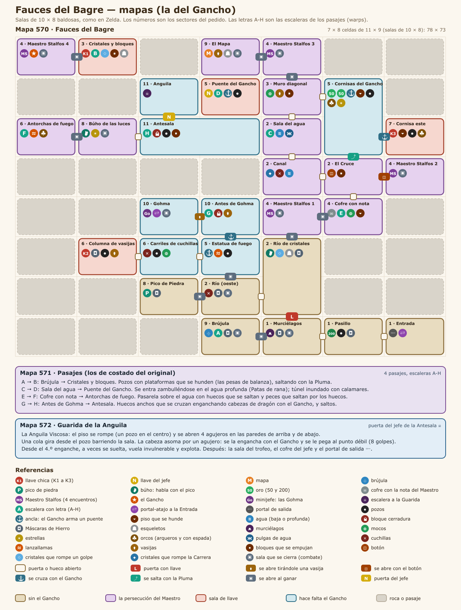

# Fauces del Bagre

Fecha: 2026-10-27. Estado: **diseño aprobado** (Leandro, 2026-10-27); en construcción. El sistema (instancias, grupo, ítems de mazmorra, mecánicas) está en [../MAZMORRAS.md](../MAZMORRAS.md); el patrón de la serie, en [00-PATRON_LINKS_AWAKENING.md](00-PATRON_LINKS_AWAKENING.md).

**Lugar en la serie: a definir.** Leandro pasa las mazmorras sin orden y el orden se decide cuando estén todas. En el original es la quinta.
- **Ítem:** da el **Gancho**. Ya está hecho (ver la sección 6): esta mazmorra le suma usos nuevos.
- **Para entrar:** pide las **Patas de rana**, como el original pide las Aletas.
- **Otros ítems que usa:** la **Pluma** (los pasajes y una fila de pozos), el **Brazalete de Fuerza** (las vasijas que tapan pasos) y los básicos (las **bombas** contra el Maestro Stalfos y el **arco** contra las Gohma). Las Botas son opcionales (rompen unos cristales que no tapan nada).

Adaptación de las **Fauces del Bagre** (*Catfish's Maw*), el nivel 5 de *Link's Awakening*. No se copia baldosa por baldosa; se respeta la estructura jugable:
- **Una mazmorra de agua y cornisas:** 34 salas en una grilla de 7 × 8, cuatro pasajes y mucho vacío entre sectores, por eso tiene ocho escaleras-atajo (A-H).
- **La primera mitad, sin el Gancho:**
  - el **Maestro Stalfos** aparece **cuatro veces**: un golpe lo desarma, y solo las bombas lo lastiman mientras está desarmado;
  - las tres primeras huye y la cuarta muere y suelta el **Gancho**.
- **La segunda mitad, con el Gancho:**
  - se cruza a las cornisas y a las llaves;
  - se arman **puentes sobre los pozos** enganchando un ancla;
  - se le arranca la máscara a las **Máscaras de Hierro**.
- **El minijefe:** las dos **Gohma**, que solo se lastiman con el ojo abierto (flechas o Gancho). Abren el portal-atajo a la Entrada.
- **El final:** la **Anguila Viscosa**, que asoma por agujeros de la pared. Se la saca con el Gancho y se le pega en el punto débil mientras una cola gira por la sala.

## 1. Cómo funciona el original

Lo leímos con el mapa del pedido (VinnyVideo, 2008) y lo cruzamos con el código del juego (el desensamblado [zladx/LADX-Disassembly](https://github.com/zladx/LADX-Disassembly): grilla, salas, cofres, enemigos y eventos) y con la lógica del randomizer [LADXR](https://github.com/daid/LADXR/blob/master/logic/dungeon5.py). El análisis completo sala por sala está en el scratchpad (`dungeon7/original.md`).

- **La grilla:** 7 columnas × 8 filas, con 34 salas vistas desde arriba. Tres son habitaciones de varias pantallas: las Cornisas (dos), la Antesala (dos) y el Río de cristales (tres, en L).
- **4 pasajes de costado,** con una escalera en cada punta (las letras A-H del dibujo):
  - **A ↔ B:** pesas de balanza; hace falta la Pluma;
  - **C ↔ D:** túnel inundado; se entra **zambulléndose** en el pozo de agua profunda de la Sala del agua, con las Aletas;
  - **E ↔ F:** pasarela con huecos sobre el agua y peces que saltan; hace falta la Pluma;
  - **G ↔ H:** huecos que se cruzan enganchándose a cabezas de dragón; hacen falta el Gancho y la Pluma.
- **Llaves:** 3 llaves chicas para 3 cerraduras (una puerta y dos bloques cerradura), más la Llave de Pesadilla.
- **El Gancho en el original:**
  - **cruza pozos** enganchándose a cofres y bloques;
  - **arma puentes:** si la punta pasa sobre un ancla, un puente baja por la columna de pozos;
  - **le arranca la máscara** a las Iron Masks;
  - **saca al jefe de la pared.**
- **Minijefes:**
  - **Master Stalfos:** cuatro encuentros, en orden. Un espadazo lo desarma, y desarmado solo lo daña la bomba. Huye al 3.er, 2.º y 2.º bombazo; la cuarta vez muere al 3.º y suelta el Gancho. Su espadazo no lo para el escudo.
  - **Gohma (dos):** caminan de lado a lado y arremeten. Solo con el ojo abierto (0,8 s) se dañan: 3 flechas o 6 enganches. Escupen una bola de fuego.
- **Jefe:** **Slime Eel**.
  - **La sala:** se abre un pozo en el centro y 4 agujeros en la pared.
  - **La cola:** sale del pozo y gira barriendo la sala.
  - **La cabeza:** asoma por un agujero al azar y solo se la engancha 0,53 s, mirando hacia ese agujero. El Gancho la saca y deja expuesto el punto débil, que pide 8 espadazos.
  - **La anguila suelta:** desde el 4.º enganche, la mitad de las veces se suelta, vuela invulnerable y explota.

## 2. Mapas de AO

| Mapa | Nombre | Qué entra |
|---|---|---|
| **570** | Fauces del Bagre | La grilla del dibujo en un mapa: 7 × 8 celdas de 11 × 9 baldosas, con salas de 10 × 8 adentro (las del original). Ocupa 78 × 73 |
| **571** | Pasajes | Los 4 pasajes de costado, como túneles vistos desde arriba |
| **572** | Guarida de la Anguila | La sala del jefe (más grande que la del original, para hasta 5 jugadores) y la del trofeo |

- **Salas de 10 × 8,** como en Zelda y como el Santuario del Rostro: con 34 salas es la única forma de que la grilla entre en un mapa.
- **Las celdas vacías del dibujo** quedan como roca. Ahí el original tiene los pasajes de costado, que en AO van al mapa 571.
- **La sala del instrumento** (arriba de la del jefe) pasa a ser la sala del trofeo de la Guarida.
- **El agua baja** que en el original se camina es piso con dibujo de agua: se camina sin las Patas. El **agua profunda** sí pide las Patas de rana.
- **Gráficos (propuesta):** piso de piedra húmeda azulada y paredes de roca con escamas, distintos de las otras mazmorras.

## 3. Salas

Celdas (columna, fila) del dibujo del pedido, desde arriba a la izquierda, de 0 a 6 y de 0 a 7. El número de sector es el del pedido (sección 9). "Persiana" es una puerta que se abre con el evento de la sala. "Cierra" es una sala que se cierra al entrar y se abre al vencer a todos.

### Mapa 570

**El sur: la Entrada y el Río de cristales**
| Sala | Celda | Sector | Contenido | Criaturas | Trampas |
|---|---|---|---|---|---|
| Entrada | (6,7) | 1 | Aparecés acá; portal de salida; **portal-atajo** a las Gohma (al vencerlas) | — | — |
| Pasillo | (5,7) | 1 / 9 | Pasillo hacia el oeste. Arriba, una **cornisa con el cofre de 200 de oro**, del otro lado de los pozos: se llega enganchando el cofre desde el rincón de los Murciélagos (de un solo sentido) | Máscara de Hierro, chispa, moco | Pozos |
| Murciélagos | (4,7) | 1 | **Puerta con llave** al norte (K1). Canal de agua baja. Persiana al oeste | 4 murciélagos sobre 4 estatuas, Máscara de Hierro | Cierra |
| Brújula | (3,7) | 9 | Cofre de la **Brújula** y **escalera A** (al pasaje A → B) | 2 Máscaras de Hierro, chispa | Cierra |
| Río de cristales | (4,5)-(4,6) y (3,6) | 2 | Sala en L de tres celdas. **Cristales que se rompen de un golpe** (no tapan el paso). **Búho:** "Si un esqueleto no se rompe con un golpe, probá con una bomba". Matar a los de arriba abre la persiana al Maestro Stalfos 1; matar a los de la izquierda abre las de 99 y del Pico | Esqueletos (saltarines y de los que esquivan), 3 Máscaras de Hierro | 4 cuchillas en los rincones de la celda de la izquierda |
| Pico de Piedra | (2,6) | 8 | Al matar a todos **aparece el cofre del Pico de Piedra** | 2 Máscaras de Hierro, chispa | — |

**El medio: el Maestro Stalfos y el Cruce**
| Sala | Celda | Sector | Contenido | Criaturas | Trampas |
|---|---|---|---|---|---|
| Maestro Stalfos 1 | (4,4) | 4 | **Primer encuentro:** huye al **3.er** bombazo | Maestro Stalfos | Cierra |
| El cofre de la nota | (5,4) | 4 | Un cofre **vacío con una nota**: «Lo que había en este cofre lo tengo yo. ¡Vení a buscarlo, si podés! — El Maestro». **Escalera E** (al pasaje E → F) | 3 mocos escondidos | Piso que se hunde |
| El Cruce | (5,3) | 2 | Sala en cruz con un **bloque central** que hay que correr para pasar de un brazo a otro. El **botón** del brazo norte abre la persiana del Maestro Stalfos 2 | 2 chispas | — |
| Maestro Stalfos 2 | (6,3) | 4 | **Segundo encuentro:** huye al **2.º** bombazo | Maestro Stalfos | Cierra |
| Canal | (4,3) | 2 | Canal de agua baja. **Cristales** que rompe la Carrera (opcionales) | Estrella, orco con espada | 4 cuchillas en los rincones |
| Sala del agua | (4,2) | 2 | Toda de agua baja, con un pozo de **agua profunda** en el centro: zambullirse ahí con las Patas de rana lleva al **pasaje C → D** (escalera bajo el agua). 4 lámparas en las paredes que "se cruzan" sobre el pozo | 4 pulgas de agua | Agua profunda |

**El norte: las Cornisas y la Llave del jefe**
| Sala | Celda | Sector | Contenido | Criaturas | Trampas |
|---|---|---|---|---|---|
| Muro diagonal | (4,1) | 3 | Un muro en escalera parte la sala en dos, con bloques que se empujan y vasijas en el muro. Hay que matar los 3 mocos (uno está del otro lado) para abrir la persiana al Maestro Stalfos 3 | 3 mocos escondidos, chispa | — |
| Cornisas del Gancho | (5,1)-(5,2) | 5 | Sala de dos celdas, con dos cornisas y un **cofre de 50 de oro** en cada una. Se llega enganchando un bloque y un cofre; en la de arriba, el Gancho pasa sobre un **ancla** y arma un puente. Una **fila de pozos** al sur, hacia el Cruce, se salta con la Pluma | Orcos (arqueros y con espada), 2 estrellas | Pozos, **piso que se hunde** |
| Cornisa este | (6,2) | 7 | Cofre de la **llave chica K3** en una cornisa: se llega enganchando un bloque desde la entrada | Orco con espada, moco, chispa | Pozos, piso que se hunde |
| Maestro Stalfos 3 | (4,0) | 4 | **Tercer encuentro:** huye al **2.º** bombazo. Solo aparece si ya huyó de los dos primeros | Maestro Stalfos | Cierra |
| El Mapa | (3,0) | 9 | Cofre del **Mapa**. 2 vasijas tapan el paso desde la puerta: se levantan con el Brazalete. Matar a todos abre la salida | 3 esqueletos | Cierra |
| Maestro Stalfos 4 | (0,0) | 4 | **Cuarto encuentro:** con el 3.er bombazo **muere** y aparece el cofre del **Gancho**. Solo aparece si huyó de los tres anteriores | Maestro Stalfos | Cierra |
| Cristales y dos bloques | (1,0) | 3 | **Escalera B** (llegada del pasaje A → B). Un macizo de **cristales que se rompen de un golpe** encierra dos bloques: al **juntarlos en la misma fila** aparece la **llave chica K1** | 4 esqueletos | — |
| Puente del Gancho | (3,1) | 5 | **Escalera D** (llegada del pasaje C → D). El cofre de la **Llave del jefe** está en una plataforma rodeada de pozos: el Gancho, tirado hacia abajo, pasa sobre un **ancla** y arma un puente | — | Pozos |

**El oeste: la rama izquierda**
| Sala | Celda | Sector | Contenido | Criaturas | Trampas |
|---|---|---|---|---|---|
| Antorchas de fuego | (0,2) | 6 | **Escalera F** (llegada del pasaje E → F). Dos antorchas que escupen fuego | Orco arquero, orco con espada | 2 lanzallamas |
| Búho de las luces | (1,2) | 8 | **Búho:** "Zambullite donde se cruzan las luces de las lámparas". Matar a todos abre las persianas | 3 estrellas | Cierra |
| Columna de vasijas | (1,5) | 6 | Cofre de la **llave chica K2** en una plataforma del otro lado de los pozos: se cruza enganchando el cofre | 3 Máscaras de Hierro | Pozos |
| Carriles de cuchillas | (2,5) | 6 | Dos carriles con cuchillas y una fila de pozos de una baldosa: se cruza de una enganchando el bloque del otro lado (o saltando pozo por pozo con la Pluma) | 2 mocos escondidos | 4 cuchillas, pozos |
| Estatua de fuego | (3,5) | 5 | Una estatua que escupe fuego. Columna de pozos con un **ancla**: el Gancho tirado hacia arriba arma el puente hacia "Antes de Gohma" | 2 mocos | Lanzallamas, pozos |

**El final: las Gohma, la Antesala y la Guarida**
| Sala | Celda | Sector | Contenido | Criaturas | Trampas |
|---|---|---|---|---|---|
| Antes de Gohma | (3,4) | 10 | Una fila de bloques con 2 vasijas parte la sala. Arriba, la **escalera G** (al pasaje G → H) y la persiana hacia las Gohma, que se abre **tirándole una vasija**. Abajo, un **bloque cerradura** (K2) con otro paso a las Gohma | 2 mocos | — |
| Gohma | (2,4) | 10 | **Minijefe: las dos Gohma.** Al vencerlas aparece el **portal-atajo** a la Entrada | 2 Gohma | Cierra |
| Antesala | (2,2)-(3,2) | 11 | Sala de dos celdas. Llega la **escalera H**; **bloque cerradura** (K3); pozos que se cruzan **enganchando un bloque**; la **puerta del jefe** al norte. Por el pasillo de abajo, desde el Búho, un bloque empujable abre un atajo de un solo sentido a la escalera | Chispa | Pozos |
| Anguila | (2,1) | 11 | La escalera a la Guarida | — | — |

### Mapa 571 (Pasajes)
| Pasaje | Une | Contenido | Hace falta |
|---|---|---|---|
| A → B | Brújula → Cristales y dos bloques | Pozos con **plataformas que se hunden** (las pesas de balanza): hay que saltar de una a otra antes de que caigan | Pluma |
| C → D | Sala del agua (zambullida) → Puente del Gancho | Túnel inundado, con calamares que nadan hacia el jugador | Patas de rana |
| E → F | El cofre de la nota → Antorchas de fuego | Pasarela sobre el agua con huecos de 1 y 2 baldosas; **peces que saltan** por los huecos | Pluma |
| G → H | Antes de Gohma → Antesala | Huecos anchos que se cruzan **enganchando cabezas de dragón** (postes del Gancho) y saltos | Gancho y Pluma |

### Mapa 572 (Guarida de la Anguila)
| Sala | Contenido |
|---|---|
| Guarida | Sala de unas 18 × 14. **Jefe: la Anguila Viscosa** (sección 5). Cuatro agujeros en las paredes de arriba y de abajo; el pozo del centro se abre al empezar |
| Sala del trofeo | Cofre del jefe (trofeo y oro, una vez por día) y portal de salida |

## 4. Recorrido

1. **La Entrada y los Murciélagos:**
   - Entrada → Pasillo → Murciélagos (matarlos abre la persiana oeste) → Brújula: **Brújula**.
   - Escalera A → pasaje A → B con la Pluma → Cristales y dos bloques: romper los cristales y juntar los bloques: **K1**.
2. **El Río de cristales y el primer Maestro Stalfos:**
   - Volver por el pasaje. Murciélagos: **puerta con llave** (K1) → Río de cristales.
   - A la izquierda: Pico de Piedra (**Pico**).
   - Arriba: **Maestro Stalfos 1**, que huye.
3. **El Cruce y el segundo:** El cofre de la nota → El Cruce: pisar el botón → **Maestro Stalfos 2**, que huye.
4. **El norte y el tercero:**
   - El Cruce → Cornisas (saltando la fila de pozos con la Pluma) → Muro diagonal: matar a los 3 mocos → **Maestro Stalfos 3**, que huye.
   - Al oeste, El Mapa: **Mapa** (con el Brazalete).
5. **El cuarto y el Gancho:** Brújula → pasaje A → B → Cristales y dos bloques → **Maestro Stalfos 4**: muere y deja el **Gancho**.
6. **Con el Gancho:**
   - Pasillo: **200 de oro**.
   - Cornisas: **50 + 50**.
   - Cornisa este: **K3**.
7. **La Llave del jefe:** Sala del agua: zambullirse (Patas de rana) → pasaje C → D → Puente del Gancho: armar el puente → **Llave del jefe**.
8. **K2:** Río de cristales → Estatua de fuego → Carriles de cuchillas (Gancho) → Columna de vasijas: **K2**.
9. **Las Gohma:**
   - Estatua de fuego: puente del Gancho → Antes de Gohma.
   - Bloque cerradura (K2) o vasija contra la persiana → **Gohma**: portal-atajo a la Entrada.
10. **El final:**
    - Antes de Gohma: escalera G → pasaje G → H (Gancho y Pluma) → Antesala.
    - **Bloque cerradura** (K3) → enganchar el bloque del otro lado de los pozos → **puerta del jefe** → Guarida.
11. **Opcional:** pasaje E → F → Antorchas de fuego → Búho de las luces (la pista de la zambullida) → el atajo de abajo de la Antesala.

**No hay forma de trabarse:**
- Las llaves son 3 para 3 cerraduras. La K1 sale antes de la primera cerradura y la K2 y la K3 piden el Gancho, igual que sus cerraduras.
- El Gancho no se puede conseguir sin los cuatro encuentros con el Maestro Stalfos, y cada uno se abre con el anterior.
- Si alguien se cae a un pozo, vuelve a la entrada de la sala.

## 5. Ubicaciones

### Llaves y cerraduras
| Llave | Dónde | Cómo |
|---|---|---|
| K1 | Cristales y dos bloques | Juntar los dos bloques en la misma fila |
| K2 | Columna de vasijas | Cofre del otro lado de los pozos, con el Gancho |
| K3 | Cornisa este | Cofre en la cornisa, con el Gancho |
| Llave del jefe | Puente del Gancho | El puente del ancla |

Cerraduras: la puerta de los Murciélagos (K1), el bloque de Antes de Gohma (K2) y el de la Antesala (K3). La puerta del jefe está en la Antesala.

### Escaleras y portales
| Letra | Une | Para qué |
|---|---|---|
| A → B | Brújula → Cristales y dos bloques | La K1 y el cuarto Maestro Stalfos |
| C → D | Sala del agua (zambullida) → Puente del Gancho | La Llave del jefe |
| E → F | El cofre de la nota → Antorchas de fuego | La rama izquierda y la pista del búho |
| G → H | Antes de Gohma → Antesala | El tramo final |
| Portal | Entrada ↔ Gohma | Atajo; aparece al vencerlas |

### Recompensas
- **Ítem:** el **Gancho**, al vencer al cuarto Maestro Stalfos.
- **Orientación:** el Mapa (El Mapa), la Brújula (Brújula) y el **Pico de Piedra** (Pico de Piedra: con él hablan los búhos).
- **Oro:** 50 en cada cornisa de las Cornisas y 200 en la cornisa del Pasillo.
- **Del jefe:** el trofeo de la serie (propuesta: **Colmillo de la Anguila**; en el original, la Marimba del Viento) y oro, una vez por día por personaje. Ocupa la casilla "Quinta mazmorra" de la Mochila.

### Minijefes

**El Maestro Stalfos** (Master Stalfos, `07_master_stalfos.asm`), cuatro veces. Cuerpo del Esqueleto de AO o un caballero esqueleto; si ninguno sirve, se busca un sprite libre.
- **Cómo pelea:** camina hacia el más cercano y, si está lejos, salta hacia él. Cerca, tira un **espadazo** que el Escudo Espejo **no** frena; saltar con la Pluma lo esquiva.
- **Cómo se le gana:**
  - un golpe cuerpo a cuerpo **lo desarma**: cae en un montón de huesos unos 4,5 s, tiembla y se rearma;
  - mientras está desarmado **solo lo lastima una bomba**;
  - armado, las bombas no le hacen nada.
- **Los cuatro encuentros:**
  1. huye al 3.er bombazo;
  2. huye al 2.º;
  3. huye al 2.º;
  4. muere al 3.º y aparece el cofre del Gancho.
- **El orden:** cada encuentro aparece solo si huyó del anterior. Si no, la sala queda vacía y abierta, como en el original. Al huir dice su frase y sale volando.

**Las Gohma** (Gohma, `05_ghoma.asm`), dos en su sala. Cuerpo de araña grande de AO.
- **Cómo se mueven:** caminan de lado a lado. Si el jugador está a su altura, tiemblan y arremeten hacia él; si está abajo, a veces bajan embistiendo.
- **El ojo:** a veces se frenan y abren el ojo **0,8 s**, y a la mitad escupen una bola de fuego. Es la única ventana: **3 flechas o 6 enganches**. Los golpes y las bombas fuera de la ventana no les hacen nada.
- **Al vencerlas:** se abre la sala y aparece el portal-atajo a la Entrada.

### Jefe: la Anguila Viscosa (Slime Eel, `05_slime_eel.asm`)
| En el original | En AO |
|---|---|
| Al entrar, el piso se rompe: un pozo de 2 × 2 en el centro y 4 agujeros en la pared | Igual, con la sala más grande. Los agujeros quedan arriba y abajo, dos de cada lado |
| Una **cola** de 5 segmentos sale del pozo y gira (una vuelta cada 4,3 s), meneándose; pega ½ corazón y empuja | Igual (10 %) |
| La **cabeza** asoma por un agujero al azar cada 2,9 s; se la engancha solo cuando está entera (0,53 s), mirando hacia el agujero y en su columna | Igual. Si el Gancho la engancha, la saca de la pared hasta donde estás |
| Afuera, el **primer segmento detrás de la cabeza** es el punto débil: **8 espadazos**. El cuerpo pega 1½ corazones | El punto débil se marca y titila; le entra cualquier golpe cuerpo a cuerpo. Son 8 golpes, más con grupo |
| Desde el 4.º enganche, la mitad de las veces la anguila se suelta: vuela invulnerable por la sala y explota | Igual |
| Al morir aparece el contenedor de corazón | Se abre la sala del trofeo |

- **Pista del búho:** "Si asoma la cabeza, enganchala; si asoma el corazón, pegale."

### Criaturas
Plantillas nuevas con cuerpos de AO, con los roles del original:
- **De presión:**
  - esqueletos de dos clases: los que **saltan encima** y los que **saltan para atrás y tiran un hueso**;
  - murciélagos, orcos arqueros y con espada, mocos escondidos y mocos que se dividen, estrellas y chispas.
- **Guardianes:** las **Máscaras de Hierro** (las Iron Masks). Custodian la Brújula, el Pico, la K2 y varias persianas.
  - **Defensa:** de frente se cubren, como el imitador: hay que pegarles por la espalda o de costado.
  - **El Gancho:** de frente **les arranca la máscara**, y desde ahí se las lastima de cualquier lado.
  - **Las bombas:** las lastiman siempre.
- **Del agua:** **pulgas de agua** (las Tektites de agua), que solo se mueven por el agua. En los pasajes, calamares y peces que saltan.
- **Trampas:** cuchillas, lanzallamas (antorchas y una estatua que escupen fuego) y chispas.

## 6. El ítem: el Gancho

**Ya está hecho** (lo pidió la Roca de la Tortuga, y el Santuario del Rostro lo usa en el Canal). Hoy:
- **Alcance:** 7 baldosas.
- **Engancha:** cofres, bloques, vasijas, estatuas, antorchas, cristales y postes.
- **Al engancharse:** arrastra al personaje por encima de pozos, lava y agua hasta lo enganchado.
- **Contra una criatura:** la aturde un momento y le saca un poco.

**Lo que esta mazmorra le suma** (es lo que pide el pedido: que abra rutas nuevas y sea la mecánica central):

| Uso nuevo | Cómo | Dónde |
|---|---|---|
| **Puente del ancla** | En el piso hay un ancla. Si la punta del Gancho pasa sobre ella en el sentido que marca, nace un puente que avanza por la columna de pozos hasta el piso firme. El puente queda armado mientras dure la corrida | Puente del Gancho (la Llave del jefe), Cornisas, Estatua de fuego |
| **Arrancar máscaras** | El Gancho de frente le saca la máscara a una Máscara de Hierro | Todas las salas con Máscaras |
| **Engancharse a cabezas de dragón** | Postes del Gancho con forma de cabeza de dragón, en la pared de los huecos | Pasaje G → H |
| **Sacar a la Anguila** | Engancharle la cabeza la saca de la pared | La Guarida |
| **Ventana del ojo** | El Gancho lastima a las Gohma con el ojo abierto | Gohma |

En la Mochila, el Gancho pasa a decir "Fauces del Bagre" (hoy dice "Mazmorra a definir").

## 7. Qué cambia respecto del original

| En el original | Acá |
|---|---|
| Espada | Cualquier golpe cuerpo a cuerpo (los cristales, desarmar al Maestro Stalfos, el punto débil de la Anguila) |
| Ocarina (abre el ojo de las Gohma) | No va: hay que esperar la ventana |
| Bumerán (hace hadas de las chispas) | No hace falta |
| Ítems flotantes que se agarran saltando | No van |
| Tres persianas sin forma de abrirse (Estatua de fuego, Carriles de cuchillas y Antorchas de fuego; en el original son restos de otras salas) | Se abren al matar a todos |
| Pesas de balanza del pasaje A → B | Plataformas que se hunden, saltando con la Pluma |
| Pasajes de costado (con gravedad) | Túneles vistos desde arriba, con las mismas piezas |
| Sala del instrumento | La sala del trofeo de la Guarida |
| Anti-hadas | No van |

## 8. Mecánicas que necesita

**Ya hechas:**
- llaves, bloques cerradura, puerta del jefe, salas que se cierran, pozos, placas, bloques que se empujan, cofres que aparecen;
- agua profunda con las Patas de rana, cristales que rompe la Carrera, piso que se desmorona;
- persianas que se abren tirándoles algo, salas de varias celdas, portal-atajo, búhos y pico;
- mocos escondidos y que se dividen, chispas, estrellas, cuchillas, lanzallamas e imitadores (la defensa de frente);
- la Pluma, las Botas, el Gancho (con sus postes), el Brazalete, las bombas y el arco.

**Nuevas:**

| Mecánica | Para qué |
|---|---|
| Puente del ancla | El Gancho arma un puente sobre una columna de pozos |
| Piso que se hunde | Si te quedás quieto encima un momento, tiembla y se vuelve pozo (el que ya existe se cae al pisarlo) |
| Escalera bajo el agua | La zambullida de la Sala del agua: solo se llega nadando |
| Juntar dos bloques | Aparece la K1 cuando dos bloques quedan pegados en la misma fila |
| Cristales que se rompen de un golpe | Tapan los bloques de la K1 y adornan el Río |
| Cofre con nota | El del Maestro Stalfos |
| Máscaras de Hierro | Se cubren de frente; el Gancho les arranca la máscara |
| Esqueletos que saltan y que esquivan | Presión de las salas de esqueletos |
| Pulgas de agua, calamares y peces que saltan | Las criaturas del agua y de los pasajes |
| Plataformas que se hunden | El pasaje A → B |
| Maestro Stalfos | Cuatro encuentros con estado entre salas; golpe que desarma y bombas |
| Gohma | El ojo que se abre y la bola de fuego |
| Anguila Viscosa | El pozo, los agujeros, la cola que gira, la cabeza y el punto débil |

## 9. Los 11 sectores del pedido

| Sector del pedido | Dónde queda |
|---|---|
| 1. Entrada / hub inicial | La Entrada, el Pasillo, los Murciélagos y la Brújula. De entrada se ven las cornisas y los pozos que pide el Gancho (el cofre de 200, a la vista) |
| 2. Sector central | El Río de cristales, El Cruce, el Canal y la Sala del agua: el núcleo del ir y volver |
| 3. Rama superior | Cristales y dos bloques (K1), el Muro diagonal y El Mapa |
| 4. Ítem principal | Los cuatro encuentros con el Maestro Stalfos y el cofre de la nota; el Gancho en el cuarto |
| 5. Puzzle con el Gancho | Las Cornisas, el Puente del Gancho (Llave del jefe), la Estatua de fuego y los Carriles de cuchillas |
| 6. Rama izquierda | Antorchas de fuego, Columna de vasijas (K2) y Carriles de cuchillas |
| 7. Rama derecha | Cornisa este (K3), el Maestro Stalfos 2 y la zona de las Cornisas |
| 8. Lore / pista | El Pico de Piedra y los búhos (Río de cristales y Búho de las luces) |
| 9. Reward secundaria | Mapa, Brújula, 50 + 50 y 200 de oro |
| 10. Encuentro importante | Las Gohma (portal-atajo) y Antes de Gohma |
| 11. Tramo final | El pasaje G → H, la Antesala (bloque cerradura, el Gancho sobre los pozos, la puerta del jefe) y la Guarida |

## 10. Cómo se construye

Para que no tarde tanto, en tres PR seguidos, como el Santuario del Rostro:
1. **Mecánicas nuevas y criaturas** (sección 8, menos los jefes): el puente del ancla, el piso que se hunde, la escalera bajo el agua, juntar dos bloques, los cristales de golpe, el cofre con nota, las Máscaras de Hierro, los esqueletos y las criaturas del agua (**hecho**, ver [../MAZMORRAS.md](../MAZMORRAS.md), sección 20). Las plataformas que se hunden del pasaje A → B son el piso que se desmorona que ya existía.
2. **Mapas 570-572, criaturas y música:** tres temas y uno de combate, libres. Incluye el recorrido completo en vivo con el simulador de recorrido.
3. **Jefes:** el Maestro Stalfos (los cuatro encuentros), las Gohma y la Anguila Viscosa.

**Números:**
- Mapas 570-572.
- Piedra de invocación: NPC 9726. Por ahora la invoca un GM, y el lugar fijo se define después.
- Plantillas de criaturas: desde 9803.
- Objetos de mazmorra: desde el 1882.
- Gráficos: desde el grh 42325 y el archivo 330023.
- Va como `soloDesarrollo`. Pide las Patas de rana, la Pluma y el Brazalete de Fuerza, como el original.

## 11. Para confirmar

| Tema | Propuesta |
|---|---|
| Nombre | Fauces del Bagre (ya figura así en el patrón de la serie) |
| Jefe | Anguila Viscosa |
| Minijefes | Maestro Stalfos (cuatro veces) y las dos Gohma |
| Trofeo | Colmillo de la Anguila |
| Salas de 10 × 8 | Como en Zelda, para que las 34 entren en un mapa |
| El ítem | El Gancho ya existe: no hace falta un ítem nuevo. Esta mazmorra lo da y le suma los usos de la sección 6 |
| Requisitos | Las Patas de rana, la Pluma y el Brazalete de Fuerza |

## Fuentes
- El mapa del pedido (VinnyVideo, 2008), con la leyenda de llaves, warps y objetos. Tiene el Mapa y el Pico de Piedra cruzados: el código del juego pone el Mapa en la sala de las vasijas y el Pico en la que aparece al matar a las Máscaras.
- [zladx/LADX-Disassembly](https://github.com/zladx/LADX-Disassembly):
  - la grilla (`src/data/maps/layouts.asm`);
  - salas, entidades, cofres y eventos (`src/data/rooms`, `entities`, `chests` y `events`);
  - el código del Master Stalfos (`07_master_stalfos.asm`), de las Gohma (`05_ghoma.asm`), de la Slime Eel (`05_slime_eel.asm`) y de la cadena del Hookshot (`18_hookshot_chain.asm`).
- [LADXR, lógica de la mazmorra 5](https://github.com/daid/LADXR/blob/master/logic/dungeon5.py).
- [Zelda's Palace](https://www.zeldaspalace.com/linksawakening/).
