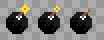
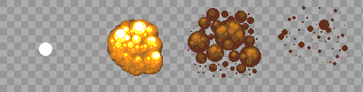
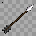

# Arte: lo común a todas las mazmorras

Los gráficos que usan varias mazmorras y se dibujan una sola vez: cofres, placas, escaleras, el portal, el búho, los bloques y cristales de color, lo que se levanta, las herramientas y los íconos de la Mochila. Las puertas y las paredes no están acá: se dibuja una versión por mazmorra, que combine con su pared (van en el documento de cada una). El índice está en [README.md](README.md).

## 1. Objetos del mapa compartidos

| Código | Actual | Qué es y qué hace | Estados que hacen falta | La usan | Hoy | Para el nuevo |
|---|---|---|---|---|---|---|
| CO-01 |  | **Portal.** La salida de la mazmorra y los portales-atajo que aparecen al vencer a un minijefe (llevan a la entrada). | portal de salida y portal-atajo (dos colores distintos), animados en bucle | Gruta del Abisal, Cueva de la Cola, Gruta de la Botella, Caverna de las Llaves, Fauces del Bagre, Santuario del Rostro, Torre del Águila, Roca de la Tortuga | 378 (Teleport, 60 × 90, 24 cuadros) | 64 × 96, 8 a 12 cuadros en bucle, anclado abajo al centro |
| CO-02 |  | **Cofre.** Guarda llaves, el mapa, la brújula, oro, el pico de piedra, la caracola o el ítem de la mazmorra. Muchos aparecen al resolver la sala (salen de la nada con un brillo). | cerrado, abierto | Gruta del Abisal, Cueva de la Cola, Gruta de la Botella, Caverna de las Llaves, Fauces del Bagre, Santuario del Rostro, Torre del Águila, Roca de la Tortuga | 1832 (Cofre de mazmorra, 32 × 32); 1833 (Cofre de mazmorra abierto, 32 × 32) | 32 × 32 (el dibujo puede tener hasta 32 × 40), cerrado y abierto |
| CO-03 |  | **Cofre del jefe.** El cofre del trofeo, en la sala del final. Una vez por día por personaje da el trofeo de la serie y oro. Hoy es el mismo dibujo que el cofre común. | cerrado, abierto | Gruta del Abisal, Cueva de la Cola, Gruta de la Botella, Caverna de las Llaves, Fauces del Bagre, Santuario del Rostro, Torre del Águila, Roca de la Tortuga | 1849 (Cofre del jefe, 32 × 32) | 48 × 40 a 64 × 48, anclado abajo al centro: tiene que verse más importante que el común |
| CO-04 |  | **Bloque que se empuja.** Se empuja una baldosa con un clic. Tapa pasos, aprieta placas y corta el camino de las cuchillas. | uno solo | Gruta del Abisal, Cueva de la Cola, Gruta de la Botella, Caverna de las Llaves, Fauces del Bagre, Santuario del Rostro, Torre del Águila, Roca de la Tortuga | 1836 (Bloque de piedra, 32 × 32) | 32 × 32 (el dibujo puede tener 32 × 40 para mostrar el alto) |
| CO-05 |  | **Placa (botón del piso).** Se aprieta con un jugador o un bloque encima. Abre puertas o hace aparecer cofres y escaleras. La de peso solo baja si el que la pisa carga algo con el Brazalete. | suelta y apretada; la placa de peso (Gruta de la Botella) distinta | Gruta del Abisal, Cueva de la Cola, Gruta de la Botella, Caverna de las Llaves, Fauces del Bagre, Torre del Águila, Roca de la Tortuga | 1837 (Runa del suelo, 32 × 32); 1838 (Runa del suelo encendida, 32 × 32) | 32 × 32 |
| CO-06 |  | **Losa de piedra.** Una losa con un texto grabado (pistas del jefe o de la mazmorra). Se lee con un clic. | una sola | Gruta del Abisal, Cueva de la Cola, Caverna de las Llaves, Torre del Águila, Roca de la Tortuga | 1839 (Losa de piedra, 32 × 32) | 32 × 48, anclada abajo |
| CO-07 |  | **Estatua búho.** Con el Pico de piedra, da una pista al hacerle clic. | una sola (opcional: los ojos que se encienden cuando habla) | Gruta de la Botella, Fauces del Bagre, Santuario del Rostro, Torre del Águila, Roca de la Tortuga | 1861 (Estatua búho, 32 × 48) | 32 × 48, anclada abajo |
| CO-08 |  | **Cristal de los bloques de color.** Al golpearlo, se invierten los bloques de color de toda la corrida. Hoy usa el mismo dibujo que la barrera de cristal. | azul y naranja | Gruta de la Botella, Santuario del Rostro, Torre del Águila, Roca de la Tortuga | 1866 (Cristal azul, 32 × 32); 1867 (Cristal naranja, 32 × 32) | 32 × 48, anclado abajo |
| CO-09 |  | **Bloques de color.** Los azules arrancan levantados (tapan el paso) y los naranjas bajados. El cristal los invierte. | azul levantado, azul bajado, naranja levantado, naranja bajado | Gruta de la Botella, Santuario del Rostro, Torre del Águila, Roca de la Tortuga | 1862 (Bloque azul, 32 × 32); 1863 (Bloque azul bajado, 32 × 32); 1864 (Bloque naranja, 32 × 32); 1865 (Bloque naranja bajado, 32 × 32) | 32 × 32 cada estado |
| CO-10 |  | **Remolino.** Arrastra hacia el centro; el que llega al centro vuelve a la entrada. | animado en bucle | Gruta de la Botella, Santuario del Rostro, Roca de la Tortuga | 1868 (Remolino, 48 × 48, 12 cuadros) | 48 × 48, 12 cuadros en bucle |
| CO-11 |  | **Vasija.** Se levanta con el Brazalete, se lleva y se tira. Tapa pasos, abre persianas al tirarla y algunas esconden algo. | entera; pedazos al romperse (4 a 6 trozos) | Gruta de la Botella, Fauces del Bagre, Santuario del Rostro, Torre del Águila, Roca de la Tortuga | 1852 (Vasija, 32 × 32) | 32 × 32 |
| CO-12 |  | **Estatua del Gancho.** Un poste para el Gancho: se engancha y te arrastra hasta ella, por encima de pozos. | una sola | Fauces del Bagre, Santuario del Rostro, Torre del Águila, Roca de la Tortuga | 1855 (Estatua de piedra, 32 × 96) | 32 × 64 a 32 × 96, anclada abajo |
| CO-13 |  | **Antorcha.** Se enciende con el Polvo de Fuego o el polvo mágico. Las salas con antorchas apagadas están a oscuras; si la sala tiene cofres, aparecen al encender todas. | apagada; encendida (fuego animado en bucle) | Gruta de la Botella, Santuario del Rostro, Torre del Águila, Roca de la Tortuga | 1856 (Antorcha apagada, 32 × 64); 1857 (Antorcha encendida, 32 × 64, 9 cuadros) | 32 × 64, anclada abajo; el fuego, 8 a 9 cuadros |
| CO-14 |  | **Bloque de cristal (la Carrera).** Lo rompe la Carrera de las Botas de Pegaso. | entero; pedazos al romperse | Caverna de las Llaves, Fauces del Bagre | 1841 (Bloque de cristal, 32 × 32) | 32 × 32 (puede subir a 32 × 48) |
| CO-15 |  | **Piso que se desmorona.** Se cae un instante después de pisarlo y vuelve a los 5 s. Se cruza corriendo o saltando. | rajado; hueco (ya se cayó) | Caverna de las Llaves, Roca de la Tortuga | 1842 (Baldosa rajada, 32 × 32); 1843 (Hueco, 32 × 32) | 32 × 32 cada estado; opcional: 3 cuadros del derrumbe |
| CO-16 |  | **Aplastador.** Un bloque que baja de golpe sobre su losa cada tanto. Hoy es el bloque de piedra común. | arriba, bajando, abajo; la losa del piso donde cae | Gruta del Abisal, Caverna de las Llaves, Santuario del Rostro | 1848 (Aplastador, 32 × 32); 1847 (Losa del aplastador, 32 × 32) | 32 × 48 el aplastador (con su sombra), 32 × 32 la losa; 3 cuadros de la caída |
| CO-17 |  | **Cabeza de caballo.** Se levanta y se tira: cae parada o acostada. Con todas las de la sala paradas, se abre la puerta o aparece el cofre. | acostada, parada | Santuario del Rostro, Torre del Águila | 1872 (Cabeza de caballo (acostada), 32 × 32); 1871 (Cabeza de caballo (parada), 32 × 32) | 32 × 32 cada estado |
| CO-18 |  | **Baldosa voladora.** Se despega del piso, sube temblando y sale volando hacia el jugador. En algunas salas deja un pozo. | baldosa con dibujo; el pozo que deja | Santuario del Rostro, Torre del Águila | 1873 (Baldosa con dibujo, 32 × 32); 1874 (Pozo, 32 × 32) | 32 × 32 cada estado |
| CO-19 |  | **Cinta transportadora.** Lleva al que la pisa en su dirección. | norte, sur, este y oeste, animadas (4 cuadros cada una) | Santuario del Rostro, Torre del Águila | 1875 (Cinta transportadora, 32 × 32, 4 cuadros); 1876 (Cinta transportadora, 32 × 32, 4 cuadros); 1877 (Cinta transportadora, 32 × 32, 4 cuadros); 1878 (Cinta transportadora, 32 × 32, 4 cuadros) | 32 × 32, 4 cuadros por dirección |
| CO-20 |  | **Lanzallamas.** Escupe una bola de fuego en línea recta cada tanto. El Campo de Protección la frena. | uno por dirección (norte, sur, este, oeste); la boca encendida al disparar | Fauces del Bagre, Santuario del Rostro, Torre del Águila | 1879 (Lanzallamas, 32 × 32) | 32 × 32 por dirección |
| CO-21 |  | **Ojo de piedra.** Gira y, si te ve en línea, avisa y tira un rayo. El Campo de Protección lo rebota y lo rompe (queda la estatua rota). | mirando a cada una de las 8 direcciones (gira); roto | Santuario del Rostro, Torre del Águila, Roca de la Tortuga | 1880 (Ojo de piedra, 32 × 48, 4 cuadros); 1894 (Ojo de piedra roto, 32 × 48) | 32 × 48, anclado abajo; 8 direcciones + roto |
| CO-22 |  | **Piso flojo.** Si te quedás quieto encima, se hunde y caés. Vuelve a los 5 s. | firme; hundiéndose | Fauces del Bagre, Torre del Águila | 1883 (Piso flojo, 32 × 32) | 32 × 32 cada estado |
| CO-23 |  | **Cristal de un golpe.** Se rompe de un golpe o con una bomba. Tapa pasos o adorna. | entero; pedazos al romperse | Fauces del Bagre, Torre del Águila | 1884 (Cristal, 32 × 32) | 32 × 32 |
| CO-PI |  | **Piedra de invocación.** Está en el mundo: con un clic se entra a la mazmorra, solo o en grupo. Hoy es una estatua dorada que no tiene que ver con las mazmorras. | Una por mazmorra (con el símbolo de su ítem), con un brillo en bucle | Todas | cuerpo 256 | 64 × 96, anclada abajo; 6 cuadros de brillo |

## 2. Herramientas y efectos

Lo que dibuja el cliente para los ítems de mazmorra (`engine/dungeonTools.ts`, `engine/dungeonMotion.ts` y `engine/dungeonDarkness.ts`).

| Código | Actual | Qué es y qué hace | Para el nuevo |
|---|---|---|---|
| CO-24 |  | **La bomba.** Se pone adelante y explota a los 2 s: la mecha titila cada vez más rápido. | La bomba con la mecha (3 cuadros, 32 × 32). Hoy: "16-bit animated bomb" de victordelima (CC0). |
| CO-25 |  | **La explosión.** La explosión de 3 × 3 baldosas. | 12 cuadros de 96 × 96. Hoy: "Pixel Explosion" de JROB774 (CC-BY 3.0). |
| CO-26 |  | **La flecha del Arco.** Vuela en línea recta. | La flecha mirando a cada dirección (4), 32 × 32. |
| CO-27 |  | **La cadena del Gancho.** La cadena sale hasta el blanco y arrastra al personaje, o vuelve. Hoy son eslabones dibujados con formas. | La punta del gancho (4 direcciones, 16 × 16) y un eslabón (8 × 8) que se repite. |
| CO-28 |  | **La llamarada del Polvo de Fuego.** Una llamarada que vuela y estalla. Hoy es el proyectil de los hechizos en colores de fuego. | La llamarada (4 cuadros, 32 × 32) y el estallido (4 cuadros, 48 × 48). |
| CO-29 | sin captura (se dibuja por código) | **El polvo mágico.** Una nube de chispas doradas y violetas sobre la baldosa de adelante. Hoy son partículas. | La nube (6 cuadros, 48 × 48). |
| CO-30 |  | **El Campo de Protección.** El arco de energía delante del personaje (3 s) y el destello cuando rebota algo. Hoy se dibuja con formas. | El arco mirando a cada dirección (4), latiendo (4 cuadros, 48 × 32), y el destello del rebote (3 cuadros). |
| CO-31 |  | **La Carrera y el salto.** El polvo de la Carrera, la estela, el choque contra la pared, la sombra del salto y el polvo al caer. | Polvo (4 cuadros, 32 × 16), destello del choque (3 cuadros, 32 × 32) y la sombra ovalada (2 tamaños). |
| CO-32 |  | **Las salas a oscuras.** Un velo negro sobre la sala, con un círculo de luz alrededor de cada personaje y cada antorcha encendida. | Una máscara de luz radial (128 × 128, en escala de grises) para dibujar el círculo de luz. |
| CO-33 | sin captura (se dibuja por código) | **Lo que aparece.** Cofres, escaleras y portales que aparecen al resolver una sala, con un destello. | Un destello de aparición (6 cuadros, 64 × 64). |

## 3. Íconos de la Mochila y la barra

Hoy son íconos de la librería [Lucide](https://lucide.dev) coloreados (`components/DungeonBackpack.tsx`), que no combinan con el juego.

 

| Código | Qué es | Hoy (Lucide) | Para el nuevo |
|---|---|---|---|
| CO-34 | **Patas de rana** (`patas_de_rana`) | `Footprints` | Ícono de 32 × 32 (y la versión a 64 × 64), con y sin color (el gris es el hueco del que todavía no se tiene) |
| CO-35 | **Pluma de Roc** (`pluma`) | `Feather` | Ícono de 32 × 32 (y la versión a 64 × 64), con y sin color (el gris es el hueco del que todavía no se tiene) |
| CO-36 | **Brazalete de Fuerza** (`pulsera`) | `Dumbbell` | Ícono de 32 × 32 (y la versión a 64 × 64), con y sin color (el gris es el hueco del que todavía no se tiene) |
| CO-37 | **Botas de Pegaso** (`botas_de_pegaso`) | `Wind` | Ícono de 32 × 32 (y la versión a 64 × 64), con y sin color (el gris es el hueco del que todavía no se tiene) |
| CO-38 | **Gancho** (`gancho`) | `Anchor` | Ícono de 32 × 32 (y la versión a 64 × 64), con y sin color (el gris es el hueco del que todavía no se tiene) |
| CO-39 | **Brazalete de Fuerza nivel 2** (`pulsera_poderosa`) | `BicepsFlexed` | Ícono de 32 × 32 (y la versión a 64 × 64), con y sin color (el gris es el hueco del que todavía no se tiene) |
| CO-40 | **Campo de Protección** (`campo_de_proteccion`) | `Shield` | Ícono de 32 × 32 (y la versión a 64 × 64), con y sin color (el gris es el hueco del que todavía no se tiene) |
| CO-41 | **Polvo de Fuego** (`polvo_de_fuego`) | `Flame` | Ícono de 32 × 32 (y la versión a 64 × 64), con y sin color (el gris es el hueco del que todavía no se tiene) |
| CO-42 | **Bombas** (`bombas`) | `Bomb` | Ícono de 32 × 32 (y la versión a 64 × 64), con y sin color (el gris es el hueco del que todavía no se tiene) |
| CO-43 | **Arco** (`arco`) | `BowArrow` | Ícono de 32 × 32 (y la versión a 64 × 64), con y sin color (el gris es el hueco del que todavía no se tiene) |
| CO-44 | **Polvo mágico** (`polvo_magico`) | `Sparkles` | Ícono de 32 × 32 (y la versión a 64 × 64), con y sin color (el gris es el hueco del que todavía no se tiene) |
| CO-45 | **Llave chica** (`llave`) | `Key` | Ícono de 32 × 32 (y la versión a 64 × 64), con y sin color (el gris es el hueco del que todavía no se tiene) |
| CO-46 | **Llave del jefe** (`llave_jefe`) | `KeyRound` | Ícono de 32 × 32 (y la versión a 64 × 64), con y sin color (el gris es el hueco del que todavía no se tiene) |
| CO-47 | **Brújula** (`brujula`) | `Compass` | Ícono de 32 × 32 (y la versión a 64 × 64), con y sin color (el gris es el hueco del que todavía no se tiene) |
| CO-48 | **Pico de piedra** (`pico`) | `Bird` | Ícono de 32 × 32 (y la versión a 64 × 64), con y sin color (el gris es el hueco del que todavía no se tiene) |
| CO-49 | **Los 8 trofeos** (Escama del Abisal, Aguijón del Ciempiés, Lámpara del Genio, Iris del Ojo, Colmillo de la Anguila, Máscara de Piedra, Garra del Águila, trofeo de la Roca de la Tortuga) | sin ícono (solo el nombre) | Uno por mazmorra, 32 × 32 y 64 × 64 |
| CO-50 | **La caracola secreta** | sin ícono | 32 × 32 y 64 × 64 |

## 4. Prompt para Claude Opus 5.5

Copiar entero y pegarlo en una sesión nueva de Claude Code abierta en el repo. Conviene correrlo antes que los de cada mazmorra: fija el estilo de lo que se repite en todas.

```text
Sos un artista técnico de videojuegos y trabajás en el repo de WoAO (/Users/leandrobisceglie/AoWeb/aoweb): un MMORPG web (Next.js + PixiJS) basado en Argentum Online. Tiene una serie de 8 mazmorras PvE con la estructura de las de *The Legend of Zelda: Link's Awakening*.

Tu trabajo: rehacer de cero los gráficos COMUNES a todas las mazmorras (los que aparecen en varias): cofres, placas, escaleras, el portal, el búho, los bloques y cristales de color, lo que se levanta, las herramientas y los íconos de la Mochila. Es la base de estilo de toda la serie: lo que hagas acá lo van a tener que respetar los trabajos de cada mazmorra. El inventario completo, con la imagen actual de cada cosa, está en docs/mazmorras/arte/00-COMUNES.md, y el de cada mazmorra en docs/mazmorras/arte/0N-*.md. Leelos antes de empezar.

DIRECCIÓN DE ARTE (PARA TODAS LAS MAZMORRAS)
- Perspectiva y escala: vista desde arriba levemente inclinada (la de Argentum Online): se ve el frente de las paredes y el techo de los objetos. La baldosa mide 32 × 32 y un personaje humano mide 1,5 baldosas de alto.
- Estilo: pintado, con volumen y sombreado suave, que combine con los personajes y los mapas de AO. Nada de pixel art de 8 bits ni de formas planas.
- Luz: desde arriba a la izquierda, igual en todas las piezas. Cada cosa que toca el piso lleva una sombra de contacto suave.
- Contorno: oscuro y fino donde ayude a leer la forma contra el piso, no alrededor de todo.
- Paleta: una por mazmorra (la del tema), con un color de acento para lo interactivo (lo que se toca, se levanta o se abre) y rojo o naranja para lo peligroso.
- Legibilidad: lo que se puede usar se distingue del decorado a primera vista, y cada estado se distingue del otro (cerrado o abierto, apagado o encendido, entero o roto).
- Original: se toma la estructura de *Link's Awakening*, no su arte. Nada copiado de Nintendo ni de otros juegos. Si se parte de algo libre (CC0 o CC-BY), se anota el autor, la licencia y el enlace.

REGLAS TÉCNICAS (LAS DEL MOTOR DEL JUEGO)
- Archivos: PNG con transparencia (RGBA), sin fondo, sin halos claros alrededor y sin texto ni marcas de agua.
- Baldosas de piso: un bloque de 4 × 4 baldosas (128 × 128) que se repite sin costura en las dos direcciones; el juego elige la baldosa por la posición en el mapa.
- Paredes: un bloque de 4 × 4. Cada fila es la cara de la pared vista a 1, 2, 3 y 4 baldosas del piso (la última fila toca el piso). Tiene que repetirse sin costura a lo ancho.
- Agua y lava: bloque de 4 × 4 animado (4 cuadros en bucle, que empalmen).
- Objetos: una baldosa (32 × 32), anclados abajo al centro. Si son altos (estatuas, puertas, pilares), el dibujo puede subir (32 × 64, 32 × 96) o ensancharse (96 × 96 las puertas); la base sigue en la baldosa.
- Cuerpos (criaturas y jefes): una hoja por cuerpo, con 4 filas en este orden: mirando arriba, abajo, derecha e izquierda. Las columnas son los cuadros, todos de la misma medida. Mínimo 6 cuadros de caminata por dirección, que entren en bucle. Los pies van abajo al centro del cuadro: el juego lo apoya sobre la baldosa.
- Animaciones aparte (ataques, poses, efectos): una tira horizontal por animación, con cuadros de la misma medida.
- Numeración del juego: al día de este documento, el próximo grh libre es el 42484, el próximo archivo de gráficos el 330041 y el próximo cuerpo el 586. Verificalos antes de indexar.

LO QUE HAY QUE ENTREGAR (51 piezas)
- [CO-01] Portal. Reemplaza: objetos 378 (Teleport, 60 × 90, 24 cuadros). Qué hace: La salida de la mazmorra y los portales-atajo que aparecen al vencer a un minijefe (llevan a la entrada). Entregar: portal de salida y portal-atajo (dos colores distintos), animados en bucle; 64 × 96, 8 a 12 cuadros en bucle, anclado abajo al centro. Referencia actual: docs/mazmorras/arte/img/familia-portal.png
- [CO-02] Cofre. Reemplaza: objetos 1832 (Cofre de mazmorra, 32 × 32); 1833 (Cofre de mazmorra abierto, 32 × 32). Qué hace: Guarda llaves, el mapa, la brújula, oro, el pico de piedra, la caracola o el ítem de la mazmorra. Muchos aparecen al resolver la sala (salen de la nada con un brillo). Entregar: cerrado, abierto; 32 × 32 (el dibujo puede tener hasta 32 × 40), cerrado y abierto. Referencia actual: docs/mazmorras/arte/img/familia-cofre.png
- [CO-03] Cofre del jefe. Reemplaza: objetos 1849 (Cofre del jefe, 32 × 32). Qué hace: El cofre del trofeo, en la sala del final. Una vez por día por personaje da el trofeo de la serie y oro. Hoy es el mismo dibujo que el cofre común. Entregar: cerrado, abierto; 48 × 40 a 64 × 48, anclado abajo al centro: tiene que verse más importante que el común. Referencia actual: docs/mazmorras/arte/img/familia-cofre_jefe.png
- [CO-04] Bloque que se empuja. Reemplaza: objetos 1836 (Bloque de piedra, 32 × 32). Qué hace: Se empuja una baldosa con un clic. Tapa pasos, aprieta placas y corta el camino de las cuchillas. Entregar: uno solo; 32 × 32 (el dibujo puede tener 32 × 40 para mostrar el alto). Referencia actual: docs/mazmorras/arte/img/familia-bloque.png
- [CO-05] Placa (botón del piso). Reemplaza: objetos 1837 (Runa del suelo, 32 × 32); 1838 (Runa del suelo encendida, 32 × 32). Qué hace: Se aprieta con un jugador o un bloque encima. Abre puertas o hace aparecer cofres y escaleras. La de peso solo baja si el que la pisa carga algo con el Brazalete. Entregar: suelta y apretada; la placa de peso (Gruta de la Botella) distinta; 32 × 32. Referencia actual: docs/mazmorras/arte/img/familia-placa.png
- [CO-06] Losa de piedra. Reemplaza: objetos 1839 (Losa de piedra, 32 × 32). Qué hace: Una losa con un texto grabado (pistas del jefe o de la mazmorra). Se lee con un clic. Entregar: una sola; 32 × 48, anclada abajo. Referencia actual: docs/mazmorras/arte/img/familia-losa.png
- [CO-07] Estatua búho. Reemplaza: objetos 1861 (Estatua búho, 32 × 48). Qué hace: Con el Pico de piedra, da una pista al hacerle clic. Entregar: una sola (opcional: los ojos que se encienden cuando habla); 32 × 48, anclada abajo. Referencia actual: docs/mazmorras/arte/img/familia-buho.png
- [CO-08] Cristal de los bloques de color. Reemplaza: objetos 1866 (Cristal azul, 32 × 32); 1867 (Cristal naranja, 32 × 32). Qué hace: Al golpearlo, se invierten los bloques de color de toda la corrida. Hoy usa el mismo dibujo que la barrera de cristal. Entregar: azul y naranja; 32 × 48, anclado abajo. Referencia actual: docs/mazmorras/arte/img/familia-cristal_color.png
- [CO-09] Bloques de color. Reemplaza: objetos 1862 (Bloque azul, 32 × 32); 1863 (Bloque azul bajado, 32 × 32); 1864 (Bloque naranja, 32 × 32); 1865 (Bloque naranja bajado, 32 × 32). Qué hace: Los azules arrancan levantados (tapan el paso) y los naranjas bajados. El cristal los invierte. Entregar: azul levantado, azul bajado, naranja levantado, naranja bajado; 32 × 32 cada estado. Referencia actual: docs/mazmorras/arte/img/familia-bloques_color.png
- [CO-10] Remolino. Reemplaza: objetos 1868 (Remolino, 48 × 48, 12 cuadros). Qué hace: Arrastra hacia el centro; el que llega al centro vuelve a la entrada. Entregar: animado en bucle; 48 × 48, 12 cuadros en bucle. Referencia actual: docs/mazmorras/arte/img/familia-remolino.png
- [CO-11] Vasija. Reemplaza: objetos 1852 (Vasija, 32 × 32). Qué hace: Se levanta con el Brazalete, se lleva y se tira. Tapa pasos, abre persianas al tirarla y algunas esconden algo. Entregar: entera; pedazos al romperse (4 a 6 trozos); 32 × 32. Referencia actual: docs/mazmorras/arte/img/familia-vasija.png
- [CO-12] Estatua del Gancho. Reemplaza: objetos 1855 (Estatua de piedra, 32 × 96). Qué hace: Un poste para el Gancho: se engancha y te arrastra hasta ella, por encima de pozos. Entregar: una sola; 32 × 64 a 32 × 96, anclada abajo. Referencia actual: docs/mazmorras/arte/img/familia-estatua_poste.png
- [CO-13] Antorcha. Reemplaza: objetos 1856 (Antorcha apagada, 32 × 64); 1857 (Antorcha encendida, 32 × 64, 9 cuadros). Qué hace: Se enciende con el Polvo de Fuego o el polvo mágico. Las salas con antorchas apagadas están a oscuras; si la sala tiene cofres, aparecen al encender todas. Entregar: apagada; encendida (fuego animado en bucle); 32 × 64, anclada abajo; el fuego, 8 a 9 cuadros. Referencia actual: docs/mazmorras/arte/img/familia-antorcha.png
- [CO-14] Bloque de cristal (la Carrera). Reemplaza: objetos 1841 (Bloque de cristal, 32 × 32). Qué hace: Lo rompe la Carrera de las Botas de Pegaso. Entregar: entero; pedazos al romperse; 32 × 32 (puede subir a 32 × 48). Referencia actual: docs/mazmorras/arte/img/familia-cristal_carrera.png
- [CO-15] Piso que se desmorona. Reemplaza: objetos 1842 (Baldosa rajada, 32 × 32); 1843 (Hueco, 32 × 32). Qué hace: Se cae un instante después de pisarlo y vuelve a los 5 s. Se cruza corriendo o saltando. Entregar: rajado; hueco (ya se cayó); 32 × 32 cada estado; opcional: 3 cuadros del derrumbe. Referencia actual: docs/mazmorras/arte/img/familia-piso_rajado.png
- [CO-16] Aplastador. Reemplaza: objetos 1848 (Aplastador, 32 × 32); 1847 (Losa del aplastador, 32 × 32). Qué hace: Un bloque que baja de golpe sobre su losa cada tanto. Hoy es el bloque de piedra común. Entregar: arriba, bajando, abajo; la losa del piso donde cae; 32 × 48 el aplastador (con su sombra), 32 × 32 la losa; 3 cuadros de la caída. Referencia actual: docs/mazmorras/arte/img/familia-aplastador.png
- [CO-17] Cabeza de caballo. Reemplaza: objetos 1872 (Cabeza de caballo (acostada), 32 × 32); 1871 (Cabeza de caballo (parada), 32 × 32). Qué hace: Se levanta y se tira: cae parada o acostada. Con todas las de la sala paradas, se abre la puerta o aparece el cofre. Entregar: acostada, parada; 32 × 32 cada estado. Referencia actual: docs/mazmorras/arte/img/familia-cabeza_caballo.png
- [CO-18] Baldosa voladora. Reemplaza: objetos 1873 (Baldosa con dibujo, 32 × 32); 1874 (Pozo, 32 × 32). Qué hace: Se despega del piso, sube temblando y sale volando hacia el jugador. En algunas salas deja un pozo. Entregar: baldosa con dibujo; el pozo que deja; 32 × 32 cada estado. Referencia actual: docs/mazmorras/arte/img/familia-baldosa_voladora.png
- [CO-19] Cinta transportadora. Reemplaza: objetos 1875 (Cinta transportadora, 32 × 32, 4 cuadros); 1876 (Cinta transportadora, 32 × 32, 4 cuadros); 1877 (Cinta transportadora, 32 × 32, 4 cuadros); 1878 (Cinta transportadora, 32 × 32, 4 cuadros). Qué hace: Lleva al que la pisa en su dirección. Entregar: norte, sur, este y oeste, animadas (4 cuadros cada una); 32 × 32, 4 cuadros por dirección. Referencia actual: docs/mazmorras/arte/img/familia-cinta.png
- [CO-20] Lanzallamas. Reemplaza: objetos 1879 (Lanzallamas, 32 × 32). Qué hace: Escupe una bola de fuego en línea recta cada tanto. El Campo de Protección la frena. Entregar: uno por dirección (norte, sur, este, oeste); la boca encendida al disparar; 32 × 32 por dirección. Referencia actual: docs/mazmorras/arte/img/familia-lanzallamas.png
- [CO-21] Ojo de piedra. Reemplaza: objetos 1880 (Ojo de piedra, 32 × 48, 4 cuadros); 1894 (Ojo de piedra roto, 32 × 48). Qué hace: Gira y, si te ve en línea, avisa y tira un rayo. El Campo de Protección lo rebota y lo rompe (queda la estatua rota). Entregar: mirando a cada una de las 8 direcciones (gira); roto; 32 × 48, anclado abajo; 8 direcciones + roto. Referencia actual: docs/mazmorras/arte/img/familia-ojo_piedra.png
- [CO-22] Piso flojo. Reemplaza: objetos 1883 (Piso flojo, 32 × 32). Qué hace: Si te quedás quieto encima, se hunde y caés. Vuelve a los 5 s. Entregar: firme; hundiéndose; 32 × 32 cada estado. Referencia actual: docs/mazmorras/arte/img/familia-piso_flojo.png
- [CO-23] Cristal de un golpe. Reemplaza: objetos 1884 (Cristal, 32 × 32). Qué hace: Se rompe de un golpe o con una bomba. Tapa pasos o adorna. Entregar: entero; pedazos al romperse; 32 × 32. Referencia actual: docs/mazmorras/arte/img/familia-cristal_golpe.png
- [CO-PI] Piedra de invocación (8 variantes, una por mazmorra). Reemplaza: cuerpo 256 (la estatua dorada). Qué hace: Está en el mundo: con un clic se entra a la mazmorra, solo o en grupo. Entregar: 64 × 96, anclada abajo, con el símbolo del ítem de cada mazmorra y 6 cuadros de brillo en bucle. Referencia actual: docs/mazmorras/arte/img/cuerpo-256.png
- [CO-24] La bomba. Reemplaza: lo que hoy dibuja el cliente. Qué hace: Se pone adelante y explota a los 2 s: la mecha titila cada vez más rápido. Entregar: La bomba con la mecha (3 cuadros, 32 × 32). Hoy: "16-bit animated bomb" de victordelima (CC0). Referencia actual: docs/mazmorras/arte/img/sprite-bomba.png
- [CO-25] La explosión. Reemplaza: lo que hoy dibuja el cliente. Qué hace: La explosión de 3 × 3 baldosas. Entregar: 12 cuadros de 96 × 96. Hoy: "Pixel Explosion" de JROB774 (CC-BY 3.0). Referencia actual: docs/mazmorras/arte/img/sprite-explosion.png
- [CO-26] La flecha del Arco. Reemplaza: lo que hoy dibuja el cliente. Qué hace: Vuela en línea recta. Entregar: La flecha mirando a cada dirección (4), 32 × 32. Referencia actual: docs/mazmorras/arte/img/grh-752.png
- [CO-27] La cadena del Gancho. Reemplaza: lo que hoy dibuja el cliente. Qué hace: La cadena sale hasta el blanco y arrastra al personaje, o vuelve. Hoy son eslabones dibujados con formas. Entregar: La punta del gancho (4 direcciones, 16 × 16) y un eslabón (8 × 8) que se repite. Referencia actual: docs/mazmorras/herramientas/gancho.png
- [CO-28] La llamarada del Polvo de Fuego. Reemplaza: lo que hoy dibuja el cliente. Qué hace: Una llamarada que vuela y estalla. Hoy es el proyectil de los hechizos en colores de fuego. Entregar: La llamarada (4 cuadros, 32 × 32) y el estallido (4 cuadros, 48 × 48). Referencia actual: docs/mazmorras/herramientas/antorchas.png
- [CO-29] El polvo mágico. Reemplaza: lo que hoy dibuja el cliente. Qué hace: Una nube de chispas doradas y violetas sobre la baldosa de adelante. Hoy son partículas. Entregar: La nube (6 cuadros, 48 × 48). Referencia actual: (sin imagen)
- [CO-30] El Campo de Protección. Reemplaza: lo que hoy dibuja el cliente. Qué hace: El arco de energía delante del personaje (3 s) y el destello cuando rebota algo. Hoy se dibuja con formas. Entregar: El arco mirando a cada dirección (4), latiendo (4 cuadros, 48 × 32), y el destello del rebote (3 cuadros). Referencia actual: docs/mazmorras/torre/aguila-campo.png
- [CO-31] La Carrera y el salto. Reemplaza: lo que hoy dibuja el cliente. Qué hace: El polvo de la Carrera, la estela, el choque contra la pared, la sombra del salto y el polvo al caer. Entregar: Polvo (4 cuadros, 32 × 16), destello del choque (3 cuadros, 32 × 32) y la sombra ovalada (2 tamaños). Referencia actual: docs/mazmorras/caverna/carrera.png
- [CO-32] Las salas a oscuras. Reemplaza: lo que hoy dibuja el cliente. Qué hace: Un velo negro sobre la sala, con un círculo de luz alrededor de cada personaje y cada antorcha encendida. Entregar: Una máscara de luz radial (128 × 128, en escala de grises) para dibujar el círculo de luz. Referencia actual: docs/mazmorras/compartidas/oscura.png
- [CO-33] Lo que aparece. Reemplaza: lo que hoy dibuja el cliente. Qué hace: Cofres, escaleras y portales que aparecen al resolver una sala, con un destello. Entregar: Un destello de aparición (6 cuadros, 64 × 64). Referencia actual: (sin imagen)
- [CO-34] Ícono: Patas de rana. Reemplaza: el ícono Footprints de Lucide. Qué hace: Muestra Patas de rana en la Mochila y en las teclas de objeto. Entregar: 32 × 32 y 64 × 64, en color y en gris. Referencia actual: (sin imagen)
- [CO-35] Ícono: Pluma de Roc. Reemplaza: el ícono Feather de Lucide. Qué hace: Muestra Pluma de Roc en la Mochila y en las teclas de objeto. Entregar: 32 × 32 y 64 × 64, en color y en gris. Referencia actual: (sin imagen)
- [CO-36] Ícono: Brazalete de Fuerza. Reemplaza: el ícono Dumbbell de Lucide. Qué hace: Muestra Brazalete de Fuerza en la Mochila y en las teclas de objeto. Entregar: 32 × 32 y 64 × 64, en color y en gris. Referencia actual: (sin imagen)
- [CO-37] Ícono: Botas de Pegaso. Reemplaza: el ícono Wind de Lucide. Qué hace: Muestra Botas de Pegaso en la Mochila y en las teclas de objeto. Entregar: 32 × 32 y 64 × 64, en color y en gris. Referencia actual: (sin imagen)
- [CO-38] Ícono: Gancho. Reemplaza: el ícono Anchor de Lucide. Qué hace: Muestra Gancho en la Mochila y en las teclas de objeto. Entregar: 32 × 32 y 64 × 64, en color y en gris. Referencia actual: (sin imagen)
- [CO-39] Ícono: Brazalete de Fuerza nivel 2. Reemplaza: el ícono BicepsFlexed de Lucide. Qué hace: Muestra Brazalete de Fuerza nivel 2 en la Mochila y en las teclas de objeto. Entregar: 32 × 32 y 64 × 64, en color y en gris. Referencia actual: (sin imagen)
- [CO-40] Ícono: Campo de Protección. Reemplaza: el ícono Shield de Lucide. Qué hace: Muestra Campo de Protección en la Mochila y en las teclas de objeto. Entregar: 32 × 32 y 64 × 64, en color y en gris. Referencia actual: (sin imagen)
- [CO-41] Ícono: Polvo de Fuego. Reemplaza: el ícono Flame de Lucide. Qué hace: Muestra Polvo de Fuego en la Mochila y en las teclas de objeto. Entregar: 32 × 32 y 64 × 64, en color y en gris. Referencia actual: (sin imagen)
- [CO-42] Ícono: Bombas. Reemplaza: el ícono Bomb de Lucide. Qué hace: Muestra Bombas en la Mochila y en las teclas de objeto. Entregar: 32 × 32 y 64 × 64, en color y en gris. Referencia actual: (sin imagen)
- [CO-43] Ícono: Arco. Reemplaza: el ícono BowArrow de Lucide. Qué hace: Muestra Arco en la Mochila y en las teclas de objeto. Entregar: 32 × 32 y 64 × 64, en color y en gris. Referencia actual: (sin imagen)
- [CO-44] Ícono: Polvo mágico. Reemplaza: el ícono Sparkles de Lucide. Qué hace: Muestra Polvo mágico en la Mochila y en las teclas de objeto. Entregar: 32 × 32 y 64 × 64, en color y en gris. Referencia actual: (sin imagen)
- [CO-45] Ícono: Llave chica. Reemplaza: el ícono Key de Lucide. Qué hace: Muestra Llave chica en la Mochila y en las teclas de objeto. Entregar: 32 × 32 y 64 × 64, en color y en gris. Referencia actual: (sin imagen)
- [CO-46] Ícono: Llave del jefe. Reemplaza: el ícono KeyRound de Lucide. Qué hace: Muestra Llave del jefe en la Mochila y en las teclas de objeto. Entregar: 32 × 32 y 64 × 64, en color y en gris. Referencia actual: (sin imagen)
- [CO-47] Ícono: Brújula. Reemplaza: el ícono Compass de Lucide. Qué hace: Muestra Brújula en la Mochila y en las teclas de objeto. Entregar: 32 × 32 y 64 × 64, en color y en gris. Referencia actual: (sin imagen)
- [CO-48] Ícono: Pico de piedra. Reemplaza: el ícono Bird de Lucide. Qué hace: Muestra Pico de piedra en la Mochila y en las teclas de objeto. Entregar: 32 × 32 y 64 × 64, en color y en gris. Referencia actual: (sin imagen)
- [CO-49] Íconos de los 8 trofeos. Reemplaza: sin ícono. Qué hace: La colección de trofeos de la Mochila, uno por jefe. Entregar: uno por trofeo (Escama del Abisal, Aguijón del Ciempiés, Lámpara del Genio, Iris del Ojo, Colmillo de la Anguila, Máscara de Piedra, Garra del Águila, trofeo de la Roca de la Tortuga), 32 × 32 y 64 × 64. Referencia actual: (sin imagen)
- [CO-50] Ícono de la caracola secreta. Reemplaza: sin ícono. Qué hace: El coleccionable secreto de cada mazmorra. Entregar: 32 × 32 y 64 × 64. Referencia actual: (sin imagen)

Como se usan en mazmorras con temas distintos (una gruta marina, una cueva de tierra, un templo de la selva, una torre de piedra, un volcán), lo común tiene que ser neutro: piedra, madera y metal sin colores de una mazmorra en particular, con el color de acento de lo interactivo.

CÓMO TRABAJAR
1. Primero, una hoja de estilo: el cofre (cerrado y abierto), la placa (suelta y apretada), la escalera, el portal y dos íconos de la Mochila, sobre dos pisos distintos de la serie (por ejemplo el de la Cueva de la Cola y el de la Torre del Águila). Mostrala y esperá la aprobación de Leandro antes de seguir.
2. Después, el resto: objetos del mapa, herramientas y efectos, íconos.
3. Revisá cada pieza a 1× y al doble, sobre pisos de distintas mazmorras y al lado de un personaje de AO.
4. Si tenés una herramienta de generación de imágenes, usala con estas especificaciones y después llevá cada pieza a la grilla exacta (medida, transparencia, cuadros alineados) con un script. Si no, dibujalo por código (Python con Pillow) cuidando la calidad: volumen, luz y sombra, no formas planas.

QUÉ ENTREGAR
- Una carpeta arte/mazmorras/comunes/ con un PNG por pieza, con el código como nombre (por ejemplo CO-01.png).
- arte/mazmorras/comunes/manifest.json con una entrada por pieza: código, archivo, qué reemplaza, medida del cuadro, cantidad de cuadros, filas o direcciones, ancla, velocidad de la animación (ms por cuadro) y origen (propio, o autor + licencia + enlace).
- arte/mazmorras/comunes/preview.png: una hoja de contacto con todas las piezas, con su código abajo.

CÓMO ENTRA AL JUEGO (SOLO DESPUÉS DE QUE LEANDRO APRUEBE EL ARTE)
1. Cada hoja va a `frontend/public/graphics/<archivo>.png`, numeradas desde el próximo archivo libre.
2. Cada cuadro es un grh. Se agrega como texto al final de `frontend/public/init/graficos.json` y `graficos_optimized.json`, sin reescribir los JSON:
   - estático: `"<grh>":{"numFrames":1,"numFile":<archivo>,"sX":<x>,"sY":<y>,"width":<w>,"height":<h>,"frames":{"1":<grh>}}` y, en el optimizado, `"<grh>":[<archivo>,<x>,<y>,<w>,<h>]`;
   - animado: `"<grh>":{"numFrames":<n>,"frames":{"1":<g1>,"2":<g2>,…},"speed":<ms>}` y `"<grh>":{"f":<n>,"r":[<g1>,<g2>,…],"s":<ms>}`.
3. Cada cuerpo se agrega a `frontend/public/init/bodies.json`: `"<cuerpo>":{"1":<grh arriba>,"2":<grh abajo>,"3":<grh derecha>,"4":<grh izquierda>,"headOffsetX":0,"headOffsetY":0}`. El cuerpo de cada criatura se cambia con `idBody` en su plantilla de `server/mazmorras/<mazmorra>/leyenda.json`.
4. Los objetos del mapa toman su grh de `DUNGEON_OBJECTS` en `server/src/scripts/buildDungeonMaps.ts`, y las baldosas de piso y pared, de `graficos` en `leyenda.json`. Después se regeneran los mapas con `pnpm --dir server exec tsx src/scripts/buildDungeonMaps.ts <mazmorra>`.
5. Lo que hoy se dibuja con formas o con sprites sueltos vive en `frontend/components/game/engine/` (el módulo de cada mazmorra; ver la tabla de efectos). Ahí se cargan las hojas nuevas.
6. Se sube la versión de las cachés en `frontend/utils/gameLoader.ts` (graficos, bodies, objs y npcs) para que los jugadores bajen lo nuevo.
7. Se prueba en vivo y se sacan capturas de cada cosa, comparadas con la imagen actual de este documento.
8. Los íconos de la Mochila reemplazan a los de Lucide en `frontend/components/DungeonBackpack.tsx` (van como imágenes en `frontend/public/sprites/mazmorras/`).

CRITERIOS PARA DAR UNA PIEZA POR TERMINADA
- Tiene la medida, los cuadros y el ancla pedidos.
- Se lee a 1× sobre pisos de distintas mazmorras: se entiende qué es y en qué estado está.
- Combina con los personajes de AO: misma luz y misma escala.
- Las animaciones entran en bucle sin saltos.
- Es arte original, o tiene anotado el origen y la licencia en el manifest.
```
