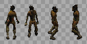
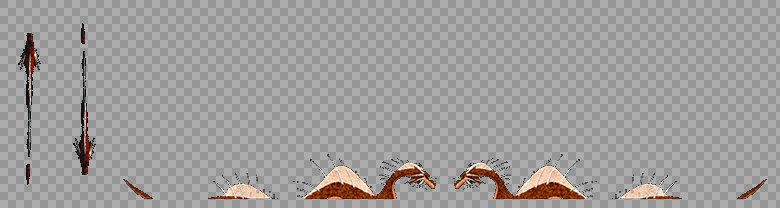

# Arte: Gruta del Abisal

Inventario de todos los gráficos de la mazmorra **Gruta del Abisal** para rehacerlos de cero. Cada fila tiene el gráfico actual (de ejemplo), qué hace en el juego y qué hay que entregar. Al final está el prompt completo para Claude Opus 5.5. El índice y la dirección de arte común están en [README.md](README.md).

| | |
|---|---|
| **Mazmorra** | 1 de 8 de la serie |
| **Estado** | Hoy se juega en la **mazmorra de prueba** (mapas 590-591), que además sirve de banco de pruebas: mezcla mecánicas de todas las mazmorras. El diseño final (mapas 510-512) está en [01-GRUTA_DEL_ABISAL.md](../01-GRUTA_DEL_ABISAL.md). Acá se listan los gráficos que necesita la Gruta del diseño, no los del banco de pruebas. |
| **Ítem que da** | Patas de rana |
| **Mapas** | 590, 591 |
| **Tema** | Una gruta marina bajo el mar: roca húmeda verde azulada, corales, algas y conchas incrustadas, charcos y canales de agua profunda que brillan. Luz azul verdosa que se filtra desde arriba. |
| **Paleta** | verde mar, azul profundo, turquesa, coral apagado y arena mojada |
| **Gráficos** | 4 baldosas, 11 puertas y mecánicas (+ la piedra de invocación), 5 criaturas, 2 minijefes y jefes, 2 efectos. **17 piezas propias** de esta mazmorra; el resto es común. |

**El plano del diseño:**


## 1. Baldosas

| Código | Actual | Qué es y qué hace | Hoy | Para el nuevo |
|---|---|---|---|---|
| GA-01 |  | **Piso.** El piso de todas las salas. | bloque de 4 × 4 desde el grh 9428 | Bloque de 4 × 4 (128 × 128) que se repite sin costura; con dos o tres variantes de baldosa sueltas (rajada, con musgo o arena) para romper la repetición. |
| GA-02 |  | **Pared.** El frente de las paredes; arriba de la cuarta fila se ve negro (el techo). | bloque de 4 × 4 desde el grh 9412 (cada fila, a 1-4 baldosas del piso) | Bloque de 4 × 4: cada fila es la cara de la pared a 1, 2, 3 y 4 baldosas del piso, sin costura a lo ancho; y el techo (lo que hoy es negro) como bloque de 4 × 4 aparte. |
| GA-03 |  | **Agua profunda.** Sin las Patas de rana no se puede pisar; con ellas se nada (no se pelea). | bloque de 4 × 4 animado desde el grh 1505 (el agua del mundo) | Bloque de 4 × 4 animado, 4 cuadros en bucle, y el borde de la orilla (4 lados y 4 esquinas, 32 × 32). |
| GA-04 | — | **Pozo.** Caer saca vida y te devuelve a la entrada de la sala (o al piso de abajo). Se salta con la Pluma. | baldosa negra (grh 1) | El pozo con su borde y profundidad: autotile de 47 piezas (o el juego de 16 de bordes y esquinas), 32 × 32. |

## 2. Puertas, cofres y mecánicas

Las marcadas **común** se dibujan una sola vez para todas las mazmorras (están en [00-COMUNES.md](00-COMUNES.md)); acá figuran para que la lista de esta mazmorra esté completa. Las de **esta mazmorra** van en su prompt.

| Código | Actual | Qué es y qué hace | Estados que hacen falta | Hoy | Para el nuevo |
|---|---|---|---|---|---|
| GA-05 |  | **Escalera.** Une las salas de distintos mapas o pisos (los atajos A, B, C… de Zelda). Se pisa y te lleva a la otra punta. Las de las salas que se cierran aparecen al vaciarlas. | una que baja y una que sube; la de la zambullida va bajo el agua y no se ve | 1198 (Escalera Grande, 32 × 96) | 32 × 64 (ocupa una baldosa, el dibujo puede subir una más), anclada abajo |
| CO-01 (común) |  | **Portal.** La salida de la mazmorra y los portales-atajo que aparecen al vencer a un minijefe (llevan a la entrada). | portal de salida y portal-atajo (dos colores distintos), animados en bucle | 378 (Teleport, 60 × 90, 24 cuadros) | 64 × 96, 8 a 12 cuadros en bucle, anclado abajo al centro |
| CO-02 (común) |  | **Cofre.** Guarda llaves, el mapa, la brújula, oro, el pico de piedra, la caracola o el ítem de la mazmorra. Muchos aparecen al resolver la sala (salen de la nada con un brillo). | cerrado, abierto | 1832 (Cofre de mazmorra, 32 × 32); 1833 (Cofre de mazmorra abierto, 32 × 32) | 32 × 32 (el dibujo puede tener hasta 32 × 40), cerrado y abierto |
| CO-03 (común) |  | **Cofre del jefe.** El cofre del trofeo, en la sala del final. Una vez por día por personaje da el trofeo de la serie y oro. Hoy es el mismo dibujo que el cofre común. | cerrado, abierto | 1849 (Cofre del jefe, 32 × 32) | 48 × 40 a 64 × 48, anclado abajo al centro: tiene que verse más importante que el común |
| GA-06 |  | **Puerta (pared horizontal).** Hoy las puertas cerradas (con llave, del jefe, la persiana que abre la sala y el bloque cerradura) usan el mismo dibujo, y las abiertas o de un solo sentido, otro. En el nuevo cada tipo tiene que distinguirse a la vista. | común abierta y cerrada; con cerradura de llave chica; del jefe (cerradura grande); persiana (reja); de un solo sentido (con flecha); bloque cerradura | 1834 (Puerta de piedra, 96 × 96); 1835 (Puerta de piedra abierta, 96 × 96) | 96 × 96 como hoy (el arco ocupa la baldosa de la puerta y el muro de los costados), anclada abajo al centro |
| GA-07 |  | **Puerta (pared vertical).** Las puertas en las paredes de los costados. Hoy es un cristal que tapa el paso. | los mismos tipos que la horizontal, vistos de costado; abierta no se dibuja | 1840 (Barrera de cristal, 32 × 32) | 32 × 64, anclada abajo |
| CO-04 (común) |  | **Bloque que se empuja.** Se empuja una baldosa con un clic. Tapa pasos, aprieta placas y corta el camino de las cuchillas. | uno solo | 1836 (Bloque de piedra, 32 × 32) | 32 × 32 (el dibujo puede tener 32 × 40 para mostrar el alto) |
| CO-05 (común) |  | **Placa (botón del piso).** Se aprieta con un jugador o un bloque encima. Abre puertas o hace aparecer cofres y escaleras. La de peso solo baja si el que la pisa carga algo con el Brazalete. | suelta y apretada; la placa de peso (Gruta de la Botella) distinta | 1837 (Runa del suelo, 32 × 32); 1838 (Runa del suelo encendida, 32 × 32) | 32 × 32 |
| CO-06 (común) |  | **Losa de piedra.** Una losa con un texto grabado (pistas del jefe o de la mazmorra). Se lee con un clic. | una sola | 1839 (Losa de piedra, 32 × 32) | 32 × 48, anclada abajo |
| CO-16 (común) |  | **Aplastador.** Un bloque que baja de golpe sobre su losa cada tanto. Hoy es el bloque de piedra común. | arriba, bajando, abajo; la losa del piso donde cae | 1848 (Aplastador, 32 × 32); 1847 (Losa del aplastador, 32 × 32) | 32 × 48 el aplastador (con su sombra), 32 × 32 la losa; 3 cuadros de la caída |
| GA-08 |  | **Pared rajada (bombas).** Un paso tapado que se abre con una bomba. Se tiene que notar apenas (una grieta), para que el jugador la descubra. | pared horizontal tapiada (un arco con piedras), pared vertical (un montón de rocas) | 1858 (Pared rajada, 96 × 96); 1859 (Rocas sueltas, 32 × 32) | 96 × 96 la horizontal (como la puerta), 32 × 32 la vertical |
| CO-PI (común) |  | **Piedra de invocación.** Está en el mundo: con un clic se entra a la mazmorra, solo o en grupo. Hoy es una estatua dorada que no tiene que ver con las mazmorras. | Una por mazmorra (con el símbolo de su ítem), con un brillo en bucle | cuerpo 256 | 64 × 96, anclada abajo; 6 cuadros de brillo |

## 3. Criaturas

Las imágenes muestran el primer cuadro mirando arriba, abajo, derecha e izquierda. "Hoy" dice cuántos cuadros por dirección tiene el cuerpo actual y de qué medida.

| Código | Actual (4 direcciones) | Qué es y qué hace | Rol | Hoy | Para el nuevo |
|---|---|---|---|---|---|
| GA-09 |  | **Esqueleto** (plantilla 503). Un esqueleto con espada. | presión | cuerpo 12: 5 cuadros de 53 × 70 | 4 direcciones × 6 cuadros de caminata, 64 × 64 |
| GA-10 |  | **Zombie** (plantilla 502). Un zombie lento que pega fuerte. | guardián | cuerpo 11: 5 cuadros de 36 × 79 | 4 direcciones × 6 cuadros de caminata, 64 × 64 |
| GA-11 |  | **Murciélago** (plantilla 566). Un murciélago que vuela en zigzag. | presión | cuerpo 9: 5 cuadros de 59 × 64 | 4 direcciones × 6 cuadros de caminata, 64 × 64 |
| GA-12 |  | **Pulga de agua** (plantilla 9843). Patina por el agua. | de agua | cuerpo 579: 6 cuadros de 56 × 50 | 4 direcciones × 6 cuadros de caminata, 64 × 64 |
| GA-13 |  | **Calamar** (plantilla 9844). Nada hacia vos. | de agua | cuerpo 580: 8 cuadros de 49 × 41 | 4 direcciones × 6 cuadros de caminata, 64 × 64 |

## 4. Minijefes y jefe

| Código | Actual | Qué es y qué hace | Hoy | Para el nuevo |
|---|---|---|---|---|
| GA-14 | <br> | **Tortuga Espinosa** (minijefe). La bola del original: da vueltas a un anillo y embiste; aturdida al chocar, se le pega. Hoy usa el cuerpo de la Tortuga gigante de AO. | cuerpo 74: 6 cuadros de 64 × 64 | Caminata en 4 direcciones (6 cuadros), metida en el caparazón rodando (4 cuadros) y aturdida (2 cuadros). |
| GA-15 | <br> | **El Abisal** (jefe). Un pez abisal gigante que nada alrededor de la plataforma, muerde al que está en el borde, llama peces chicos y embiste. Hoy usa el cuerpo del Leviatán de AO. | cuerpo 99: 5 cuadros de 49 × 200 | Nadando en 4 direcciones (6 cuadros), saliendo del agua para morder (4 cuadros), la luz de la antena que titila y el pez chico que llama (48 × 48, 4 direcciones). |

## 5. Efectos que se dibujan aparte

Lo que no es una baldosa, un objeto ni un cuerpo: lo dibuja el cliente (con formas o con sprites sueltos) en `frontend/components/game/engine/`.

| Código | Actual | Qué es y qué hace | Para el nuevo |
|---|---|---|---|
| GA-16 | sin captura (se dibuja por código) | **Nado con las Patas de rana.** Con las Patas de rana el personaje bucea por el agua profunda: se ve hundido y no puede atacar. | Una máscara de agua para la mitad de abajo del cuerpo y burbujas que suben (4 cuadros), común a todos los cuerpos. |
| GA-17 | sin captura (se dibuja por código) | **Agua profunda.** La parte oscura del mapa: sin las Patas de rana no se puede pisar. | Ver la baldosa de agua (bloque de 4 × 4 animado). |

## 6. Prompt para Claude Opus 5.5

Copiar entero y pegarlo en una sesión nueva de Claude Code abierta en el repo. Hace el arte de esta mazmorra; lo común sale del prompt de [00-COMUNES.md](00-COMUNES.md), que conviene correr antes.

```text
Sos un artista técnico de videojuegos y trabajás en el repo de WoAO (/Users/leandrobisceglie/AoWeb/aoweb): un MMORPG web (Next.js + PixiJS) basado en Argentum Online. Tiene una serie de 8 mazmorras PvE con la estructura de las de *The Legend of Zelda: Link's Awakening* (llaves, puertas que se cierran, puzzles, un ítem por mazmorra, minijefe y jefe).

Tu trabajo: rehacer de cero TODOS los gráficos de la mazmorra "Gruta del Abisal" (1 de 8; ítem: Patas de rana), para que se vea profesional y coherente. Hoy es una mezcla de gráficos de AO, paquetes libres de otros estilos y cosas dibujadas con formas por código. El inventario completo, con la imagen actual de cada cosa, está en docs/mazmorras/arte/01-GRUTA_DEL_ABISAL.md. Leelo entero antes de empezar y mirá cada imagen de referencia.

TEMA DE ESTA MAZMORRA
Una gruta marina bajo el mar: roca húmeda verde azulada, corales, algas y conchas incrustadas, charcos y canales de agua profunda que brillan. Luz azul verdosa que se filtra desde arriba.
Paleta: verde mar, azul profundo, turquesa, coral apagado y arena mojada.

DIRECCIÓN DE ARTE (PARA TODAS LAS MAZMORRAS)
- Perspectiva y escala: vista desde arriba levemente inclinada (la de Argentum Online): se ve el frente de las paredes y el techo de los objetos. La baldosa mide 32 × 32 y un personaje humano mide 1,5 baldosas de alto.
- Estilo: pintado, con volumen y sombreado suave, que combine con los personajes y los mapas de AO. Nada de pixel art de 8 bits ni de formas planas.
- Luz: desde arriba a la izquierda, igual en todas las piezas. Cada cosa que toca el piso lleva una sombra de contacto suave.
- Contorno: oscuro y fino donde ayude a leer la forma contra el piso, no alrededor de todo.
- Paleta: una por mazmorra (la del tema), con un color de acento para lo interactivo (lo que se toca, se levanta o se abre) y rojo o naranja para lo peligroso.
- Legibilidad: lo que se puede usar se distingue del decorado a primera vista, y cada estado se distingue del otro (cerrado o abierto, apagado o encendido, entero o roto).
- Original: se toma la estructura de *Link's Awakening*, no su arte. Nada copiado de Nintendo ni de otros juegos. Si se parte de algo libre (CC0 o CC-BY), se anota el autor, la licencia y el enlace.

REGLAS TÉCNICAS (LAS DEL MOTOR DEL JUEGO)
- Archivos: PNG con transparencia (RGBA), sin fondo, sin halos claros alrededor y sin texto ni marcas de agua.
- Baldosas de piso: un bloque de 4 × 4 baldosas (128 × 128) que se repite sin costura en las dos direcciones; el juego elige la baldosa por la posición en el mapa.
- Paredes: un bloque de 4 × 4. Cada fila es la cara de la pared vista a 1, 2, 3 y 4 baldosas del piso (la última fila toca el piso). Tiene que repetirse sin costura a lo ancho.
- Agua y lava: bloque de 4 × 4 animado (4 cuadros en bucle, que empalmen).
- Objetos: una baldosa (32 × 32), anclados abajo al centro. Si son altos (estatuas, puertas, pilares), el dibujo puede subir (32 × 64, 32 × 96) o ensancharse (96 × 96 las puertas); la base sigue en la baldosa.
- Cuerpos (criaturas y jefes): una hoja por cuerpo, con 4 filas en este orden: mirando arriba, abajo, derecha e izquierda. Las columnas son los cuadros, todos de la misma medida. Mínimo 6 cuadros de caminata por dirección, que entren en bucle. Los pies van abajo al centro del cuadro: el juego lo apoya sobre la baldosa.
- Animaciones aparte (ataques, poses, efectos): una tira horizontal por animación, con cuadros de la misma medida.
- Numeración del juego: al día de este documento, el próximo grh libre es el 42484, el próximo archivo de gráficos el 330041 y el próximo cuerpo el 586. Verificalos antes de indexar.

LO QUE HAY QUE ENTREGAR (17 piezas, todas de esta mazmorra)
- [GA-01] Piso. Reemplaza: bloque de 4 × 4 desde el grh 9428. Qué hace: El piso de todas las salas. Entregar: Bloque de 4 × 4 (128 × 128) que se repite sin costura; con dos o tres variantes de baldosa sueltas (rajada, con musgo o arena) para romper la repetición. Referencia actual: docs/mazmorras/arte/img/piso-9428.png
- [GA-02] Pared. Reemplaza: bloque de 4 × 4 desde el grh 9412 (cada fila, a 1-4 baldosas del piso). Qué hace: El frente de las paredes; arriba de la cuarta fila se ve negro (el techo). Entregar: Bloque de 4 × 4: cada fila es la cara de la pared a 1, 2, 3 y 4 baldosas del piso, sin costura a lo ancho; y el techo (lo que hoy es negro) como bloque de 4 × 4 aparte. Referencia actual: docs/mazmorras/arte/img/pared-9412.png
- [GA-03] Agua profunda. Reemplaza: bloque de 4 × 4 animado desde el grh 1505 (el agua del mundo). Qué hace: Sin las Patas de rana no se puede pisar; con ellas se nada (no se pelea). Entregar: Bloque de 4 × 4 animado, 4 cuadros en bucle, y el borde de la orilla (4 lados y 4 esquinas, 32 × 32). Referencia actual: docs/mazmorras/arte/img/agua-1505.png
- [GA-04] Pozo. Reemplaza: baldosa negra (grh 1). Qué hace: Caer saca vida y te devuelve a la entrada de la sala (o al piso de abajo). Se salta con la Pluma. Entregar: El pozo con su borde y profundidad: autotile de 47 piezas (o el juego de 16 de bordes y esquinas), 32 × 32. Referencia actual: (no tiene imagen: se dibuja por código)
- [GA-05] Escalera. Reemplaza: objetos 1198 (Escalera Grande, 32 × 96). Qué hace: Une las salas de distintos mapas o pisos (los atajos A, B, C… de Zelda). Se pisa y te lleva a la otra punta. Las de las salas que se cierran aparecen al vaciarlas. Entregar: una que baja y una que sube; la de la zambullida va bajo el agua y no se ve; 32 × 64 (ocupa una baldosa, el dibujo puede subir una más), anclada abajo. Referencia actual: docs/mazmorras/arte/img/familia-escalera.png
- [GA-06] Puerta (pared horizontal). Reemplaza: objetos 1834 (Puerta de piedra, 96 × 96); 1835 (Puerta de piedra abierta, 96 × 96). Qué hace: Hoy las puertas cerradas (con llave, del jefe, la persiana que abre la sala y el bloque cerradura) usan el mismo dibujo, y las abiertas o de un solo sentido, otro. En el nuevo cada tipo tiene que distinguirse a la vista. Entregar: común abierta y cerrada; con cerradura de llave chica; del jefe (cerradura grande); persiana (reja); de un solo sentido (con flecha); bloque cerradura; 96 × 96 como hoy (el arco ocupa la baldosa de la puerta y el muro de los costados), anclada abajo al centro. Referencia actual: docs/mazmorras/arte/img/familia-puerta.png
- [GA-07] Puerta (pared vertical). Reemplaza: objetos 1840 (Barrera de cristal, 32 × 32). Qué hace: Las puertas en las paredes de los costados. Hoy es un cristal que tapa el paso. Entregar: los mismos tipos que la horizontal, vistos de costado; abierta no se dibuja; 32 × 64, anclada abajo. Referencia actual: docs/mazmorras/arte/img/familia-barrera.png
- [GA-08] Pared rajada (bombas). Reemplaza: objetos 1858 (Pared rajada, 96 × 96); 1859 (Rocas sueltas, 32 × 32). Qué hace: Un paso tapado que se abre con una bomba. Se tiene que notar apenas (una grieta), para que el jugador la descubra. Entregar: pared horizontal tapiada (un arco con piedras), pared vertical (un montón de rocas); 96 × 96 la horizontal (como la puerta), 32 × 32 la vertical. Referencia actual: docs/mazmorras/arte/img/familia-pared_bomba.png
- [GA-09] Esqueleto (criatura, presión). Reemplaza: cuerpo 12: 5 cuadros de 53 × 70 (plantilla 503). Qué hace: Un esqueleto con espada. Entregar: 4 direcciones × 6 cuadros de caminata, 64 × 64. Referencia actual: docs/mazmorras/arte/img/cuerpo-12.png
- [GA-10] Zombie (criatura, guardián). Reemplaza: cuerpo 11: 5 cuadros de 36 × 79 (plantilla 502). Qué hace: Un zombie lento que pega fuerte. Entregar: 4 direcciones × 6 cuadros de caminata, 64 × 64. Referencia actual: docs/mazmorras/arte/img/cuerpo-11.png
- [GA-11] Murciélago (criatura, presión). Reemplaza: cuerpo 9: 5 cuadros de 59 × 64 (plantilla 566). Qué hace: Un murciélago que vuela en zigzag. Entregar: 4 direcciones × 6 cuadros de caminata, 64 × 64. Referencia actual: docs/mazmorras/arte/img/cuerpo-9.png
- [GA-12] Pulga de agua (criatura, de agua). Reemplaza: cuerpo 579: 6 cuadros de 56 × 50 (plantilla 9843). Qué hace: Patina por el agua. Entregar: 4 direcciones × 6 cuadros de caminata, 64 × 64. Referencia actual: docs/mazmorras/arte/img/cuerpo-579.png
- [GA-13] Calamar (criatura, de agua). Reemplaza: cuerpo 580: 8 cuadros de 49 × 41 (plantilla 9844). Qué hace: Nada hacia vos. Entregar: 4 direcciones × 6 cuadros de caminata, 64 × 64. Referencia actual: docs/mazmorras/arte/img/cuerpo-580.png
- [GA-14] Tortuga Espinosa (minijefe). Reemplaza: cuerpo 74: 6 cuadros de 64 × 64. Qué hace: La bola del original: da vueltas a un anillo y embiste; aturdida al chocar, se le pega. Hoy usa el cuerpo de la Tortuga gigante de AO. Entregar: Caminata en 4 direcciones (6 cuadros), metida en el caparazón rodando (4 cuadros) y aturdida (2 cuadros). Referencia actual: docs/mazmorras/arte/img/cuerpo-74.png
- [GA-15] El Abisal (jefe). Reemplaza: cuerpo 99: 5 cuadros de 49 × 200. Qué hace: Un pez abisal gigante que nada alrededor de la plataforma, muerde al que está en el borde, llama peces chicos y embiste. Hoy usa el cuerpo del Leviatán de AO. Entregar: Nadando en 4 direcciones (6 cuadros), saliendo del agua para morder (4 cuadros), la luz de la antena que titila y el pez chico que llama (48 × 48, 4 direcciones). Referencia actual: docs/mazmorras/arte/img/cuerpo-99.png
- [GA-16] Nado con las Patas de rana. Reemplaza: lo que hoy dibuja el cliente. Qué hace: Con las Patas de rana el personaje bucea por el agua profunda: se ve hundido y no puede atacar. Entregar: Una máscara de agua para la mitad de abajo del cuerpo y burbujas que suben (4 cuadros), común a todos los cuerpos. Referencia actual: (no tiene imagen: se dibuja por código)
- [GA-17] Agua profunda. Reemplaza: lo que hoy dibuja el cliente. Qué hace: La parte oscura del mapa: sin las Patas de rana no se puede pisar. Entregar: Ver la baldosa de agua (bloque de 4 × 4 animado). Referencia actual: (no tiene imagen: se dibuja por código)

Lo común a todas las mazmorras (cofres, placas, escaleras, portal, búho, bloques y cristales de color, vasijas y piedras, herramientas e íconos) NO va en este trabajo: sale del prompt de docs/mazmorras/arte/00-COMUNES.md. Esta mazmorra usa estos: CO-01 Portal, CO-02 Cofre, CO-03 Cofre del jefe, CO-04 Bloque que se empuja, CO-05 Placa (botón del piso), CO-06 Losa de piedra, CO-16 Aplastador. Tus piezas tienen que combinar con ellos (si ya existen, miralos; si no, respetá la dirección de arte de arriba).

CÓMO TRABAJAR
1. Primero, una hoja de estilo: la paleta, el piso, la pared, una puerta y una criatura de esta mazmorra, apoyados sobre el piso nuevo. Mostrala y esperá la aprobación de Leandro antes de seguir.
2. Después, el resto, en este orden: baldosas, puertas y mecánicas, criaturas, minijefes y jefe, efectos.
3. Revisá cada pieza a tamaño real (1×) y al doble sobre el piso de la mazmorra, y al lado de un personaje de AO para la escala.
4. Si tenés una herramienta de generación de imágenes, usala con estas especificaciones y después llevá cada pieza a la grilla exacta (medida, transparencia, cuadros alineados) con un script. Si no, dibujalo por código (Python con Pillow) cuidando la calidad: volumen, luz y sombra, no formas planas.

QUÉ ENTREGAR
- Una carpeta arte/mazmorras/gruta/ con un PNG por pieza, con el código como nombre (por ejemplo GA-01.png).
- arte/mazmorras/gruta/manifest.json con una entrada por pieza: código, archivo, qué reemplaza, medida del cuadro, cantidad de cuadros, filas o direcciones, ancla, velocidad de la animación (ms por cuadro) y origen (propio, o autor + licencia + enlace).
- arte/mazmorras/gruta/preview.png: una hoja de contacto con todas las piezas sobre el piso de la mazmorra, con su código abajo.

CÓMO ENTRA AL JUEGO (SOLO DESPUÉS DE QUE LEANDRO APRUEBE EL ARTE)
1. Cada hoja va a `frontend/public/graphics/<archivo>.png`, numeradas desde el próximo archivo libre.
2. Cada cuadro es un grh. Se agrega como texto al final de `frontend/public/init/graficos.json` y `graficos_optimized.json`, sin reescribir los JSON:
   - estático: `"<grh>":{"numFrames":1,"numFile":<archivo>,"sX":<x>,"sY":<y>,"width":<w>,"height":<h>,"frames":{"1":<grh>}}` y, en el optimizado, `"<grh>":[<archivo>,<x>,<y>,<w>,<h>]`;
   - animado: `"<grh>":{"numFrames":<n>,"frames":{"1":<g1>,"2":<g2>,…},"speed":<ms>}` y `"<grh>":{"f":<n>,"r":[<g1>,<g2>,…],"s":<ms>}`.
3. Cada cuerpo se agrega a `frontend/public/init/bodies.json`: `"<cuerpo>":{"1":<grh arriba>,"2":<grh abajo>,"3":<grh derecha>,"4":<grh izquierda>,"headOffsetX":0,"headOffsetY":0}`. El cuerpo de cada criatura se cambia con `idBody` en su plantilla de `server/mazmorras/<mazmorra>/leyenda.json`.
4. Los objetos del mapa toman su grh de `DUNGEON_OBJECTS` en `server/src/scripts/buildDungeonMaps.ts`, y las baldosas de piso y pared, de `graficos` en `leyenda.json`. Después se regeneran los mapas con `pnpm --dir server exec tsx src/scripts/buildDungeonMaps.ts <mazmorra>`.
5. Lo que hoy se dibuja con formas o con sprites sueltos vive en `frontend/components/game/engine/` (el módulo de cada mazmorra; ver la tabla de efectos). Ahí se cargan las hojas nuevas.
6. Se sube la versión de las cachés en `frontend/utils/gameLoader.ts` (graficos, bodies, objs y npcs) para que los jugadores bajen lo nuevo.
7. Se prueba en vivo y se sacan capturas de cada cosa, comparadas con la imagen actual de este documento.

CRITERIOS PARA DAR UNA PIEZA POR TERMINADA
- Tiene la medida, los cuadros, el orden de las direcciones y el ancla pedidos.
- Se lee a 1× sobre el piso de la mazmorra: se entiende qué es y en qué estado está.
- Combina con el resto de la mazmorra y con los personajes de AO: misma luz, misma escala, misma paleta.
- Las animaciones entran en bucle sin saltos, y los bloques de piso, pared, agua y lava se repiten sin costura.
- Es arte original, o tiene anotado el origen y la licencia en el manifest.
```
