# Arte: Gruta de la Botella

Inventario de todos los gráficos de la mazmorra **Gruta de la Botella** para rehacerlos de cero. Cada fila tiene el gráfico actual (de ejemplo), qué hace en el juego y qué hay que entregar. Al final está el prompt completo para Claude Opus 5.5. El índice y la dirección de arte común están en [README.md](README.md).

| | |
|---|---|
| **Mazmorra** | 3 de 8 de la serie |
| **Estado** | Hecha (mapas 550-552). |
| **Ítem que da** | Brazalete de Fuerza |
| **Mapas** | 550, 551, 552 |
| **Tema** | Una gruta de arenisca del desierto llena de vasijas de cerámica; corrales de madera, antorchas y dibujos pintados en la roca. El Genio aporta un violeta mágico. |
| **Paleta** | ocre arena, terracota, marrón madera y violeta mágico |
| **Gráficos** | 3 baldosas, 15 puertas y mecánicas (+ la piedra de invocación), 12 criaturas, 2 minijefes y jefes, 5 efectos. **26 piezas propias** de esta mazmorra; el resto es común. |

**El plano:**

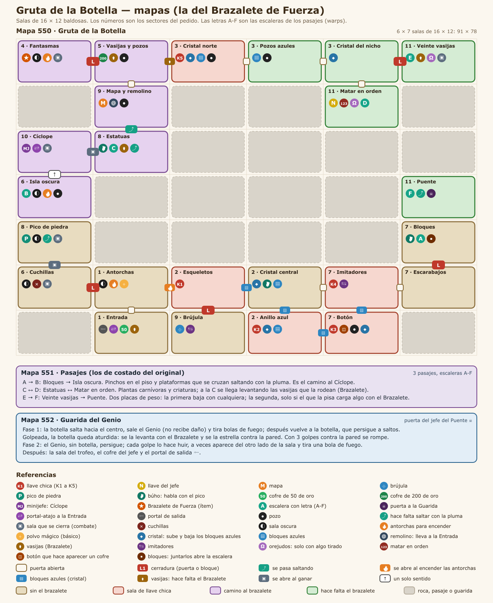

## 1. Baldosas

| Código | Actual | Qué es y qué hace | Hoy | Para el nuevo |
|---|---|---|---|---|
| GB-01 | 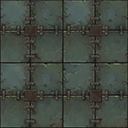 | **Piso.** El piso de todas las salas. | bloque de 4 × 4 desde el grh 33847 | Bloque de 4 × 4 (128 × 128) que se repite sin costura; con dos o tres variantes de baldosa sueltas (rajada, con musgo o arena) para romper la repetición. |
| GB-02 | 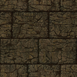 | **Pared.** El frente de las paredes; arriba de la cuarta fila se ve negro (el techo). | bloque de 4 × 4 desde el grh 9683 (cada fila, a 1-4 baldosas del piso) | Bloque de 4 × 4: cada fila es la cara de la pared a 1, 2, 3 y 4 baldosas del piso, sin costura a lo ancho; y el techo (lo que hoy es negro) como bloque de 4 × 4 aparte. |
| GB-03 | — | **Pozo.** Caer saca vida y te devuelve a la entrada de la sala (o al piso de abajo). Se salta con la Pluma. | baldosa negra (grh 1) | El pozo con su borde y profundidad: autotile de 47 piezas (o el juego de 16 de bordes y esquinas), 32 × 32. |

## 2. Puertas, cofres y mecánicas

Las marcadas **común** se dibujan una sola vez para todas las mazmorras (están en [00-COMUNES.md](00-COMUNES.md)); acá figuran para que la lista de esta mazmorra esté completa. Las de **esta mazmorra** van en su prompt.

| Código | Actual | Qué es y qué hace | Estados que hacen falta | Hoy | Para el nuevo |
|---|---|---|---|---|---|
| GB-04 |  | **Escalera.** Une las salas de distintos mapas o pisos (los atajos A, B, C… de Zelda). Se pisa y te lleva a la otra punta. Las de las salas que se cierran aparecen al vaciarlas. | una que baja y una que sube; la de la zambullida va bajo el agua y no se ve | 1198 (Escalera Grande, 32 × 96) | 32 × 64 (ocupa una baldosa, el dibujo puede subir una más), anclada abajo |
| CO-01 (común) |  | **Portal.** La salida de la mazmorra y los portales-atajo que aparecen al vencer a un minijefe (llevan a la entrada). | portal de salida y portal-atajo (dos colores distintos), animados en bucle | 378 (Teleport, 60 × 90, 24 cuadros) | 64 × 96, 8 a 12 cuadros en bucle, anclado abajo al centro |
| CO-02 (común) |  | **Cofre.** Guarda llaves, el mapa, la brújula, oro, el pico de piedra, la caracola o el ítem de la mazmorra. Muchos aparecen al resolver la sala (salen de la nada con un brillo). | cerrado, abierto | 1832 (Cofre de mazmorra, 32 × 32); 1833 (Cofre de mazmorra abierto, 32 × 32) | 32 × 32 (el dibujo puede tener hasta 32 × 40), cerrado y abierto |
| CO-03 (común) |  | **Cofre del jefe.** El cofre del trofeo, en la sala del final. Una vez por día por personaje da el trofeo de la serie y oro. Hoy es el mismo dibujo que el cofre común. | cerrado, abierto | 1849 (Cofre del jefe, 32 × 32) | 48 × 40 a 64 × 48, anclado abajo al centro: tiene que verse más importante que el común |
| GB-05 |  | **Puerta (pared horizontal).** Hoy las puertas cerradas (con llave, del jefe, la persiana que abre la sala y el bloque cerradura) usan el mismo dibujo, y las abiertas o de un solo sentido, otro. En el nuevo cada tipo tiene que distinguirse a la vista. | común abierta y cerrada; con cerradura de llave chica; del jefe (cerradura grande); persiana (reja); de un solo sentido (con flecha); bloque cerradura | 1834 (Puerta de piedra, 96 × 96); 1835 (Puerta de piedra abierta, 96 × 96) | 96 × 96 como hoy (el arco ocupa la baldosa de la puerta y el muro de los costados), anclada abajo al centro |
| GB-06 |  | **Puerta (pared vertical).** Las puertas en las paredes de los costados. Hoy es un cristal que tapa el paso. | los mismos tipos que la horizontal, vistos de costado; abierta no se dibuja | 1840 (Barrera de cristal, 32 × 32) | 32 × 64, anclada abajo |
| GB-07 | 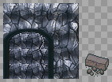 | **Pared rajada (bombas).** Un paso tapado que se abre con una bomba. Se tiene que notar apenas (una grieta), para que el jugador la descubra. | pared horizontal tapiada (un arco con piedras), pared vertical (un montón de rocas) | 1858 (Pared rajada, 96 × 96); 1859 (Rocas sueltas, 32 × 32) | 96 × 96 la horizontal (como la puerta), 32 × 32 la vertical |
| CO-04 (común) |  | **Bloque que se empuja.** Se empuja una baldosa con un clic. Tapa pasos, aprieta placas y corta el camino de las cuchillas. | uno solo | 1836 (Bloque de piedra, 32 × 32) | 32 × 32 (el dibujo puede tener 32 × 40 para mostrar el alto) |
| CO-05 (común) |  | **Placa (botón del piso).** Se aprieta con un jugador o un bloque encima. Abre puertas o hace aparecer cofres y escaleras. La de peso solo baja si el que la pisa carga algo con el Brazalete. | suelta y apretada; la placa de peso (Gruta de la Botella) distinta | 1837 (Runa del suelo, 32 × 32); 1838 (Runa del suelo encendida, 32 × 32) | 32 × 32 |
| CO-07 (común) | 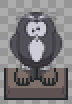 | **Estatua búho.** Con el Pico de piedra, da una pista al hacerle clic. | una sola (opcional: los ojos que se encienden cuando habla) | 1861 (Estatua búho, 32 × 48) | 32 × 48, anclada abajo |
| CO-08 (común) | 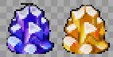 | **Cristal de los bloques de color.** Al golpearlo, se invierten los bloques de color de toda la corrida. Hoy usa el mismo dibujo que la barrera de cristal. | azul y naranja | 1866 (Cristal azul, 32 × 32); 1867 (Cristal naranja, 32 × 32) | 32 × 48, anclado abajo |
| CO-09 (común) | 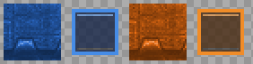 | **Bloques de color.** Los azules arrancan levantados (tapan el paso) y los naranjas bajados. El cristal los invierte. | azul levantado, azul bajado, naranja levantado, naranja bajado | 1862 (Bloque azul, 32 × 32); 1863 (Bloque azul bajado, 32 × 32); 1864 (Bloque naranja, 32 × 32); 1865 (Bloque naranja bajado, 32 × 32) | 32 × 32 cada estado |
| CO-10 (común) | 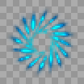 | **Remolino.** Arrastra hacia el centro; el que llega al centro vuelve a la entrada. | animado en bucle | 1868 (Remolino, 48 × 48, 12 cuadros) | 48 × 48, 12 cuadros en bucle |
| CO-11 (común) | 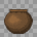 | **Vasija.** Se levanta con el Brazalete, se lleva y se tira. Tapa pasos, abre persianas al tirarla y algunas esconden algo. | entera; pedazos al romperse (4 a 6 trozos) | 1852 (Vasija, 32 × 32) | 32 × 32 |
| CO-13 (común) | 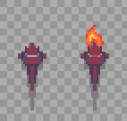 | **Antorcha.** Se enciende con el Polvo de Fuego o el polvo mágico. Las salas con antorchas apagadas están a oscuras; si la sala tiene cofres, aparecen al encender todas. | apagada; encendida (fuego animado en bucle) | 1856 (Antorcha apagada, 32 × 64); 1857 (Antorcha encendida, 32 × 64, 9 cuadros) | 32 × 64, anclada abajo; el fuego, 8 a 9 cuadros |
| CO-PI (común) |  | **Piedra de invocación.** Está en el mundo: con un clic se entra a la mazmorra, solo o en grupo. Hoy es una estatua dorada que no tiene que ver con las mazmorras. | Una por mazmorra (con el símbolo de su ítem), con un brillo en bucle | cuerpo 256 | 64 × 96, anclada abajo; 6 cuadros de brillo |

## 3. Criaturas

Las imágenes muestran el primer cuadro mirando arriba, abajo, derecha e izquierda. "Hoy" dice cuántos cuadros por dirección tiene el cuerpo actual y de qué medida.

| Código | Actual (4 direcciones) | Qué es y qué hace | Rol | Hoy | Para el nuevo |
|---|---|---|---|---|---|
| GB-08 |  | **Murciélago** (plantilla 9760, 9771). Un murciélago de la gruta: vuela en zigzag. | criatura | cuerpo 9: 5 cuadros de 59 × 64 | 4 direcciones × 6 cuadros de caminata, 64 × 64 |
| GB-09 |  | **Esqueleto** (plantilla 9761, 9772). Un esqueleto con espada que cuida la gruta. | criatura | cuerpo 12: 5 cuadros de 53 × 70 | 4 direcciones × 6 cuadros de caminata, 64 × 64 |
| GB-10 |  | **Chispa** (plantilla 9762). Una chispa que da vueltas alrededor de un pilar y quema al que toca. | trampa | cuerpo 413: 10 cuadros de 80 × 60 | 4 direcciones × 4 cuadros (si gira o se mueve), 48 × 48 |
| GB-11 |  | **Cuchilla** (plantilla 9763). Una trampa de cuchillas: sale disparada si te ve en su fila. | trampa | cuerpo 244: 2 cuadros de 75 × 75 | 4 direcciones × 4 cuadros (si gira o se mueve), 48 × 48 |
| GB-12 | 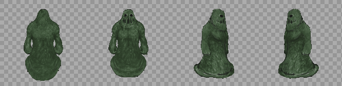 | **Moco de la gruta** (plantilla 9764). Un moco verde: al morir se parte en dos moquitos. | criatura | cuerpo 504: 8 cuadros de 160 × 160 | 4 direcciones × 6 cuadros de caminata, 128 × 128 |
| GB-13 |  | **Escarabajo de púas** (plantilla 9766). Un escarabajo cubierto de púas. | criatura | cuerpo 51: 5 cuadros de 50 × 40 | 4 direcciones × 6 cuadros de caminata, 64 × 64 |
| GB-14 | 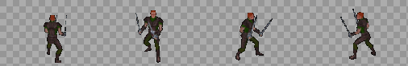 | **Imitador** (plantilla 9767). Copia cada paso tuyo, al revés. De frente se cubre: pegale de costado o por la espalda. | criatura | cuerpo 371: 5 cuadros de 120 × 75 | 4 direcciones × 6 cuadros de caminata, 96 × 96 |
| GB-15 | 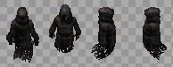 | **Fantasma** (plantilla 9768). A oscuras no le entra nada: encendé una antorcha. | criatura | cuerpo 251: 5 cuadros de 42 × 68 | 4 direcciones × 6 cuadros de caminata, 64 × 64 |
| GB-16 | 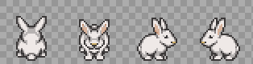 | **Orejudo** (plantilla 9769). No le entran golpes ni hechizos: tirale algo (una vasija, una bomba o una flecha). | criatura | cuerpo 577: 4 cuadros de 36 × 36 | 4 direcciones × 6 cuadros de caminata, 48 × 48 |
| GB-17 |  | **Orejudo preso** (plantilla 9770). Está preso en un corral. Es el primero de la sala. | criatura | cuerpo 577: 4 cuadros de 36 × 36 | 4 direcciones × 6 cuadros de caminata, 48 × 48 |
| GB-18 |  | **Escarabajo de casco** (plantilla 9773). No le hace nada ningún golpe: cada golpe lo corre. Empujalo a un pozo. | criatura | cuerpo 74: 6 cuadros de 64 × 64 | 4 direcciones × 6 cuadros de caminata, 64 × 64 |
| GB-19 | 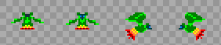 | **Moquito** (plantilla 9765). Un pedazo del moco de la gruta. | criatura | cuerpo 146: 2 cuadros de 32 × 25 | 4 direcciones × 6 cuadros de caminata, 48 × 48 |

## 4. Minijefes y jefe

| Código | Actual | Qué es y qué hace | Hoy | Para el nuevo |
|---|---|---|---|---|
| GB-20 | 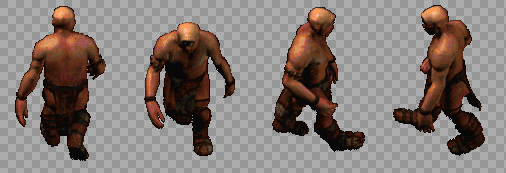<br>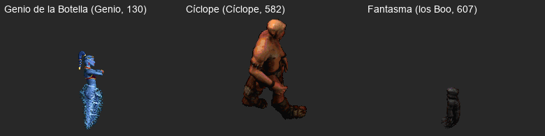 | **Cíclope** (minijefe). El guardián de la gruta: embiste y tira bombas. | cuerpo 176: 7 cuadros de 120 × 165 | Caminata en 4 direcciones (6 cuadros), carga antes de embestir (2 cuadros), tirando una bomba (3 cuadros) y aturdido (2 cuadros). |
| GB-21 | 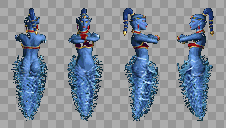<br> | **Genio de la Botella** (jefe). Sale de su botella en una nube de humo, flota y tira bolas de fuego. Con la botella no se lo puede lastimar: se la aturde, se la levanta y se la rompe contra la pared. Después pelea sin ella. | cuerpo 235: 6 cuadros de 50 × 120 | El Genio flotando (4 direcciones, 6 cuadros), tirando fuego (3 cuadros), saliendo y entrando del humo (6 cuadros); la botella entera, aturdida (torcida) y rota en pedazos; la nube de humo (6 cuadros, 64 × 64); la bola de fuego (4 cuadros, 24 × 24). |

## 5. Efectos que se dibujan aparte

Lo que no es una baldosa, un objeto ni un cuerpo: lo dibuja el cliente (con formas o con sprites sueltos) en `frontend/components/game/engine/`.

| Código | Actual | Qué es y qué hace | Para el nuevo |
|---|---|---|---|
| GB-22 |  | **Lo que se levanta y se tira.** Con el Brazalete, la vasija (o la botella, o el Orbe) se lleva sobre la cabeza y se tira en arco; al romperse quedan pedazos. | Los pedazos de cada cosa que se rompe (vasija, piedra, botella): 4 a 6 trozos de 8 × 8 a 12 × 12. |
| GB-23 |  | **Los orejudos.** Criaturas a las que no les entran golpes: solo algo tirado. | Ver Orejudo en criaturas. |
| GB-24 |  | **Placa de peso.** Solo baja si el que la pisa carga algo con el Brazalete. | Una placa más grande y robusta que la común (32 × 32), suelta y apretada. |
| GB-25 |  | **Fantasmas en la oscuridad.** A oscuras no se los puede tocar: hay que encender las antorchas. | Ver Fantasma en criaturas; además, el brillo tenue que se ve en la oscuridad (48 × 48). |
| GB-26 |  | **Vencer en orden.** Tres criaturas que hay que vencer en orden; si no, vuelven. | Un número flotante sobre cada una (I, II, III) o una marca de color: 16 × 16. |

## 6. Prompt para Claude Opus 5.5

Copiar entero y pegarlo en una sesión nueva de Claude Code abierta en el repo. Hace el arte de esta mazmorra; lo común sale del prompt de [00-COMUNES.md](00-COMUNES.md), que conviene correr antes.

```text
Sos un artista técnico de videojuegos y trabajás en el repo de WoAO (/Users/leandrobisceglie/AoWeb/aoweb): un MMORPG web (Next.js + PixiJS) basado en Argentum Online. Tiene una serie de 8 mazmorras PvE con la estructura de las de *The Legend of Zelda: Link's Awakening* (llaves, puertas que se cierran, puzzles, un ítem por mazmorra, minijefe y jefe).

Tu trabajo: rehacer de cero TODOS los gráficos de la mazmorra "Gruta de la Botella" (3 de 8; ítem: Brazalete de Fuerza), para que se vea profesional y coherente. Hoy es una mezcla de gráficos de AO, paquetes libres de otros estilos y cosas dibujadas con formas por código. El inventario completo, con la imagen actual de cada cosa, está en docs/mazmorras/arte/03-GRUTA_DE_LA_BOTELLA.md. Leelo entero antes de empezar y mirá cada imagen de referencia.

TEMA DE ESTA MAZMORRA
Una gruta de arenisca del desierto llena de vasijas de cerámica; corrales de madera, antorchas y dibujos pintados en la roca. El Genio aporta un violeta mágico.
Paleta: ocre arena, terracota, marrón madera y violeta mágico.

DIRECCIÓN DE ARTE (PARA TODAS LAS MAZMORRAS)
- Perspectiva y escala: vista desde arriba levemente inclinada (la de Argentum Online): se ve el frente de las paredes y el techo de los objetos. La baldosa mide 32 × 32 y un personaje humano mide 1,5 baldosas de alto.
- Estilo: pintado, con volumen y sombreado suave, que combine con los personajes y los mapas de AO. Nada de pixel art de 8 bits ni de formas planas.
- Luz: desde arriba a la izquierda, igual en todas las piezas. Cada cosa que toca el piso lleva una sombra de contacto suave.
- Contorno: oscuro y fino donde ayude a leer la forma contra el piso, no alrededor de todo.
- Paleta: una por mazmorra (la del tema), con un color de acento para lo interactivo (lo que se toca, se levanta o se abre) y rojo o naranja para lo peligroso.
- Legibilidad: lo que se puede usar se distingue del decorado a primera vista, y cada estado se distingue del otro (cerrado o abierto, apagado o encendido, entero o roto).
- Original: se toma la estructura de *Link's Awakening*, no su arte. Nada copiado de Nintendo ni de otros juegos. Si se parte de algo libre (CC0 o CC-BY), se anota el autor, la licencia y el enlace.

REGLAS TÉCNICAS (LAS DEL MOTOR DEL JUEGO)
- Archivos: PNG con transparencia (RGBA), sin fondo, sin halos claros alrededor y sin texto ni marcas de agua.
- Baldosas de piso: un bloque de 4 × 4 baldosas (128 × 128) que se repite sin costura en las dos direcciones; el juego elige la baldosa por la posición en el mapa.
- Paredes: un bloque de 4 × 4. Cada fila es la cara de la pared vista a 1, 2, 3 y 4 baldosas del piso (la última fila toca el piso). Tiene que repetirse sin costura a lo ancho.
- Agua y lava: bloque de 4 × 4 animado (4 cuadros en bucle, que empalmen).
- Objetos: una baldosa (32 × 32), anclados abajo al centro. Si son altos (estatuas, puertas, pilares), el dibujo puede subir (32 × 64, 32 × 96) o ensancharse (96 × 96 las puertas); la base sigue en la baldosa.
- Cuerpos (criaturas y jefes): una hoja por cuerpo, con 4 filas en este orden: mirando arriba, abajo, derecha e izquierda. Las columnas son los cuadros, todos de la misma medida. Mínimo 6 cuadros de caminata por dirección, que entren en bucle. Los pies van abajo al centro del cuadro: el juego lo apoya sobre la baldosa.
- Animaciones aparte (ataques, poses, efectos): una tira horizontal por animación, con cuadros de la misma medida.
- Numeración del juego: al día de este documento, el próximo grh libre es el 42484, el próximo archivo de gráficos el 330041 y el próximo cuerpo el 586. Verificalos antes de indexar.

LO QUE HAY QUE ENTREGAR (26 piezas, todas de esta mazmorra)
- [GB-01] Piso. Reemplaza: bloque de 4 × 4 desde el grh 33847. Qué hace: El piso de todas las salas. Entregar: Bloque de 4 × 4 (128 × 128) que se repite sin costura; con dos o tres variantes de baldosa sueltas (rajada, con musgo o arena) para romper la repetición. Referencia actual: docs/mazmorras/arte/img/piso-33847.png
- [GB-02] Pared. Reemplaza: bloque de 4 × 4 desde el grh 9683 (cada fila, a 1-4 baldosas del piso). Qué hace: El frente de las paredes; arriba de la cuarta fila se ve negro (el techo). Entregar: Bloque de 4 × 4: cada fila es la cara de la pared a 1, 2, 3 y 4 baldosas del piso, sin costura a lo ancho; y el techo (lo que hoy es negro) como bloque de 4 × 4 aparte. Referencia actual: docs/mazmorras/arte/img/pared-9683.png
- [GB-03] Pozo. Reemplaza: baldosa negra (grh 1). Qué hace: Caer saca vida y te devuelve a la entrada de la sala (o al piso de abajo). Se salta con la Pluma. Entregar: El pozo con su borde y profundidad: autotile de 47 piezas (o el juego de 16 de bordes y esquinas), 32 × 32. Referencia actual: (no tiene imagen: se dibuja por código)
- [GB-04] Escalera. Reemplaza: objetos 1198 (Escalera Grande, 32 × 96). Qué hace: Une las salas de distintos mapas o pisos (los atajos A, B, C… de Zelda). Se pisa y te lleva a la otra punta. Las de las salas que se cierran aparecen al vaciarlas. Entregar: una que baja y una que sube; la de la zambullida va bajo el agua y no se ve; 32 × 64 (ocupa una baldosa, el dibujo puede subir una más), anclada abajo. Referencia actual: docs/mazmorras/arte/img/familia-escalera.png
- [GB-05] Puerta (pared horizontal). Reemplaza: objetos 1834 (Puerta de piedra, 96 × 96); 1835 (Puerta de piedra abierta, 96 × 96). Qué hace: Hoy las puertas cerradas (con llave, del jefe, la persiana que abre la sala y el bloque cerradura) usan el mismo dibujo, y las abiertas o de un solo sentido, otro. En el nuevo cada tipo tiene que distinguirse a la vista. Entregar: común abierta y cerrada; con cerradura de llave chica; del jefe (cerradura grande); persiana (reja); de un solo sentido (con flecha); bloque cerradura; 96 × 96 como hoy (el arco ocupa la baldosa de la puerta y el muro de los costados), anclada abajo al centro. Referencia actual: docs/mazmorras/arte/img/familia-puerta.png
- [GB-06] Puerta (pared vertical). Reemplaza: objetos 1840 (Barrera de cristal, 32 × 32). Qué hace: Las puertas en las paredes de los costados. Hoy es un cristal que tapa el paso. Entregar: los mismos tipos que la horizontal, vistos de costado; abierta no se dibuja; 32 × 64, anclada abajo. Referencia actual: docs/mazmorras/arte/img/familia-barrera.png
- [GB-07] Pared rajada (bombas). Reemplaza: objetos 1858 (Pared rajada, 96 × 96); 1859 (Rocas sueltas, 32 × 32). Qué hace: Un paso tapado que se abre con una bomba. Se tiene que notar apenas (una grieta), para que el jugador la descubra. Entregar: pared horizontal tapiada (un arco con piedras), pared vertical (un montón de rocas); 96 × 96 la horizontal (como la puerta), 32 × 32 la vertical. Referencia actual: docs/mazmorras/arte/img/familia-pared_bomba.png
- [GB-08] Murciélago (criatura). Reemplaza: cuerpo 9: 5 cuadros de 59 × 64 (plantilla 9760, 9771). Qué hace: Un murciélago de la gruta: vuela en zigzag. Entregar: 4 direcciones × 6 cuadros de caminata, 64 × 64. Referencia actual: docs/mazmorras/arte/img/cuerpo-9.png
- [GB-09] Esqueleto (criatura). Reemplaza: cuerpo 12: 5 cuadros de 53 × 70 (plantilla 9761, 9772). Qué hace: Un esqueleto con espada que cuida la gruta. Entregar: 4 direcciones × 6 cuadros de caminata, 64 × 64. Referencia actual: docs/mazmorras/arte/img/cuerpo-12.png
- [GB-10] Chispa (criatura, trampa). Reemplaza: cuerpo 413: 10 cuadros de 80 × 60 (plantilla 9762). Qué hace: Una chispa que da vueltas alrededor de un pilar y quema al que toca. Entregar: 4 direcciones × 4 cuadros (si gira o se mueve), 48 × 48. Referencia actual: docs/mazmorras/arte/img/cuerpo-413.png
- [GB-11] Cuchilla (criatura, trampa). Reemplaza: cuerpo 244: 2 cuadros de 75 × 75 (plantilla 9763). Qué hace: Una trampa de cuchillas: sale disparada si te ve en su fila. Entregar: 4 direcciones × 4 cuadros (si gira o se mueve), 48 × 48. Referencia actual: docs/mazmorras/arte/img/cuerpo-244.png
- [GB-12] Moco de la gruta (criatura). Reemplaza: cuerpo 504: 8 cuadros de 160 × 160 (plantilla 9764). Qué hace: Un moco verde: al morir se parte en dos moquitos. Entregar: 4 direcciones × 6 cuadros de caminata, 128 × 128. Referencia actual: docs/mazmorras/arte/img/cuerpo-504.png
- [GB-13] Escarabajo de púas (criatura). Reemplaza: cuerpo 51: 5 cuadros de 50 × 40 (plantilla 9766). Qué hace: Un escarabajo cubierto de púas. Entregar: 4 direcciones × 6 cuadros de caminata, 64 × 64. Referencia actual: docs/mazmorras/arte/img/cuerpo-51.png
- [GB-14] Imitador (criatura). Reemplaza: cuerpo 371: 5 cuadros de 120 × 75 (plantilla 9767). Qué hace: Copia cada paso tuyo, al revés. De frente se cubre: pegale de costado o por la espalda. Entregar: 4 direcciones × 6 cuadros de caminata, 96 × 96. Referencia actual: docs/mazmorras/arte/img/cuerpo-371.png
- [GB-15] Fantasma (criatura). Reemplaza: cuerpo 251: 5 cuadros de 42 × 68 (plantilla 9768). Qué hace: A oscuras no le entra nada: encendé una antorcha. Entregar: 4 direcciones × 6 cuadros de caminata, 64 × 64. Referencia actual: docs/mazmorras/arte/img/cuerpo-251.png
- [GB-16] Orejudo (criatura). Reemplaza: cuerpo 577: 4 cuadros de 36 × 36 (plantilla 9769). Qué hace: No le entran golpes ni hechizos: tirale algo (una vasija, una bomba o una flecha). Entregar: 4 direcciones × 6 cuadros de caminata, 48 × 48. Referencia actual: docs/mazmorras/arte/img/cuerpo-577.png
- [GB-17] Orejudo preso (criatura). Reemplaza: cuerpo 577: 4 cuadros de 36 × 36 (plantilla 9770). Qué hace: Está preso en un corral. Es el primero de la sala. Entregar: 4 direcciones × 6 cuadros de caminata, 48 × 48. Referencia actual: docs/mazmorras/arte/img/cuerpo-577.png
- [GB-18] Escarabajo de casco (criatura). Reemplaza: cuerpo 74: 6 cuadros de 64 × 64 (plantilla 9773). Qué hace: No le hace nada ningún golpe: cada golpe lo corre. Empujalo a un pozo. Entregar: 4 direcciones × 6 cuadros de caminata, 64 × 64. Referencia actual: docs/mazmorras/arte/img/cuerpo-74.png
- [GB-19] Moquito (criatura). Reemplaza: cuerpo 146: 2 cuadros de 32 × 25 (plantilla 9765). Qué hace: Un pedazo del moco de la gruta. Entregar: 4 direcciones × 6 cuadros de caminata, 48 × 48. Referencia actual: docs/mazmorras/arte/img/cuerpo-146.png
- [GB-20] Cíclope (minijefe). Reemplaza: cuerpo 176: 7 cuadros de 120 × 165. Qué hace: El guardián de la gruta: embiste y tira bombas. Entregar: Caminata en 4 direcciones (6 cuadros), carga antes de embestir (2 cuadros), tirando una bomba (3 cuadros) y aturdido (2 cuadros). Referencia actual: docs/mazmorras/arte/img/cuerpo-176.png
- [GB-21] Genio de la Botella (jefe). Reemplaza: cuerpo 235: 6 cuadros de 50 × 120. Qué hace: Sale de su botella en una nube de humo, flota y tira bolas de fuego. Con la botella no se lo puede lastimar: se la aturde, se la levanta y se la rompe contra la pared. Después pelea sin ella. Entregar: El Genio flotando (4 direcciones, 6 cuadros), tirando fuego (3 cuadros), saliendo y entrando del humo (6 cuadros); la botella entera, aturdida (torcida) y rota en pedazos; la nube de humo (6 cuadros, 64 × 64); la bola de fuego (4 cuadros, 24 × 24). Referencia actual: docs/mazmorras/arte/img/cuerpo-235.png
- [GB-22] Lo que se levanta y se tira. Reemplaza: lo que hoy dibuja el cliente. Qué hace: Con el Brazalete, la vasija (o la botella, o el Orbe) se lleva sobre la cabeza y se tira en arco; al romperse quedan pedazos. Entregar: Los pedazos de cada cosa que se rompe (vasija, piedra, botella): 4 a 6 trozos de 8 × 8 a 12 × 12. Referencia actual: docs/mazmorras/botella/levantada.png
- [GB-23] Los orejudos. Reemplaza: lo que hoy dibuja el cliente. Qué hace: Criaturas a las que no les entran golpes: solo algo tirado. Entregar: Ver Orejudo en criaturas. Referencia actual: docs/mazmorras/botella/orejudos.png
- [GB-24] Placa de peso. Reemplaza: lo que hoy dibuja el cliente. Qué hace: Solo baja si el que la pisa carga algo con el Brazalete. Entregar: Una placa más grande y robusta que la común (32 × 32), suelta y apretada. Referencia actual: docs/mazmorras/gruta/placa-peso.png
- [GB-25] Fantasmas en la oscuridad. Reemplaza: lo que hoy dibuja el cliente. Qué hace: A oscuras no se los puede tocar: hay que encender las antorchas. Entregar: Ver Fantasma en criaturas; además, el brillo tenue que se ve en la oscuridad (48 × 48). Referencia actual: docs/mazmorras/gruta/fantasmas.png
- [GB-26] Vencer en orden. Reemplaza: lo que hoy dibuja el cliente. Qué hace: Tres criaturas que hay que vencer en orden; si no, vuelven. Entregar: Un número flotante sobre cada una (I, II, III) o una marca de color: 16 × 16. Referencia actual: docs/mazmorras/gruta/orden.png

Lo común a todas las mazmorras (cofres, placas, escaleras, portal, búho, bloques y cristales de color, vasijas y piedras, herramientas e íconos) NO va en este trabajo: sale del prompt de docs/mazmorras/arte/00-COMUNES.md. Esta mazmorra usa estos: CO-01 Portal, CO-02 Cofre, CO-03 Cofre del jefe, CO-04 Bloque que se empuja, CO-05 Placa (botón del piso), CO-07 Estatua búho, CO-08 Cristal de los bloques de color, CO-09 Bloques de color, CO-10 Remolino, CO-11 Vasija, CO-13 Antorcha. Tus piezas tienen que combinar con ellos (si ya existen, miralos; si no, respetá la dirección de arte de arriba).

CÓMO TRABAJAR
1. Primero, una hoja de estilo: la paleta, el piso, la pared, una puerta y una criatura de esta mazmorra, apoyados sobre el piso nuevo. Mostrala y esperá la aprobación de Leandro antes de seguir.
2. Después, el resto, en este orden: baldosas, puertas y mecánicas, criaturas, minijefes y jefe, efectos.
3. Revisá cada pieza a tamaño real (1×) y al doble sobre el piso de la mazmorra, y al lado de un personaje de AO para la escala.
4. Si tenés una herramienta de generación de imágenes, usala con estas especificaciones y después llevá cada pieza a la grilla exacta (medida, transparencia, cuadros alineados) con un script. Si no, dibujalo por código (Python con Pillow) cuidando la calidad: volumen, luz y sombra, no formas planas.

QUÉ ENTREGAR
- Una carpeta arte/mazmorras/botella/ con un PNG por pieza, con el código como nombre (por ejemplo GB-01.png).
- arte/mazmorras/botella/manifest.json con una entrada por pieza: código, archivo, qué reemplaza, medida del cuadro, cantidad de cuadros, filas o direcciones, ancla, velocidad de la animación (ms por cuadro) y origen (propio, o autor + licencia + enlace).
- arte/mazmorras/botella/preview.png: una hoja de contacto con todas las piezas sobre el piso de la mazmorra, con su código abajo.

CÓMO ENTRA AL JUEGO (SOLO DESPUÉS DE QUE LEANDRO APRUEBE EL ARTE)
1. Cada hoja va a `frontend/public/graphics/<archivo>.png`, numeradas desde el próximo archivo libre.
2. Cada cuadro es un grh. Se agrega como texto al final de `frontend/public/init/graficos.json` y `graficos_optimized.json`, sin reescribir los JSON:
   - estático: `"<grh>":{"numFrames":1,"numFile":<archivo>,"sX":<x>,"sY":<y>,"width":<w>,"height":<h>,"frames":{"1":<grh>}}` y, en el optimizado, `"<grh>":[<archivo>,<x>,<y>,<w>,<h>]`;
   - animado: `"<grh>":{"numFrames":<n>,"frames":{"1":<g1>,"2":<g2>,…},"speed":<ms>}` y `"<grh>":{"f":<n>,"r":[<g1>,<g2>,…],"s":<ms>}`.
3. Cada cuerpo se agrega a `frontend/public/init/bodies.json`: `"<cuerpo>":{"1":<grh arriba>,"2":<grh abajo>,"3":<grh derecha>,"4":<grh izquierda>,"headOffsetX":0,"headOffsetY":0}`. El cuerpo de cada criatura se cambia con `idBody` en su plantilla de `server/mazmorras/<mazmorra>/leyenda.json`.
4. Los objetos del mapa toman su grh de `DUNGEON_OBJECTS` en `server/src/scripts/buildDungeonMaps.ts`, y las baldosas de piso y pared, de `graficos` en `leyenda.json`. Después se regeneran los mapas con `pnpm --dir server exec tsx src/scripts/buildDungeonMaps.ts <mazmorra>`.
5. Lo que hoy se dibuja con formas o con sprites sueltos vive en `frontend/components/game/engine/` (el módulo de cada mazmorra; ver la tabla de efectos). Ahí se cargan las hojas nuevas.
6. Se sube la versión de las cachés en `frontend/utils/gameLoader.ts` (graficos, bodies, objs y npcs) para que los jugadores bajen lo nuevo.
7. Se prueba en vivo y se sacan capturas de cada cosa, comparadas con la imagen actual de este documento.

CRITERIOS PARA DAR UNA PIEZA POR TERMINADA
- Tiene la medida, los cuadros, el orden de las direcciones y el ancla pedidos.
- Se lee a 1× sobre el piso de la mazmorra: se entiende qué es y en qué estado está.
- Combina con el resto de la mazmorra y con los personajes de AO: misma luz, misma escala, misma paleta.
- Las animaciones entran en bucle sin saltos, y los bloques de piso, pared, agua y lava se repiten sin costura.
- Es arte original, o tiene anotado el origen y la licencia en el manifest.
```
