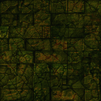
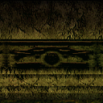
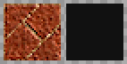
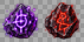
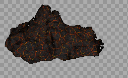
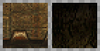
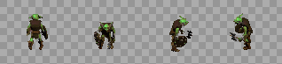
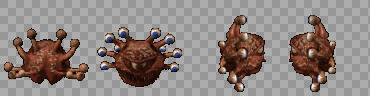

# Arte: Caverna de las Llaves

Inventario de todos los gráficos de la mazmorra **Caverna de las Llaves** para rehacerlos de cero. Cada fila tiene el gráfico actual (de ejemplo), qué hace en el juego y qué hay que entregar. Al final está el prompt completo para Claude Opus 5.5. El índice y la dirección de arte común están en [README.md](README.md).

| | |
|---|---|
| **Mazmorra** | 4 de 8 de la serie |
| **Estado** | Hecha (mapas 520-522). Hoy usa el piso y la pared por defecto del generador (los del mapa 116). |
| **Ítem que da** | Botas de Pegaso |
| **Mapas** | 520, 521, 522 |
| **Tema** | Una caverna fría de roca gris con vetas de cristal celeste y violeta; estatuas guardianas talladas, cerraduras de bronce. Ecos y humedad. |
| **Paleta** | gris pizarra, celeste cristal, violeta y bronce |
| **Gráficos** | 4 baldosas, 14 puertas y mecánicas (+ la piedra de invocación), 6 criaturas, 2 minijefes y jefes, 3 efectos. **20 piezas propias** de esta mazmorra; el resto es común. |

**El plano:**


## 1. Baldosas

| Código | Actual | Qué es y qué hace | Hoy | Para el nuevo |
|---|---|---|---|---|
| CL-01 |  | **Piso.** El piso de todas las salas. | bloque de 4 × 4 desde el grh 9428 | Bloque de 4 × 4 (128 × 128) que se repite sin costura; con dos o tres variantes de baldosa sueltas (rajada, con musgo o arena) para romper la repetición. |
| CL-02 |  | **Pared.** El frente de las paredes; arriba de la cuarta fila se ve negro (el techo). | bloque de 4 × 4 desde el grh 9412 (cada fila, a 1-4 baldosas del piso) | Bloque de 4 × 4: cada fila es la cara de la pared a 1, 2, 3 y 4 baldosas del piso, sin costura a lo ancho; y el techo (lo que hoy es negro) como bloque de 4 × 4 aparte. |
| CL-03 |  | **Agua profunda.** Sin las Patas de rana no se puede pisar; con ellas se nada (no se pelea). | bloque de 4 × 4 animado desde el grh 1505 (el agua del mundo) | Bloque de 4 × 4 animado, 4 cuadros en bucle, y el borde de la orilla (4 lados y 4 esquinas, 32 × 32). |
| CL-04 | — | **Pozo.** Caer saca vida y te devuelve a la entrada de la sala (o al piso de abajo). Se salta con la Pluma. | baldosa negra (grh 1) | El pozo con su borde y profundidad: autotile de 47 piezas (o el juego de 16 de bordes y esquinas), 32 × 32. |

## 2. Puertas, cofres y mecánicas

Las marcadas **común** se dibujan una sola vez para todas las mazmorras (están en [00-COMUNES.md](00-COMUNES.md)); acá figuran para que la lista de esta mazmorra esté completa. Las de **esta mazmorra** van en su prompt.

| Código | Actual | Qué es y qué hace | Estados que hacen falta | Hoy | Para el nuevo |
|---|---|---|---|---|---|
| CL-05 |  | **Escalera.** Une las salas de distintos mapas o pisos (los atajos A, B, C… de Zelda). Se pisa y te lleva a la otra punta. Las de las salas que se cierran aparecen al vaciarlas. | una que baja y una que sube; la de la zambullida va bajo el agua y no se ve | 1198 (Escalera Grande, 32 × 96) | 32 × 64 (ocupa una baldosa, el dibujo puede subir una más), anclada abajo |
| CO-01 (común) |  | **Portal.** La salida de la mazmorra y los portales-atajo que aparecen al vencer a un minijefe (llevan a la entrada). | portal de salida y portal-atajo (dos colores distintos), animados en bucle | 378 (Teleport, 60 × 90, 24 cuadros) | 64 × 96, 8 a 12 cuadros en bucle, anclado abajo al centro |
| CO-02 (común) |  | **Cofre.** Guarda llaves, el mapa, la brújula, oro, el pico de piedra, la caracola o el ítem de la mazmorra. Muchos aparecen al resolver la sala (salen de la nada con un brillo). | cerrado, abierto | 1832 (Cofre de mazmorra, 32 × 32); 1833 (Cofre de mazmorra abierto, 32 × 32) | 32 × 32 (el dibujo puede tener hasta 32 × 40), cerrado y abierto |
| CO-03 (común) |  | **Cofre del jefe.** El cofre del trofeo, en la sala del final. Una vez por día por personaje da el trofeo de la serie y oro. Hoy es el mismo dibujo que el cofre común. | cerrado, abierto | 1849 (Cofre del jefe, 32 × 32) | 48 × 40 a 64 × 48, anclado abajo al centro: tiene que verse más importante que el común |
| CL-06 |  | **Puerta (pared horizontal).** Hoy las puertas cerradas (con llave, del jefe, la persiana que abre la sala y el bloque cerradura) usan el mismo dibujo, y las abiertas o de un solo sentido, otro. En el nuevo cada tipo tiene que distinguirse a la vista. | común abierta y cerrada; con cerradura de llave chica; del jefe (cerradura grande); persiana (reja); de un solo sentido (con flecha); bloque cerradura | 1834 (Puerta de piedra, 96 × 96); 1835 (Puerta de piedra abierta, 96 × 96) | 96 × 96 como hoy (el arco ocupa la baldosa de la puerta y el muro de los costados), anclada abajo al centro |
| CL-07 |  | **Puerta (pared vertical).** Las puertas en las paredes de los costados. Hoy es un cristal que tapa el paso. | los mismos tipos que la horizontal, vistos de costado; abierta no se dibuja | 1840 (Barrera de cristal, 32 × 32) | 32 × 64, anclada abajo |
| CO-04 (común) |  | **Bloque que se empuja.** Se empuja una baldosa con un clic. Tapa pasos, aprieta placas y corta el camino de las cuchillas. | uno solo | 1836 (Bloque de piedra, 32 × 32) | 32 × 32 (el dibujo puede tener 32 × 40 para mostrar el alto) |
| CO-05 (común) |  | **Placa (botón del piso).** Se aprieta con un jugador o un bloque encima. Abre puertas o hace aparecer cofres y escaleras. La de peso solo baja si el que la pisa carga algo con el Brazalete. | suelta y apretada; la placa de peso (Gruta de la Botella) distinta | 1837 (Runa del suelo, 32 × 32); 1838 (Runa del suelo encendida, 32 × 32) | 32 × 32 |
| CO-06 (común) |  | **Losa de piedra.** Una losa con un texto grabado (pistas del jefe o de la mazmorra). Se lee con un clic. | una sola | 1839 (Losa de piedra, 32 × 32) | 32 × 48, anclada abajo |
| CO-14 (común) |  | **Bloque de cristal (la Carrera).** Lo rompe la Carrera de las Botas de Pegaso. | entero; pedazos al romperse | 1841 (Bloque de cristal, 32 × 32) | 32 × 32 (puede subir a 32 × 48) |
| CO-15 (común) |  | **Piso que se desmorona.** Se cae un instante después de pisarlo y vuelve a los 5 s. Se cruza corriendo o saltando. | rajado; hueco (ya se cayó) | 1842 (Baldosa rajada, 32 × 32); 1843 (Hueco, 32 × 32) | 32 × 32 cada estado; opcional: 3 cuadros del derrumbe |
| CL-08 |  | **Runa con tiempo.** Al pisarla abre unas rejas por unos segundos. | apagada, encendida | 1844 (Runa del tiempo, 32 × 32); 1845 (Runa del tiempo encendida, 32 × 32) | 32 × 32 |
| CL-09 |  | **Pared rajada (la Carrera).** Tiembla cuando la Carrera choca contra ella; en la arena del Ojo Viscoso, lo hace caer. | rajada; derrumbada | 1846 (Pared rajada, 250 × 150) | 96 × 96 (hoy es una roca de 250 × 150 que no combina) |
| CO-16 (común) |  | **Aplastador.** Un bloque que baja de golpe sobre su losa cada tanto. Hoy es el bloque de piedra común. | arriba, bajando, abajo; la losa del piso donde cae | 1848 (Aplastador, 32 × 32); 1847 (Losa del aplastador, 32 × 32) | 32 × 48 el aplastador (con su sombra), 32 × 32 la losa; 3 cuadros de la caída |
| CO-PI (común) |  | **Piedra de invocación.** Está en el mundo: con un clic se entra a la mazmorra, solo o en grupo. Hoy es una estatua dorada que no tiene que ver con las mazmorras. | Una por mazmorra (con el símbolo de su ítem), con un brillo en bucle | cuerpo 256 | 64 × 96, anclada abajo; 6 cuadros de brillo |

## 3. Criaturas

Las imágenes muestran el primer cuadro mirando arriba, abajo, derecha e izquierda. "Hoy" dice cuántos cuadros por dirección tiene el cuerpo actual y de qué medida.

| Código | Actual (4 direcciones) | Qué es y qué hace | Rol | Hoy | Para el nuevo |
|---|---|---|---|---|---|
| CL-10 |  | **Serpiente** (plantilla 504). Una serpiente que se arrastra hacia el jugador. | criatura | cuerpo 13: 5 cuadros de 91 × 65 | 4 direcciones × 6 cuadros de caminata, 96 × 96 |
| CL-11 |  | **Goblin** (plantilla 505). Un goblin que ataca en grupo. | criatura | cuerpo 14: 5 cuadros de 73 × 65 | 4 direcciones × 6 cuadros de caminata, 64 × 64 |
| CL-12 |  | **Esqueleto Guerrero** (plantilla 508). Un esqueleto con armadura, más duro que el común. | criatura | cuerpo 12: 5 cuadros de 53 × 70 | 4 direcciones × 6 cuadros de caminata, 64 × 64 |
| CL-13 |  | **Murciélago** (plantilla 566). Un murciélago que vuela en zigzag. | criatura | cuerpo 9: 5 cuadros de 59 × 64 | 4 direcciones × 6 cuadros de caminata, 64 × 64 |
| CL-14 |  | **Duende Mágico** (plantilla 567). Un duende que tira hechizos. | criatura | cuerpo 75: 5 cuadros de 65 × 57 | 4 direcciones × 6 cuadros de caminata, 64 × 64 |
| CL-15 |  | **Estatua guardiana** (plantilla 9730). Una estatua de piedra. Parece que te mira. | criatura | cuerpo 141: 5 cuadros de 165 × 144 | 4 direcciones × 6 cuadros de caminata, 128 × 128 |

## 4. Minijefes y jefe

| Código | Actual | Qué es y qué hace | Hoy | Para el nuevo |
|---|---|---|---|---|
| CL-16 | <br> | **Serpientes Gemelas** (minijefe). Dos serpientes que hay que bajar casi juntas: si cae una y la otra sigue viva, la primera vuelve a los 15 s y la que queda se enfurece. | cuerpo 13: 5 cuadros de 91 × 65 | Caminata en 4 direcciones (6 cuadros) de dos colores distintos, y el humo con que revive la compañera (6 cuadros). |
| CL-17 | <br> | **Ojo Viscoso** (jefe). Un ojo enorme que flota fuera de alcance; la Carrera contra la pared lo hace caer. Al bajar a la mitad se parte en dos Ojos Menores. | cuerpo 72: 5 cuadros de 86 × 80 | El ojo flotando (4 cuadros), cayendo y aturdido en el piso (3 cuadros), partiéndose (4 cuadros) y el Ojo Menor (4 direcciones, 4 cuadros); su sombra en el piso. |

## 5. Efectos que se dibujan aparte

Lo que no es una baldosa, un objeto ni un cuerpo: lo dibuja el cliente (con formas o con sprites sueltos) en `frontend/components/game/engine/`.

| Código | Actual | Qué es y qué hace | Para el nuevo |
|---|---|---|---|
| CL-18 |  | **La Carrera de las Botas.** Carga pataleando, corre en línea recta con una estela y polvo, y rompe cristales o choca contra la pared con un sacudón. | Polvo de la carrera (4 cuadros, 32 × 16) y el destello del choque (3 cuadros, 32 × 32). Común a todas las mazmorras. |
| CL-19 |  | **El Ojo partido.** Los dos Ojos Menores que quedan al partirse el Ojo Viscoso. | Ver el jefe. |
| CL-20 |  | **El cofre del jefe.** El cofre del trofeo, que aparece al vencer al jefe. | Ver Cofre del jefe. |

## 6. Prompt para Claude Opus 5.5

Copiar entero y pegarlo en una sesión nueva de Claude Code abierta en el repo. Hace el arte de esta mazmorra; lo común sale del prompt de [00-COMUNES.md](00-COMUNES.md), que conviene correr antes.

```text
Sos un artista técnico de videojuegos y trabajás en el repo de WoAO (/Users/leandrobisceglie/AoWeb/aoweb): un MMORPG web (Next.js + PixiJS) basado en Argentum Online. Tiene una serie de 8 mazmorras PvE con la estructura de las de *The Legend of Zelda: Link's Awakening* (llaves, puertas que se cierran, puzzles, un ítem por mazmorra, minijefe y jefe).

Tu trabajo: rehacer de cero TODOS los gráficos de la mazmorra "Caverna de las Llaves" (4 de 8; ítem: Botas de Pegaso), para que se vea profesional y coherente. Hoy es una mezcla de gráficos de AO, paquetes libres de otros estilos y cosas dibujadas con formas por código. El inventario completo, con la imagen actual de cada cosa, está en docs/mazmorras/arte/04-CAVERNA_DE_LAS_LLAVES.md. Leelo entero antes de empezar y mirá cada imagen de referencia.

TEMA DE ESTA MAZMORRA
Una caverna fría de roca gris con vetas de cristal celeste y violeta; estatuas guardianas talladas, cerraduras de bronce. Ecos y humedad.
Paleta: gris pizarra, celeste cristal, violeta y bronce.

DIRECCIÓN DE ARTE (PARA TODAS LAS MAZMORRAS)
- Perspectiva y escala: vista desde arriba levemente inclinada (la de Argentum Online): se ve el frente de las paredes y el techo de los objetos. La baldosa mide 32 × 32 y un personaje humano mide 1,5 baldosas de alto.
- Estilo: pintado, con volumen y sombreado suave, que combine con los personajes y los mapas de AO. Nada de pixel art de 8 bits ni de formas planas.
- Luz: desde arriba a la izquierda, igual en todas las piezas. Cada cosa que toca el piso lleva una sombra de contacto suave.
- Contorno: oscuro y fino donde ayude a leer la forma contra el piso, no alrededor de todo.
- Paleta: una por mazmorra (la del tema), con un color de acento para lo interactivo (lo que se toca, se levanta o se abre) y rojo o naranja para lo peligroso.
- Legibilidad: lo que se puede usar se distingue del decorado a primera vista, y cada estado se distingue del otro (cerrado o abierto, apagado o encendido, entero o roto).
- Original: se toma la estructura de *Link's Awakening*, no su arte. Nada copiado de Nintendo ni de otros juegos. Si se parte de algo libre (CC0 o CC-BY), se anota el autor, la licencia y el enlace.

REGLAS TÉCNICAS (LAS DEL MOTOR DEL JUEGO)
- Archivos: PNG con transparencia (RGBA), sin fondo, sin halos claros alrededor y sin texto ni marcas de agua.
- Baldosas de piso: un bloque de 4 × 4 baldosas (128 × 128) que se repite sin costura en las dos direcciones; el juego elige la baldosa por la posición en el mapa.
- Paredes: un bloque de 4 × 4. Cada fila es la cara de la pared vista a 1, 2, 3 y 4 baldosas del piso (la última fila toca el piso). Tiene que repetirse sin costura a lo ancho.
- Agua y lava: bloque de 4 × 4 animado (4 cuadros en bucle, que empalmen).
- Objetos: una baldosa (32 × 32), anclados abajo al centro. Si son altos (estatuas, puertas, pilares), el dibujo puede subir (32 × 64, 32 × 96) o ensancharse (96 × 96 las puertas); la base sigue en la baldosa.
- Cuerpos (criaturas y jefes): una hoja por cuerpo, con 4 filas en este orden: mirando arriba, abajo, derecha e izquierda. Las columnas son los cuadros, todos de la misma medida. Mínimo 6 cuadros de caminata por dirección, que entren en bucle. Los pies van abajo al centro del cuadro: el juego lo apoya sobre la baldosa.
- Animaciones aparte (ataques, poses, efectos): una tira horizontal por animación, con cuadros de la misma medida.
- Numeración del juego: al día de este documento, el próximo grh libre es el 42484, el próximo archivo de gráficos el 330041 y el próximo cuerpo el 586. Verificalos antes de indexar.

LO QUE HAY QUE ENTREGAR (20 piezas, todas de esta mazmorra)
- [CL-01] Piso. Reemplaza: bloque de 4 × 4 desde el grh 9428. Qué hace: El piso de todas las salas. Entregar: Bloque de 4 × 4 (128 × 128) que se repite sin costura; con dos o tres variantes de baldosa sueltas (rajada, con musgo o arena) para romper la repetición. Referencia actual: docs/mazmorras/arte/img/piso-9428.png
- [CL-02] Pared. Reemplaza: bloque de 4 × 4 desde el grh 9412 (cada fila, a 1-4 baldosas del piso). Qué hace: El frente de las paredes; arriba de la cuarta fila se ve negro (el techo). Entregar: Bloque de 4 × 4: cada fila es la cara de la pared a 1, 2, 3 y 4 baldosas del piso, sin costura a lo ancho; y el techo (lo que hoy es negro) como bloque de 4 × 4 aparte. Referencia actual: docs/mazmorras/arte/img/pared-9412.png
- [CL-03] Agua profunda. Reemplaza: bloque de 4 × 4 animado desde el grh 1505 (el agua del mundo). Qué hace: Sin las Patas de rana no se puede pisar; con ellas se nada (no se pelea). Entregar: Bloque de 4 × 4 animado, 4 cuadros en bucle, y el borde de la orilla (4 lados y 4 esquinas, 32 × 32). Referencia actual: docs/mazmorras/arte/img/agua-1505.png
- [CL-04] Pozo. Reemplaza: baldosa negra (grh 1). Qué hace: Caer saca vida y te devuelve a la entrada de la sala (o al piso de abajo). Se salta con la Pluma. Entregar: El pozo con su borde y profundidad: autotile de 47 piezas (o el juego de 16 de bordes y esquinas), 32 × 32. Referencia actual: (no tiene imagen: se dibuja por código)
- [CL-05] Escalera. Reemplaza: objetos 1198 (Escalera Grande, 32 × 96). Qué hace: Une las salas de distintos mapas o pisos (los atajos A, B, C… de Zelda). Se pisa y te lleva a la otra punta. Las de las salas que se cierran aparecen al vaciarlas. Entregar: una que baja y una que sube; la de la zambullida va bajo el agua y no se ve; 32 × 64 (ocupa una baldosa, el dibujo puede subir una más), anclada abajo. Referencia actual: docs/mazmorras/arte/img/familia-escalera.png
- [CL-06] Puerta (pared horizontal). Reemplaza: objetos 1834 (Puerta de piedra, 96 × 96); 1835 (Puerta de piedra abierta, 96 × 96). Qué hace: Hoy las puertas cerradas (con llave, del jefe, la persiana que abre la sala y el bloque cerradura) usan el mismo dibujo, y las abiertas o de un solo sentido, otro. En el nuevo cada tipo tiene que distinguirse a la vista. Entregar: común abierta y cerrada; con cerradura de llave chica; del jefe (cerradura grande); persiana (reja); de un solo sentido (con flecha); bloque cerradura; 96 × 96 como hoy (el arco ocupa la baldosa de la puerta y el muro de los costados), anclada abajo al centro. Referencia actual: docs/mazmorras/arte/img/familia-puerta.png
- [CL-07] Puerta (pared vertical). Reemplaza: objetos 1840 (Barrera de cristal, 32 × 32). Qué hace: Las puertas en las paredes de los costados. Hoy es un cristal que tapa el paso. Entregar: los mismos tipos que la horizontal, vistos de costado; abierta no se dibuja; 32 × 64, anclada abajo. Referencia actual: docs/mazmorras/arte/img/familia-barrera.png
- [CL-08] Runa con tiempo. Reemplaza: objetos 1844 (Runa del tiempo, 32 × 32); 1845 (Runa del tiempo encendida, 32 × 32). Qué hace: Al pisarla abre unas rejas por unos segundos. Entregar: apagada, encendida; 32 × 32. Referencia actual: docs/mazmorras/arte/img/familia-runa_tiempo.png
- [CL-09] Pared rajada (la Carrera). Reemplaza: objetos 1846 (Pared rajada, 250 × 150). Qué hace: Tiembla cuando la Carrera choca contra ella; en la arena del Ojo Viscoso, lo hace caer. Entregar: rajada; derrumbada; 96 × 96 (hoy es una roca de 250 × 150 que no combina). Referencia actual: docs/mazmorras/arte/img/familia-pared_rajada_caverna.png
- [CL-10] Serpiente (criatura). Reemplaza: cuerpo 13: 5 cuadros de 91 × 65 (plantilla 504). Qué hace: Una serpiente que se arrastra hacia el jugador. Entregar: 4 direcciones × 6 cuadros de caminata, 96 × 96. Referencia actual: docs/mazmorras/arte/img/cuerpo-13.png
- [CL-11] Goblin (criatura). Reemplaza: cuerpo 14: 5 cuadros de 73 × 65 (plantilla 505). Qué hace: Un goblin que ataca en grupo. Entregar: 4 direcciones × 6 cuadros de caminata, 64 × 64. Referencia actual: docs/mazmorras/arte/img/cuerpo-14.png
- [CL-12] Esqueleto Guerrero (criatura). Reemplaza: cuerpo 12: 5 cuadros de 53 × 70 (plantilla 508). Qué hace: Un esqueleto con armadura, más duro que el común. Entregar: 4 direcciones × 6 cuadros de caminata, 64 × 64. Referencia actual: docs/mazmorras/arte/img/cuerpo-12.png
- [CL-13] Murciélago (criatura). Reemplaza: cuerpo 9: 5 cuadros de 59 × 64 (plantilla 566). Qué hace: Un murciélago que vuela en zigzag. Entregar: 4 direcciones × 6 cuadros de caminata, 64 × 64. Referencia actual: docs/mazmorras/arte/img/cuerpo-9.png
- [CL-14] Duende Mágico (criatura). Reemplaza: cuerpo 75: 5 cuadros de 65 × 57 (plantilla 567). Qué hace: Un duende que tira hechizos. Entregar: 4 direcciones × 6 cuadros de caminata, 64 × 64. Referencia actual: docs/mazmorras/arte/img/cuerpo-75.png
- [CL-15] Estatua guardiana (criatura). Reemplaza: cuerpo 141: 5 cuadros de 165 × 144 (plantilla 9730). Qué hace: Una estatua de piedra. Parece que te mira. Entregar: 4 direcciones × 6 cuadros de caminata, 128 × 128. Referencia actual: docs/mazmorras/arte/img/cuerpo-141.png
- [CL-16] Serpientes Gemelas (minijefe). Reemplaza: cuerpo 13: 5 cuadros de 91 × 65. Qué hace: Dos serpientes que hay que bajar casi juntas: si cae una y la otra sigue viva, la primera vuelve a los 15 s y la que queda se enfurece. Entregar: Caminata en 4 direcciones (6 cuadros) de dos colores distintos, y el humo con que revive la compañera (6 cuadros). Referencia actual: docs/mazmorras/arte/img/cuerpo-13.png
- [CL-17] Ojo Viscoso (jefe). Reemplaza: cuerpo 72: 5 cuadros de 86 × 80. Qué hace: Un ojo enorme que flota fuera de alcance; la Carrera contra la pared lo hace caer. Al bajar a la mitad se parte en dos Ojos Menores. Entregar: El ojo flotando (4 cuadros), cayendo y aturdido en el piso (3 cuadros), partiéndose (4 cuadros) y el Ojo Menor (4 direcciones, 4 cuadros); su sombra en el piso. Referencia actual: docs/mazmorras/arte/img/cuerpo-72.png
- [CL-18] La Carrera de las Botas. Reemplaza: lo que hoy dibuja el cliente. Qué hace: Carga pataleando, corre en línea recta con una estela y polvo, y rompe cristales o choca contra la pared con un sacudón. Entregar: Polvo de la carrera (4 cuadros, 32 × 16) y el destello del choque (3 cuadros, 32 × 32). Común a todas las mazmorras. Referencia actual: docs/mazmorras/caverna/carrera.png
- [CL-19] El Ojo partido. Reemplaza: lo que hoy dibuja el cliente. Qué hace: Los dos Ojos Menores que quedan al partirse el Ojo Viscoso. Entregar: Ver el jefe. Referencia actual: docs/mazmorras/caverna/ojo-partido.png
- [CL-20] El cofre del jefe. Reemplaza: lo que hoy dibuja el cliente. Qué hace: El cofre del trofeo, que aparece al vencer al jefe. Entregar: Ver Cofre del jefe. Referencia actual: docs/mazmorras/caverna/cofre-del-jefe.png

Lo común a todas las mazmorras (cofres, placas, escaleras, portal, búho, bloques y cristales de color, vasijas y piedras, herramientas e íconos) NO va en este trabajo: sale del prompt de docs/mazmorras/arte/00-COMUNES.md. Esta mazmorra usa estos: CO-01 Portal, CO-02 Cofre, CO-03 Cofre del jefe, CO-04 Bloque que se empuja, CO-05 Placa (botón del piso), CO-06 Losa de piedra, CO-14 Bloque de cristal (la Carrera), CO-15 Piso que se desmorona, CO-16 Aplastador. Tus piezas tienen que combinar con ellos (si ya existen, miralos; si no, respetá la dirección de arte de arriba).

CÓMO TRABAJAR
1. Primero, una hoja de estilo: la paleta, el piso, la pared, una puerta y una criatura de esta mazmorra, apoyados sobre el piso nuevo. Mostrala y esperá la aprobación de Leandro antes de seguir.
2. Después, el resto, en este orden: baldosas, puertas y mecánicas, criaturas, minijefes y jefe, efectos.
3. Revisá cada pieza a tamaño real (1×) y al doble sobre el piso de la mazmorra, y al lado de un personaje de AO para la escala.
4. Si tenés una herramienta de generación de imágenes, usala con estas especificaciones y después llevá cada pieza a la grilla exacta (medida, transparencia, cuadros alineados) con un script. Si no, dibujalo por código (Python con Pillow) cuidando la calidad: volumen, luz y sombra, no formas planas.

QUÉ ENTREGAR
- Una carpeta arte/mazmorras/caverna/ con un PNG por pieza, con el código como nombre (por ejemplo CL-01.png).
- arte/mazmorras/caverna/manifest.json con una entrada por pieza: código, archivo, qué reemplaza, medida del cuadro, cantidad de cuadros, filas o direcciones, ancla, velocidad de la animación (ms por cuadro) y origen (propio, o autor + licencia + enlace).
- arte/mazmorras/caverna/preview.png: una hoja de contacto con todas las piezas sobre el piso de la mazmorra, con su código abajo.

CÓMO ENTRA AL JUEGO (SOLO DESPUÉS DE QUE LEANDRO APRUEBE EL ARTE)
1. Cada hoja va a `frontend/public/graphics/<archivo>.png`, numeradas desde el próximo archivo libre.
2. Cada cuadro es un grh. Se agrega como texto al final de `frontend/public/init/graficos.json` y `graficos_optimized.json`, sin reescribir los JSON:
   - estático: `"<grh>":{"numFrames":1,"numFile":<archivo>,"sX":<x>,"sY":<y>,"width":<w>,"height":<h>,"frames":{"1":<grh>}}` y, en el optimizado, `"<grh>":[<archivo>,<x>,<y>,<w>,<h>]`;
   - animado: `"<grh>":{"numFrames":<n>,"frames":{"1":<g1>,"2":<g2>,…},"speed":<ms>}` y `"<grh>":{"f":<n>,"r":[<g1>,<g2>,…],"s":<ms>}`.
3. Cada cuerpo se agrega a `frontend/public/init/bodies.json`: `"<cuerpo>":{"1":<grh arriba>,"2":<grh abajo>,"3":<grh derecha>,"4":<grh izquierda>,"headOffsetX":0,"headOffsetY":0}`. El cuerpo de cada criatura se cambia con `idBody` en su plantilla de `server/mazmorras/<mazmorra>/leyenda.json`.
4. Los objetos del mapa toman su grh de `DUNGEON_OBJECTS` en `server/src/scripts/buildDungeonMaps.ts`, y las baldosas de piso y pared, de `graficos` en `leyenda.json`. Después se regeneran los mapas con `pnpm --dir server exec tsx src/scripts/buildDungeonMaps.ts <mazmorra>`.
5. Lo que hoy se dibuja con formas o con sprites sueltos vive en `frontend/components/game/engine/` (el módulo de cada mazmorra; ver la tabla de efectos). Ahí se cargan las hojas nuevas.
6. Se sube la versión de las cachés en `frontend/utils/gameLoader.ts` (graficos, bodies, objs y npcs) para que los jugadores bajen lo nuevo.
7. Se prueba en vivo y se sacan capturas de cada cosa, comparadas con la imagen actual de este documento.

CRITERIOS PARA DAR UNA PIEZA POR TERMINADA
- Tiene la medida, los cuadros, el orden de las direcciones y el ancla pedidos.
- Se lee a 1× sobre el piso de la mazmorra: se entiende qué es y en qué estado está.
- Combina con el resto de la mazmorra y con los personajes de AO: misma luz, misma escala, misma paleta.
- Las animaciones entran en bucle sin saltos, y los bloques de piso, pared, agua y lava se repiten sin costura.
- Es arte original, o tiene anotado el origen y la licencia en el manifest.
```
