# Arte: Fauces del Bagre

Inventario de todos los gráficos de la mazmorra **Fauces del Bagre** para rehacerlos de cero. Cada fila tiene el gráfico actual (de ejemplo), qué hace en el juego y qué hay que entregar. Al final está el prompt completo para Claude Opus 5.5. El índice y la dirección de arte común están en [README.md](README.md).

| | |
|---|---|
| **Mazmorra** | 5 de 8 de la serie |
| **Estado** | Hecha (mapas 570-572). |
| **Ítem que da** | Gancho |
| **Mapas** | 570, 571, 572 |
| **Tema** | Una cueva marina con forma de bagre: piedra azulada y húmeda con escamas talladas, cornisas sobre el agua, agua baja con piedritas y anclas de hierro oxidado. |
| **Paleta** | azul pizarra, verde agua, óxido y blanco hueso |
| **Gráficos** | 5 baldosas, 18 puertas y mecánicas (+ la piedra de invocación), 13 criaturas, 3 minijefes y jefes, 5 efectos. **32 piezas propias** de esta mazmorra; el resto es común. |

**Así se ve hoy (mapa 570):**

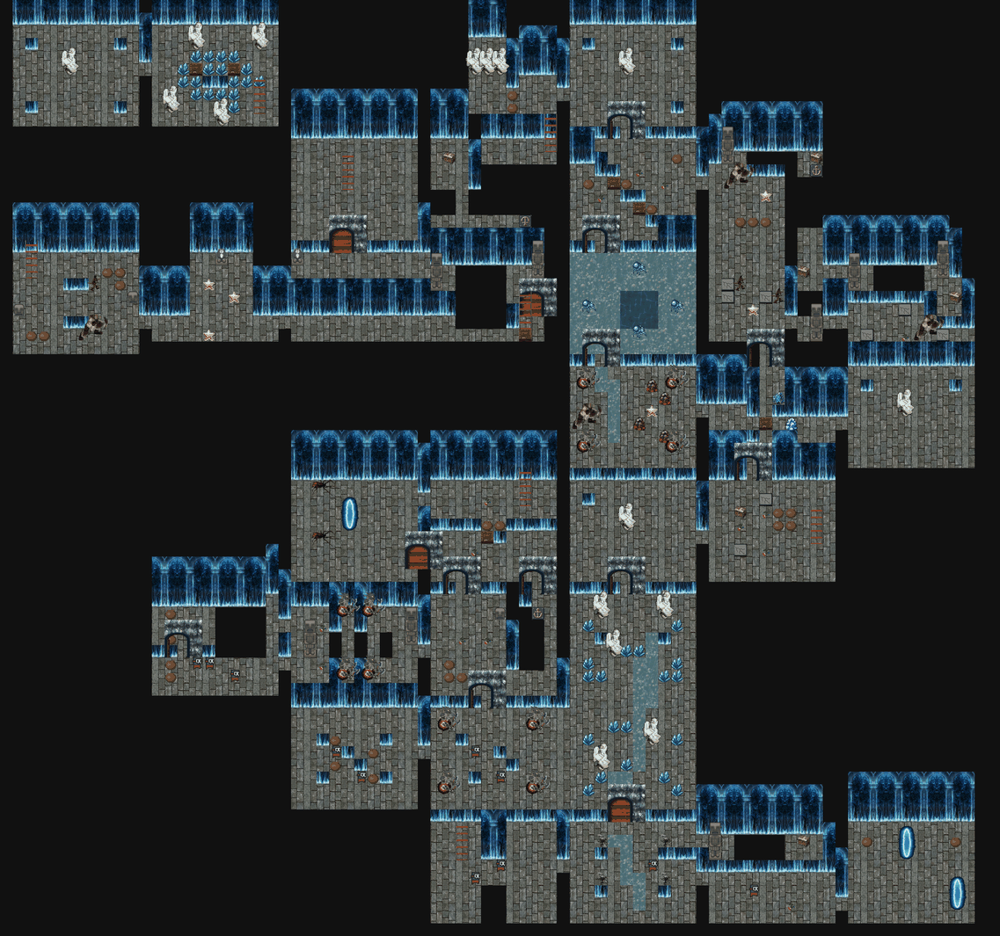

## 1. Baldosas

| Código | Actual | Qué es y qué hace | Hoy | Para el nuevo |
|---|---|---|---|---|
| FB-01 | 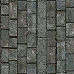 | **Piso.** El piso de todas las salas. | bloque de 4 × 4 desde el grh 9731 | Bloque de 4 × 4 (128 × 128) que se repite sin costura; con dos o tres variantes de baldosa sueltas (rajada, con musgo o arena) para romper la repetición. |
| FB-02 | 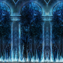 | **Pared.** El frente de las paredes; arriba de la cuarta fila se ve negro (el techo). | bloque de 4 × 4 desde el grh 34062 (cada fila, a 1-4 baldosas del piso) | Bloque de 4 × 4: cada fila es la cara de la pared a 1, 2, 3 y 4 baldosas del piso, sin costura a lo ancho; y el techo (lo que hoy es negro) como bloque de 4 × 4 aparte. |
| FB-03 | 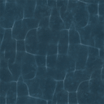 | **Agua profunda.** Sin las Patas de rana no se puede pisar; con ellas se nada (no se pelea). | bloque de 4 × 4 animado desde el grh 1505 (el agua del mundo) | Bloque de 4 × 4 animado, 4 cuadros en bucle, y el borde de la orilla (4 lados y 4 esquinas, 32 × 32). |
| FB-04 | 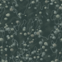 | **Agua baja.** Agua que se camina sin las Patas de rana. | el agua con un reflejo encima (grh 42326, bloque de 4 × 4) | Bloque de 4 × 4 (puede ir animado) que se distinga a la vista del agua profunda. |
| FB-05 | — | **Pozo.** Caer saca vida y te devuelve a la entrada de la sala (o al piso de abajo). Se salta con la Pluma. | baldosa negra (grh 1) | El pozo con su borde y profundidad: autotile de 47 piezas (o el juego de 16 de bordes y esquinas), 32 × 32. |

## 2. Puertas, cofres y mecánicas

Las marcadas **común** se dibujan una sola vez para todas las mazmorras (están en [00-COMUNES.md](00-COMUNES.md)); acá figuran para que la lista de esta mazmorra esté completa. Las de **esta mazmorra** van en su prompt.

| Código | Actual | Qué es y qué hace | Estados que hacen falta | Hoy | Para el nuevo |
|---|---|---|---|---|---|
| FB-06 |  | **Escalera.** Une las salas de distintos mapas o pisos (los atajos A, B, C… de Zelda). Se pisa y te lleva a la otra punta. Las de las salas que se cierran aparecen al vaciarlas. | una que baja y una que sube; la de la zambullida va bajo el agua y no se ve | 1198 (Escalera Grande, 32 × 96) | 32 × 64 (ocupa una baldosa, el dibujo puede subir una más), anclada abajo |
| CO-01 (común) |  | **Portal.** La salida de la mazmorra y los portales-atajo que aparecen al vencer a un minijefe (llevan a la entrada). | portal de salida y portal-atajo (dos colores distintos), animados en bucle | 378 (Teleport, 60 × 90, 24 cuadros) | 64 × 96, 8 a 12 cuadros en bucle, anclado abajo al centro |
| CO-02 (común) |  | **Cofre.** Guarda llaves, el mapa, la brújula, oro, el pico de piedra, la caracola o el ítem de la mazmorra. Muchos aparecen al resolver la sala (salen de la nada con un brillo). | cerrado, abierto | 1832 (Cofre de mazmorra, 32 × 32); 1833 (Cofre de mazmorra abierto, 32 × 32) | 32 × 32 (el dibujo puede tener hasta 32 × 40), cerrado y abierto |
| CO-03 (común) |  | **Cofre del jefe.** El cofre del trofeo, en la sala del final. Una vez por día por personaje da el trofeo de la serie y oro. Hoy es el mismo dibujo que el cofre común. | cerrado, abierto | 1849 (Cofre del jefe, 32 × 32) | 48 × 40 a 64 × 48, anclado abajo al centro: tiene que verse más importante que el común |
| FB-07 |  | **Puerta (pared horizontal).** Hoy las puertas cerradas (con llave, del jefe, la persiana que abre la sala y el bloque cerradura) usan el mismo dibujo, y las abiertas o de un solo sentido, otro. En el nuevo cada tipo tiene que distinguirse a la vista. | común abierta y cerrada; con cerradura de llave chica; del jefe (cerradura grande); persiana (reja); de un solo sentido (con flecha); bloque cerradura | 1834 (Puerta de piedra, 96 × 96); 1835 (Puerta de piedra abierta, 96 × 96) | 96 × 96 como hoy (el arco ocupa la baldosa de la puerta y el muro de los costados), anclada abajo al centro |
| FB-08 |  | **Puerta (pared vertical).** Las puertas en las paredes de los costados. Hoy es un cristal que tapa el paso. | los mismos tipos que la horizontal, vistos de costado; abierta no se dibuja | 1840 (Barrera de cristal, 32 × 32) | 32 × 64, anclada abajo |
| CO-04 (común) |  | **Bloque que se empuja.** Se empuja una baldosa con un clic. Tapa pasos, aprieta placas y corta el camino de las cuchillas. | uno solo | 1836 (Bloque de piedra, 32 × 32) | 32 × 32 (el dibujo puede tener 32 × 40 para mostrar el alto) |
| CO-05 (común) |  | **Placa (botón del piso).** Se aprieta con un jugador o un bloque encima. Abre puertas o hace aparecer cofres y escaleras. La de peso solo baja si el que la pisa carga algo con el Brazalete. | suelta y apretada; la placa de peso (Gruta de la Botella) distinta | 1837 (Runa del suelo, 32 × 32); 1838 (Runa del suelo encendida, 32 × 32) | 32 × 32 |
| CO-07 (común) |  | **Estatua búho.** Con el Pico de piedra, da una pista al hacerle clic. | una sola (opcional: los ojos que se encienden cuando habla) | 1861 (Estatua búho, 32 × 48) | 32 × 48, anclada abajo |
| CO-11 (común) |  | **Vasija.** Se levanta con el Brazalete, se lleva y se tira. Tapa pasos, abre persianas al tirarla y algunas esconden algo. | entera; pedazos al romperse (4 a 6 trozos) | 1852 (Vasija, 32 × 32) | 32 × 32 |
| CO-12 (común) | 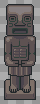 | **Estatua del Gancho.** Un poste para el Gancho: se engancha y te arrastra hasta ella, por encima de pozos. | una sola | 1855 (Estatua de piedra, 32 × 96) | 32 × 64 a 32 × 96, anclada abajo |
| CO-14 (común) | 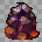 | **Bloque de cristal (la Carrera).** Lo rompe la Carrera de las Botas de Pegaso. | entero; pedazos al romperse | 1841 (Bloque de cristal, 32 × 32) | 32 × 32 (puede subir a 32 × 48) |
| CO-20 (común) | 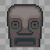 | **Lanzallamas.** Escupe una bola de fuego en línea recta cada tanto. El Campo de Protección la frena. | uno por dirección (norte, sur, este, oeste); la boca encendida al disparar | 1879 (Lanzallamas, 32 × 32) | 32 × 32 por dirección |
| FB-09 | 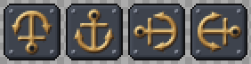 | **Ancla del Gancho.** Si la punta del Gancho pasa por encima, nace un puente sobre la columna de pozos hacia donde apunta. | apuntando al norte, sur, este y oeste | 1882 (Ancla del Gancho, 32 × 32); 1887 (Ancla del Gancho, 32 × 32); 1888 (Ancla del Gancho, 32 × 32); 1889 (Ancla del Gancho, 32 × 32) | 32 × 32 por dirección |
| FB-10 | 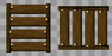 | **Puente del ancla.** El puente que arma el ancla, baldosa por baldosa sobre los pozos. | vertical, horizontal; opcional: 3 cuadros de aparición | 1886 (Puente, 32 × 32); 1890 (Puente, 32 × 32) | 32 × 32 cada uno (tiene que empalmar sin costura) |
| CO-22 (común) | 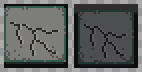 | **Piso flojo.** Si te quedás quieto encima, se hunde y caés. Vuelve a los 5 s. | firme; hundiéndose | 1883 (Piso flojo, 32 × 32) | 32 × 32 cada estado |
| CO-23 (común) | 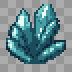 | **Cristal de un golpe.** Se rompe de un golpe o con una bomba. Tapa pasos o adorna. | entero; pedazos al romperse | 1884 (Cristal, 32 × 32) | 32 × 32 |
| FB-11 | 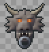 | **Cabeza de dragón.** Un poste del Gancho en la pared, con una argolla. | una sola | 1885 (Cabeza de dragón, 32 × 34) | 32 × 40, anclada abajo |
| CO-PI (común) |  | **Piedra de invocación.** Está en el mundo: con un clic se entra a la mazmorra, solo o en grupo. Hoy es una estatua dorada que no tiene que ver con las mazmorras. | Una por mazmorra (con el símbolo de su ítem), con un brillo en bucle | cuerpo 256 | 64 × 96, anclada abajo; 6 cuadros de brillo |

## 3. Criaturas

Las imágenes muestran el primer cuadro mirando arriba, abajo, derecha e izquierda. "Hoy" dice cuántos cuadros por dirección tiene el cuerpo actual y de qué medida.

| Código | Actual (4 direcciones) | Qué es y qué hace | Rol | Hoy | Para el nuevo |
|---|---|---|---|---|---|
| FB-12 | 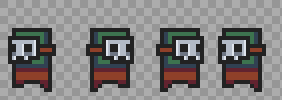 | **Máscara de Hierro** (plantilla 9803). De frente se cubre: pegale de costado o por la espalda, o arrancale la máscara con el Gancho. | criatura | cuerpo 582: 4 cuadros de 32 × 46 | 4 direcciones × 6 cuadros de caminata, 48 × 48 |
| FB-13 | 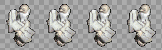 | **Esqueleto saltarín** (plantilla 9804). Si te acercás, te salta encima. | criatura | cuerpo 393: 23 cuadros de 60 × 75 | 4 direcciones × 6 cuadros de caminata, 64 × 64 |
| FB-14 |  | **Esqueleto esquivo** (plantilla 9805). Salta para atrás y te tira un hueso. | criatura | cuerpo 393: 23 cuadros de 60 × 75 | 4 direcciones × 6 cuadros de caminata, 64 × 64 |
| FB-15 |  | **Murciélago** (plantilla 9806). Duerme sobre su estatua hasta que te acercás. | criatura | cuerpo 9: 5 cuadros de 59 × 64 | 4 direcciones × 6 cuadros de caminata, 64 × 64 |
| FB-16 | 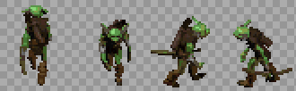 | **Orco arquero** (plantilla 9807). Tira flechas desde lejos. | criatura | cuerpo 377: 5 cuadros de 38 × 44 | 4 direcciones × 6 cuadros de caminata, 48 × 48 |
| FB-17 | 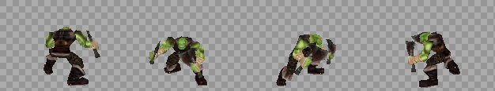 | **Orco espadachín** (plantilla 9808). Patrulla y te persigue si te ve. | criatura | cuerpo 43: 5 cuadros de 150 × 108 | 4 direcciones × 6 cuadros de caminata, 128 × 128 |
| FB-18 |  | **Moco escondido** (plantilla 9809). No se ve hasta que te acercás. | criatura | cuerpo 146: 2 cuadros de 32 × 25 | 4 direcciones × 6 cuadros de caminata, 48 × 48 |
| FB-19 |  | **Moco** (plantilla 9810). Un moco común: se arrastra hacia el jugador y lo ataca. | criatura | cuerpo 146: 2 cuadros de 32 × 25 | 4 direcciones × 6 cuadros de caminata, 48 × 48 |
| FB-20 | 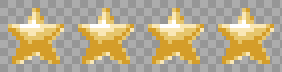 | **Estrella** (plantilla 9811). Rebota en diagonal contra las paredes. | criatura | cuerpo 578: 4 cuadros de 32 × 32 | 4 direcciones × 6 cuadros de caminata, 48 × 48 |
| FB-21 | 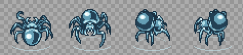 | **Pulga de agua** (plantilla 9812). Patina por el agua. | de agua | cuerpo 579: 6 cuadros de 56 × 50 | 4 direcciones × 6 cuadros de caminata, 64 × 64 |
| FB-22 | 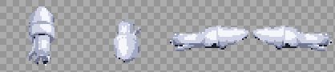 | **Calamar** (plantilla 9813). Nada hacia vos por el túnel inundado. | de agua | cuerpo 580: 8 cuadros de 49 × 41 | 4 direcciones × 6 cuadros de caminata, 64 × 64 |
| FB-23 |  | **Cuchilla** (plantilla 9815). Una trampa de cuchillas: sale disparada si te ve en su fila. | trampa | cuerpo 244: 2 cuadros de 75 × 75 | 4 direcciones × 4 cuadros (si gira o se mueve), 48 × 48 |
| FB-24 |  | **Chispa** (plantilla 9814). Una chispa que da vueltas alrededor de un pilar y quema al que toca. | trampa | cuerpo 413: 10 cuadros de 80 × 60 | 4 direcciones × 4 cuadros (si gira o se mueve), 48 × 48 |

## 4. Minijefes y jefe

| Código | Actual | Qué es y qué hace | Hoy | Para el nuevo |
|---|---|---|---|---|
| FB-25 | 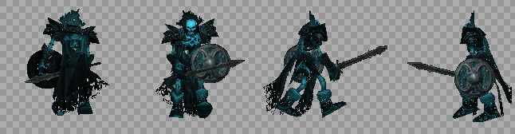<br>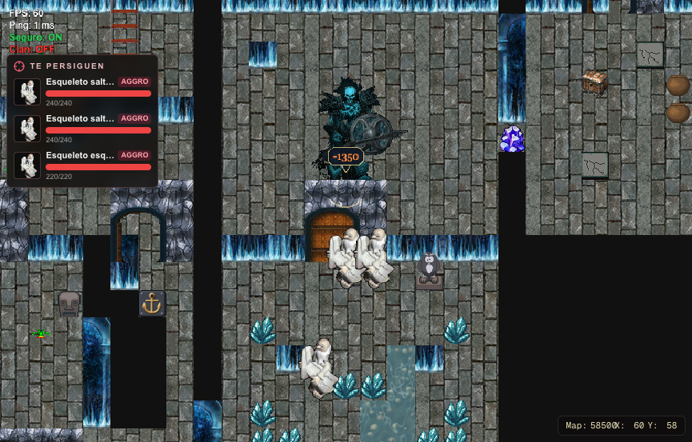 | **Maestro Stalfos** (minijefe). Un esqueleto espadachín con escudo que aparece cuatro veces. Un golpe lo desarma (queda un montón de huesos) y desarmado solo le entran las bombas. Las tres primeras huye volando; la cuarta muere. | cuerpo 482: 5 cuadros de 150 × 160 | Caminata en 4 direcciones (6 cuadros), cargando el espadazo (2 cuadros) y el tajo (3 cuadros), el escudo levantado (1 cuadro por dirección), el montón de huesos (1 cuadro y 2 de temblor) y la huida volando (4 cuadros). |
| FB-26 | 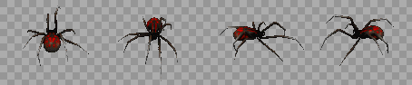<br>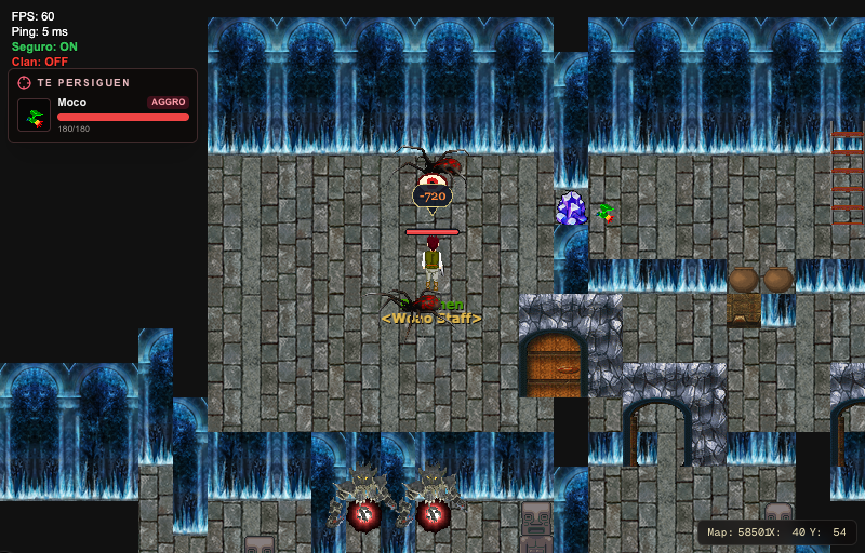 | **Gohma** (minijefe). Dos arañas que caminan de lado a lado; se frenan frente al jugador y abren el ojo, que es cuando se las lastima. Tiemblan y arremeten. | cuerpo 42: 6 cuadros de 107 × 86 | Caminata de costado (6 cuadros), el ojo cerrado, abriéndose y abierto (3 cuadros), el temblor y la bola de fuego que escupen (24 × 24, 4 cuadros). |
| FB-27 | 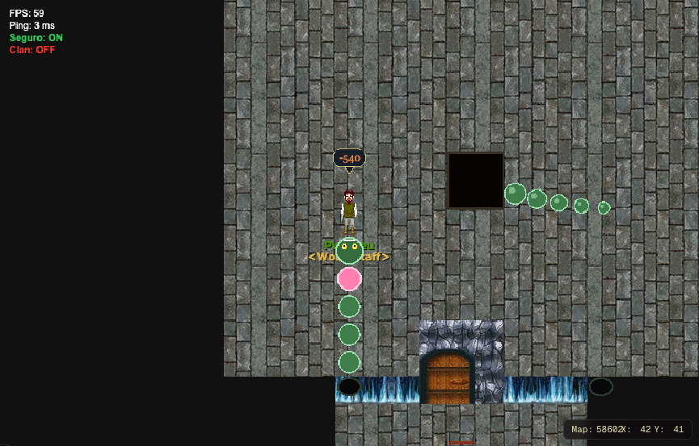 | **Anguila Viscosa** (jefe). Asoma la cabeza por cuatro agujeros de la pared; con el Gancho se la saca y se le pega al corazón, que titila. Una cola gira desde un pozo del medio. Hoy se dibuja con formas. | se dibuja con formas por código (la criatura de AO, cuerpo 13, no se ve) | La cabeza (4 direcciones, 3 cuadros de mordida), el segmento del cuerpo, el corazón (2 cuadros titilando), la punta de la cola, el agujero de la pared (asomando) y el pozo del medio; cada pieza 32 × 32 a 48 × 48. |

## 5. Efectos que se dibujan aparte

Lo que no es una baldosa, un objeto ni un cuerpo: lo dibuja el cliente (con formas o con sprites sueltos) en `frontend/components/game/engine/`.

| Código | Actual | Qué es y qué hace | Para el nuevo |
|---|---|---|---|
| FB-28 | 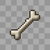 | **El hueso de los esqueletos.** El esqueleto esquivo salta para atrás y tira un hueso que vuela girando. | Hueso de 16 × 16, 4 cuadros de giro. |
| FB-29 | 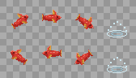 | **El pez que salta.** Sale del agua, da un salto en arco y vuelve a meterse. | Pez subiendo, arriba y bajando (3 cuadros, 40 × 44) y el salpicón (3 cuadros). |
| FB-30 | 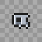 | **La máscara arrancada.** El Gancho le arranca la máscara a la Máscara de Hierro: sale volando y cae. | La máscara suelta (32 × 32, 4 cuadros de giro). |
| FB-31 | 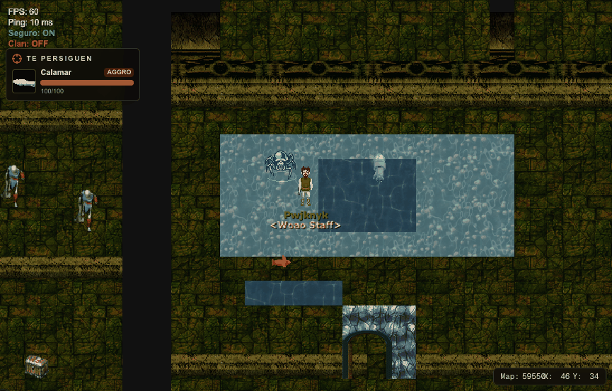 | **El agua baja.** Agua que se camina sin las Patas de rana. | Ver la baldosa de agua baja. |
| FB-32 | 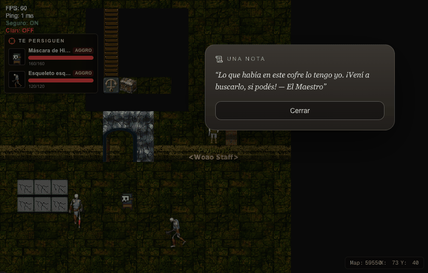 | **La nota del Maestro.** Un cofre vacío con una nota. | El papel de la nota sobre el cofre abierto (16 × 16). |

## 6. Prompt para Claude Opus 5.5

Copiar entero y pegarlo en una sesión nueva de Claude Code abierta en el repo. Hace el arte de esta mazmorra; lo común sale del prompt de [00-COMUNES.md](00-COMUNES.md), que conviene correr antes.

```text
Sos un artista técnico de videojuegos y trabajás en el repo de WoAO (/Users/leandrobisceglie/AoWeb/aoweb): un MMORPG web (Next.js + PixiJS) basado en Argentum Online. Tiene una serie de 8 mazmorras PvE con la estructura de las de *The Legend of Zelda: Link's Awakening* (llaves, puertas que se cierran, puzzles, un ítem por mazmorra, minijefe y jefe).

Tu trabajo: rehacer de cero TODOS los gráficos de la mazmorra "Fauces del Bagre" (5 de 8; ítem: Gancho), para que se vea profesional y coherente. Hoy es una mezcla de gráficos de AO, paquetes libres de otros estilos y cosas dibujadas con formas por código. El inventario completo, con la imagen actual de cada cosa, está en docs/mazmorras/arte/05-FAUCES_DEL_BAGRE.md. Leelo entero antes de empezar y mirá cada imagen de referencia.

TEMA DE ESTA MAZMORRA
Una cueva marina con forma de bagre: piedra azulada y húmeda con escamas talladas, cornisas sobre el agua, agua baja con piedritas y anclas de hierro oxidado.
Paleta: azul pizarra, verde agua, óxido y blanco hueso.

DIRECCIÓN DE ARTE (PARA TODAS LAS MAZMORRAS)
- Perspectiva y escala: vista desde arriba levemente inclinada (la de Argentum Online): se ve el frente de las paredes y el techo de los objetos. La baldosa mide 32 × 32 y un personaje humano mide 1,5 baldosas de alto.
- Estilo: pintado, con volumen y sombreado suave, que combine con los personajes y los mapas de AO. Nada de pixel art de 8 bits ni de formas planas.
- Luz: desde arriba a la izquierda, igual en todas las piezas. Cada cosa que toca el piso lleva una sombra de contacto suave.
- Contorno: oscuro y fino donde ayude a leer la forma contra el piso, no alrededor de todo.
- Paleta: una por mazmorra (la del tema), con un color de acento para lo interactivo (lo que se toca, se levanta o se abre) y rojo o naranja para lo peligroso.
- Legibilidad: lo que se puede usar se distingue del decorado a primera vista, y cada estado se distingue del otro (cerrado o abierto, apagado o encendido, entero o roto).
- Original: se toma la estructura de *Link's Awakening*, no su arte. Nada copiado de Nintendo ni de otros juegos. Si se parte de algo libre (CC0 o CC-BY), se anota el autor, la licencia y el enlace.

REGLAS TÉCNICAS (LAS DEL MOTOR DEL JUEGO)
- Archivos: PNG con transparencia (RGBA), sin fondo, sin halos claros alrededor y sin texto ni marcas de agua.
- Baldosas de piso: un bloque de 4 × 4 baldosas (128 × 128) que se repite sin costura en las dos direcciones; el juego elige la baldosa por la posición en el mapa.
- Paredes: un bloque de 4 × 4. Cada fila es la cara de la pared vista a 1, 2, 3 y 4 baldosas del piso (la última fila toca el piso). Tiene que repetirse sin costura a lo ancho.
- Agua y lava: bloque de 4 × 4 animado (4 cuadros en bucle, que empalmen).
- Objetos: una baldosa (32 × 32), anclados abajo al centro. Si son altos (estatuas, puertas, pilares), el dibujo puede subir (32 × 64, 32 × 96) o ensancharse (96 × 96 las puertas); la base sigue en la baldosa.
- Cuerpos (criaturas y jefes): una hoja por cuerpo, con 4 filas en este orden: mirando arriba, abajo, derecha e izquierda. Las columnas son los cuadros, todos de la misma medida. Mínimo 6 cuadros de caminata por dirección, que entren en bucle. Los pies van abajo al centro del cuadro: el juego lo apoya sobre la baldosa.
- Animaciones aparte (ataques, poses, efectos): una tira horizontal por animación, con cuadros de la misma medida.
- Numeración del juego: al día de este documento, el próximo grh libre es el 42484, el próximo archivo de gráficos el 330041 y el próximo cuerpo el 586. Verificalos antes de indexar.

LO QUE HAY QUE ENTREGAR (32 piezas, todas de esta mazmorra)
- [FB-01] Piso. Reemplaza: bloque de 4 × 4 desde el grh 9731. Qué hace: El piso de todas las salas. Entregar: Bloque de 4 × 4 (128 × 128) que se repite sin costura; con dos o tres variantes de baldosa sueltas (rajada, con musgo o arena) para romper la repetición. Referencia actual: docs/mazmorras/arte/img/piso-9731.png
- [FB-02] Pared. Reemplaza: bloque de 4 × 4 desde el grh 34062 (cada fila, a 1-4 baldosas del piso). Qué hace: El frente de las paredes; arriba de la cuarta fila se ve negro (el techo). Entregar: Bloque de 4 × 4: cada fila es la cara de la pared a 1, 2, 3 y 4 baldosas del piso, sin costura a lo ancho; y el techo (lo que hoy es negro) como bloque de 4 × 4 aparte. Referencia actual: docs/mazmorras/arte/img/pared-34062.png
- [FB-03] Agua profunda. Reemplaza: bloque de 4 × 4 animado desde el grh 1505 (el agua del mundo). Qué hace: Sin las Patas de rana no se puede pisar; con ellas se nada (no se pelea). Entregar: Bloque de 4 × 4 animado, 4 cuadros en bucle, y el borde de la orilla (4 lados y 4 esquinas, 32 × 32). Referencia actual: docs/mazmorras/arte/img/agua-1505.png
- [FB-04] Agua baja. Reemplaza: el agua con un reflejo encima (grh 42326, bloque de 4 × 4). Qué hace: Agua que se camina sin las Patas de rana. Entregar: Bloque de 4 × 4 (puede ir animado) que se distinga a la vista del agua profunda. Referencia actual: docs/mazmorras/arte/img/agua-baja-42326.png
- [FB-05] Pozo. Reemplaza: baldosa negra (grh 1). Qué hace: Caer saca vida y te devuelve a la entrada de la sala (o al piso de abajo). Se salta con la Pluma. Entregar: El pozo con su borde y profundidad: autotile de 47 piezas (o el juego de 16 de bordes y esquinas), 32 × 32. Referencia actual: (no tiene imagen: se dibuja por código)
- [FB-06] Escalera. Reemplaza: objetos 1198 (Escalera Grande, 32 × 96). Qué hace: Une las salas de distintos mapas o pisos (los atajos A, B, C… de Zelda). Se pisa y te lleva a la otra punta. Las de las salas que se cierran aparecen al vaciarlas. Entregar: una que baja y una que sube; la de la zambullida va bajo el agua y no se ve; 32 × 64 (ocupa una baldosa, el dibujo puede subir una más), anclada abajo. Referencia actual: docs/mazmorras/arte/img/familia-escalera.png
- [FB-07] Puerta (pared horizontal). Reemplaza: objetos 1834 (Puerta de piedra, 96 × 96); 1835 (Puerta de piedra abierta, 96 × 96). Qué hace: Hoy las puertas cerradas (con llave, del jefe, la persiana que abre la sala y el bloque cerradura) usan el mismo dibujo, y las abiertas o de un solo sentido, otro. En el nuevo cada tipo tiene que distinguirse a la vista. Entregar: común abierta y cerrada; con cerradura de llave chica; del jefe (cerradura grande); persiana (reja); de un solo sentido (con flecha); bloque cerradura; 96 × 96 como hoy (el arco ocupa la baldosa de la puerta y el muro de los costados), anclada abajo al centro. Referencia actual: docs/mazmorras/arte/img/familia-puerta.png
- [FB-08] Puerta (pared vertical). Reemplaza: objetos 1840 (Barrera de cristal, 32 × 32). Qué hace: Las puertas en las paredes de los costados. Hoy es un cristal que tapa el paso. Entregar: los mismos tipos que la horizontal, vistos de costado; abierta no se dibuja; 32 × 64, anclada abajo. Referencia actual: docs/mazmorras/arte/img/familia-barrera.png
- [FB-09] Ancla del Gancho. Reemplaza: objetos 1882 (Ancla del Gancho, 32 × 32); 1887 (Ancla del Gancho, 32 × 32); 1888 (Ancla del Gancho, 32 × 32); 1889 (Ancla del Gancho, 32 × 32). Qué hace: Si la punta del Gancho pasa por encima, nace un puente sobre la columna de pozos hacia donde apunta. Entregar: apuntando al norte, sur, este y oeste; 32 × 32 por dirección. Referencia actual: docs/mazmorras/arte/img/familia-ancla.png
- [FB-10] Puente del ancla. Reemplaza: objetos 1886 (Puente, 32 × 32); 1890 (Puente, 32 × 32). Qué hace: El puente que arma el ancla, baldosa por baldosa sobre los pozos. Entregar: vertical, horizontal; opcional: 3 cuadros de aparición; 32 × 32 cada uno (tiene que empalmar sin costura). Referencia actual: docs/mazmorras/arte/img/familia-puente.png
- [FB-11] Cabeza de dragón. Reemplaza: objetos 1885 (Cabeza de dragón, 32 × 34). Qué hace: Un poste del Gancho en la pared, con una argolla. Entregar: una sola; 32 × 40, anclada abajo. Referencia actual: docs/mazmorras/arte/img/familia-cabeza_dragon.png
- [FB-12] Máscara de Hierro (criatura). Reemplaza: cuerpo 582: 4 cuadros de 32 × 46 (plantilla 9803). Qué hace: De frente se cubre: pegale de costado o por la espalda, o arrancale la máscara con el Gancho. Entregar: 4 direcciones × 6 cuadros de caminata, 48 × 48. Referencia actual: docs/mazmorras/arte/img/cuerpo-582.png
- [FB-13] Esqueleto saltarín (criatura). Reemplaza: cuerpo 393: 23 cuadros de 60 × 75 (plantilla 9804). Qué hace: Si te acercás, te salta encima. Entregar: 4 direcciones × 6 cuadros de caminata, 64 × 64. Referencia actual: docs/mazmorras/arte/img/cuerpo-393.png
- [FB-14] Esqueleto esquivo (criatura). Reemplaza: cuerpo 393: 23 cuadros de 60 × 75 (plantilla 9805). Qué hace: Salta para atrás y te tira un hueso. Entregar: 4 direcciones × 6 cuadros de caminata, 64 × 64. Referencia actual: docs/mazmorras/arte/img/cuerpo-393.png
- [FB-15] Murciélago (criatura). Reemplaza: cuerpo 9: 5 cuadros de 59 × 64 (plantilla 9806). Qué hace: Duerme sobre su estatua hasta que te acercás. Entregar: 4 direcciones × 6 cuadros de caminata, 64 × 64. Referencia actual: docs/mazmorras/arte/img/cuerpo-9.png
- [FB-16] Orco arquero (criatura). Reemplaza: cuerpo 377: 5 cuadros de 38 × 44 (plantilla 9807). Qué hace: Tira flechas desde lejos. Entregar: 4 direcciones × 6 cuadros de caminata, 48 × 48. Referencia actual: docs/mazmorras/arte/img/cuerpo-377.png
- [FB-17] Orco espadachín (criatura). Reemplaza: cuerpo 43: 5 cuadros de 150 × 108 (plantilla 9808). Qué hace: Patrulla y te persigue si te ve. Entregar: 4 direcciones × 6 cuadros de caminata, 128 × 128. Referencia actual: docs/mazmorras/arte/img/cuerpo-43.png
- [FB-18] Moco escondido (criatura). Reemplaza: cuerpo 146: 2 cuadros de 32 × 25 (plantilla 9809). Qué hace: No se ve hasta que te acercás. Entregar: 4 direcciones × 6 cuadros de caminata, 48 × 48. Referencia actual: docs/mazmorras/arte/img/cuerpo-146.png
- [FB-19] Moco (criatura). Reemplaza: cuerpo 146: 2 cuadros de 32 × 25 (plantilla 9810). Qué hace: Un moco común: se arrastra hacia el jugador y lo ataca. Entregar: 4 direcciones × 6 cuadros de caminata, 48 × 48. Referencia actual: docs/mazmorras/arte/img/cuerpo-146.png
- [FB-20] Estrella (criatura). Reemplaza: cuerpo 578: 4 cuadros de 32 × 32 (plantilla 9811). Qué hace: Rebota en diagonal contra las paredes. Entregar: 4 direcciones × 6 cuadros de caminata, 48 × 48. Referencia actual: docs/mazmorras/arte/img/cuerpo-578.png
- [FB-21] Pulga de agua (criatura, de agua). Reemplaza: cuerpo 579: 6 cuadros de 56 × 50 (plantilla 9812). Qué hace: Patina por el agua. Entregar: 4 direcciones × 6 cuadros de caminata, 64 × 64. Referencia actual: docs/mazmorras/arte/img/cuerpo-579.png
- [FB-22] Calamar (criatura, de agua). Reemplaza: cuerpo 580: 8 cuadros de 49 × 41 (plantilla 9813). Qué hace: Nada hacia vos por el túnel inundado. Entregar: 4 direcciones × 6 cuadros de caminata, 64 × 64. Referencia actual: docs/mazmorras/arte/img/cuerpo-580.png
- [FB-23] Cuchilla (criatura, trampa). Reemplaza: cuerpo 244: 2 cuadros de 75 × 75 (plantilla 9815). Qué hace: Una trampa de cuchillas: sale disparada si te ve en su fila. Entregar: 4 direcciones × 4 cuadros (si gira o se mueve), 48 × 48. Referencia actual: docs/mazmorras/arte/img/cuerpo-244.png
- [FB-24] Chispa (criatura, trampa). Reemplaza: cuerpo 413: 10 cuadros de 80 × 60 (plantilla 9814). Qué hace: Una chispa que da vueltas alrededor de un pilar y quema al que toca. Entregar: 4 direcciones × 4 cuadros (si gira o se mueve), 48 × 48. Referencia actual: docs/mazmorras/arte/img/cuerpo-413.png
- [FB-25] Maestro Stalfos (minijefe). Reemplaza: cuerpo 482: 5 cuadros de 150 × 160. Qué hace: Un esqueleto espadachín con escudo que aparece cuatro veces. Un golpe lo desarma (queda un montón de huesos) y desarmado solo le entran las bombas. Las tres primeras huye volando; la cuarta muere. Entregar: Caminata en 4 direcciones (6 cuadros), cargando el espadazo (2 cuadros) y el tajo (3 cuadros), el escudo levantado (1 cuadro por dirección), el montón de huesos (1 cuadro y 2 de temblor) y la huida volando (4 cuadros). Referencia actual: docs/mazmorras/arte/img/cuerpo-482.png
- [FB-26] Gohma (minijefe). Reemplaza: cuerpo 42: 6 cuadros de 107 × 86. Qué hace: Dos arañas que caminan de lado a lado; se frenan frente al jugador y abren el ojo, que es cuando se las lastima. Tiemblan y arremeten. Entregar: Caminata de costado (6 cuadros), el ojo cerrado, abriéndose y abierto (3 cuadros), el temblor y la bola de fuego que escupen (24 × 24, 4 cuadros). Referencia actual: docs/mazmorras/arte/img/cuerpo-42.png
- [FB-27] Anguila Viscosa (jefe). Reemplaza: se dibuja con formas por código (la criatura de AO, cuerpo 13, no se ve). Qué hace: Asoma la cabeza por cuatro agujeros de la pared; con el Gancho se la saca y se le pega al corazón, que titila. Una cola gira desde un pozo del medio. Hoy se dibuja con formas. Entregar: La cabeza (4 direcciones, 3 cuadros de mordida), el segmento del cuerpo, el corazón (2 cuadros titilando), la punta de la cola, el agujero de la pared (asomando) y el pozo del medio; cada pieza 32 × 32 a 48 × 48. Referencia actual: docs/mazmorras/fauces/jefes-05-anguila-afuera.png
- [FB-28] El hueso de los esqueletos. Reemplaza: lo que hoy dibuja el cliente. Qué hace: El esqueleto esquivo salta para atrás y tira un hueso que vuela girando. Entregar: Hueso de 16 × 16, 4 cuadros de giro. Referencia actual: docs/mazmorras/arte/img/sprite-330030.png
- [FB-29] El pez que salta. Reemplaza: lo que hoy dibuja el cliente. Qué hace: Sale del agua, da un salto en arco y vuelve a meterse. Entregar: Pez subiendo, arriba y bajando (3 cuadros, 40 × 44) y el salpicón (3 cuadros). Referencia actual: docs/mazmorras/arte/img/sprite-330033.png
- [FB-30] La máscara arrancada. Reemplaza: lo que hoy dibuja el cliente. Qué hace: El Gancho le arranca la máscara a la Máscara de Hierro: sale volando y cae. Entregar: La máscara suelta (32 × 32, 4 cuadros de giro). Referencia actual: docs/mazmorras/arte/img/sprite-330036.png
- [FB-31] El agua baja. Reemplaza: lo que hoy dibuja el cliente. Qué hace: Agua que se camina sin las Patas de rana. Entregar: Ver la baldosa de agua baja. Referencia actual: docs/mazmorras/fauces/agua-baja.png
- [FB-32] La nota del Maestro. Reemplaza: lo que hoy dibuja el cliente. Qué hace: Un cofre vacío con una nota. Entregar: El papel de la nota sobre el cofre abierto (16 × 16). Referencia actual: docs/mazmorras/fauces/nota.png

Lo común a todas las mazmorras (cofres, placas, escaleras, portal, búho, bloques y cristales de color, vasijas y piedras, herramientas e íconos) NO va en este trabajo: sale del prompt de docs/mazmorras/arte/00-COMUNES.md. Esta mazmorra usa estos: CO-01 Portal, CO-02 Cofre, CO-03 Cofre del jefe, CO-04 Bloque que se empuja, CO-05 Placa (botón del piso), CO-07 Estatua búho, CO-11 Vasija, CO-12 Estatua del Gancho, CO-14 Bloque de cristal (la Carrera), CO-20 Lanzallamas, CO-22 Piso flojo, CO-23 Cristal de un golpe. Tus piezas tienen que combinar con ellos (si ya existen, miralos; si no, respetá la dirección de arte de arriba).

CÓMO TRABAJAR
1. Primero, una hoja de estilo: la paleta, el piso, la pared, una puerta y una criatura de esta mazmorra, apoyados sobre el piso nuevo. Mostrala y esperá la aprobación de Leandro antes de seguir.
2. Después, el resto, en este orden: baldosas, puertas y mecánicas, criaturas, minijefes y jefe, efectos.
3. Revisá cada pieza a tamaño real (1×) y al doble sobre el piso de la mazmorra, y al lado de un personaje de AO para la escala.
4. Si tenés una herramienta de generación de imágenes, usala con estas especificaciones y después llevá cada pieza a la grilla exacta (medida, transparencia, cuadros alineados) con un script. Si no, dibujalo por código (Python con Pillow) cuidando la calidad: volumen, luz y sombra, no formas planas.

QUÉ ENTREGAR
- Una carpeta arte/mazmorras/fauces/ con un PNG por pieza, con el código como nombre (por ejemplo FB-01.png).
- arte/mazmorras/fauces/manifest.json con una entrada por pieza: código, archivo, qué reemplaza, medida del cuadro, cantidad de cuadros, filas o direcciones, ancla, velocidad de la animación (ms por cuadro) y origen (propio, o autor + licencia + enlace).
- arte/mazmorras/fauces/preview.png: una hoja de contacto con todas las piezas sobre el piso de la mazmorra, con su código abajo.

CÓMO ENTRA AL JUEGO (SOLO DESPUÉS DE QUE LEANDRO APRUEBE EL ARTE)
1. Cada hoja va a `frontend/public/graphics/<archivo>.png`, numeradas desde el próximo archivo libre.
2. Cada cuadro es un grh. Se agrega como texto al final de `frontend/public/init/graficos.json` y `graficos_optimized.json`, sin reescribir los JSON:
   - estático: `"<grh>":{"numFrames":1,"numFile":<archivo>,"sX":<x>,"sY":<y>,"width":<w>,"height":<h>,"frames":{"1":<grh>}}` y, en el optimizado, `"<grh>":[<archivo>,<x>,<y>,<w>,<h>]`;
   - animado: `"<grh>":{"numFrames":<n>,"frames":{"1":<g1>,"2":<g2>,…},"speed":<ms>}` y `"<grh>":{"f":<n>,"r":[<g1>,<g2>,…],"s":<ms>}`.
3. Cada cuerpo se agrega a `frontend/public/init/bodies.json`: `"<cuerpo>":{"1":<grh arriba>,"2":<grh abajo>,"3":<grh derecha>,"4":<grh izquierda>,"headOffsetX":0,"headOffsetY":0}`. El cuerpo de cada criatura se cambia con `idBody` en su plantilla de `server/mazmorras/<mazmorra>/leyenda.json`.
4. Los objetos del mapa toman su grh de `DUNGEON_OBJECTS` en `server/src/scripts/buildDungeonMaps.ts`, y las baldosas de piso y pared, de `graficos` en `leyenda.json`. Después se regeneran los mapas con `pnpm --dir server exec tsx src/scripts/buildDungeonMaps.ts <mazmorra>`.
5. Lo que hoy se dibuja con formas o con sprites sueltos vive en `frontend/components/game/engine/` (el módulo de cada mazmorra; ver la tabla de efectos). Ahí se cargan las hojas nuevas.
6. Se sube la versión de las cachés en `frontend/utils/gameLoader.ts` (graficos, bodies, objs y npcs) para que los jugadores bajen lo nuevo.
7. Se prueba en vivo y se sacan capturas de cada cosa, comparadas con la imagen actual de este documento.

CRITERIOS PARA DAR UNA PIEZA POR TERMINADA
- Tiene la medida, los cuadros, el orden de las direcciones y el ancla pedidos.
- Se lee a 1× sobre el piso de la mazmorra: se entiende qué es y en qué estado está.
- Combina con el resto de la mazmorra y con los personajes de AO: misma luz, misma escala, misma paleta.
- Las animaciones entran en bucle sin saltos, y los bloques de piso, pared, agua y lava se repiten sin costura.
- Es arte original, o tiene anotado el origen y la licencia en el manifest.
```
