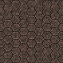
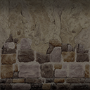
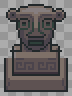

# Arte: Santuario del Rostro

Inventario de todos los gráficos de la mazmorra **Santuario del Rostro** para rehacerlos de cero. Cada fila tiene el gráfico actual (de ejemplo), qué hace en el juego y qué hay que entregar. Al final está el prompt completo para Claude Opus 5.5. El índice y la dirección de arte común están en [README.md](README.md).

| | |
|---|---|
| **Mazmorra** | 6 de 8 de la serie |
| **Estado** | Hecho (mapas 560-562). |
| **Ítem que da** | Brazalete de Fuerza nivel 2 |
| **Mapas** | 560, 561, 562 |
| **Tema** | Un templo de la selva: piedra tallada con caras, musgo y raíces, estatuas de caballos y braseros. Solemne y antiguo. |
| **Paleta** | verde jade, piedra arenisca, dorado gastado y musgo |
| **Gráficos** | 4 baldosas, 22 puertas y mecánicas (+ la piedra de invocación), 8 criaturas, 3 minijefes y jefes, 5 efectos. **25 piezas propias** de esta mazmorra; el resto es común. |

**Así se ve hoy:**


## 1. Baldosas

| Código | Actual | Qué es y qué hace | Hoy | Para el nuevo |
|---|---|---|---|---|
| SR-01 |  | **Piso.** El piso de todas las salas. | bloque de 4 × 4 desde el grh 9667 | Bloque de 4 × 4 (128 × 128) que se repite sin costura; con dos o tres variantes de baldosa sueltas (rajada, con musgo o arena) para romper la repetición. |
| SR-02 |  | **Pared.** El frente de las paredes; arriba de la cuarta fila se ve negro (el techo). | bloque de 4 × 4 desde el grh 9699 (cada fila, a 1-4 baldosas del piso) | Bloque de 4 × 4: cada fila es la cara de la pared a 1, 2, 3 y 4 baldosas del piso, sin costura a lo ancho; y el techo (lo que hoy es negro) como bloque de 4 × 4 aparte. |
| SR-03 |  | **Agua profunda.** Sin las Patas de rana no se puede pisar; con ellas se nada (no se pelea). | bloque de 4 × 4 animado desde el grh 1505 (el agua del mundo) | Bloque de 4 × 4 animado, 4 cuadros en bucle, y el borde de la orilla (4 lados y 4 esquinas, 32 × 32). |
| SR-04 | — | **Pozo.** Caer saca vida y te devuelve a la entrada de la sala (o al piso de abajo). Se salta con la Pluma. | baldosa negra (grh 1) | El pozo con su borde y profundidad: autotile de 47 piezas (o el juego de 16 de bordes y esquinas), 32 × 32. |

## 2. Puertas, cofres y mecánicas

Las marcadas **común** se dibujan una sola vez para todas las mazmorras (están en [00-COMUNES.md](00-COMUNES.md)); acá figuran para que la lista de esta mazmorra esté completa. Las de **esta mazmorra** van en su prompt.

| Código | Actual | Qué es y qué hace | Estados que hacen falta | Hoy | Para el nuevo |
|---|---|---|---|---|---|
| SR-05 |  | **Escalera.** Une las salas de distintos mapas o pisos (los atajos A, B, C… de Zelda). Se pisa y te lleva a la otra punta. Las de las salas que se cierran aparecen al vaciarlas. | una que baja y una que sube; la de la zambullida va bajo el agua y no se ve | 1198 (Escalera Grande, 32 × 96) | 32 × 64 (ocupa una baldosa, el dibujo puede subir una más), anclada abajo |
| CO-01 (común) |  | **Portal.** La salida de la mazmorra y los portales-atajo que aparecen al vencer a un minijefe (llevan a la entrada). | portal de salida y portal-atajo (dos colores distintos), animados en bucle | 378 (Teleport, 60 × 90, 24 cuadros) | 64 × 96, 8 a 12 cuadros en bucle, anclado abajo al centro |
| CO-02 (común) |  | **Cofre.** Guarda llaves, el mapa, la brújula, oro, el pico de piedra, la caracola o el ítem de la mazmorra. Muchos aparecen al resolver la sala (salen de la nada con un brillo). | cerrado, abierto | 1832 (Cofre de mazmorra, 32 × 32); 1833 (Cofre de mazmorra abierto, 32 × 32) | 32 × 32 (el dibujo puede tener hasta 32 × 40), cerrado y abierto |
| CO-03 (común) |  | **Cofre del jefe.** El cofre del trofeo, en la sala del final. Una vez por día por personaje da el trofeo de la serie y oro. Hoy es el mismo dibujo que el cofre común. | cerrado, abierto | 1849 (Cofre del jefe, 32 × 32) | 48 × 40 a 64 × 48, anclado abajo al centro: tiene que verse más importante que el común |
| SR-06 |  | **Puerta (pared horizontal).** Hoy las puertas cerradas (con llave, del jefe, la persiana que abre la sala y el bloque cerradura) usan el mismo dibujo, y las abiertas o de un solo sentido, otro. En el nuevo cada tipo tiene que distinguirse a la vista. | común abierta y cerrada; con cerradura de llave chica; del jefe (cerradura grande); persiana (reja); de un solo sentido (con flecha); bloque cerradura | 1834 (Puerta de piedra, 96 × 96); 1835 (Puerta de piedra abierta, 96 × 96) | 96 × 96 como hoy (el arco ocupa la baldosa de la puerta y el muro de los costados), anclada abajo al centro |
| SR-07 |  | **Puerta (pared vertical).** Las puertas en las paredes de los costados. Hoy es un cristal que tapa el paso. | los mismos tipos que la horizontal, vistos de costado; abierta no se dibuja | 1840 (Barrera de cristal, 32 × 32) | 32 × 64, anclada abajo |
| SR-08 |  | **Pared rajada (bombas).** Un paso tapado que se abre con una bomba. Se tiene que notar apenas (una grieta), para que el jugador la descubra. | pared horizontal tapiada (un arco con piedras), pared vertical (un montón de rocas) | 1858 (Pared rajada, 96 × 96); 1859 (Rocas sueltas, 32 × 32) | 96 × 96 la horizontal (como la puerta), 32 × 32 la vertical |
| CO-04 (común) |  | **Bloque que se empuja.** Se empuja una baldosa con un clic. Tapa pasos, aprieta placas y corta el camino de las cuchillas. | uno solo | 1836 (Bloque de piedra, 32 × 32) | 32 × 32 (el dibujo puede tener 32 × 40 para mostrar el alto) |
| CO-07 (común) |  | **Estatua búho.** Con el Pico de piedra, da una pista al hacerle clic. | una sola (opcional: los ojos que se encienden cuando habla) | 1861 (Estatua búho, 32 × 48) | 32 × 48, anclada abajo |
| CO-08 (común) |  | **Cristal de los bloques de color.** Al golpearlo, se invierten los bloques de color de toda la corrida. Hoy usa el mismo dibujo que la barrera de cristal. | azul y naranja | 1866 (Cristal azul, 32 × 32); 1867 (Cristal naranja, 32 × 32) | 32 × 48, anclado abajo |
| CO-09 (común) |  | **Bloques de color.** Los azules arrancan levantados (tapan el paso) y los naranjas bajados. El cristal los invierte. | azul levantado, azul bajado, naranja levantado, naranja bajado | 1862 (Bloque azul, 32 × 32); 1863 (Bloque azul bajado, 32 × 32); 1864 (Bloque naranja, 32 × 32); 1865 (Bloque naranja bajado, 32 × 32) | 32 × 32 cada estado |
| CO-10 (común) |  | **Remolino.** Arrastra hacia el centro; el que llega al centro vuelve a la entrada. | animado en bucle | 1868 (Remolino, 48 × 48, 12 cuadros) | 48 × 48, 12 cuadros en bucle |
| CO-11 (común) |  | **Vasija.** Se levanta con el Brazalete, se lleva y se tira. Tapa pasos, abre persianas al tirarla y algunas esconden algo. | entera; pedazos al romperse (4 a 6 trozos) | 1852 (Vasija, 32 × 32) | 32 × 32 |
| CO-12 (común) |  | **Estatua del Gancho.** Un poste para el Gancho: se engancha y te arrastra hasta ella, por encima de pozos. | una sola | 1855 (Estatua de piedra, 32 × 96) | 32 × 64 a 32 × 96, anclada abajo |
| CO-13 (común) |  | **Antorcha.** Se enciende con el Polvo de Fuego o el polvo mágico. Las salas con antorchas apagadas están a oscuras; si la sala tiene cofres, aparecen al encender todas. | apagada; encendida (fuego animado en bucle) | 1856 (Antorcha apagada, 32 × 64); 1857 (Antorcha encendida, 32 × 64, 9 cuadros) | 32 × 64, anclada abajo; el fuego, 8 a 9 cuadros |
| CO-16 (común) |  | **Aplastador.** Un bloque que baja de golpe sobre su losa cada tanto. Hoy es el bloque de piedra común. | arriba, bajando, abajo; la losa del piso donde cae | 1848 (Aplastador, 32 × 32); 1847 (Losa del aplastador, 32 × 32) | 32 × 48 el aplastador (con su sombra), 32 × 32 la losa; 3 cuadros de la caída |
| SR-09 |  | **Estatua pesada.** Solo la levanta el Brazalete nivel 2. Se tira contra las persianas para abrirlas. | una sola | 1870 (Estatua pesada, 32 × 44) | 32 × 48, anclada abajo |
| CO-17 (común) |  | **Cabeza de caballo.** Se levanta y se tira: cae parada o acostada. Con todas las de la sala paradas, se abre la puerta o aparece el cofre. | acostada, parada | 1872 (Cabeza de caballo (acostada), 32 × 32); 1871 (Cabeza de caballo (parada), 32 × 32) | 32 × 32 cada estado |
| CO-18 (común) |  | **Baldosa voladora.** Se despega del piso, sube temblando y sale volando hacia el jugador. En algunas salas deja un pozo. | baldosa con dibujo; el pozo que deja | 1873 (Baldosa con dibujo, 32 × 32); 1874 (Pozo, 32 × 32) | 32 × 32 cada estado |
| CO-19 (común) |  | **Cinta transportadora.** Lleva al que la pisa en su dirección. | norte, sur, este y oeste, animadas (4 cuadros cada una) | 1875 (Cinta transportadora, 32 × 32, 4 cuadros); 1876 (Cinta transportadora, 32 × 32, 4 cuadros); 1877 (Cinta transportadora, 32 × 32, 4 cuadros); 1878 (Cinta transportadora, 32 × 32, 4 cuadros) | 32 × 32, 4 cuadros por dirección |
| CO-20 (común) |  | **Lanzallamas.** Escupe una bola de fuego en línea recta cada tanto. El Campo de Protección la frena. | uno por dirección (norte, sur, este, oeste); la boca encendida al disparar | 1879 (Lanzallamas, 32 × 32) | 32 × 32 por dirección |
| CO-21 (común) |  | **Ojo de piedra.** Gira y, si te ve en línea, avisa y tira un rayo. El Campo de Protección lo rebota y lo rompe (queda la estatua rota). | mirando a cada una de las 8 direcciones (gira); roto | 1880 (Ojo de piedra, 32 × 48, 4 cuadros); 1894 (Ojo de piedra roto, 32 × 48) | 32 × 48, anclado abajo; 8 direcciones + roto |
| CO-PI (común) |  | **Piedra de invocación.** Está en el mundo: con un clic se entra a la mazmorra, solo o en grupo. Hoy es una estatua dorada que no tiene que ver con las mazmorras. | Una por mazmorra (con el símbolo de su ítem), con un brillo en bucle | cuerpo 256 | 64 × 96, anclada abajo; 6 cuadros de brillo |

## 3. Criaturas

Las imágenes muestran el primer cuadro mirando arriba, abajo, derecha e izquierda. "Hoy" dice cuántos cuadros por dirección tiene el cuerpo actual y de qué medida.

| Código | Actual (4 direcciones) | Qué es y qué hace | Rol | Hoy | Para el nuevo |
|---|---|---|---|---|---|
| SR-10 |  | **Hechicero** (plantilla 9776). Aparece, tira un rayo y desaparece. Un golpe lo corre. | criatura | cuerpo 372: 6 cuadros de 82 × 100 | 4 direcciones × 6 cuadros de caminata, 96 × 96 |
| SR-11 |  | **Moco escondido** (plantilla 9777). No se ve hasta que te acercás. | criatura | cuerpo 146: 2 cuadros de 32 × 25 | 4 direcciones × 6 cuadros de caminata, 48 × 48 |
| SR-12 |  | **Estrella** (plantilla 9778). Rebota en diagonal contra las paredes. | criatura | cuerpo 578: 4 cuadros de 32 × 32 | 4 direcciones × 6 cuadros de caminata, 48 × 48 |
| SR-13 |  | **Chispa** (plantilla 9779). Una chispa que da vueltas alrededor de un pilar y quema al que toca. | trampa | cuerpo 413: 10 cuadros de 80 × 60 | 4 direcciones × 4 cuadros (si gira o se mueve), 48 × 48 |
| SR-14 |  | **Cuchilla** (plantilla 9780). Una trampa de cuchillas: sale disparada si te ve en su fila. | trampa | cuerpo 244: 2 cuadros de 75 × 75 | 4 direcciones × 4 cuadros (si gira o se mueve), 48 × 48 |
| SR-15 |  | **Gusano** (plantilla 9781). Un gusano que repta por el santuario. | criatura | cuerpo 375: 5 cuadros de 64 × 42 | 4 direcciones × 6 cuadros de caminata, 64 × 64 |
| SR-16 |  | **Imitador** (plantilla 9782). Copia cada paso tuyo, al revés. De frente se cubre: pegale de costado o por la espalda. | criatura | cuerpo 371: 5 cuadros de 120 × 75 | 4 direcciones × 6 cuadros de caminata, 96 × 96 |
| SR-17 |  | **Orejudo** (plantilla 9783). No le entran golpes ni hechizos: tirale algo (una vasija, una bomba o una flecha). | criatura | cuerpo 577: 4 cuadros de 36 × 36 | 4 direcciones × 6 cuadros de caminata, 48 × 48 |

## 4. Minijefes y jefe

| Código | Actual | Qué es y qué hace | Hoy | Para el nuevo |
|---|---|---|---|---|
| SR-18 | <br> | **Machacador** (minijefe). Un bruto que tira una bola de hierro. Solo lo lastima su propia bola: se la levanta con el Brazalete y se le tira. | cuerpo 159: 5 cuadros de 128 × 107 | Caminata en 4 direcciones (6 cuadros), levantando la bola (3 cuadros), tirándola (3 cuadros) y tambaleando (2 cuadros); la bola de hierro con su sombra (32 × 32). |
| SR-19 | <br> | **Serpientes Glotonas** (minijefe). Se tragan las bombas que se les ponen cerca; solo mueren así. Titilan al tragar, se inflan cuando les explota adentro y eructan humo. | cuerpo 13: 5 cuadros de 91 × 65 | Caminata en 4 direcciones (6 cuadros), tragando (3 cuadros), inflada (2 cuadros) y el eructo de humo (4 cuadros). |
| SR-20 |  | **Rostro de Piedra** (jefe). Una cara de piedra en el piso que no se mueve: tira las baldosas y las vasijas de la sala y abre pozos alrededor. Solo le entran las bombas. Hoy son tres cabezas de "[LPC] Jungle Ruins". | tres caras de "[LPC] Jungle Ruins" (graphics/330021.png); la criatura de AO (cuerpo 141) no se ve | La cara (96 × 96 a 128 × 128): calma, boca abierta, enojada y escondiéndose (4 cuadros); los pozos que abre (rajadura, agujero que gira y cierre: 4 cuadros). |

## 5. Efectos que se dibujan aparte

Lo que no es una baldosa, un objeto ni un cuerpo: lo dibuja el cliente (con formas o con sprites sueltos) en `frontend/components/game/engine/`.

| Código | Actual | Qué es y qué hace | Para el nuevo |
|---|---|---|---|
| SR-21 |  | **El rayo del ojo de piedra.** Primero un aviso fino y después el rayo. | El rayo (una pieza de 32 × 8 que se repite) y el impacto (3 cuadros, 32 × 32). |
| SR-22 |  | **Las baldosas voladoras.** Se despegan, tiemblan y salen volando hacia el jugador. | Ver Baldosa voladora; además, los pedazos al romperse (4 trozos). |
| SR-23 |  | **Las cabezas de caballo.** Se tiran y caen paradas o acostadas. | Ver Cabeza de caballo. |
| SR-24 |  | **Los aplastadores.** Bloques que bajan de golpe. | Ver Aplastador. |
| SR-25 | sin captura (se dibuja por código) | **Las bolas de fuego de los hechiceros y lanzallamas.** Vuelan en línea recta. | Bola de fuego (24 × 24, 4 cuadros) y la de magia del hechicero en otro color. |

## 6. Prompt para Claude Opus 5.5

Copiar entero y pegarlo en una sesión nueva de Claude Code abierta en el repo. Hace el arte de esta mazmorra; lo común sale del prompt de [00-COMUNES.md](00-COMUNES.md), que conviene correr antes.

```text
Sos un artista técnico de videojuegos y trabajás en el repo de WoAO (/Users/leandrobisceglie/AoWeb/aoweb): un MMORPG web (Next.js + PixiJS) basado en Argentum Online. Tiene una serie de 8 mazmorras PvE con la estructura de las de *The Legend of Zelda: Link's Awakening* (llaves, puertas que se cierran, puzzles, un ítem por mazmorra, minijefe y jefe).

Tu trabajo: rehacer de cero TODOS los gráficos de la mazmorra "Santuario del Rostro" (6 de 8; ítem: Brazalete de Fuerza nivel 2), para que se vea profesional y coherente. Hoy es una mezcla de gráficos de AO, paquetes libres de otros estilos y cosas dibujadas con formas por código. El inventario completo, con la imagen actual de cada cosa, está en docs/mazmorras/arte/06-SANTUARIO_DEL_ROSTRO.md. Leelo entero antes de empezar y mirá cada imagen de referencia.

TEMA DE ESTA MAZMORRA
Un templo de la selva: piedra tallada con caras, musgo y raíces, estatuas de caballos y braseros. Solemne y antiguo.
Paleta: verde jade, piedra arenisca, dorado gastado y musgo.

DIRECCIÓN DE ARTE (PARA TODAS LAS MAZMORRAS)
- Perspectiva y escala: vista desde arriba levemente inclinada (la de Argentum Online): se ve el frente de las paredes y el techo de los objetos. La baldosa mide 32 × 32 y un personaje humano mide 1,5 baldosas de alto.
- Estilo: pintado, con volumen y sombreado suave, que combine con los personajes y los mapas de AO. Nada de pixel art de 8 bits ni de formas planas.
- Luz: desde arriba a la izquierda, igual en todas las piezas. Cada cosa que toca el piso lleva una sombra de contacto suave.
- Contorno: oscuro y fino donde ayude a leer la forma contra el piso, no alrededor de todo.
- Paleta: una por mazmorra (la del tema), con un color de acento para lo interactivo (lo que se toca, se levanta o se abre) y rojo o naranja para lo peligroso.
- Legibilidad: lo que se puede usar se distingue del decorado a primera vista, y cada estado se distingue del otro (cerrado o abierto, apagado o encendido, entero o roto).
- Original: se toma la estructura de *Link's Awakening*, no su arte. Nada copiado de Nintendo ni de otros juegos. Si se parte de algo libre (CC0 o CC-BY), se anota el autor, la licencia y el enlace.

REGLAS TÉCNICAS (LAS DEL MOTOR DEL JUEGO)
- Archivos: PNG con transparencia (RGBA), sin fondo, sin halos claros alrededor y sin texto ni marcas de agua.
- Baldosas de piso: un bloque de 4 × 4 baldosas (128 × 128) que se repite sin costura en las dos direcciones; el juego elige la baldosa por la posición en el mapa.
- Paredes: un bloque de 4 × 4. Cada fila es la cara de la pared vista a 1, 2, 3 y 4 baldosas del piso (la última fila toca el piso). Tiene que repetirse sin costura a lo ancho.
- Agua y lava: bloque de 4 × 4 animado (4 cuadros en bucle, que empalmen).
- Objetos: una baldosa (32 × 32), anclados abajo al centro. Si son altos (estatuas, puertas, pilares), el dibujo puede subir (32 × 64, 32 × 96) o ensancharse (96 × 96 las puertas); la base sigue en la baldosa.
- Cuerpos (criaturas y jefes): una hoja por cuerpo, con 4 filas en este orden: mirando arriba, abajo, derecha e izquierda. Las columnas son los cuadros, todos de la misma medida. Mínimo 6 cuadros de caminata por dirección, que entren en bucle. Los pies van abajo al centro del cuadro: el juego lo apoya sobre la baldosa.
- Animaciones aparte (ataques, poses, efectos): una tira horizontal por animación, con cuadros de la misma medida.
- Numeración del juego: al día de este documento, el próximo grh libre es el 42484, el próximo archivo de gráficos el 330041 y el próximo cuerpo el 586. Verificalos antes de indexar.

LO QUE HAY QUE ENTREGAR (25 piezas, todas de esta mazmorra)
- [SR-01] Piso. Reemplaza: bloque de 4 × 4 desde el grh 9667. Qué hace: El piso de todas las salas. Entregar: Bloque de 4 × 4 (128 × 128) que se repite sin costura; con dos o tres variantes de baldosa sueltas (rajada, con musgo o arena) para romper la repetición. Referencia actual: docs/mazmorras/arte/img/piso-9667.png
- [SR-02] Pared. Reemplaza: bloque de 4 × 4 desde el grh 9699 (cada fila, a 1-4 baldosas del piso). Qué hace: El frente de las paredes; arriba de la cuarta fila se ve negro (el techo). Entregar: Bloque de 4 × 4: cada fila es la cara de la pared a 1, 2, 3 y 4 baldosas del piso, sin costura a lo ancho; y el techo (lo que hoy es negro) como bloque de 4 × 4 aparte. Referencia actual: docs/mazmorras/arte/img/pared-9699.png
- [SR-03] Agua profunda. Reemplaza: bloque de 4 × 4 animado desde el grh 1505 (el agua del mundo). Qué hace: Sin las Patas de rana no se puede pisar; con ellas se nada (no se pelea). Entregar: Bloque de 4 × 4 animado, 4 cuadros en bucle, y el borde de la orilla (4 lados y 4 esquinas, 32 × 32). Referencia actual: docs/mazmorras/arte/img/agua-1505.png
- [SR-04] Pozo. Reemplaza: baldosa negra (grh 1). Qué hace: Caer saca vida y te devuelve a la entrada de la sala (o al piso de abajo). Se salta con la Pluma. Entregar: El pozo con su borde y profundidad: autotile de 47 piezas (o el juego de 16 de bordes y esquinas), 32 × 32. Referencia actual: (no tiene imagen: se dibuja por código)
- [SR-05] Escalera. Reemplaza: objetos 1198 (Escalera Grande, 32 × 96). Qué hace: Une las salas de distintos mapas o pisos (los atajos A, B, C… de Zelda). Se pisa y te lleva a la otra punta. Las de las salas que se cierran aparecen al vaciarlas. Entregar: una que baja y una que sube; la de la zambullida va bajo el agua y no se ve; 32 × 64 (ocupa una baldosa, el dibujo puede subir una más), anclada abajo. Referencia actual: docs/mazmorras/arte/img/familia-escalera.png
- [SR-06] Puerta (pared horizontal). Reemplaza: objetos 1834 (Puerta de piedra, 96 × 96); 1835 (Puerta de piedra abierta, 96 × 96). Qué hace: Hoy las puertas cerradas (con llave, del jefe, la persiana que abre la sala y el bloque cerradura) usan el mismo dibujo, y las abiertas o de un solo sentido, otro. En el nuevo cada tipo tiene que distinguirse a la vista. Entregar: común abierta y cerrada; con cerradura de llave chica; del jefe (cerradura grande); persiana (reja); de un solo sentido (con flecha); bloque cerradura; 96 × 96 como hoy (el arco ocupa la baldosa de la puerta y el muro de los costados), anclada abajo al centro. Referencia actual: docs/mazmorras/arte/img/familia-puerta.png
- [SR-07] Puerta (pared vertical). Reemplaza: objetos 1840 (Barrera de cristal, 32 × 32). Qué hace: Las puertas en las paredes de los costados. Hoy es un cristal que tapa el paso. Entregar: los mismos tipos que la horizontal, vistos de costado; abierta no se dibuja; 32 × 64, anclada abajo. Referencia actual: docs/mazmorras/arte/img/familia-barrera.png
- [SR-08] Pared rajada (bombas). Reemplaza: objetos 1858 (Pared rajada, 96 × 96); 1859 (Rocas sueltas, 32 × 32). Qué hace: Un paso tapado que se abre con una bomba. Se tiene que notar apenas (una grieta), para que el jugador la descubra. Entregar: pared horizontal tapiada (un arco con piedras), pared vertical (un montón de rocas); 96 × 96 la horizontal (como la puerta), 32 × 32 la vertical. Referencia actual: docs/mazmorras/arte/img/familia-pared_bomba.png
- [SR-09] Estatua pesada. Reemplaza: objetos 1870 (Estatua pesada, 32 × 44). Qué hace: Solo la levanta el Brazalete nivel 2. Se tira contra las persianas para abrirlas. Entregar: una sola; 32 × 48, anclada abajo. Referencia actual: docs/mazmorras/arte/img/familia-estatua_pesada.png
- [SR-10] Hechicero (criatura). Reemplaza: cuerpo 372: 6 cuadros de 82 × 100 (plantilla 9776). Qué hace: Aparece, tira un rayo y desaparece. Un golpe lo corre. Entregar: 4 direcciones × 6 cuadros de caminata, 96 × 96. Referencia actual: docs/mazmorras/arte/img/cuerpo-372.png
- [SR-11] Moco escondido (criatura). Reemplaza: cuerpo 146: 2 cuadros de 32 × 25 (plantilla 9777). Qué hace: No se ve hasta que te acercás. Entregar: 4 direcciones × 6 cuadros de caminata, 48 × 48. Referencia actual: docs/mazmorras/arte/img/cuerpo-146.png
- [SR-12] Estrella (criatura). Reemplaza: cuerpo 578: 4 cuadros de 32 × 32 (plantilla 9778). Qué hace: Rebota en diagonal contra las paredes. Entregar: 4 direcciones × 6 cuadros de caminata, 48 × 48. Referencia actual: docs/mazmorras/arte/img/cuerpo-578.png
- [SR-13] Chispa (criatura, trampa). Reemplaza: cuerpo 413: 10 cuadros de 80 × 60 (plantilla 9779). Qué hace: Una chispa que da vueltas alrededor de un pilar y quema al que toca. Entregar: 4 direcciones × 4 cuadros (si gira o se mueve), 48 × 48. Referencia actual: docs/mazmorras/arte/img/cuerpo-413.png
- [SR-14] Cuchilla (criatura, trampa). Reemplaza: cuerpo 244: 2 cuadros de 75 × 75 (plantilla 9780). Qué hace: Una trampa de cuchillas: sale disparada si te ve en su fila. Entregar: 4 direcciones × 4 cuadros (si gira o se mueve), 48 × 48. Referencia actual: docs/mazmorras/arte/img/cuerpo-244.png
- [SR-15] Gusano (criatura). Reemplaza: cuerpo 375: 5 cuadros de 64 × 42 (plantilla 9781). Qué hace: Un gusano que repta por el santuario. Entregar: 4 direcciones × 6 cuadros de caminata, 64 × 64. Referencia actual: docs/mazmorras/arte/img/cuerpo-375.png
- [SR-16] Imitador (criatura). Reemplaza: cuerpo 371: 5 cuadros de 120 × 75 (plantilla 9782). Qué hace: Copia cada paso tuyo, al revés. De frente se cubre: pegale de costado o por la espalda. Entregar: 4 direcciones × 6 cuadros de caminata, 96 × 96. Referencia actual: docs/mazmorras/arte/img/cuerpo-371.png
- [SR-17] Orejudo (criatura). Reemplaza: cuerpo 577: 4 cuadros de 36 × 36 (plantilla 9783). Qué hace: No le entran golpes ni hechizos: tirale algo (una vasija, una bomba o una flecha). Entregar: 4 direcciones × 6 cuadros de caminata, 48 × 48. Referencia actual: docs/mazmorras/arte/img/cuerpo-577.png
- [SR-18] Machacador (minijefe). Reemplaza: cuerpo 159: 5 cuadros de 128 × 107. Qué hace: Un bruto que tira una bola de hierro. Solo lo lastima su propia bola: se la levanta con el Brazalete y se le tira. Entregar: Caminata en 4 direcciones (6 cuadros), levantando la bola (3 cuadros), tirándola (3 cuadros) y tambaleando (2 cuadros); la bola de hierro con su sombra (32 × 32). Referencia actual: docs/mazmorras/arte/img/cuerpo-159.png
- [SR-19] Serpientes Glotonas (minijefe). Reemplaza: cuerpo 13: 5 cuadros de 91 × 65. Qué hace: Se tragan las bombas que se les ponen cerca; solo mueren así. Titilan al tragar, se inflan cuando les explota adentro y eructan humo. Entregar: Caminata en 4 direcciones (6 cuadros), tragando (3 cuadros), inflada (2 cuadros) y el eructo de humo (4 cuadros). Referencia actual: docs/mazmorras/arte/img/cuerpo-13.png
- [SR-20] Rostro de Piedra (jefe). Reemplaza: tres caras de "[LPC] Jungle Ruins" (graphics/330021.png); la criatura de AO (cuerpo 141) no se ve. Qué hace: Una cara de piedra en el piso que no se mueve: tira las baldosas y las vasijas de la sala y abre pozos alrededor. Solo le entran las bombas. Hoy son tres cabezas de "[LPC] Jungle Ruins". Entregar: La cara (96 × 96 a 128 × 128): calma, boca abierta, enojada y escondiéndose (4 cuadros); los pozos que abre (rajadura, agujero que gira y cierre: 4 cuadros). Referencia actual: docs/mazmorras/rostro/jefes-04-rostro.png
- [SR-21] El rayo del ojo de piedra. Reemplaza: lo que hoy dibuja el cliente. Qué hace: Primero un aviso fino y después el rayo. Entregar: El rayo (una pieza de 32 × 8 que se repite) y el impacto (3 cuadros, 32 × 32). Referencia actual: docs/mazmorras/santuario/ojo.png
- [SR-22] Las baldosas voladoras. Reemplaza: lo que hoy dibuja el cliente. Qué hace: Se despegan, tiemblan y salen volando hacia el jugador. Entregar: Ver Baldosa voladora; además, los pedazos al romperse (4 trozos). Referencia actual: docs/mazmorras/santuario/baldosas.png
- [SR-23] Las cabezas de caballo. Reemplaza: lo que hoy dibuja el cliente. Qué hace: Se tiran y caen paradas o acostadas. Entregar: Ver Cabeza de caballo. Referencia actual: docs/mazmorras/santuario/cabezas.png
- [SR-24] Los aplastadores. Reemplaza: lo que hoy dibuja el cliente. Qué hace: Bloques que bajan de golpe. Entregar: Ver Aplastador. Referencia actual: docs/mazmorras/rostro/09-aplastadores.png
- [SR-25] Las bolas de fuego de los hechiceros y lanzallamas. Reemplaza: lo que hoy dibuja el cliente. Qué hace: Vuelan en línea recta. Entregar: Bola de fuego (24 × 24, 4 cuadros) y la de magia del hechicero en otro color. Referencia actual: (no tiene imagen: se dibuja por código)

Lo común a todas las mazmorras (cofres, placas, escaleras, portal, búho, bloques y cristales de color, vasijas y piedras, herramientas e íconos) NO va en este trabajo: sale del prompt de docs/mazmorras/arte/00-COMUNES.md. Esta mazmorra usa estos: CO-01 Portal, CO-02 Cofre, CO-03 Cofre del jefe, CO-04 Bloque que se empuja, CO-07 Estatua búho, CO-08 Cristal de los bloques de color, CO-09 Bloques de color, CO-10 Remolino, CO-11 Vasija, CO-12 Estatua del Gancho, CO-13 Antorcha, CO-16 Aplastador, CO-17 Cabeza de caballo, CO-18 Baldosa voladora, CO-19 Cinta transportadora, CO-20 Lanzallamas, CO-21 Ojo de piedra. Tus piezas tienen que combinar con ellos (si ya existen, miralos; si no, respetá la dirección de arte de arriba).

CÓMO TRABAJAR
1. Primero, una hoja de estilo: la paleta, el piso, la pared, una puerta y una criatura de esta mazmorra, apoyados sobre el piso nuevo. Mostrala y esperá la aprobación de Leandro antes de seguir.
2. Después, el resto, en este orden: baldosas, puertas y mecánicas, criaturas, minijefes y jefe, efectos.
3. Revisá cada pieza a tamaño real (1×) y al doble sobre el piso de la mazmorra, y al lado de un personaje de AO para la escala.
4. Si tenés una herramienta de generación de imágenes, usala con estas especificaciones y después llevá cada pieza a la grilla exacta (medida, transparencia, cuadros alineados) con un script. Si no, dibujalo por código (Python con Pillow) cuidando la calidad: volumen, luz y sombra, no formas planas.

QUÉ ENTREGAR
- Una carpeta arte/mazmorras/rostro/ con un PNG por pieza, con el código como nombre (por ejemplo SR-01.png).
- arte/mazmorras/rostro/manifest.json con una entrada por pieza: código, archivo, qué reemplaza, medida del cuadro, cantidad de cuadros, filas o direcciones, ancla, velocidad de la animación (ms por cuadro) y origen (propio, o autor + licencia + enlace).
- arte/mazmorras/rostro/preview.png: una hoja de contacto con todas las piezas sobre el piso de la mazmorra, con su código abajo.

CÓMO ENTRA AL JUEGO (SOLO DESPUÉS DE QUE LEANDRO APRUEBE EL ARTE)
1. Cada hoja va a `frontend/public/graphics/<archivo>.png`, numeradas desde el próximo archivo libre.
2. Cada cuadro es un grh. Se agrega como texto al final de `frontend/public/init/graficos.json` y `graficos_optimized.json`, sin reescribir los JSON:
   - estático: `"<grh>":{"numFrames":1,"numFile":<archivo>,"sX":<x>,"sY":<y>,"width":<w>,"height":<h>,"frames":{"1":<grh>}}` y, en el optimizado, `"<grh>":[<archivo>,<x>,<y>,<w>,<h>]`;
   - animado: `"<grh>":{"numFrames":<n>,"frames":{"1":<g1>,"2":<g2>,…},"speed":<ms>}` y `"<grh>":{"f":<n>,"r":[<g1>,<g2>,…],"s":<ms>}`.
3. Cada cuerpo se agrega a `frontend/public/init/bodies.json`: `"<cuerpo>":{"1":<grh arriba>,"2":<grh abajo>,"3":<grh derecha>,"4":<grh izquierda>,"headOffsetX":0,"headOffsetY":0}`. El cuerpo de cada criatura se cambia con `idBody` en su plantilla de `server/mazmorras/<mazmorra>/leyenda.json`.
4. Los objetos del mapa toman su grh de `DUNGEON_OBJECTS` en `server/src/scripts/buildDungeonMaps.ts`, y las baldosas de piso y pared, de `graficos` en `leyenda.json`. Después se regeneran los mapas con `pnpm --dir server exec tsx src/scripts/buildDungeonMaps.ts <mazmorra>`.
5. Lo que hoy se dibuja con formas o con sprites sueltos vive en `frontend/components/game/engine/` (el módulo de cada mazmorra; ver la tabla de efectos). Ahí se cargan las hojas nuevas.
6. Se sube la versión de las cachés en `frontend/utils/gameLoader.ts` (graficos, bodies, objs y npcs) para que los jugadores bajen lo nuevo.
7. Se prueba en vivo y se sacan capturas de cada cosa, comparadas con la imagen actual de este documento.

CRITERIOS PARA DAR UNA PIEZA POR TERMINADA
- Tiene la medida, los cuadros, el orden de las direcciones y el ancla pedidos.
- Se lee a 1× sobre el piso de la mazmorra: se entiende qué es y en qué estado está.
- Combina con el resto de la mazmorra y con los personajes de AO: misma luz, misma escala, misma paleta.
- Las animaciones entran en bucle sin saltos, y los bloques de piso, pared, agua y lava se repiten sin costura.
- Es arte original, o tiene anotado el origen y la licencia en el manifest.
```
