# Arte: Torre del Águila

Inventario de todos los gráficos de la mazmorra **Torre del Águila** para rehacerlos de cero. Cada fila tiene el gráfico actual (de ejemplo), qué hace en el juego y qué hay que entregar. Al final está el prompt completo para Claude Opus 5.5. El índice y la dirección de arte común están en [README.md](README.md).

| | |
|---|---|
| **Mazmorra** | 7 de 8 de la serie |
| **Estado** | Hecha (mapas 580-583). |
| **Ítem que da** | Campo de Protección |
| **Mapas** | 580, 581, 582, 583 |
| **Tema** | Una torre de piedra gris de cuatro pisos, con columnas, plumas y nidos; arriba, una terraza al aire libre con el cielo y las nubes alrededor. |
| **Paleta** | gris piedra clara, blanco, celeste cielo, marrón pluma y dorado |
| **Gráficos** | 4 baldosas, 25 puertas y mecánicas (+ la piedra de invocación), 15 criaturas, 3 minijefes y jefes, 6 efectos. **34 piezas propias** de esta mazmorra; el resto es común. |

**Así se ve hoy (la planta baja):**

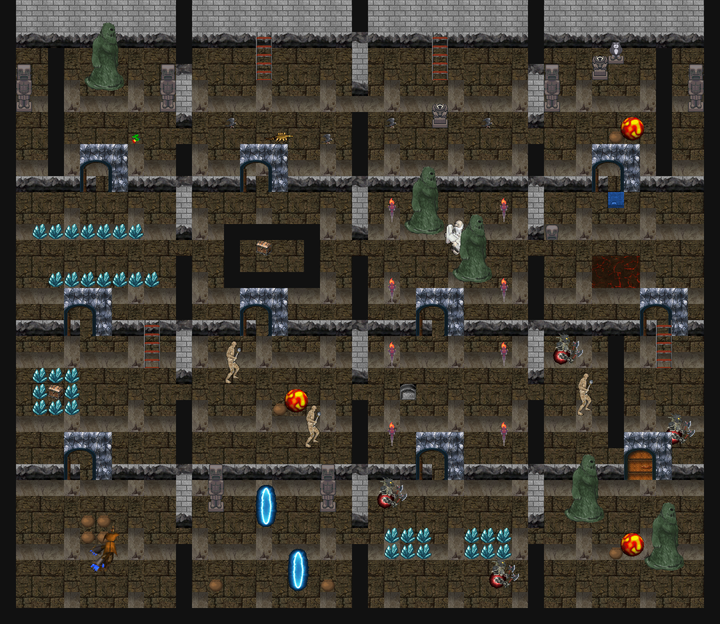

## 1. Baldosas

| Código | Actual | Qué es y qué hace | Hoy | Para el nuevo |
|---|---|---|---|---|
| TA-01 | 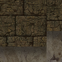 | **Piso.** El piso de todas las salas. | bloque de 4 × 4 desde el grh 9688 | Bloque de 4 × 4 (128 × 128) que se repite sin costura; con dos o tres variantes de baldosa sueltas (rajada, con musgo o arena) para romper la repetición. |
| TA-02 |  | **Pared.** El frente de las paredes; arriba de la cuarta fila se ve negro (el techo). | bloque de 4 × 4 desde el grh 7812 (cada fila, a 1-4 baldosas del piso) | Bloque de 4 × 4: cada fila es la cara de la pared a 1, 2, 3 y 4 baldosas del piso, sin costura a lo ancho; y el techo (lo que hoy es negro) como bloque de 4 × 4 aparte. |
| TA-03 | — | **Pozo.** Caer saca vida y te devuelve a la entrada de la sala (o al piso de abajo). Se salta con la Pluma. | baldosa negra (grh 1) | El pozo con su borde y profundidad: autotile de 47 piezas (o el juego de 16 de bordes y esquinas), 32 × 32. |
| TA-04 | — | **El cielo de la terraza.** Lo que rodea la terraza del Águila: el que se cae, baja a la sala de la escalera. | negro (el vacío alrededor de la terraza) | Cielo con nubes (bloque de 4 × 4 animado, 4 cuadros) y el borde de la terraza. |

## 2. Puertas, cofres y mecánicas

Las marcadas **común** se dibujan una sola vez para todas las mazmorras (están en [00-COMUNES.md](00-COMUNES.md)); acá figuran para que la lista de esta mazmorra esté completa. Las de **esta mazmorra** van en su prompt.

| Código | Actual | Qué es y qué hace | Estados que hacen falta | Hoy | Para el nuevo |
|---|---|---|---|---|---|
| TA-05 |  | **Escalera.** Une las salas de distintos mapas o pisos (los atajos A, B, C… de Zelda). Se pisa y te lleva a la otra punta. Las de las salas que se cierran aparecen al vaciarlas. | una que baja y una que sube; la de la zambullida va bajo el agua y no se ve | 1198 (Escalera Grande, 32 × 96) | 32 × 64 (ocupa una baldosa, el dibujo puede subir una más), anclada abajo |
| CO-01 (común) |  | **Portal.** La salida de la mazmorra y los portales-atajo que aparecen al vencer a un minijefe (llevan a la entrada). | portal de salida y portal-atajo (dos colores distintos), animados en bucle | 378 (Teleport, 60 × 90, 24 cuadros) | 64 × 96, 8 a 12 cuadros en bucle, anclado abajo al centro |
| CO-02 (común) |  | **Cofre.** Guarda llaves, el mapa, la brújula, oro, el pico de piedra, la caracola o el ítem de la mazmorra. Muchos aparecen al resolver la sala (salen de la nada con un brillo). | cerrado, abierto | 1832 (Cofre de mazmorra, 32 × 32); 1833 (Cofre de mazmorra abierto, 32 × 32) | 32 × 32 (el dibujo puede tener hasta 32 × 40), cerrado y abierto |
| CO-03 (común) |  | **Cofre del jefe.** El cofre del trofeo, en la sala del final. Una vez por día por personaje da el trofeo de la serie y oro. Hoy es el mismo dibujo que el cofre común. | cerrado, abierto | 1849 (Cofre del jefe, 32 × 32) | 48 × 40 a 64 × 48, anclado abajo al centro: tiene que verse más importante que el común |
| TA-06 |  | **Puerta (pared horizontal).** Hoy las puertas cerradas (con llave, del jefe, la persiana que abre la sala y el bloque cerradura) usan el mismo dibujo, y las abiertas o de un solo sentido, otro. En el nuevo cada tipo tiene que distinguirse a la vista. | común abierta y cerrada; con cerradura de llave chica; del jefe (cerradura grande); persiana (reja); de un solo sentido (con flecha); bloque cerradura | 1834 (Puerta de piedra, 96 × 96); 1835 (Puerta de piedra abierta, 96 × 96) | 96 × 96 como hoy (el arco ocupa la baldosa de la puerta y el muro de los costados), anclada abajo al centro |
| TA-07 |  | **Puerta (pared vertical).** Las puertas en las paredes de los costados. Hoy es un cristal que tapa el paso. | los mismos tipos que la horizontal, vistos de costado; abierta no se dibuja | 1840 (Barrera de cristal, 32 × 32) | 32 × 64, anclada abajo |
| TA-08 |  | **Pared rajada (bombas).** Un paso tapado que se abre con una bomba. Se tiene que notar apenas (una grieta), para que el jugador la descubra. | pared horizontal tapiada (un arco con piedras), pared vertical (un montón de rocas) | 1858 (Pared rajada, 96 × 96); 1859 (Rocas sueltas, 32 × 32) | 96 × 96 la horizontal (como la puerta), 32 × 32 la vertical |
| CO-04 (común) |  | **Bloque que se empuja.** Se empuja una baldosa con un clic. Tapa pasos, aprieta placas y corta el camino de las cuchillas. | uno solo | 1836 (Bloque de piedra, 32 × 32) | 32 × 32 (el dibujo puede tener 32 × 40 para mostrar el alto) |
| CO-05 (común) |  | **Placa (botón del piso).** Se aprieta con un jugador o un bloque encima. Abre puertas o hace aparecer cofres y escaleras. La de peso solo baja si el que la pisa carga algo con el Brazalete. | suelta y apretada; la placa de peso (Gruta de la Botella) distinta | 1837 (Runa del suelo, 32 × 32); 1838 (Runa del suelo encendida, 32 × 32) | 32 × 32 |
| CO-06 (común) |  | **Losa de piedra.** Una losa con un texto grabado (pistas del jefe o de la mazmorra). Se lee con un clic. | una sola | 1839 (Losa de piedra, 32 × 32) | 32 × 48, anclada abajo |
| CO-07 (común) |  | **Estatua búho.** Con el Pico de piedra, da una pista al hacerle clic. | una sola (opcional: los ojos que se encienden cuando habla) | 1861 (Estatua búho, 32 × 48) | 32 × 48, anclada abajo |
| CO-08 (común) |  | **Cristal de los bloques de color.** Al golpearlo, se invierten los bloques de color de toda la corrida. Hoy usa el mismo dibujo que la barrera de cristal. | azul y naranja | 1866 (Cristal azul, 32 × 32); 1867 (Cristal naranja, 32 × 32) | 32 × 48, anclado abajo |
| CO-09 (común) |  | **Bloques de color.** Los azules arrancan levantados (tapan el paso) y los naranjas bajados. El cristal los invierte. | azul levantado, azul bajado, naranja levantado, naranja bajado | 1862 (Bloque azul, 32 × 32); 1863 (Bloque azul bajado, 32 × 32); 1864 (Bloque naranja, 32 × 32); 1865 (Bloque naranja bajado, 32 × 32) | 32 × 32 cada estado |
| CO-11 (común) |  | **Vasija.** Se levanta con el Brazalete, se lleva y se tira. Tapa pasos, abre persianas al tirarla y algunas esconden algo. | entera; pedazos al romperse (4 a 6 trozos) | 1852 (Vasija, 32 × 32) | 32 × 32 |
| CO-12 (común) |  | **Estatua del Gancho.** Un poste para el Gancho: se engancha y te arrastra hasta ella, por encima de pozos. | una sola | 1855 (Estatua de piedra, 32 × 96) | 32 × 64 a 32 × 96, anclada abajo |
| CO-13 (común) |  | **Antorcha.** Se enciende con el Polvo de Fuego o el polvo mágico. Las salas con antorchas apagadas están a oscuras; si la sala tiene cofres, aparecen al encender todas. | apagada; encendida (fuego animado en bucle) | 1856 (Antorcha apagada, 32 × 64); 1857 (Antorcha encendida, 32 × 64, 9 cuadros) | 32 × 64, anclada abajo; el fuego, 8 a 9 cuadros |
| CO-17 (común) | 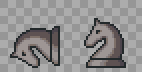 | **Cabeza de caballo.** Se levanta y se tira: cae parada o acostada. Con todas las de la sala paradas, se abre la puerta o aparece el cofre. | acostada, parada | 1872 (Cabeza de caballo (acostada), 32 × 32); 1871 (Cabeza de caballo (parada), 32 × 32) | 32 × 32 cada estado |
| CO-18 (común) | 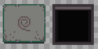 | **Baldosa voladora.** Se despega del piso, sube temblando y sale volando hacia el jugador. En algunas salas deja un pozo. | baldosa con dibujo; el pozo que deja | 1873 (Baldosa con dibujo, 32 × 32); 1874 (Pozo, 32 × 32) | 32 × 32 cada estado |
| CO-19 (común) | 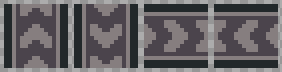 | **Cinta transportadora.** Lleva al que la pisa en su dirección. | norte, sur, este y oeste, animadas (4 cuadros cada una) | 1875 (Cinta transportadora, 32 × 32, 4 cuadros); 1876 (Cinta transportadora, 32 × 32, 4 cuadros); 1877 (Cinta transportadora, 32 × 32, 4 cuadros); 1878 (Cinta transportadora, 32 × 32, 4 cuadros) | 32 × 32, 4 cuadros por dirección |
| CO-20 (común) |  | **Lanzallamas.** Escupe una bola de fuego en línea recta cada tanto. El Campo de Protección la frena. | uno por dirección (norte, sur, este, oeste); la boca encendida al disparar | 1879 (Lanzallamas, 32 × 32) | 32 × 32 por dirección |
| CO-21 (común) | 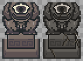 | **Ojo de piedra.** Gira y, si te ve en línea, avisa y tira un rayo. El Campo de Protección lo rebota y lo rompe (queda la estatua rota). | mirando a cada una de las 8 direcciones (gira); roto | 1880 (Ojo de piedra, 32 × 48, 4 cuadros); 1894 (Ojo de piedra roto, 32 × 48) | 32 × 48, anclado abajo; 8 direcciones + roto |
| CO-22 (común) |  | **Piso flojo.** Si te quedás quieto encima, se hunde y caés. Vuelve a los 5 s. | firme; hundiéndose | 1883 (Piso flojo, 32 × 32) | 32 × 32 cada estado |
| CO-23 (común) |  | **Cristal de un golpe.** Se rompe de un golpe o con una bomba. Tapa pasos o adorna. | entero; pedazos al romperse | 1884 (Cristal, 32 × 32) | 32 × 32 |
| TA-09 | 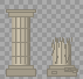 | **Pilar de la torre.** Cuatro pilares sostienen el piso de arriba. El Orbe tirado contra uno lo rompe; con los cuatro rotos, la torre se derrumba. | entero; roto | 1891 (Pilar de la torre, 32 × 64); 1892 (Pilar roto, 32 × 40) | 32 × 64 el entero, 32 × 40 el roto; anclados abajo |
| TA-10 | 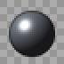 | **Orbe.** Se levanta con el Brazalete y se tira contra los pilares. Si cae a un pozo, vuelve a su lugar. Hoy es la bola de hierro del Machacador. | en el piso; en las manos (el mismo dibujo, más arriba) | 1893 (Orbe, 32 × 32) | 32 × 32 |
| CO-PI (común) |  | **Piedra de invocación.** Está en el mundo: con un clic se entra a la mazmorra, solo o en grupo. Hoy es una estatua dorada que no tiene que ver con las mazmorras. | Una por mazmorra (con el símbolo de su ítem), con un brillo en bucle | cuerpo 256 | 64 × 96, anclada abajo; 6 cuadros de brillo |

## 3. Criaturas

Las imágenes muestran el primer cuadro mirando arriba, abajo, derecha e izquierda. "Hoy" dice cuántos cuadros por dirección tiene el cuerpo actual y de qué medida.

| Código | Actual (4 direcciones) | Qué es y qué hace | Rol | Hoy | Para el nuevo |
|---|---|---|---|---|---|
| TA-11 |  | **Mini gusano** (plantilla 9739). Un gusano anillado que se mueve rápido. | criatura | cuerpo 375: 5 cuadros de 64 × 42 | 4 direcciones × 6 cuadros de caminata, 64 × 64 |
| TA-12 | 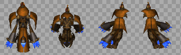 | **Hechicero** (plantilla 9800). Aparece, tira un rayo y desaparece. | criatura | cuerpo 372: 6 cuadros de 82 × 100 | 4 direcciones × 6 cuadros de caminata, 96 × 96 |
| TA-13 |  | **Máscara de Hierro** (plantilla 9803). De frente se cubre: pegale de costado o por la espalda, o arrancale la máscara con el Gancho. | criatura | cuerpo 582: 4 cuadros de 32 × 46 | 4 direcciones × 6 cuadros de caminata, 48 × 48 |
| TA-14 |  | **Esqueleto esquivo** (plantilla 9805). Salta para atrás y te tira un hueso. | criatura | cuerpo 393: 23 cuadros de 60 × 75 | 4 direcciones × 6 cuadros de caminata, 64 × 64 |
| TA-15 |  | **Moco escondido** (plantilla 9809). No se ve hasta que te acercás. | criatura | cuerpo 146: 2 cuadros de 32 × 25 | 4 direcciones × 6 cuadros de caminata, 48 × 48 |
| TA-16 |  | **Moco** (plantilla 9810). Un moco común: se arrastra hacia el jugador y lo ataca. | criatura | cuerpo 146: 2 cuadros de 32 × 25 | 4 direcciones × 6 cuadros de caminata, 48 × 48 |
| TA-17 |  | **Chispa** (plantilla 9814). Una chispa que da vueltas alrededor de un pilar y quema al que toca. | trampa | cuerpo 413: 10 cuadros de 80 × 60 | 4 direcciones × 4 cuadros (si gira o se mueve), 48 × 48 |
| TA-18 |  | **Cuchilla** (plantilla 9815). Una trampa de cuchillas: sale disparada si te ve en su fila. | trampa | cuerpo 244: 2 cuadros de 75 × 75 | 4 direcciones × 4 cuadros (si gira o se mueve), 48 × 48 |
| TA-19 |  | **Tragón** (plantilla 9822). Un moco grande que se arrastra hacia vos y te traga. Si tenías el Campo de Protección levantado, se lo come. | criatura | cuerpo 504: 8 cuadros de 160 × 160 | 4 direcciones × 6 cuadros de caminata, 128 × 128 |
| TA-20 | 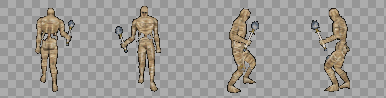 | **Momia** (plantilla 9823). Una momia de la torre: lenta y dura. | criatura | cuerpo 252: 5 cuadros de 90 × 90 | 4 direcciones × 6 cuadros de caminata, 96 × 96 |
| TA-21 | 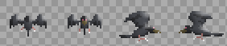 | **Cuervo de la torre** (plantilla 9824). Un cuervo que da vueltas por la torre y picotea. | criatura | cuerpo 68: 2 cuadros de 32 × 25 | 4 direcciones × 6 cuadros de caminata, 48 × 48 |
| TA-22 |  | **Hongo** (plantilla 9825). Un hongo que camina. No se mete con nadie que no se meta con él. | criatura | cuerpo 146: 2 cuadros de 32 × 25 | 4 direcciones × 6 cuadros de caminata, 48 × 48 |
| TA-23 | 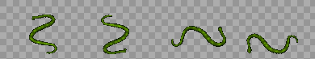 | **Serpiente de la torre** (plantilla 9827). Una serpiente que vive entre las piedras de la torre. | criatura | cuerpo 13: 5 cuadros de 91 × 65 | 4 direcciones × 6 cuadros de caminata, 96 × 96 |
| TA-24 |  | **Naipe (I, II y III)** (plantilla 9828, 9829, 9830). Tres Naipes que hay que vencer en orden (I, II y III): si cae uno antes de tiempo, vuelven todos. | criatura | cuerpo 12: 5 cuadros de 53 × 70 | 4 direcciones × 6 cuadros de caminata, 64 × 64 |
| TA-25 |  | **Murciélago del Flautista** (plantilla 9832). Uno de los murciélagos que llama el Flautista con su flauta. | criatura | cuerpo 9: 5 cuadros de 59 × 64 | 4 direcciones × 6 cuadros de caminata, 64 × 64 |

## 4. Minijefes y jefe

| Código | Actual | Qué es y qué hace | Hoy | Para el nuevo |
|---|---|---|---|---|
| TA-26 |  | **Cíclope rojo** (minijefe). El Cíclope de la Gruta de la Botella, más bravo: tira bombas y arremete. | cuerpo 176: 7 cuadros de 120 × 165 | Una variante del Cíclope (ver la Gruta de la Botella), con otra paleta. |
| TA-27 | <br>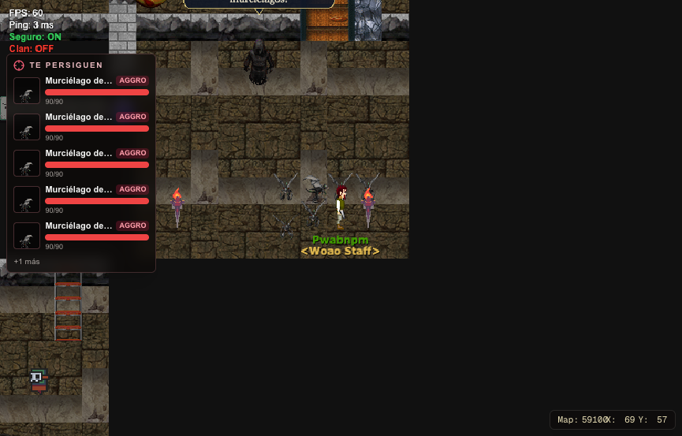 | **Flautista** (minijefe). Un flautista encapuchado: no se lo puede lastimar; toca la flauta y llama a seis murciélagos; vencidos, huye volando. Después aparece montado en el Águila. | cuerpo 251: 5 cuadros de 42 × 68 | Caminata en 4 direcciones (6 cuadros), tocando la flauta (4 cuadros), huyendo (4 cuadros) y montado (sentado, para dibujarlo sobre el Águila); las notas que suben (16 × 16, 3 variantes). |
| TA-28 | 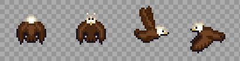<br>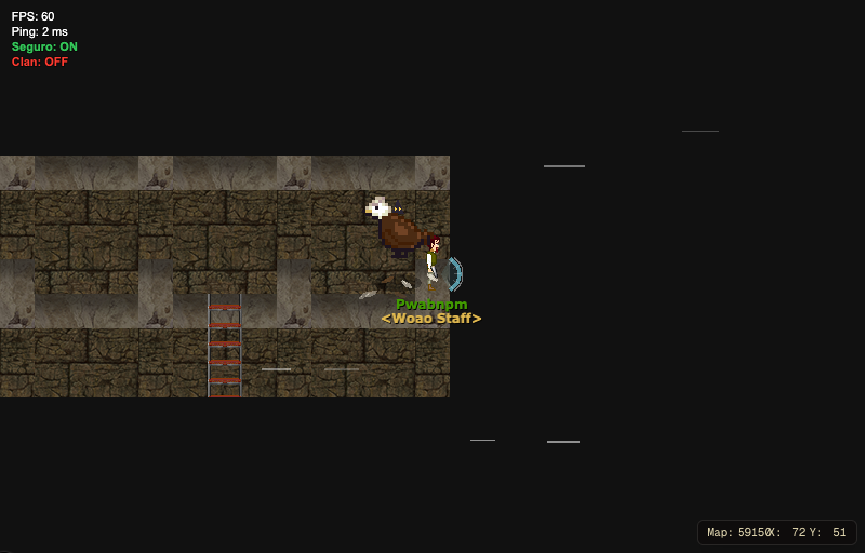 | **Águila Malvada** (jefe). Ronda alto fuera de alcance; pasa bajo atropellando, aletea desde un costado con un viento que empuja al vacío y tira plumas, y se tira en picada. Con el Campo de frente, la pluma rebota y la tira a la terraza. Hoy es "[LPC] Birds" al triple. | cuerpo 584: 3 cuadros de 96 × 96 | En vuelo (4 direcciones, 6 cuadros de aleteo, 128 × 128 o más), en picada (2 cuadros), posada (4 direcciones, 3 cuadros), aleteando quieta (6 cuadros) y cayendo derrotada (4 cuadros); la pluma (16 × 32, 2 cuadros) y la sombra en el piso. |

## 5. Efectos que se dibujan aparte

Lo que no es una baldosa, un objeto ni un cuerpo: lo dibuja el cliente (con formas o con sprites sueltos) en `frontend/components/game/engine/`.

| Código | Actual | Qué es y qué hace | Para el nuevo |
|---|---|---|---|
| TA-29 |  | **El Campo de Protección.** Un arco de energía delante del personaje mientras dura (3 s); destella al rebotar algo. Hoy se dibuja con formas. | El arco mirando a cada dirección (4), latiendo (4 cuadros, 48 × 32), y el destello del rebote (3 cuadros). Común a todas las mazmorras. |
| TA-30 | 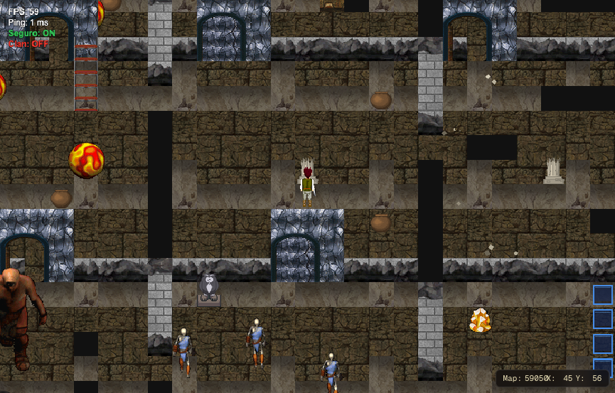 | **El derrumbe.** Con los cuatro pilares rotos, la cámara tiembla y caen escombros. | Escombros que caen (4 piezas, 8 × 8 a 16 × 16) y una nube de polvo (4 cuadros, 48 × 32). |
| TA-31 | 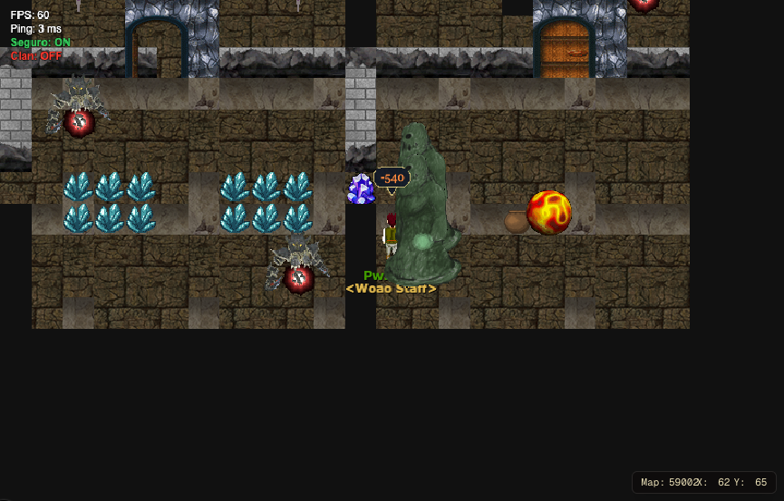 | **El Tragón tragando.** El personaje queda adentro del moco un momento y lo escupe. | El Tragón con alguien adentro (2 cuadros) y escupiendo (3 cuadros). |
| TA-32 | 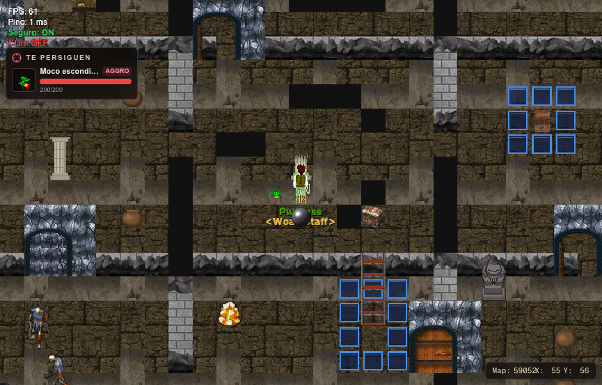 | **El Orbe.** Se lleva sobre la cabeza y se tira contra los pilares. | Ver Orbe. |
| TA-33 | 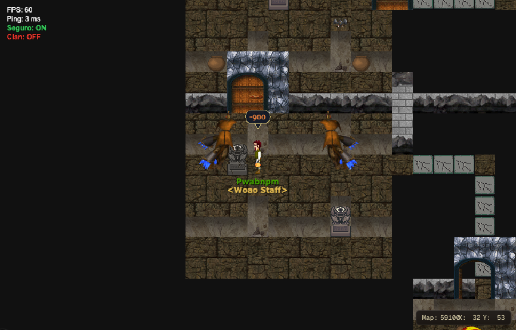 | **El ojo roto.** El Campo rebota el rayo del ojo de piedra y lo rompe. | Ver Ojo de piedra. |
| TA-34 | 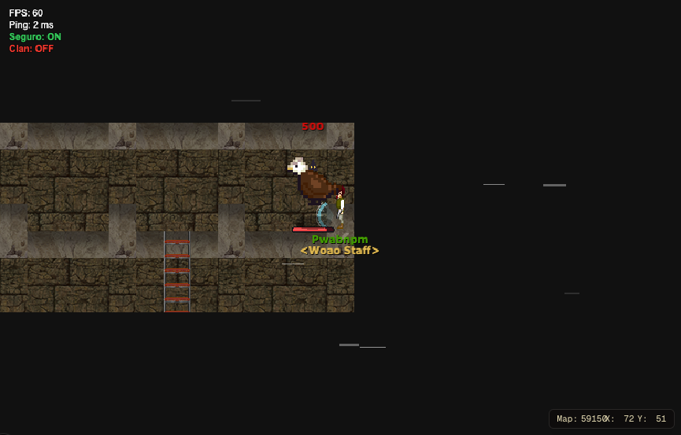 | **El viento del Águila.** Rachas blancas que cruzan la terraza mientras aletea. | Una racha de viento (3 variantes, 48 × 8). |

## 6. Prompt para Claude Opus 5.5

Copiar entero y pegarlo en una sesión nueva de Claude Code abierta en el repo. Hace el arte de esta mazmorra; lo común sale del prompt de [00-COMUNES.md](00-COMUNES.md), que conviene correr antes.

```text
Sos un artista técnico de videojuegos y trabajás en el repo de WoAO (/Users/leandrobisceglie/AoWeb/aoweb): un MMORPG web (Next.js + PixiJS) basado en Argentum Online. Tiene una serie de 8 mazmorras PvE con la estructura de las de *The Legend of Zelda: Link's Awakening* (llaves, puertas que se cierran, puzzles, un ítem por mazmorra, minijefe y jefe).

Tu trabajo: rehacer de cero TODOS los gráficos de la mazmorra "Torre del Águila" (7 de 8; ítem: Campo de Protección), para que se vea profesional y coherente. Hoy es una mezcla de gráficos de AO, paquetes libres de otros estilos y cosas dibujadas con formas por código. El inventario completo, con la imagen actual de cada cosa, está en docs/mazmorras/arte/07-TORRE_DEL_AGUILA.md. Leelo entero antes de empezar y mirá cada imagen de referencia.

TEMA DE ESTA MAZMORRA
Una torre de piedra gris de cuatro pisos, con columnas, plumas y nidos; arriba, una terraza al aire libre con el cielo y las nubes alrededor.
Paleta: gris piedra clara, blanco, celeste cielo, marrón pluma y dorado.

DIRECCIÓN DE ARTE (PARA TODAS LAS MAZMORRAS)
- Perspectiva y escala: vista desde arriba levemente inclinada (la de Argentum Online): se ve el frente de las paredes y el techo de los objetos. La baldosa mide 32 × 32 y un personaje humano mide 1,5 baldosas de alto.
- Estilo: pintado, con volumen y sombreado suave, que combine con los personajes y los mapas de AO. Nada de pixel art de 8 bits ni de formas planas.
- Luz: desde arriba a la izquierda, igual en todas las piezas. Cada cosa que toca el piso lleva una sombra de contacto suave.
- Contorno: oscuro y fino donde ayude a leer la forma contra el piso, no alrededor de todo.
- Paleta: una por mazmorra (la del tema), con un color de acento para lo interactivo (lo que se toca, se levanta o se abre) y rojo o naranja para lo peligroso.
- Legibilidad: lo que se puede usar se distingue del decorado a primera vista, y cada estado se distingue del otro (cerrado o abierto, apagado o encendido, entero o roto).
- Original: se toma la estructura de *Link's Awakening*, no su arte. Nada copiado de Nintendo ni de otros juegos. Si se parte de algo libre (CC0 o CC-BY), se anota el autor, la licencia y el enlace.

REGLAS TÉCNICAS (LAS DEL MOTOR DEL JUEGO)
- Archivos: PNG con transparencia (RGBA), sin fondo, sin halos claros alrededor y sin texto ni marcas de agua.
- Baldosas de piso: un bloque de 4 × 4 baldosas (128 × 128) que se repite sin costura en las dos direcciones; el juego elige la baldosa por la posición en el mapa.
- Paredes: un bloque de 4 × 4. Cada fila es la cara de la pared vista a 1, 2, 3 y 4 baldosas del piso (la última fila toca el piso). Tiene que repetirse sin costura a lo ancho.
- Agua y lava: bloque de 4 × 4 animado (4 cuadros en bucle, que empalmen).
- Objetos: una baldosa (32 × 32), anclados abajo al centro. Si son altos (estatuas, puertas, pilares), el dibujo puede subir (32 × 64, 32 × 96) o ensancharse (96 × 96 las puertas); la base sigue en la baldosa.
- Cuerpos (criaturas y jefes): una hoja por cuerpo, con 4 filas en este orden: mirando arriba, abajo, derecha e izquierda. Las columnas son los cuadros, todos de la misma medida. Mínimo 6 cuadros de caminata por dirección, que entren en bucle. Los pies van abajo al centro del cuadro: el juego lo apoya sobre la baldosa.
- Animaciones aparte (ataques, poses, efectos): una tira horizontal por animación, con cuadros de la misma medida.
- Numeración del juego: al día de este documento, el próximo grh libre es el 42484, el próximo archivo de gráficos el 330041 y el próximo cuerpo el 586. Verificalos antes de indexar.

LO QUE HAY QUE ENTREGAR (34 piezas, todas de esta mazmorra)
- [TA-01] Piso. Reemplaza: bloque de 4 × 4 desde el grh 9688. Qué hace: El piso de todas las salas. Entregar: Bloque de 4 × 4 (128 × 128) que se repite sin costura; con dos o tres variantes de baldosa sueltas (rajada, con musgo o arena) para romper la repetición. Referencia actual: docs/mazmorras/arte/img/piso-9688.png
- [TA-02] Pared. Reemplaza: bloque de 4 × 4 desde el grh 7812 (cada fila, a 1-4 baldosas del piso). Qué hace: El frente de las paredes; arriba de la cuarta fila se ve negro (el techo). Entregar: Bloque de 4 × 4: cada fila es la cara de la pared a 1, 2, 3 y 4 baldosas del piso, sin costura a lo ancho; y el techo (lo que hoy es negro) como bloque de 4 × 4 aparte. Referencia actual: docs/mazmorras/arte/img/pared-7812.png
- [TA-03] Pozo. Reemplaza: baldosa negra (grh 1). Qué hace: Caer saca vida y te devuelve a la entrada de la sala (o al piso de abajo). Se salta con la Pluma. Entregar: El pozo con su borde y profundidad: autotile de 47 piezas (o el juego de 16 de bordes y esquinas), 32 × 32. Referencia actual: (no tiene imagen: se dibuja por código)
- [TA-04] El cielo de la terraza. Reemplaza: negro (el vacío alrededor de la terraza). Qué hace: Lo que rodea la terraza del Águila: el que se cae, baja a la sala de la escalera. Entregar: Cielo con nubes (bloque de 4 × 4 animado, 4 cuadros) y el borde de la terraza. Referencia actual: (no tiene imagen: se dibuja por código)
- [TA-05] Escalera. Reemplaza: objetos 1198 (Escalera Grande, 32 × 96). Qué hace: Une las salas de distintos mapas o pisos (los atajos A, B, C… de Zelda). Se pisa y te lleva a la otra punta. Las de las salas que se cierran aparecen al vaciarlas. Entregar: una que baja y una que sube; la de la zambullida va bajo el agua y no se ve; 32 × 64 (ocupa una baldosa, el dibujo puede subir una más), anclada abajo. Referencia actual: docs/mazmorras/arte/img/familia-escalera.png
- [TA-06] Puerta (pared horizontal). Reemplaza: objetos 1834 (Puerta de piedra, 96 × 96); 1835 (Puerta de piedra abierta, 96 × 96). Qué hace: Hoy las puertas cerradas (con llave, del jefe, la persiana que abre la sala y el bloque cerradura) usan el mismo dibujo, y las abiertas o de un solo sentido, otro. En el nuevo cada tipo tiene que distinguirse a la vista. Entregar: común abierta y cerrada; con cerradura de llave chica; del jefe (cerradura grande); persiana (reja); de un solo sentido (con flecha); bloque cerradura; 96 × 96 como hoy (el arco ocupa la baldosa de la puerta y el muro de los costados), anclada abajo al centro. Referencia actual: docs/mazmorras/arte/img/familia-puerta.png
- [TA-07] Puerta (pared vertical). Reemplaza: objetos 1840 (Barrera de cristal, 32 × 32). Qué hace: Las puertas en las paredes de los costados. Hoy es un cristal que tapa el paso. Entregar: los mismos tipos que la horizontal, vistos de costado; abierta no se dibuja; 32 × 64, anclada abajo. Referencia actual: docs/mazmorras/arte/img/familia-barrera.png
- [TA-08] Pared rajada (bombas). Reemplaza: objetos 1858 (Pared rajada, 96 × 96); 1859 (Rocas sueltas, 32 × 32). Qué hace: Un paso tapado que se abre con una bomba. Se tiene que notar apenas (una grieta), para que el jugador la descubra. Entregar: pared horizontal tapiada (un arco con piedras), pared vertical (un montón de rocas); 96 × 96 la horizontal (como la puerta), 32 × 32 la vertical. Referencia actual: docs/mazmorras/arte/img/familia-pared_bomba.png
- [TA-09] Pilar de la torre. Reemplaza: objetos 1891 (Pilar de la torre, 32 × 64); 1892 (Pilar roto, 32 × 40). Qué hace: Cuatro pilares sostienen el piso de arriba. El Orbe tirado contra uno lo rompe; con los cuatro rotos, la torre se derrumba. Entregar: entero; roto; 32 × 64 el entero, 32 × 40 el roto; anclados abajo. Referencia actual: docs/mazmorras/arte/img/familia-pilar.png
- [TA-10] Orbe. Reemplaza: objetos 1893 (Orbe, 32 × 32). Qué hace: Se levanta con el Brazalete y se tira contra los pilares. Si cae a un pozo, vuelve a su lugar. Hoy es la bola de hierro del Machacador. Entregar: en el piso; en las manos (el mismo dibujo, más arriba); 32 × 32. Referencia actual: docs/mazmorras/arte/img/familia-orbe.png
- [TA-11] Mini gusano (criatura). Reemplaza: cuerpo 375: 5 cuadros de 64 × 42 (plantilla 9739). Qué hace: Un gusano anillado que se mueve rápido. Entregar: 4 direcciones × 6 cuadros de caminata, 64 × 64. Referencia actual: docs/mazmorras/arte/img/cuerpo-375.png
- [TA-12] Hechicero (criatura). Reemplaza: cuerpo 372: 6 cuadros de 82 × 100 (plantilla 9800). Qué hace: Aparece, tira un rayo y desaparece. Entregar: 4 direcciones × 6 cuadros de caminata, 96 × 96. Referencia actual: docs/mazmorras/arte/img/cuerpo-372.png
- [TA-13] Máscara de Hierro (criatura). Reemplaza: cuerpo 582: 4 cuadros de 32 × 46 (plantilla 9803). Qué hace: De frente se cubre: pegale de costado o por la espalda, o arrancale la máscara con el Gancho. Entregar: 4 direcciones × 6 cuadros de caminata, 48 × 48. Referencia actual: docs/mazmorras/arte/img/cuerpo-582.png
- [TA-14] Esqueleto esquivo (criatura). Reemplaza: cuerpo 393: 23 cuadros de 60 × 75 (plantilla 9805). Qué hace: Salta para atrás y te tira un hueso. Entregar: 4 direcciones × 6 cuadros de caminata, 64 × 64. Referencia actual: docs/mazmorras/arte/img/cuerpo-393.png
- [TA-15] Moco escondido (criatura). Reemplaza: cuerpo 146: 2 cuadros de 32 × 25 (plantilla 9809). Qué hace: No se ve hasta que te acercás. Entregar: 4 direcciones × 6 cuadros de caminata, 48 × 48. Referencia actual: docs/mazmorras/arte/img/cuerpo-146.png
- [TA-16] Moco (criatura). Reemplaza: cuerpo 146: 2 cuadros de 32 × 25 (plantilla 9810). Qué hace: Un moco común: se arrastra hacia el jugador y lo ataca. Entregar: 4 direcciones × 6 cuadros de caminata, 48 × 48. Referencia actual: docs/mazmorras/arte/img/cuerpo-146.png
- [TA-17] Chispa (criatura, trampa). Reemplaza: cuerpo 413: 10 cuadros de 80 × 60 (plantilla 9814). Qué hace: Una chispa que da vueltas alrededor de un pilar y quema al que toca. Entregar: 4 direcciones × 4 cuadros (si gira o se mueve), 48 × 48. Referencia actual: docs/mazmorras/arte/img/cuerpo-413.png
- [TA-18] Cuchilla (criatura, trampa). Reemplaza: cuerpo 244: 2 cuadros de 75 × 75 (plantilla 9815). Qué hace: Una trampa de cuchillas: sale disparada si te ve en su fila. Entregar: 4 direcciones × 4 cuadros (si gira o se mueve), 48 × 48. Referencia actual: docs/mazmorras/arte/img/cuerpo-244.png
- [TA-19] Tragón (criatura). Reemplaza: cuerpo 504: 8 cuadros de 160 × 160 (plantilla 9822). Qué hace: Un moco grande que se arrastra hacia vos y te traga. Si tenías el Campo de Protección levantado, se lo come. Entregar: 4 direcciones × 6 cuadros de caminata, 128 × 128. Referencia actual: docs/mazmorras/arte/img/cuerpo-504.png
- [TA-20] Momia (criatura). Reemplaza: cuerpo 252: 5 cuadros de 90 × 90 (plantilla 9823). Qué hace: Una momia de la torre: lenta y dura. Entregar: 4 direcciones × 6 cuadros de caminata, 96 × 96. Referencia actual: docs/mazmorras/arte/img/cuerpo-252.png
- [TA-21] Cuervo de la torre (criatura). Reemplaza: cuerpo 68: 2 cuadros de 32 × 25 (plantilla 9824). Qué hace: Un cuervo que da vueltas por la torre y picotea. Entregar: 4 direcciones × 6 cuadros de caminata, 48 × 48. Referencia actual: docs/mazmorras/arte/img/cuerpo-68.png
- [TA-22] Hongo (criatura). Reemplaza: cuerpo 146: 2 cuadros de 32 × 25 (plantilla 9825). Qué hace: Un hongo que camina. No se mete con nadie que no se meta con él. Entregar: 4 direcciones × 6 cuadros de caminata, 48 × 48. Referencia actual: docs/mazmorras/arte/img/cuerpo-146.png
- [TA-23] Serpiente de la torre (criatura). Reemplaza: cuerpo 13: 5 cuadros de 91 × 65 (plantilla 9827). Qué hace: Una serpiente que vive entre las piedras de la torre. Entregar: 4 direcciones × 6 cuadros de caminata, 96 × 96. Referencia actual: docs/mazmorras/arte/img/cuerpo-13.png
- [TA-24] Naipe (I, II y III) (criatura). Reemplaza: cuerpo 12: 5 cuadros de 53 × 70 (plantilla 9828, 9829, 9830). Qué hace: Tres Naipes que hay que vencer en orden (I, II y III): si cae uno antes de tiempo, vuelven todos. Entregar: 4 direcciones × 6 cuadros de caminata, 64 × 64. Referencia actual: docs/mazmorras/arte/img/cuerpo-12.png
- [TA-25] Murciélago del Flautista (criatura). Reemplaza: cuerpo 9: 5 cuadros de 59 × 64 (plantilla 9832). Qué hace: Uno de los murciélagos que llama el Flautista con su flauta. Entregar: 4 direcciones × 6 cuadros de caminata, 64 × 64. Referencia actual: docs/mazmorras/arte/img/cuerpo-9.png
- [TA-26] Cíclope rojo (minijefe). Reemplaza: cuerpo 176: 7 cuadros de 120 × 165. Qué hace: El Cíclope de la Gruta de la Botella, más bravo: tira bombas y arremete. Entregar: Una variante del Cíclope (ver la Gruta de la Botella), con otra paleta. Referencia actual: docs/mazmorras/arte/img/cuerpo-176.png
- [TA-27] Flautista (minijefe). Reemplaza: cuerpo 251: 5 cuadros de 42 × 68. Qué hace: Un flautista encapuchado: no se lo puede lastimar; toca la flauta y llama a seis murciélagos; vencidos, huye volando. Después aparece montado en el Águila. Entregar: Caminata en 4 direcciones (6 cuadros), tocando la flauta (4 cuadros), huyendo (4 cuadros) y montado (sentado, para dibujarlo sobre el Águila); las notas que suben (16 × 16, 3 variantes). Referencia actual: docs/mazmorras/arte/img/cuerpo-251.png
- [TA-28] Águila Malvada (jefe). Reemplaza: cuerpo 584: 3 cuadros de 96 × 96. Qué hace: Ronda alto fuera de alcance; pasa bajo atropellando, aletea desde un costado con un viento que empuja al vacío y tira plumas, y se tira en picada. Con el Campo de frente, la pluma rebota y la tira a la terraza. Hoy es "[LPC] Birds" al triple. Entregar: En vuelo (4 direcciones, 6 cuadros de aleteo, 128 × 128 o más), en picada (2 cuadros), posada (4 direcciones, 3 cuadros), aleteando quieta (6 cuadros) y cayendo derrotada (4 cuadros); la pluma (16 × 32, 2 cuadros) y la sombra en el piso. Referencia actual: docs/mazmorras/arte/img/cuerpo-584.png
- [TA-29] El Campo de Protección. Reemplaza: lo que hoy dibuja el cliente. Qué hace: Un arco de energía delante del personaje mientras dura (3 s); destella al rebotar algo. Hoy se dibuja con formas. Entregar: El arco mirando a cada dirección (4), latiendo (4 cuadros, 48 × 32), y el destello del rebote (3 cuadros). Común a todas las mazmorras. Referencia actual: docs/mazmorras/torre/aguila-campo.png
- [TA-30] El derrumbe. Reemplaza: lo que hoy dibuja el cliente. Qué hace: Con los cuatro pilares rotos, la cámara tiembla y caen escombros. Entregar: Escombros que caen (4 piezas, 8 × 8 a 16 × 16) y una nube de polvo (4 cuadros, 48 × 32). Referencia actual: docs/mazmorras/torre/derrumbe.png
- [TA-31] El Tragón tragando. Reemplaza: lo que hoy dibuja el cliente. Qué hace: El personaje queda adentro del moco un momento y lo escupe. Entregar: El Tragón con alguien adentro (2 cuadros) y escupiendo (3 cuadros). Referencia actual: docs/mazmorras/torre/tragon.png
- [TA-32] El Orbe. Reemplaza: lo que hoy dibuja el cliente. Qué hace: Se lleva sobre la cabeza y se tira contra los pilares. Entregar: Ver Orbe. Referencia actual: docs/mazmorras/torre/orbe.png
- [TA-33] El ojo roto. Reemplaza: lo que hoy dibuja el cliente. Qué hace: El Campo rebota el rayo del ojo de piedra y lo rompe. Entregar: Ver Ojo de piedra. Referencia actual: docs/mazmorras/torre/ojo-roto.png
- [TA-34] El viento del Águila. Reemplaza: lo que hoy dibuja el cliente. Qué hace: Rachas blancas que cruzan la terraza mientras aletea. Entregar: Una racha de viento (3 variantes, 48 × 8). Referencia actual: docs/mazmorras/torre/aguila-golpe.png

Lo común a todas las mazmorras (cofres, placas, escaleras, portal, búho, bloques y cristales de color, vasijas y piedras, herramientas e íconos) NO va en este trabajo: sale del prompt de docs/mazmorras/arte/00-COMUNES.md. Esta mazmorra usa estos: CO-01 Portal, CO-02 Cofre, CO-03 Cofre del jefe, CO-04 Bloque que se empuja, CO-05 Placa (botón del piso), CO-06 Losa de piedra, CO-07 Estatua búho, CO-08 Cristal de los bloques de color, CO-09 Bloques de color, CO-11 Vasija, CO-12 Estatua del Gancho, CO-13 Antorcha, CO-17 Cabeza de caballo, CO-18 Baldosa voladora, CO-19 Cinta transportadora, CO-20 Lanzallamas, CO-21 Ojo de piedra, CO-22 Piso flojo, CO-23 Cristal de un golpe. Tus piezas tienen que combinar con ellos (si ya existen, miralos; si no, respetá la dirección de arte de arriba).

CÓMO TRABAJAR
1. Primero, una hoja de estilo: la paleta, el piso, la pared, una puerta y una criatura de esta mazmorra, apoyados sobre el piso nuevo. Mostrala y esperá la aprobación de Leandro antes de seguir.
2. Después, el resto, en este orden: baldosas, puertas y mecánicas, criaturas, minijefes y jefe, efectos.
3. Revisá cada pieza a tamaño real (1×) y al doble sobre el piso de la mazmorra, y al lado de un personaje de AO para la escala.
4. Si tenés una herramienta de generación de imágenes, usala con estas especificaciones y después llevá cada pieza a la grilla exacta (medida, transparencia, cuadros alineados) con un script. Si no, dibujalo por código (Python con Pillow) cuidando la calidad: volumen, luz y sombra, no formas planas.

QUÉ ENTREGAR
- Una carpeta arte/mazmorras/torre/ con un PNG por pieza, con el código como nombre (por ejemplo TA-01.png).
- arte/mazmorras/torre/manifest.json con una entrada por pieza: código, archivo, qué reemplaza, medida del cuadro, cantidad de cuadros, filas o direcciones, ancla, velocidad de la animación (ms por cuadro) y origen (propio, o autor + licencia + enlace).
- arte/mazmorras/torre/preview.png: una hoja de contacto con todas las piezas sobre el piso de la mazmorra, con su código abajo.

CÓMO ENTRA AL JUEGO (SOLO DESPUÉS DE QUE LEANDRO APRUEBE EL ARTE)
1. Cada hoja va a `frontend/public/graphics/<archivo>.png`, numeradas desde el próximo archivo libre.
2. Cada cuadro es un grh. Se agrega como texto al final de `frontend/public/init/graficos.json` y `graficos_optimized.json`, sin reescribir los JSON:
   - estático: `"<grh>":{"numFrames":1,"numFile":<archivo>,"sX":<x>,"sY":<y>,"width":<w>,"height":<h>,"frames":{"1":<grh>}}` y, en el optimizado, `"<grh>":[<archivo>,<x>,<y>,<w>,<h>]`;
   - animado: `"<grh>":{"numFrames":<n>,"frames":{"1":<g1>,"2":<g2>,…},"speed":<ms>}` y `"<grh>":{"f":<n>,"r":[<g1>,<g2>,…],"s":<ms>}`.
3. Cada cuerpo se agrega a `frontend/public/init/bodies.json`: `"<cuerpo>":{"1":<grh arriba>,"2":<grh abajo>,"3":<grh derecha>,"4":<grh izquierda>,"headOffsetX":0,"headOffsetY":0}`. El cuerpo de cada criatura se cambia con `idBody` en su plantilla de `server/mazmorras/<mazmorra>/leyenda.json`.
4. Los objetos del mapa toman su grh de `DUNGEON_OBJECTS` en `server/src/scripts/buildDungeonMaps.ts`, y las baldosas de piso y pared, de `graficos` en `leyenda.json`. Después se regeneran los mapas con `pnpm --dir server exec tsx src/scripts/buildDungeonMaps.ts <mazmorra>`.
5. Lo que hoy se dibuja con formas o con sprites sueltos vive en `frontend/components/game/engine/` (el módulo de cada mazmorra; ver la tabla de efectos). Ahí se cargan las hojas nuevas.
6. Se sube la versión de las cachés en `frontend/utils/gameLoader.ts` (graficos, bodies, objs y npcs) para que los jugadores bajen lo nuevo.
7. Se prueba en vivo y se sacan capturas de cada cosa, comparadas con la imagen actual de este documento.

CRITERIOS PARA DAR UNA PIEZA POR TERMINADA
- Tiene la medida, los cuadros, el orden de las direcciones y el ancla pedidos.
- Se lee a 1× sobre el piso de la mazmorra: se entiende qué es y en qué estado está.
- Combina con el resto de la mazmorra y con los personajes de AO: misma luz, misma escala, misma paleta.
- Las animaciones entran en bucle sin saltos, y los bloques de piso, pared, agua y lava se repiten sin costura.
- Es arte original, o tiene anotado el origen y la licencia en el manifest.
```
