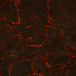
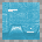
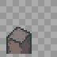
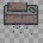
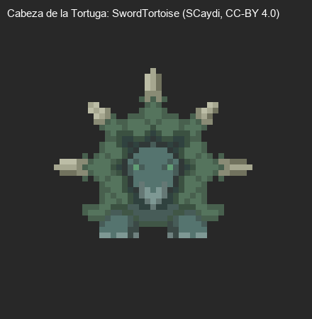
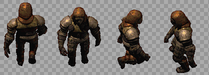
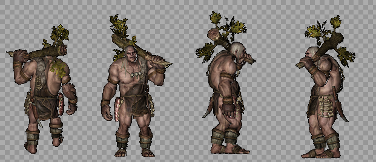
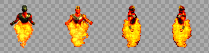

# Arte: Roca de la Tortuga

Inventario de todos los gráficos de la mazmorra **Roca de la Tortuga** para rehacerlos de cero. Cada fila tiene el gráfico actual (de ejemplo), qué hace en el juego y qué hay que entregar. Al final está el prompt completo para Claude Opus 5.5. El índice y la dirección de arte común están en [README.md](README.md).

| | |
|---|---|
| **Mazmorra** | 8 de 8 de la serie |
| **Estado** | **Diseñada, todavía no construida** (mapas 540-542). Las mecánicas que usa ya existen (antorchas, hielo, vasijas, piedras, estatuas, lava, bloques de color, ojo de piedra). El diseño está en [04-ROCA_DE_LA_TORTUGA.md](../04-ROCA_DE_LA_TORTUGA.md). |
| **Ítem que da** | Polvo de Fuego |
| **Tema** | Un volcán dentro de una tortuga gigante: roca negra, ríos de lava, obsidiana y braseros; el caparazón se ve en las paredes. Calor y humo. |
| **Paleta** | negro basalto, naranja y rojo lava, gris ceniza y verde caparazón |
| **Gráficos** | 4 baldosas, 22 puertas y mecánicas (+ la piedra de invocación), 8 criaturas, 4 minijefes y jefes, 4 efectos. **27 piezas propias** de esta mazmorra; el resto es común. |

**El plano del diseño:**


## 1. Baldosas

| Código | Actual | Qué es y qué hace | Hoy | Para el nuevo |
|---|---|---|---|---|
| RT-01 |  | **Piso.** El piso de todas las salas. | bloque de 4 × 4 desde el grh 9428 | Bloque de 4 × 4 (128 × 128) que se repite sin costura; con dos o tres variantes de baldosa sueltas (rajada, con musgo o arena) para romper la repetición. |
| RT-02 |  | **Pared.** El frente de las paredes; arriba de la cuarta fila se ve negro (el techo). | bloque de 4 × 4 desde el grh 9412 (cada fila, a 1-4 baldosas del piso) | Bloque de 4 × 4: cada fila es la cara de la pared a 1, 2, 3 y 4 baldosas del piso, sin costura a lo ancho; y el techo (lo que hoy es negro) como bloque de 4 × 4 aparte. |
| RT-03 |  | **Lava.** Quema al pisarla; la periódica erupciona cada 3 s. | las 9 baldosas de lava del mapa 162 (grh 9487-9495) | Bloque de 4 × 4 animado (4 cuadros) y la erupción de la lava periódica (4 cuadros). |
| RT-04 | — | **Pozo.** Caer saca vida y te devuelve a la entrada de la sala (o al piso de abajo). Se salta con la Pluma. | baldosa negra (grh 1) | El pozo con su borde y profundidad: autotile de 47 piezas (o el juego de 16 de bordes y esquinas), 32 × 32. |

## 2. Puertas, cofres y mecánicas

Las marcadas **común** se dibujan una sola vez para todas las mazmorras (están en [00-COMUNES.md](00-COMUNES.md)); acá figuran para que la lista de esta mazmorra esté completa. Las de **esta mazmorra** van en su prompt.

| Código | Actual | Qué es y qué hace | Estados que hacen falta | Hoy | Para el nuevo |
|---|---|---|---|---|---|
| RT-05 |  | **Escalera.** Une las salas de distintos mapas o pisos (los atajos A, B, C… de Zelda). Se pisa y te lleva a la otra punta. Las de las salas que se cierran aparecen al vaciarlas. | una que baja y una que sube; la de la zambullida va bajo el agua y no se ve | 1198 (Escalera Grande, 32 × 96) | 32 × 64 (ocupa una baldosa, el dibujo puede subir una más), anclada abajo |
| CO-01 (común) |  | **Portal.** La salida de la mazmorra y los portales-atajo que aparecen al vencer a un minijefe (llevan a la entrada). | portal de salida y portal-atajo (dos colores distintos), animados en bucle | 378 (Teleport, 60 × 90, 24 cuadros) | 64 × 96, 8 a 12 cuadros en bucle, anclado abajo al centro |
| CO-02 (común) |  | **Cofre.** Guarda llaves, el mapa, la brújula, oro, el pico de piedra, la caracola o el ítem de la mazmorra. Muchos aparecen al resolver la sala (salen de la nada con un brillo). | cerrado, abierto | 1832 (Cofre de mazmorra, 32 × 32); 1833 (Cofre de mazmorra abierto, 32 × 32) | 32 × 32 (el dibujo puede tener hasta 32 × 40), cerrado y abierto |
| CO-03 (común) |  | **Cofre del jefe.** El cofre del trofeo, en la sala del final. Una vez por día por personaje da el trofeo de la serie y oro. Hoy es el mismo dibujo que el cofre común. | cerrado, abierto | 1849 (Cofre del jefe, 32 × 32) | 48 × 40 a 64 × 48, anclado abajo al centro: tiene que verse más importante que el común |
| RT-06 |  | **Puerta (pared horizontal).** Hoy las puertas cerradas (con llave, del jefe, la persiana que abre la sala y el bloque cerradura) usan el mismo dibujo, y las abiertas o de un solo sentido, otro. En el nuevo cada tipo tiene que distinguirse a la vista. | común abierta y cerrada; con cerradura de llave chica; del jefe (cerradura grande); persiana (reja); de un solo sentido (con flecha); bloque cerradura | 1834 (Puerta de piedra, 96 × 96); 1835 (Puerta de piedra abierta, 96 × 96) | 96 × 96 como hoy (el arco ocupa la baldosa de la puerta y el muro de los costados), anclada abajo al centro |
| RT-07 |  | **Puerta (pared vertical).** Las puertas en las paredes de los costados. Hoy es un cristal que tapa el paso. | los mismos tipos que la horizontal, vistos de costado; abierta no se dibuja | 1840 (Barrera de cristal, 32 × 32) | 32 × 64, anclada abajo |
| CO-04 (común) |  | **Bloque que se empuja.** Se empuja una baldosa con un clic. Tapa pasos, aprieta placas y corta el camino de las cuchillas. | uno solo | 1836 (Bloque de piedra, 32 × 32) | 32 × 32 (el dibujo puede tener 32 × 40 para mostrar el alto) |
| CO-05 (común) |  | **Placa (botón del piso).** Se aprieta con un jugador o un bloque encima. Abre puertas o hace aparecer cofres y escaleras. La de peso solo baja si el que la pisa carga algo con el Brazalete. | suelta y apretada; la placa de peso (Gruta de la Botella) distinta | 1837 (Runa del suelo, 32 × 32); 1838 (Runa del suelo encendida, 32 × 32) | 32 × 32 |
| CO-06 (común) |  | **Losa de piedra.** Una losa con un texto grabado (pistas del jefe o de la mazmorra). Se lee con un clic. | una sola | 1839 (Losa de piedra, 32 × 32) | 32 × 48, anclada abajo |
| CO-07 (común) |  | **Estatua búho.** Con el Pico de piedra, da una pista al hacerle clic. | una sola (opcional: los ojos que se encienden cuando habla) | 1861 (Estatua búho, 32 × 48) | 32 × 48, anclada abajo |
| CO-13 (común) |  | **Antorcha.** Se enciende con el Polvo de Fuego o el polvo mágico. Las salas con antorchas apagadas están a oscuras; si la sala tiene cofres, aparecen al encender todas. | apagada; encendida (fuego animado en bucle) | 1856 (Antorcha apagada, 32 × 64); 1857 (Antorcha encendida, 32 × 64, 9 cuadros) | 32 × 64, anclada abajo; el fuego, 8 a 9 cuadros |
| RT-08 |  | **Bloque de hielo.** Tapa el paso hasta derretirlo con el Polvo de Fuego. | entero; derritiéndose (2 a 3 cuadros) | 1854 (Bloque de hielo, 32 × 32) | 32 × 32 (puede subir a 32 × 40) |
| CO-11 (común) |  | **Vasija.** Se levanta con el Brazalete, se lleva y se tira. Tapa pasos, abre persianas al tirarla y algunas esconden algo. | entera; pedazos al romperse (4 a 6 trozos) | 1852 (Vasija, 32 × 32) | 32 × 32 |
| RT-09 |  | **Piedra suelta.** Como la vasija, pero de piedra. | entera; pedazos | 1853 (Piedra suelta, 32 × 32) | 32 × 32 |
| RT-10 |  | **Piedra pesada.** Solo la levanta el Brazalete de Fuerza nivel 2. | una sola | 1860 (Piedra pesada, 32 × 32) | 32 × 32 (más grande y oscura que la suelta) |
| CO-12 (común) |  | **Estatua del Gancho.** Un poste para el Gancho: se engancha y te arrastra hasta ella, por encima de pozos. | una sola | 1855 (Estatua de piedra, 32 × 96) | 32 × 64 a 32 × 96, anclada abajo |
| RT-11 |  | **Pared rajada (bombas).** Un paso tapado que se abre con una bomba. Se tiene que notar apenas (una grieta), para que el jugador la descubra. | pared horizontal tapiada (un arco con piedras), pared vertical (un montón de rocas) | 1858 (Pared rajada, 96 × 96); 1859 (Rocas sueltas, 32 × 32) | 96 × 96 la horizontal (como la puerta), 32 × 32 la vertical |
| CO-09 (común) |  | **Bloques de color.** Los azules arrancan levantados (tapan el paso) y los naranjas bajados. El cristal los invierte. | azul levantado, azul bajado, naranja levantado, naranja bajado | 1862 (Bloque azul, 32 × 32); 1863 (Bloque azul bajado, 32 × 32); 1864 (Bloque naranja, 32 × 32); 1865 (Bloque naranja bajado, 32 × 32) | 32 × 32 cada estado |
| CO-08 (común) |  | **Cristal de los bloques de color.** Al golpearlo, se invierten los bloques de color de toda la corrida. Hoy usa el mismo dibujo que la barrera de cristal. | azul y naranja | 1866 (Cristal azul, 32 × 32); 1867 (Cristal naranja, 32 × 32) | 32 × 48, anclado abajo |
| CO-10 (común) |  | **Remolino.** Arrastra hacia el centro; el que llega al centro vuelve a la entrada. | animado en bucle | 1868 (Remolino, 48 × 48, 12 cuadros) | 48 × 48, 12 cuadros en bucle |
| CO-21 (común) |  | **Ojo de piedra.** Gira y, si te ve en línea, avisa y tira un rayo. El Campo de Protección lo rebota y lo rompe (queda la estatua rota). | mirando a cada una de las 8 direcciones (gira); roto | 1880 (Ojo de piedra, 32 × 48, 4 cuadros); 1894 (Ojo de piedra roto, 32 × 48) | 32 × 48, anclado abajo; 8 direcciones + roto |
| CO-15 (común) |  | **Piso que se desmorona.** Se cae un instante después de pisarlo y vuelve a los 5 s. Se cruza corriendo o saltando. | rajado; hueco (ya se cayó) | 1842 (Baldosa rajada, 32 × 32); 1843 (Hueco, 32 × 32) | 32 × 32 cada estado; opcional: 3 cuadros del derrumbe |
| CO-PI (común) |  | **Piedra de invocación.** Está en el mundo: con un clic se entra a la mazmorra, solo o en grupo. Hoy es una estatua dorada que no tiene que ver con las mazmorras. | Una por mazmorra (con el símbolo de su ítem), con un brillo en bucle | cuerpo 256 | 64 × 96, anclada abajo; 6 cuadros de brillo |

## 3. Criaturas

Las imágenes muestran el primer cuadro mirando arriba, abajo, derecha e izquierda. "Hoy" dice cuántos cuadros por dirección tiene el cuerpo actual y de qué medida.

| Código | Actual (4 direcciones) | Qué es y qué hace | Rol | Hoy | Para el nuevo |
|---|---|---|---|---|---|
| RT-12 |  | **Serpiente** (plantilla 504). Una serpiente que se arrastra hacia el jugador. | presión | cuerpo 13: 5 cuadros de 91 × 65 | 4 direcciones × 6 cuadros de caminata, 96 × 96 |
| RT-13 |  | **Babosa** (plantilla 9735). Una babosa negra que se arrastra por la cueva. | presión | cuerpo 412: 4 cuadros de 90 × 60 | 4 direcciones × 6 cuadros de caminata, 96 × 96 |
| RT-14 |  | **Imp** (plantilla 500). El vire: vuela, tira bolas de fuego y al morir se parte en dos murciélagos. | presión | cuerpo 9: 5 cuadros de 59 × 64 | 4 direcciones × 6 cuadros de caminata, 64 × 64 |
| RT-15 |  | **Momia** (plantilla 9823). Una momia de la torre: lenta y dura. | guardián | cuerpo 252: 5 cuadros de 90 × 90 | 4 direcciones × 6 cuadros de caminata, 96 × 96 |
| RT-16 |  | **Esqueleto** (plantilla 503). Un esqueleto con espada. | guardián | cuerpo 12: 5 cuadros de 53 × 70 | 4 direcciones × 6 cuadros de caminata, 64 × 64 |
| RT-17 |  | **Imitador** (plantilla 9767). Copia cada paso tuyo, al revés. De frente se cubre: pegale de costado o por la espalda. | trampa | cuerpo 371: 5 cuadros de 120 × 75 | 4 direcciones × 4 cuadros (si gira o se mueve), 48 × 48 |
| RT-18 |  | **Chispa** (plantilla 9736). Una chispa que da vueltas y quema al que toca. | trampa | cuerpo 413: 10 cuadros de 80 × 60 | 4 direcciones × 4 cuadros (si gira o se mueve), 48 × 48 |
| RT-19 |  | **Cuchilla** (plantilla 9737). Una trampa de cuchillas: sale disparada si te ve en su fila. | trampa | cuerpo 244: 2 cuadros de 75 × 75 | 4 direcciones × 4 cuadros (si gira o se mueve), 48 × 48 |

## 4. Minijefes y jefe

| Código | Actual | Qué es y qué hace | Hoy | Para el nuevo |
|---|---|---|---|---|
| RT-20 |  | **Cabeza de la Tortuga** (minijefe). Sale de la pared norte de la entrada, se mueve de costado y estira el cuello para embestir. Abre la mazmorra. Propuesta: SwordTortoise de SCaydi. | propuesta del diseño | La cabeza de frente (96 × 96): quieta, estirando el cuello (3 cuadros) y temblando al recibir daño (2 cuadros). |
| RT-21 | <br> | **Golem de la Bola** (minijefe). Tira su bola de hierro; se la levanta con el Brazalete y se le tira de vuelta. | cuerpo 161: 5 cuadros de 98 × 139 | Como el Machacador, en roca volcánica. |
| RT-22 | <br> | **Gigante Púgil** (minijefe). Avanza a saltitos, tira cinco golpes cortos y uno al azar (una embestida que marea o un gancho que te manda a la entrada). Bloquea todo de frente. | cuerpo 510: 8 cuadros de 145 × 260 | Caminata a saltitos en 4 direcciones (6 cuadros), golpe corto (3 cuadros), embestida (3), gancho (4) y guardia de frente (1). |
| RT-23 | <br> | **Cabeza Ardiente** (jefe). El jefe: una bola de fuego viva que salta de la lava. Se la pelea con el Polvo de Fuego (ver el diseño, 6.1). | cuerpo 472: 6 cuadros de 100 × 100 | La cabeza de fuego (4 cuadros de llama, 128 × 128), saltando de la lava (4 cuadros), apagada y vulnerable (2 cuadros), las bolas de fuego que tira (24 × 24) y el salpicón de lava (4 cuadros). |

## 5. Efectos que se dibujan aparte

Lo que no es una baldosa, un objeto ni un cuerpo: lo dibuja el cliente (con formas o con sprites sueltos) en `frontend/components/game/engine/`.

| Código | Actual | Qué es y qué hace | Para el nuevo |
|---|---|---|---|
| RT-24 |  | **El Polvo de Fuego.** Una llamarada que vuela hacia adelante y estalla: enciende antorchas, derrite hielo y quema criaturas. | La llamarada (4 cuadros, 32 × 32) y el estallido (4 cuadros, 48 × 48). Común a todas las mazmorras. |
| RT-25 | sin captura (se dibuja por código) | **La lava.** Quema al pisarla; la periódica erupciona cada 3 s. | Ver la baldosa de lava; además, la erupción (4 cuadros) y las burbujas que saltan de la lava (3 cuadros). |
| RT-26 | sin captura (se dibuja por código) | **La roca rodante.** Una roca que se empuja y rueda hasta caer en un pozo y taparlo. | Roca de 32 × 32 rodando (4 cuadros) y el pozo tapado. |
| RT-27 | sin captura (se dibuja por código) | **Los braseros.** Escupen fuego cada tanto. | Brasero apagado y encendido (4 cuadros de fuego), 32 × 48. |

## 6. Prompt para Claude Opus 5.5

Copiar entero y pegarlo en una sesión nueva de Claude Code abierta en el repo. Hace el arte de esta mazmorra; lo común sale del prompt de [00-COMUNES.md](00-COMUNES.md), que conviene correr antes.

```text
Sos un artista técnico de videojuegos y trabajás en el repo de WoAO (/Users/leandrobisceglie/AoWeb/aoweb): un MMORPG web (Next.js + PixiJS) basado en Argentum Online. Tiene una serie de 8 mazmorras PvE con la estructura de las de *The Legend of Zelda: Link's Awakening* (llaves, puertas que se cierran, puzzles, un ítem por mazmorra, minijefe y jefe).

Tu trabajo: rehacer de cero TODOS los gráficos de la mazmorra "Roca de la Tortuga" (8 de 8; ítem: Polvo de Fuego), para que se vea profesional y coherente. Hoy es una mezcla de gráficos de AO, paquetes libres de otros estilos y cosas dibujadas con formas por código. El inventario completo, con la imagen actual de cada cosa, está en docs/mazmorras/arte/08-ROCA_DE_LA_TORTUGA.md. Leelo entero antes de empezar y mirá cada imagen de referencia.

TEMA DE ESTA MAZMORRA
Un volcán dentro de una tortuga gigante: roca negra, ríos de lava, obsidiana y braseros; el caparazón se ve en las paredes. Calor y humo.
Paleta: negro basalto, naranja y rojo lava, gris ceniza y verde caparazón.

DIRECCIÓN DE ARTE (PARA TODAS LAS MAZMORRAS)
- Perspectiva y escala: vista desde arriba levemente inclinada (la de Argentum Online): se ve el frente de las paredes y el techo de los objetos. La baldosa mide 32 × 32 y un personaje humano mide 1,5 baldosas de alto.
- Estilo: pintado, con volumen y sombreado suave, que combine con los personajes y los mapas de AO. Nada de pixel art de 8 bits ni de formas planas.
- Luz: desde arriba a la izquierda, igual en todas las piezas. Cada cosa que toca el piso lleva una sombra de contacto suave.
- Contorno: oscuro y fino donde ayude a leer la forma contra el piso, no alrededor de todo.
- Paleta: una por mazmorra (la del tema), con un color de acento para lo interactivo (lo que se toca, se levanta o se abre) y rojo o naranja para lo peligroso.
- Legibilidad: lo que se puede usar se distingue del decorado a primera vista, y cada estado se distingue del otro (cerrado o abierto, apagado o encendido, entero o roto).
- Original: se toma la estructura de *Link's Awakening*, no su arte. Nada copiado de Nintendo ni de otros juegos. Si se parte de algo libre (CC0 o CC-BY), se anota el autor, la licencia y el enlace.

REGLAS TÉCNICAS (LAS DEL MOTOR DEL JUEGO)
- Archivos: PNG con transparencia (RGBA), sin fondo, sin halos claros alrededor y sin texto ni marcas de agua.
- Baldosas de piso: un bloque de 4 × 4 baldosas (128 × 128) que se repite sin costura en las dos direcciones; el juego elige la baldosa por la posición en el mapa.
- Paredes: un bloque de 4 × 4. Cada fila es la cara de la pared vista a 1, 2, 3 y 4 baldosas del piso (la última fila toca el piso). Tiene que repetirse sin costura a lo ancho.
- Agua y lava: bloque de 4 × 4 animado (4 cuadros en bucle, que empalmen).
- Objetos: una baldosa (32 × 32), anclados abajo al centro. Si son altos (estatuas, puertas, pilares), el dibujo puede subir (32 × 64, 32 × 96) o ensancharse (96 × 96 las puertas); la base sigue en la baldosa.
- Cuerpos (criaturas y jefes): una hoja por cuerpo, con 4 filas en este orden: mirando arriba, abajo, derecha e izquierda. Las columnas son los cuadros, todos de la misma medida. Mínimo 6 cuadros de caminata por dirección, que entren en bucle. Los pies van abajo al centro del cuadro: el juego lo apoya sobre la baldosa.
- Animaciones aparte (ataques, poses, efectos): una tira horizontal por animación, con cuadros de la misma medida.
- Numeración del juego: al día de este documento, el próximo grh libre es el 42484, el próximo archivo de gráficos el 330041 y el próximo cuerpo el 586. Verificalos antes de indexar.

LO QUE HAY QUE ENTREGAR (27 piezas, todas de esta mazmorra)
- [RT-01] Piso. Reemplaza: bloque de 4 × 4 desde el grh 9428. Qué hace: El piso de todas las salas. Entregar: Bloque de 4 × 4 (128 × 128) que se repite sin costura; con dos o tres variantes de baldosa sueltas (rajada, con musgo o arena) para romper la repetición. Referencia actual: docs/mazmorras/arte/img/piso-9428.png
- [RT-02] Pared. Reemplaza: bloque de 4 × 4 desde el grh 9412 (cada fila, a 1-4 baldosas del piso). Qué hace: El frente de las paredes; arriba de la cuarta fila se ve negro (el techo). Entregar: Bloque de 4 × 4: cada fila es la cara de la pared a 1, 2, 3 y 4 baldosas del piso, sin costura a lo ancho; y el techo (lo que hoy es negro) como bloque de 4 × 4 aparte. Referencia actual: docs/mazmorras/arte/img/pared-9412.png
- [RT-03] Lava. Reemplaza: las 9 baldosas de lava del mapa 162 (grh 9487-9495). Qué hace: Quema al pisarla; la periódica erupciona cada 3 s. Entregar: Bloque de 4 × 4 animado (4 cuadros) y la erupción de la lava periódica (4 cuadros). Referencia actual: docs/mazmorras/arte/img/lava.png
- [RT-04] Pozo. Reemplaza: baldosa negra (grh 1). Qué hace: Caer saca vida y te devuelve a la entrada de la sala (o al piso de abajo). Se salta con la Pluma. Entregar: El pozo con su borde y profundidad: autotile de 47 piezas (o el juego de 16 de bordes y esquinas), 32 × 32. Referencia actual: (no tiene imagen: se dibuja por código)
- [RT-05] Escalera. Reemplaza: objetos 1198 (Escalera Grande, 32 × 96). Qué hace: Une las salas de distintos mapas o pisos (los atajos A, B, C… de Zelda). Se pisa y te lleva a la otra punta. Las de las salas que se cierran aparecen al vaciarlas. Entregar: una que baja y una que sube; la de la zambullida va bajo el agua y no se ve; 32 × 64 (ocupa una baldosa, el dibujo puede subir una más), anclada abajo. Referencia actual: docs/mazmorras/arte/img/familia-escalera.png
- [RT-06] Puerta (pared horizontal). Reemplaza: objetos 1834 (Puerta de piedra, 96 × 96); 1835 (Puerta de piedra abierta, 96 × 96). Qué hace: Hoy las puertas cerradas (con llave, del jefe, la persiana que abre la sala y el bloque cerradura) usan el mismo dibujo, y las abiertas o de un solo sentido, otro. En el nuevo cada tipo tiene que distinguirse a la vista. Entregar: común abierta y cerrada; con cerradura de llave chica; del jefe (cerradura grande); persiana (reja); de un solo sentido (con flecha); bloque cerradura; 96 × 96 como hoy (el arco ocupa la baldosa de la puerta y el muro de los costados), anclada abajo al centro. Referencia actual: docs/mazmorras/arte/img/familia-puerta.png
- [RT-07] Puerta (pared vertical). Reemplaza: objetos 1840 (Barrera de cristal, 32 × 32). Qué hace: Las puertas en las paredes de los costados. Hoy es un cristal que tapa el paso. Entregar: los mismos tipos que la horizontal, vistos de costado; abierta no se dibuja; 32 × 64, anclada abajo. Referencia actual: docs/mazmorras/arte/img/familia-barrera.png
- [RT-08] Bloque de hielo. Reemplaza: objetos 1854 (Bloque de hielo, 32 × 32). Qué hace: Tapa el paso hasta derretirlo con el Polvo de Fuego. Entregar: entero; derritiéndose (2 a 3 cuadros); 32 × 32 (puede subir a 32 × 40). Referencia actual: docs/mazmorras/arte/img/familia-hielo.png
- [RT-09] Piedra suelta. Reemplaza: objetos 1853 (Piedra suelta, 32 × 32). Qué hace: Como la vasija, pero de piedra. Entregar: entera; pedazos; 32 × 32. Referencia actual: docs/mazmorras/arte/img/familia-piedra.png
- [RT-10] Piedra pesada. Reemplaza: objetos 1860 (Piedra pesada, 32 × 32). Qué hace: Solo la levanta el Brazalete de Fuerza nivel 2. Entregar: una sola; 32 × 32 (más grande y oscura que la suelta). Referencia actual: docs/mazmorras/arte/img/familia-piedra_pesada.png
- [RT-11] Pared rajada (bombas). Reemplaza: objetos 1858 (Pared rajada, 96 × 96); 1859 (Rocas sueltas, 32 × 32). Qué hace: Un paso tapado que se abre con una bomba. Se tiene que notar apenas (una grieta), para que el jugador la descubra. Entregar: pared horizontal tapiada (un arco con piedras), pared vertical (un montón de rocas); 96 × 96 la horizontal (como la puerta), 32 × 32 la vertical. Referencia actual: docs/mazmorras/arte/img/familia-pared_bomba.png
- [RT-12] Serpiente (criatura, presión). Reemplaza: cuerpo 13: 5 cuadros de 91 × 65 (plantilla 504). Qué hace: Una serpiente que se arrastra hacia el jugador. Entregar: 4 direcciones × 6 cuadros de caminata, 96 × 96. Referencia actual: docs/mazmorras/arte/img/cuerpo-13.png
- [RT-13] Babosa (criatura, presión). Reemplaza: cuerpo 412: 4 cuadros de 90 × 60 (plantilla 9735). Qué hace: Una babosa negra que se arrastra por la cueva. Entregar: 4 direcciones × 6 cuadros de caminata, 96 × 96. Referencia actual: docs/mazmorras/arte/img/cuerpo-412.png
- [RT-14] Imp (criatura, presión). Reemplaza: cuerpo 9: 5 cuadros de 59 × 64 (plantilla 500). Qué hace: El vire: vuela, tira bolas de fuego y al morir se parte en dos murciélagos. Entregar: 4 direcciones × 6 cuadros de caminata, 64 × 64. Referencia actual: docs/mazmorras/arte/img/cuerpo-9.png
- [RT-15] Momia (criatura, guardián). Reemplaza: cuerpo 252: 5 cuadros de 90 × 90 (plantilla 9823). Qué hace: Una momia de la torre: lenta y dura. Entregar: 4 direcciones × 6 cuadros de caminata, 96 × 96. Referencia actual: docs/mazmorras/arte/img/cuerpo-252.png
- [RT-16] Esqueleto (criatura, guardián). Reemplaza: cuerpo 12: 5 cuadros de 53 × 70 (plantilla 503). Qué hace: Un esqueleto con espada. Entregar: 4 direcciones × 6 cuadros de caminata, 64 × 64. Referencia actual: docs/mazmorras/arte/img/cuerpo-12.png
- [RT-17] Imitador (criatura, trampa). Reemplaza: cuerpo 371: 5 cuadros de 120 × 75 (plantilla 9767). Qué hace: Copia cada paso tuyo, al revés. De frente se cubre: pegale de costado o por la espalda. Entregar: 4 direcciones × 4 cuadros (si gira o se mueve), 48 × 48. Referencia actual: docs/mazmorras/arte/img/cuerpo-371.png
- [RT-18] Chispa (criatura, trampa). Reemplaza: cuerpo 413: 10 cuadros de 80 × 60 (plantilla 9736). Qué hace: Una chispa que da vueltas y quema al que toca. Entregar: 4 direcciones × 4 cuadros (si gira o se mueve), 48 × 48. Referencia actual: docs/mazmorras/arte/img/cuerpo-413.png
- [RT-19] Cuchilla (criatura, trampa). Reemplaza: cuerpo 244: 2 cuadros de 75 × 75 (plantilla 9737). Qué hace: Una trampa de cuchillas: sale disparada si te ve en su fila. Entregar: 4 direcciones × 4 cuadros (si gira o se mueve), 48 × 48. Referencia actual: docs/mazmorras/arte/img/cuerpo-244.png
- [RT-20] Cabeza de la Tortuga (minijefe). Reemplaza: propuesta del diseño. Qué hace: Sale de la pared norte de la entrada, se mueve de costado y estira el cuello para embestir. Abre la mazmorra. Propuesta: SwordTortoise de SCaydi. Entregar: La cabeza de frente (96 × 96): quieta, estirando el cuello (3 cuadros) y temblando al recibir daño (2 cuadros). Referencia actual: docs/mazmorras/jefes/cabeza-de-la-tortuga-propuesta.png
- [RT-21] Golem de la Bola (minijefe). Reemplaza: cuerpo 161: 5 cuadros de 98 × 139. Qué hace: Tira su bola de hierro; se la levanta con el Brazalete y se le tira de vuelta. Entregar: Como el Machacador, en roca volcánica. Referencia actual: docs/mazmorras/arte/img/cuerpo-161.png
- [RT-22] Gigante Púgil (minijefe). Reemplaza: cuerpo 510: 8 cuadros de 145 × 260. Qué hace: Avanza a saltitos, tira cinco golpes cortos y uno al azar (una embestida que marea o un gancho que te manda a la entrada). Bloquea todo de frente. Entregar: Caminata a saltitos en 4 direcciones (6 cuadros), golpe corto (3 cuadros), embestida (3), gancho (4) y guardia de frente (1). Referencia actual: docs/mazmorras/arte/img/cuerpo-510.png
- [RT-23] Cabeza Ardiente (jefe). Reemplaza: cuerpo 472: 6 cuadros de 100 × 100. Qué hace: El jefe: una bola de fuego viva que salta de la lava. Se la pelea con el Polvo de Fuego (ver el diseño, 6.1). Entregar: La cabeza de fuego (4 cuadros de llama, 128 × 128), saltando de la lava (4 cuadros), apagada y vulnerable (2 cuadros), las bolas de fuego que tira (24 × 24) y el salpicón de lava (4 cuadros). Referencia actual: docs/mazmorras/arte/img/cuerpo-472.png
- [RT-24] El Polvo de Fuego. Reemplaza: lo que hoy dibuja el cliente. Qué hace: Una llamarada que vuela hacia adelante y estalla: enciende antorchas, derrite hielo y quema criaturas. Entregar: La llamarada (4 cuadros, 32 × 32) y el estallido (4 cuadros, 48 × 48). Común a todas las mazmorras. Referencia actual: docs/mazmorras/herramientas/antorchas.png
- [RT-25] La lava. Reemplaza: lo que hoy dibuja el cliente. Qué hace: Quema al pisarla; la periódica erupciona cada 3 s. Entregar: Ver la baldosa de lava; además, la erupción (4 cuadros) y las burbujas que saltan de la lava (3 cuadros). Referencia actual: (no tiene imagen: se dibuja por código)
- [RT-26] La roca rodante. Reemplaza: lo que hoy dibuja el cliente. Qué hace: Una roca que se empuja y rueda hasta caer en un pozo y taparlo. Entregar: Roca de 32 × 32 rodando (4 cuadros) y el pozo tapado. Referencia actual: (no tiene imagen: se dibuja por código)
- [RT-27] Los braseros. Reemplaza: lo que hoy dibuja el cliente. Qué hace: Escupen fuego cada tanto. Entregar: Brasero apagado y encendido (4 cuadros de fuego), 32 × 48. Referencia actual: (no tiene imagen: se dibuja por código)

Lo común a todas las mazmorras (cofres, placas, escaleras, portal, búho, bloques y cristales de color, vasijas y piedras, herramientas e íconos) NO va en este trabajo: sale del prompt de docs/mazmorras/arte/00-COMUNES.md. Esta mazmorra usa estos: CO-01 Portal, CO-02 Cofre, CO-03 Cofre del jefe, CO-04 Bloque que se empuja, CO-05 Placa (botón del piso), CO-06 Losa de piedra, CO-07 Estatua búho, CO-08 Cristal de los bloques de color, CO-09 Bloques de color, CO-10 Remolino, CO-11 Vasija, CO-12 Estatua del Gancho, CO-13 Antorcha, CO-15 Piso que se desmorona, CO-21 Ojo de piedra. Tus piezas tienen que combinar con ellos (si ya existen, miralos; si no, respetá la dirección de arte de arriba).

CÓMO TRABAJAR
1. Primero, una hoja de estilo: la paleta, el piso, la pared, una puerta y una criatura de esta mazmorra, apoyados sobre el piso nuevo. Mostrala y esperá la aprobación de Leandro antes de seguir.
2. Después, el resto, en este orden: baldosas, puertas y mecánicas, criaturas, minijefes y jefe, efectos.
3. Revisá cada pieza a tamaño real (1×) y al doble sobre el piso de la mazmorra, y al lado de un personaje de AO para la escala.
4. Si tenés una herramienta de generación de imágenes, usala con estas especificaciones y después llevá cada pieza a la grilla exacta (medida, transparencia, cuadros alineados) con un script. Si no, dibujalo por código (Python con Pillow) cuidando la calidad: volumen, luz y sombra, no formas planas.

QUÉ ENTREGAR
- Una carpeta arte/mazmorras/roca/ con un PNG por pieza, con el código como nombre (por ejemplo RT-01.png).
- arte/mazmorras/roca/manifest.json con una entrada por pieza: código, archivo, qué reemplaza, medida del cuadro, cantidad de cuadros, filas o direcciones, ancla, velocidad de la animación (ms por cuadro) y origen (propio, o autor + licencia + enlace).
- arte/mazmorras/roca/preview.png: una hoja de contacto con todas las piezas sobre el piso de la mazmorra, con su código abajo.

CÓMO ENTRA AL JUEGO (SOLO DESPUÉS DE QUE LEANDRO APRUEBE EL ARTE)
1. Cada hoja va a `frontend/public/graphics/<archivo>.png`, numeradas desde el próximo archivo libre.
2. Cada cuadro es un grh. Se agrega como texto al final de `frontend/public/init/graficos.json` y `graficos_optimized.json`, sin reescribir los JSON:
   - estático: `"<grh>":{"numFrames":1,"numFile":<archivo>,"sX":<x>,"sY":<y>,"width":<w>,"height":<h>,"frames":{"1":<grh>}}` y, en el optimizado, `"<grh>":[<archivo>,<x>,<y>,<w>,<h>]`;
   - animado: `"<grh>":{"numFrames":<n>,"frames":{"1":<g1>,"2":<g2>,…},"speed":<ms>}` y `"<grh>":{"f":<n>,"r":[<g1>,<g2>,…],"s":<ms>}`.
3. Cada cuerpo se agrega a `frontend/public/init/bodies.json`: `"<cuerpo>":{"1":<grh arriba>,"2":<grh abajo>,"3":<grh derecha>,"4":<grh izquierda>,"headOffsetX":0,"headOffsetY":0}`. El cuerpo de cada criatura se cambia con `idBody` en su plantilla de `server/mazmorras/<mazmorra>/leyenda.json`.
4. Los objetos del mapa toman su grh de `DUNGEON_OBJECTS` en `server/src/scripts/buildDungeonMaps.ts`, y las baldosas de piso y pared, de `graficos` en `leyenda.json`. Después se regeneran los mapas con `pnpm --dir server exec tsx src/scripts/buildDungeonMaps.ts <mazmorra>`.
5. Lo que hoy se dibuja con formas o con sprites sueltos vive en `frontend/components/game/engine/` (el módulo de cada mazmorra; ver la tabla de efectos). Ahí se cargan las hojas nuevas.
6. Se sube la versión de las cachés en `frontend/utils/gameLoader.ts` (graficos, bodies, objs y npcs) para que los jugadores bajen lo nuevo.
7. Se prueba en vivo y se sacan capturas de cada cosa, comparadas con la imagen actual de este documento.

CRITERIOS PARA DAR UNA PIEZA POR TERMINADA
- Tiene la medida, los cuadros, el orden de las direcciones y el ancla pedidos.
- Se lee a 1× sobre el piso de la mazmorra: se entiende qué es y en qué estado está.
- Combina con el resto de la mazmorra y con los personajes de AO: misma luz, misma escala, misma paleta.
- Las animaciones entran en bucle sin saltos, y los bloques de piso, pared, agua y lava se repiten sin costura.
- Es arte original, o tiene anotado el origen y la licencia en el manifest.
```
