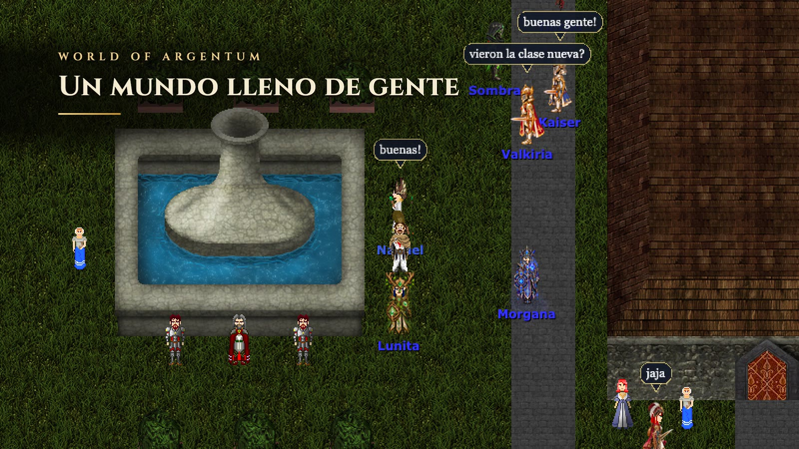

# Teaser del juego

Un video corto de World of Argentum (un minuto, 1920 × 1080) grabado con el juego real. Se hace igual que el teaser de game-space: un guion de Playwright juega el recorrido sin HUD, guarda los cuadros y el momento en que arranca cada escena, y otro script arma el video con carteles, música y los sonidos del juego.

Para que el mundo se vea con gente, el server pone bots con nombres de jugador que caminan, charlan, meditan, cazan y asedian un castillo. Esos bots existen solo en la grabación.

El recorrido:

1. **Nix**: gente alrededor de la fuente, charlando y meditando.
2. **Caza**: una party (guerrero, paladín, mago y arquero) contra orcos en el bosque del mapa 54.
3. **La clase nueva**: el Chamán elemental tira Ventisca, Llamarada, Incinerar y Rayo Eléctrico contra lobos árticos y osos polares, de noche en la nieve (mapa 89).
4. **Castillo**: el clan Los Inmortales entra a la sala del trono del Castillo Norte y pelea con el rey y con la Guardia de Plata, con tormenta.
5. **Al final, la mazmorra nueva** (la de prueba, con el arte de la Gruta del Abisal), con el cartel "Próximamente · En desarrollo":
   - abre el cofre de la llave chica;
   - salta la lava con la Pluma y abre la puerta con llave;
   - empuja el bloque hasta una placa y se para en la otra, y se abre la sala del agua;
   - saca las Patas de rana del cofre, nada hasta la isla y le tira flechas y una bomba al Abisal.
6. El logo, la dirección del sitio y el crédito de la música.



## Cómo se graba

Necesita el stack local levantado: Postgres, la API (3001), el server de juego (7666) y el frontend en el 3010. También necesita Chrome instalado y ffmpeg con libx264.

```bash
cd teaser
PLAYWRIGHT_SKIP_BROWSER_DOWNLOAD=1 pnpm install   # usa el Chrome de la máquina
pnpm grabar     # dos minutos y medio; TEASER_MOSTRAR=1 para ver la ventana, TEASER_SOLO=mazmorra para una parte
pnpm editar     # 1 minuto; deja out/world-of-argentum-teaser.mp4
```

La primera vez, `grabar` crea la cuenta `teaser` y el personaje Nahuel, un chamán. Al entrar a cada escena, el server lo pasa a nivel 50 con el equipo y los hechizos del chamán de la arena. Todo lo que genera (cuadros, marcas, sonidos y el video) queda en `teaser/out/`, y la música se baja a `teaser/assets/`. Ninguna de las dos carpetas se sube.

El audio es AAC, como piden las redes. La vista previa de VS Code no lo reproduce y muestra el sonido como deshabilitado: para escucharlo, abrir el video con QuickTime o Chrome.

## Cómo funciona

- **Las escenas y los bots** están en `server/src/teaser.ts`. Cada escena dice a qué lugar va el que graba, qué bots pone (clase, lugar, qué hacen y qué dicen), qué criaturas aparecen y a qué hora y con qué clima se ve. Los bots entran con la plantilla de su clase de la arena y mandan los mismos paquetes que un cliente: girar, golpear, hechizos y chat. El server los valida igual que a cualquiera.
- **Los endpoints** `/debug/teaser/escena`, `estado`, `decir`, `ir` y `limpiar` solo existen fuera de producción (`server.ts`). `ir` sirve para buscar lugares nuevos.
- **El modo grabación** está en `frontend/lib/teaserRecording.ts`. Se prende con `woao.grabacion` en sessionStorage y solo funciona en desarrollo. El render tapa toda la ventana en escala 2 exacta y se esconde todo lo demás. Además anota cada sonido que suena y deja tirar hechizos, hablar, hacer clic en una baldosa y girar sin la interfaz (`window.__woaoTeaser`). En la mazmorra, los clics abren cofres y puertas y empujan bloques, y los ítems se usan con `/mazmorra salto`, `flecha` y `bomba`. La Pluma se la da la escena del server antes de entrar.
- **`grabar.ts`** juega el recorrido y graba la pantalla con la transmisión de pantalla de Chrome: los cuadros son de 1600 × 900 y llevan la hora.
- **`editar.ts`** hace el resto:
  - corta las escenas y les pone los carteles, en Cinzel, la letra del sitio;
  - las une con fundidos y las lleva a 1920 × 1080;
  - acerca la cámara en la mazmorra, donde los bloques, las placas y las bombas son chicos;
  - arma la música con "Five Armies", de Kevin MacLeod (incompetech.com, CC BY 4.0; el crédito sale en el cartel final). La ciudad va con el arranque del tema; desde la caza, el tema sigue hasta su golpe final, que cae con el logo;
  - suma los golpes de tráiler, que hace con ffmpeg (sin licencias que cumplir): un golpe grave al entrar cada escena grande, un barrido en cada cambio de lugar y una subida antes del logo;
  - suma el clima (la tormenta del castillo con un trueno y el viento de la nieve, CC0, de `frontend/public/sounds/clima`);
  - mezcla los sonidos del juego donde sonaron y deja el volumen en −14 LUFS.

## Para cambiar algo

- **Un lugar, los bots o lo que dicen:** se cambia en `ESCENAS` de `server/src/teaser.ts`. El server de desarrollo se reinicia solo.
- **Qué parte de cada escena entra al video, cuánto dura o qué dice el cartel:** se cambia en `ESCENAS` de `editar.ts`. Se puede volver a editar sin grabar de nuevo.
- **Para ver una escena sin grabar todo:** se arma con `/debug/teaser/escena?id=castillo&jugador=Nahuel` y se revisa con `/debug/teaser/estado`.

Las escenas de caza y del chamán sacan las criaturas del mapa que andan cerca, así no se meten en la toma. No vuelven hasta que se reinicia el server de juego.

## Los videos de las habilidades de cada clase

La creación de personaje muestra las habilidades más importantes de la clase elegida, con un video corto de cada una que pasa solo (`frontend/lib/classSkills.ts` y `components/character-creation/ClassSkillShowcase.tsx`). Esos videos se graban con este mismo paquete:

```bash
pnpm habilidades            # todas las clases, unos 6 minutos
pnpm habilidades mago bardo # solo esas
```

`habilidades.ts` arma la vitrina del server para cada clase: un bot de la clase y un muñeco en un claro del bosque. El que graba queda escondido entre los dos, porque el modo grabación no lo dibuja, y tampoco se dibujan los nombres (en un recorte chico se pisan, y la clase ya la dice el panel). El bot hace cada habilidad con `/debug/teaser/hacer`, y de la grabación sale un clip de 4 s, recortado de cerca (8 × 5 baldosas) y sin sonido. Quedan en `frontend/public/static/clases/<clase>/<habilidad>.mp4`, con un `.jpg` que se ve mientras carga.

Para sumar o cambiar una habilidad: el texto va en `classSkills.ts`, y cómo la hace el bot va en `TOMAS` de `habilidades.ts`.

## Video de ejemplo de la invisibilidad

`pnpm invisibilidad` graba un video corto que explica cómo funciona la invisibilidad (`out/invisibilidad-ejemplo.mp4`), con un asesino y un paladín, vistos por otro jugador. Muestra cuatro cosas:

1. Se vuelve invisible: los demás no lo ven, tampoco el nombre.
2. Si pelea con un jugador, parpadea durante 5 s.
3. Si le hace daño a un jugador, se le corta.
4. Su clan lo ve transparente y con el nombre.

Usa las escenas `invisibilidad` e `invisibilidad-clan` de `server/src/teaser.ts`.
